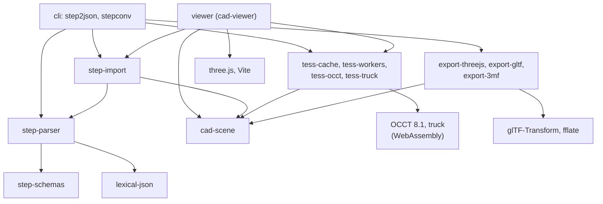
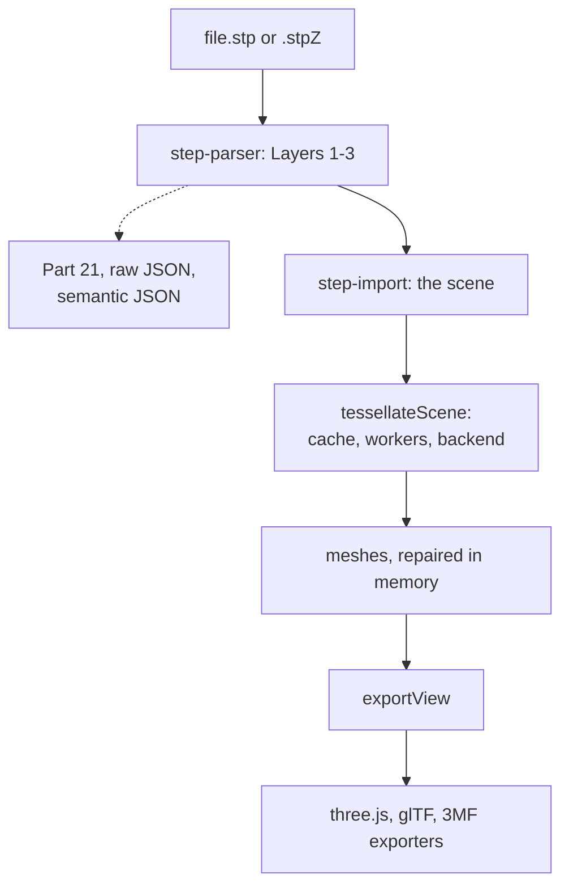
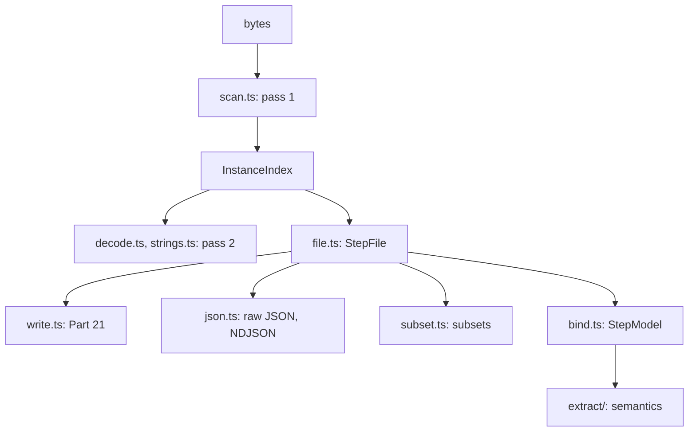
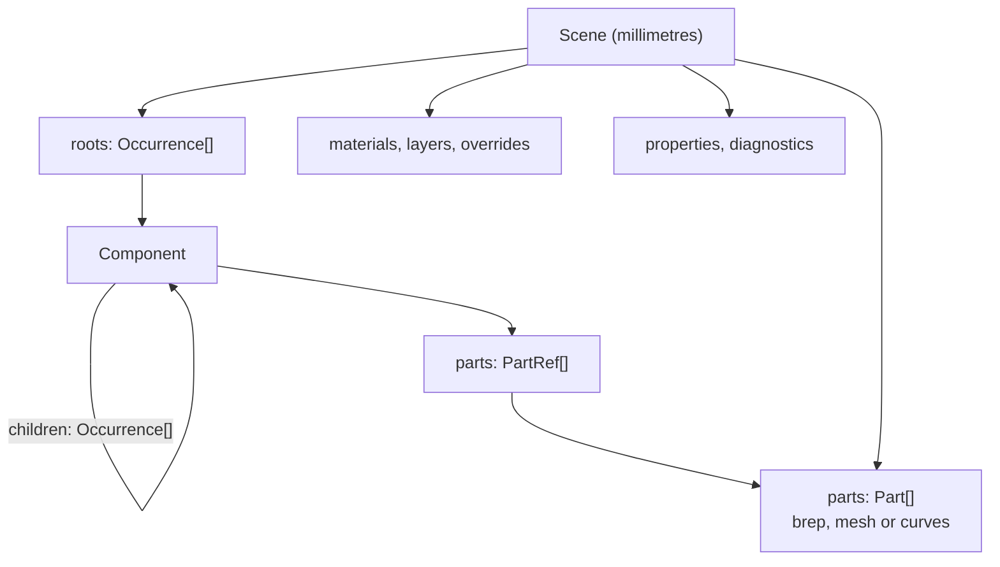
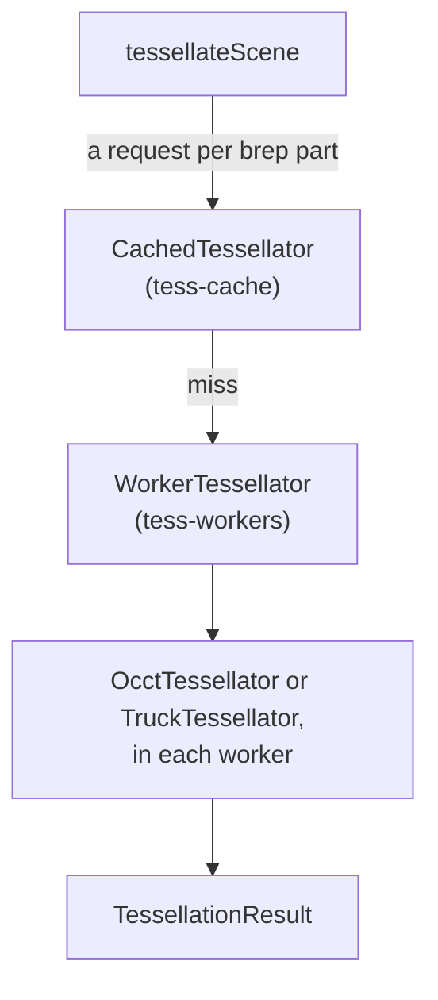

<!--
This file is GitHub-flavoured Markdown: GitHub and browser Markdown viewers render it as it is, and `scripts/md2pdf.sh README.md` makes a PDF of it with Typst (see scripts/md2pdf.typ). The PDF gets a title page with a detailed table of contents from the comment that follows the title, and leaves out the short contents list below, which is between the two "typst-...-exclude" comments.
-->

# cad-io-js

<!--raw-typst
#outline()
#pagebreak()
-->

Reading CAD files into memory, and converting them, in TypeScript for Node.js and browsers. Today that means [STEP](./step_tutorial.md) (ISO 10303-21 files of AP203, AP214 and AP242). **[Live demo](https://martyvona.github.io/cad-io-js/)**: the [viewer](#viewer), in the browser, on your own STEP, glTF or three.js files (nothing is uploaded; it works offline once loaded).

In more detail:

- **a STEP parser and writer** in pure TypeScript with no runtime dependencies: lossless, schema-aware, tolerant of real-world files, and fast (about 230 MB/s to index, 140 MB/s to decode);
- **a scene model**: the assembly tree with transforms and instancing, names, part numbers, units, colours and layers, as the file states them and as well as they can be recovered from imperfect files;
- **tessellation by WebAssembly backends** behind one per-part interface: our own build of OCCT 8.1 (robust; the default) and truck (Apache-2.0, a seventh of the size and about twice as fast on the parts it meshes, but complete and on OCCT's geometry for only 83.5% of the corpus's parts, and stuck until the timeout on a few), run in a pool of workers with timeouts and an optional cache;
- **exporters** to three.js JSON, glTF/GLB and 3MF;
- **two command-line tools**, `step2json` (STEP to JSON, lossless or semantic) and `stepconv` (STEP to three.js, glTF or 3MF).

Version 0.1.0, not yet published to npm: the packages run as TypeScript sources under Node 24 (see [Building From Source](#building-from-source)). A browser-based [viewer](#viewer) shows models in three.js, and more input formats are on the [roadmap](#roadmap).

```sh
stepconv bracket.step -o bracket.glb          # STEP to GLB, OCCT, 0.1 mm, all cores
stepconv assembly.stp -o assembly.3mf --3mf-assembly
step2json -m semantic --instances --pretty part.stp -o part.json
```

```ts
import fs from 'node:fs';
import { exportView, tessellateScene } from 'cad-scene';
import { glb } from 'export-gltf';
import { importStep } from 'step-import';
import { OcctTessellator } from 'tess-occt';

const { scene } = await importStep(fs.readFileSync('bracket.step'));   // the assembly, parts, colours, ...
const occt = new OcctTessellator();
await occt.init();
const { meshes, diagnostics } = await tessellateScene(scene, occt);   // the medium profile: 0.1 mm, 15 degrees
occt.dispose();
const { bytes } = await glb(scene, exportView(scene, meshes));
fs.writeFileSync('bracket.glb', bytes);
```

(Until the packages are on npm, code like this runs inside the repository, where the workspace resolves the package names.)

<!--typst-begin-exclude-->
Contents:

* [Building From Source](#building-from-source)
* [Installing](#installing)
* [Command-Line Tools](#command-line-tools)
* [Viewer](#viewer)
* [Architecture](#architecture)
* [Package APIs](#package-apis)
* [Test Corpus](#test-corpus)
* [Tests](#tests)
* [Roadmap](#roadmap)
* [Backlog](#backlog)
* [License](#license)
<!--typst-end-exclude-->

The decisions behind the design and the lessons learned are in [`CLAUDE.md`](CLAUDE.md) (the detailed history of the work up to 0.1.0 is in its version at tag `V0.1.0`); [`CHANGELOG.md`](CHANGELOG.md) lists the releases; [`step_tutorial.md`](step_tutorial.md) is a tutorial on STEP AP203/214/242 in practice.

## Building From Source

On macOS or Linux (the build scripts are bash; Windows is untested).

### What You Need First

None of these comes with the repository. `source env.sh` (below) checks every one of them and prints the commands to install or update what's missing, for macOS (Homebrew) or Linux (apt or dnf).

| Tool | Version | Needed for |
|---|---|---|
| Node.js | 24 or later | everything: the sources run as TypeScript through Node's type stripping |
| npm | (with Node) | the workspace and the dev dependencies |
| git | 2.25+ | the fetch scripts |
| curl, unzip | any | the fetch scripts (the NIST corpus packages are zips) |
| CMake | 3.10+ | configuring the OCCT build |
| make | any | building OCCT |
| Emscripten (emsdk) | 6.0.12 | compiling OCCT and our wrapper to WebAssembly (`~/emsdk`, or `$EMSDK`); it brings its own clang, so the OCCT build needs no other C++ compiler |
| a C/C++ toolchain for the host (Xcode command-line tools, or gcc) | any | the truck build: Rust links its build scripts and procedural macros, which run on the host, with the system's linker; also the optional native test of the `VBernstein` patch (`packages/tess-occt/occt_overlay/test/table_test.cpp`, which checks a computed table against the one OCCT stores) |
| Rust, cargo | 1.85+ (edition 2024), with the `wasm32-unknown-unknown` target | the truck backend |
| wasm-pack | 0.15.0 | its `wasm-opt` optimizes the truck module |
| python3 with `venv` | 3.8+, optional | extracting the JT specifications' text; the `VBernstein` patch's tests |
| Typst | 0.15.1, fetched | `scripts/md2pdf.sh` (PDFs of the Markdown documents); not installed on the system: `scripts/fetch-typst.sh` fetches the official binary and the Typst packages it uses, pinned and checksummed, into `third_party/typst/` (`md2pdf.sh` does so itself on first use) |

The project was built and tested with Node 24.5, Emscripten 6.0.12, Rust 1.99.1 and wasm-pack 0.15.0 on an M-series Mac.

### Steps

```sh
git clone https://github.com/martyvona/cad-io-js.git
cd cad-io-js
source env.sh                        # checks the tools; sets up Rust's and Emscripten's environment in this shell,
                                     # and puts node_modules/.bin (stepconv, step2json) on PATH
npm install                          # dev dependencies (TypeScript, three, the validators) and the workspace links
third_party/pull.sh                  # OCCT, stepcode, truck and reference documents, at pinned versions (~400 MB)
packages/tess-occt/build-occt.sh     # OCCT's static libraries for WebAssembly (~6-12 minutes, ~850 MB)
packages/tess-occt/build.sh          # our OCCT wrapper, linked: packages/tess-occt/dist/occt_tess.{mjs,wasm}
packages/tess-truck/build.sh         # the truck backend: packages/tess-truck/dist/tess_truck.wasm
npm test                             # the package tests
npm run typecheck
```

Then the tools run as commands: `stepconv model.step -o model.glb`. `npm install` links them into `node_modules/.bin`, which `env.sh` puts on your `PATH` (at its end, so the dev dependencies' tools there, such as `tsc`, don't shadow ones you have installed). Without `env.sh`, run them as `npx stepconv ...` from inside the repository, or as `node packages/cli/bin/stepconv.ts ...`. The parser, importer, scene and exporters need none of the native builds; only tessellation does (one backend is enough: `stepconv -b truck` without OCCT, the default otherwise).

To run the [corpus checks](#corpus-checks) (scripts that run the code over 517 real-world STEP files, against OCCT and the output formats' own validators), also fetch the [test corpus](#test-corpus) (about 1.5 GB):

```sh
test_corpus/third_party/pull.sh
```

Two of the checks (`cache_check.ts`, `truck_bench.ts`) tessellate per-part subsets of 30 corpus files instead of whole files. Make those once (a few seconds):

```sh
N=test_corpus/third_party/nist-pmi-models/NIST-PMI-STEP-Files/NIST-PMI-STEP-Files
G=test_corpus/third_party/gkv311-opencascade-dataset/step
for f in $N/*.stp $G/trj2_as1-id-203.stp $G/trj2_as1-tc-214.stp $G/bug21802_as1-oc-214.stp $G/trj7_k1-*-214.stp \
         $G/sp7_04-dx-242.stp $G/bug32049_sp7_10nx_242.stp $G/bug33569.stp; do
  node corpus_checks/make_subsets.ts "$f" test_corpus/subsets/out
done
node corpus_checks/make_subsets.ts $G/Median_cx-fs01_bicycle.stp test_corpus/subsets/out_bike
```

Then run any check, for example `node corpus_checks/writer_corpus.ts`; [Corpus Checks](#corpus-checks) below describes each one with its command line.

**The documents** are GitHub-flavoured Markdown, readable as they are on GitHub and in browser Markdown viewers (such as [markdown-viewer](https://github.com/simov/markdown-viewer), with its Mermaid and MathJax options on). `scripts/md2pdf.sh README.md` (or `step_tutorial.md`) makes a PDF with Typst, with no other tools: no pandoc, LaTeX or browser. Diagrams are Mermaid (` ```mermaid ` blocks), math is LaTeX (`$...$`, `$$...$$`); how a document is written for the PDF is in `scripts/md2pdf.typ`.

Details: [`third_party/README.md`](third_party/README.md) (the pinned dependencies), [`test_corpus/README.md`](test_corpus/README.md), [`corpus_checks/README.md`](corpus_checks/README.md).

**OCCT build notes:** `build-occt.sh` builds only the `TKDESTEP` and `TKMesh` toolkits and their dependencies, with `-Os` (`-O2`, `-O3` and LTO buy no speed), `-fwasm-exceptions` and `-UOCC_CONVERT_SIGNALS` (without it the link produces invalid WebAssembly), into `packages/tess-occt/build/occt-Os/`. A build directory can't be moved (CMake keeps absolute paths); delete it and build again. The module is 7.2 MB (2.18 MB brotli). An optional patch, `packages/tess-occt/occt_overlay/`, computes a table OCCT stores and brings it to 1.71 MB brotli; it isn't used (see its README). **Our patches to OCCT:** `build-occt.sh` builds from `packages/tess-occt/build/occt-src/`, a git worktree of the pinned `third_party/OCCT` checkout that each run resets and patches afresh with `packages/tess-occt/occt_patches/*.patch` (unified diffs, applied in name order; one that no longer applies stops the build), so `third_party/OCCT` stays as fetched and a changed patch rebuilds only the files it touches. Each patch's header says what it fixes, the evidence, and how it's checked. The backend's version names the patches it was built with (`OCCT 8.1 (3d097a0328) + patches 0001-...`), so caches tell patched builds apart. Today: `0001-brepmesh-cone-seam-pcurves` (a cone whose seam pcurves have the slightest slope was left unmeshed). They aren't reported upstream.

## Installing

The packages aren't on npm yet. When they are, this section will say how to install and use them, and the build above will only be needed to work on cad-io-js itself.

## Command-Line Tools

Both are in `packages/cli` (npm name `cad-io-cli`), as `bin/step2json.ts` and `bin/stepconv.ts`. Both read a file or standard input (`-`), plain or gzipped (`.stpZ`, detected by content), write a summary and the diagnostics to standard error (`-q` silences it), and exit with 0 on success, 1 for a usage error, 2 when the input can't be read or the output can't be written. Problems in the file are diagnostics, not failures.

### `step2json`: STEP to JSON

```
Usage: step2json [options] <file.stp | file.stpZ | ->

  -o, --output <file>    write here instead of standard output
  -m, --mode <mode>      raw (default): every instance, losslessly
                         semantic: product structure, units, styles, validation properties
      --ndjson           raw mode: one JSON value per line
      --names            raw mode: annotate each record with its attribute names
      --instances        semantic mode: list every product instance with its transform
      --check            semantic mode: check every instance against the schema; adds diagnostics
      --pretty           semantic mode: indent the output
  -q, --quiet            no summary on standard error
  -h, --help             show this help
```

```sh
step2json part.stp -o part.json                       # raw: every instance, losslessly, streamed
step2json --ndjson --names part.stp > part.ndjson      # one instance per line, attribute names added
gunzip -c part.stpZ | step2json - -o part.json         # standard input (gzipped input is also read directly)
step2json -m semantic --instances --check --pretty assembly.stp -o assembly.json
```

**Raw mode** is the lossless form: the header and every instance, attributes in file order, numbers keeping their integer or real form (`5` against `5.0`), references, enumerations, `$` and `*` explicit. It loads back into exactly the parsed model and writes back to equivalent Part 21; the whole corpus round-trips with no differences. Format:

```
{"format":"cad-io-js raw","version":1,"source":"step",
"header":[{"type":"FILE_DESCRIPTION","attrs":[["a test"],"2;1"]}, ...],
"data":[{"instances":[
{"id":1,"type":"CARTESIAN_POINT","attrs":["origin",[0.0,-1.5,1e-7]]},
{"id":3,"type":"AXIS2_PLACEMENT_3D","attrs":["",{"ref":1},{"ref":2},null]},
{"id":10,"parts":[{"type":"LENGTH_UNIT","attrs":[]},{"type":"NAMED_UNIT","attrs":[{"derived":true}]},{"type":"SI_UNIT","attrs":[{"enum":"MILLI"},{"enum":"METRE"}]}]},
...]}]}
```

| Part 21 | JSON |
|---|---|
| real `5.` | `5.0` |
| integer `5` | `5` |
| string | `"x"` (decoded Unicode) |
| `$` | `null` |
| list | `[...]` |
| typed `LENGTH_MEASURE(5.)` | `{"type":"LENGTH_MEASURE","value":5.0}` |
| reference `#12` | `{"ref":12}` |
| list of references | `{"refs":[1,2]}` |
| enumeration `.T.` | `{"enum":"T"}` |
| `*` | `{"derived":true}` |
| binary | `{"bin":"0FF"}` |

It is standard JSON (any parser reads it, though `JSON.parse` merges ints and reals); `lexical-json` reads it keeping the distinction. NDJSON: an envelope line with the header, a `{"data":{...}}` line opening each DATA section, then one instance per line. `--names` adds `"names":[...]` before each record's `"attrs"`; loading ignores it.

**Semantic mode** is what the file means, as standard JSON: `{"format":"cad-io-js semantic","version":1, file, roots, products, occurrences, representations, instances?, styles, validation, diagnostics}`. Products carry part number, name, description, version, life-cycle stage, shape representations and documents; occurrences their placement matrices (16 numbers, column-major, units converted); representations their contexts and units; styles the styled items with colours, transparency, overrides and layers; validation the CAx-IF validation properties in SI units. `--check` binds every instance with value checks and adds what it finds to the diagnostics.

On the largest corpus file (59 MB, 537k instances), raw output takes 1.2 s and semantic 0.4 s.

### `stepconv`: STEP to three.js, glTF or 3MF

```
Usage: stepconv [options] <file.stp | file.stpZ | -> -o <output>

Formats:
  threejs    .json        three.js JSON Object Scene format 4 (THREE.ObjectLoader)
  glb        .glb         glTF 2.0, binary
  gltf       .gltf        glTF 2.0, JSON with its buffer in a .bin beside it (or embedded: --gltf-embed)
  3mf        .3mf         3MF core, closed meshes (an item per placed part; colours as basematerials)

Options:
  -o, --output <file>      the output file
  -f, --format <format>    the output format, whatever the extension
  -b, --backend <name>     occt (default) or truck
      --coarse, --medium, --fine
                           the meshing profile (default medium), with its deflections:
                             coarse  0.2 mm, 30 deg
                             medium  0.1 mm, 15 deg
                             fine    0.05 mm, 7.5 deg
  -d, --deflection <mm>    maximum distance between mesh and surface, in millimetres (default the profile's)
      --angular-deflection <deg>
                           maximum angle between adjacent mesh normals, in degrees (default the profile's;
                           truck ignores it)
      --with-edges         write B-rep edges (not 3MF, which has no lines)
      --with-curves        write wireframe curves and points (not 3MF)
      --unlit-lines        edges, curves and points in a flat colour: glTF with KHR_materials_unlit (three.js
                           lines are always unlit; not 3MF)
      --double-sided       render faces from both sides (not 3MF)
      --keep-hidden        glTF: write hidden instances with KHR_node_visibility; 3MF: as ordinary parts
                           (default: left out); three.js always writes them hidden
      --keep-empty         keep assembly nodes with nothing to draw beneath them (default: left out; not 3MF,
                           which never writes them)
      --extras             our ids for picking and lookup: source ids, properties and face ranges (glTF extras,
                           three.js userData, 3MF metadata); default: left out, as other systems don't read them
      --gltf-compression <draco|meshopt|none>
                           glTF geometry compression (default draco: KHR_draco_mesh_compression, triangles only,
                           lossy; meshopt: EXT_meshopt_compression, every buffer, 16-bit positions)
      --gltf-draco-bits <n>
                           Draco's position quantization, bits over each part mesh's extent (default 14)
      --gltf-instancing    each part placed more than once as one node with EXT_mesh_gpu_instancing (required),
                           out of the assembly tree, losing its occurrence names (edges, curves and points stay
                           a node per placement); mirrored or sheared placements stay in the tree
      --gltf-embed         .gltf: the buffer embedded as base64 instead of a .bin beside it (a third bigger)
      --3mf-colorgroup     3MF: colours as the Materials extension's colorgroup (print colours, opaque) instead
                           of basematerials (display colours)
      --3mf-assembly       3MF: one build item, the assembly as components, instead of an item per placed part
      --3mf-surfaces       3MF: meshes that aren't closed manifolds as surface objects instead of left out
  -j, --workers <n>        parts tessellated at once, each in a worker (default: cores - 1); 0: one at a time
                           on the main thread, without a timeout
      --timeout <s>        per part, in a worker (default 60); 0: none
      --cache <dir>        cache tessellations in this directory
      --cache-size <MB>    the cache's maximum size (default 1024)
      --strict             exit 3 if a part fails to tessellate (the output is written all the same)
  -q, --quiet              no summary on standard error
  -h, --help               show this help
```

```sh
stepconv motor.step -o motor.glb                                        # OCCT, medium, faces only, Draco
stepconv --coarse motor.step -o motor.glb                               # fewer triangles (0.2 mm, 30 degrees)
stepconv --fine -d 0.02 part.stp -o part.glb                            # fine's angle, a 0.02 mm distance
stepconv motor.step -o motor.glb --gltf-compression meshopt --extras    # meshopt, with ids for picking
stepconv motor.step -o motor.glb --gltf-instancing                      # repeated parts as GPU instances
stepconv motor.step -o motor.json --with-edges --with-curves            # three.js with B-rep edges and wireframes
stepconv motor.step -o motor.gltf --with-edges --unlit-lines            # motor.gltf + motor.bin
stepconv motor.step -o motor.3mf --3mf-assembly --3mf-colorgroup        # one item, components following the tree
stepconv -b truck -d 0.05 --angular-deflection 15 part.stp -o part.glb  # truck, finer
stepconv --cache ~/.cache/cad-io-js big.stp -o big.glb                  # a second run reads the meshes from the cache
cat part.stp | stepconv - -f glb -o - > part.glb                        # standard input to standard output
stepconv --strict part.stp -o part.glb || echo "some part failed"       # exit 3 if a part has no mesh
```

The summary, for example:

```
1 parts (1 of 1 brep parts tessellated), 1 placed; 5628 triangles; 0.1 MB written
import 0.0 s, tessellation 0.5 s (medium: 0.1 mm, 15 deg), export 0.0 s
0 errors, 0 warnings, 1 notes
```

What each format holds:

| | three.js JSON | glTF / GLB | 3MF |
|---|---|---|---|
| Tree | an `Object3D` tree following the assembly; a `Mesh` per placed part | a node tree following the assembly; a node per placed part (with `--gltf-instancing`, a node per repeated part, under the root) | by default a build item per placed part at its world transform (slicers may rearrange them), the instance path as its part number; `--3mf-assembly`: one item, nested component objects |
| Sharing | geometries shared by the instances of a part (and look) | a mesh per look, shared across nodes | a mesh object per look |
| Units, axes | metres and Y up, by the root's matrix | metres and Y up, by one root node | `unit="millimeter"` |
| Colours | `MeshStandardMaterial`, sRGB | `pbrMetallicRoughness`, linear base colour, alpha blending | `basematerials` with alpha; `--3mf-colorgroup` the Materials extension (opaque) |
| Metadata | names; with `--extras`, STEP ids, properties, per-face ranges in `userData` | names; with `--extras`, the same in `extras` (with Draco, faces as a `_FACE` vertex attribute) | names, part numbers, the instance path as the item's part number; with `--extras`, its names in `cadio:path` |
| Compression | none | Draco (`KHR_draco_mesh_compression`, the triangles), or meshopt (`EXT_meshopt_compression` with `KHR_mesh_quantization`, every buffer), or none | deflate (zip) |
| Hidden instances | `visible: false` | left out (or `KHR_node_visibility` with `--keep-hidden`) | left out (or kept) |
| Edges, curves, points | `LineSegments`, `Points` children, on request (always unlit) | `LINES`, `POINTS` child nodes, on request (lit, or unlit with `--unlit-lines`) | none (3MF has no lines) |
| Open shells | written | written | left out with a warning (or `surface` objects with `--3mf-surfaces`) |

**Empty assembly nodes**, those with nothing to draw beneath them (only parts that failed to tessellate, external references, hidden parts left out), are left out of three.js and glTF output unless `--keep-empty`; 3MF never writes them.

**glTF instancing** (`--gltf-instancing`) draws each part placed more than once (with the same colours, and visible or hidden alike) as one node under the root with `EXT_mesh_gpu_instancing`, its placements as per-instance transforms; viewers draw them with one call per mesh. Those placements leave the assembly tree, so the tree loses their occurrence names (and the assembly nodes left empty, unless `--keep-empty`); with `--extras`, the instanced node's `extras.instances` lists each instance's tree path, names and occurrence ids, in instance order. The extension is required, since a viewer without it would draw each such part once, misplaced. Edges, curves and points of instanced parts stay ordinary nodes, one per placement under the root: three.js's `GLTFLoader` (0.186) instances only triangles. A mirrored or sheared placement, which the extension's translation, rotation and scale can't express, stays in the tree. Meshes are shared between instances either way, so files barely shrink; the gain is in nodes and draw calls (over the corpus, 2,157 of 5,027 placed parts go into 425 instanced nodes, leaving 3,295 part nodes).

**glTF compression** is lossy either way, and a viewer needs the codec's decoder (three.js: `DRACOLoader`, `MeshoptDecoder`). Draco, the default, quantizes positions to 14 bits over each part mesh's extent (a step of 0.05 mm on a part 785 mm across; `--gltf-draco-bits` for more), normals to 10 bits, and reorders triangles; edges, curves and points aren't compressed. meshopt quantizes positions to 16 bits over each part mesh's extent (its edges, curves and points included; the scale and offset are in the part's node), normals to 8 bits, and compresses every buffer; it reorders triangles only within each face. With `--extras`, faces stay findable for picking: with meshopt as index ranges, as uncompressed; with Draco as a `_FACE` vertex attribute, the index of the vertex's face in the primitive's `extras.faces` (16 bits, so at most 65,535 faces in one primitive, else the run fails; the corpus's largest has 4,660).

Parts that fail to tessellate don't fail the run; they are in the summary (with `--strict`, exit 3). OCCT's own messages are kept as warnings on their parts, not printed. Over the 517 corpus files, a run with the defaults takes about 200 s in all with 9 workers, nearly all of it tessellation; exporting is 6 s for glTF (with Draco), 15 s for three.js and 33 s for 3MF. The corpus's GLBs come to 34.5 MB with Draco, against 411 MB uncompressed; with edges and curves (which Draco leaves as they are), 90 MB with Draco and 109 MB with meshopt, against 461 MB.

## Viewer

`cad-viewer` (`packages/viewer`, private) is an interactive three.js viewer for debugging, prototyping and inspecting models, not for end users: a single-page web app built with Vite, served by any static server, and usable offline once loaded (a progressive web app); a build is live at <https://martyvona.github.io/cad-io-js/>. It opens STEP files through our own packages (parsed and meshed off the page's thread, by OCCT or truck in Web Workers, cached in IndexedDB, appearing part by part) and glTF, GLB and three.js JSON through three.js's own loaders. It has an orthographic camera with trackball controls (mouse and touch), an assembly tree with hiding, picking and selection with details, a CAD rendering style, section planes, and works on phones and tablets. The plan it was built to, in nine phases, and the decisions behind it are in `CLAUDE.md` ("The viewer").

### Running It

```sh
npm run viewer -- start              # the dev server in the background (http://localhost:5180/); or: npx cad-viewer start
npm run viewer -- open part.glb      # starts it if needed, then opens the file in the default browser
npm run viewer -- shot part.stp -o part.png --view iso   # starts it if needed; renders headlessly to a PNG
npm run viewer -- status
npm run viewer -- stop
```

The dev server serves a **content root**, by default the repository's `test_corpus/`, at `/content/`: `open` takes a file below it (`--content-root <dir>` to serve another directory; stop the server first if it is running with another). `start` and `open` also take `--port <n>`, `--lan` and `--https self|mkcert` (see [Phones, Tablets and https](#phones-tablets-and-https)). The server's process and URL are in `packages/viewer/.run/server.json`, its output in `.run/server.log`.

### Using It

The controls (lil-gui, top right) are in folders, all closed at first:

- **File** opens local files (STEP as `.stp`, `.step` or `.stpZ`, glTF, GLB, three.js JSON) with the browser's file picker (pick a `.gltf` together with its `.bin`), or **Load URL...** asks for a URL (the same server, or another that allows cross-origin requests), a path on the page's server (`/content/as1.stp`) or a relative path, which is a path within the content root (`demo/rpbp-ap242.step`; `..` and `.` refused). Files can also be dropped on the page, and `?model=` in the address loads one at startup, read as Load URL... reads what's typed (`?model=demo/rpbp-ap242.step`, `?model=/content/as1.stp`, `?model=https://...`; `?url=` is the same, for older links, and `model` wins if both are given). The content root is `content/` beside the page: the dev server's `/content/`, and in the GitHub Pages deployment the demo models (`content/demo/`).
- **View** has zoom all, **Zoom selected** (fits the selection in the view; disabled with nothing selected), **Copy link to this view** (see [Driving It](#driving-it)), the views along the axes (front looks along +Y with Z up; top has +Y up, bottom -Y), centring (once the model's centroid is known: the centre of the box around all its geometry, hidden or not) and full screen (disabled where the browser can't, as on iPhone).
- **Tree**: the tree (on the left, from when a model loads, unless you've closed it; over the view on phones, closed at first) shows the assembly, each placement of a part separately, as placed, down to parts by default. "Faces, edges, curves" shows below each part its faces, one node for its B-rep edges, its curves and its points (for glTF and three.js files, its meshes, lines and points). Click, ctrl/cmd-click and shift-click select rows (the arrow keys move). **Hide selected**, **Show selected** and **Show all** act on them (show all also shows what the file hid). Hidden rows stay in the tree, greyed, as does everything below them. Hiding a face hides it in every placement of its part, as they share their geometry. The handle on the tree's right edge drags its width (remembered in the browser; on touch screens a wider grip, always shown); a double click on it goes back to the default.
- **Selection**: a click or tap on the model (one that doesn't move the view) picks what's under it at the **Pick** level: an assembly, a part (the default), or a face, B-rep edges, curves or points (which shows them in the tree). Ctrl/cmd/shift-click adds or removes, and the **Multi-select** switch does the same for touch; a click on nothing clears the selection. What's hidden, or cut away, isn't picked. The face under the pointer decides, except that its own part's edges, curves and points within 4 pixels win over it (so they can be picked), as do wireframes in front of it; off the model, an edge or point within 4 pixels is picked. The selection is the tree's too, and is tinted orange (a selected face by an overlay); **All instances** also tints, in blue, every other placement of the selected parts. **Details** shows what's selected: for one node its name, its place in the tree and, for a part, which of its part's placements it is ("Placement 3 of 8"); then the triangles and their area, the line segments (edges, curves) and their length, and points, in millimetres. **Select parent** selects the selection's parents.
- **Rendering**: Phong faces with their edges, **Triangle edges** for inspecting the tessellation (every triangle's edges over the faces: off, the selection's only, following it, or all; hidden parts and faces and section cuts apply to them too; `&triangleEdges=selected` or `all` in the address), ambient occlusion (N8AO, its radius in screen pixels as models are viewed at every scale; intensity, radius and quality adjustable) and SMAA antialiasing, each of which can be turned off. glTF and three.js files get Phong materials like STEP's (or keep their own, from the next file loaded). Transparent materials are drawn as three.js does, sorted whole objects at a time.
- **Section**: up to three planes, one across each world axis, each at a position along it (the sliders span the model) with the side above it cut away (**Flip** for the side below). Where they cut a closed part (one whose triangles close up), a cap in the part's colour, hatched, shows the cut. Picks skip what's cut away, and centring moves the planes with the model. Each model loaded starts with every plane off.
- **B-Rep Meshing** starts with **Device**: the kind of device the viewer thinks it's on, **Auto (phone)**, **Auto (tablet)** or **Auto (desktop)**, from the screen's size (not the window's), the primary pointer and the touch points, which you can override (remembered in this browser) with **Phone**, **Tablet** or **Desktop**. Phones and tablets mesh **coarse** by default, with at most 3 workers; desktops **medium**, the library's default. Then the backend (OCCT, the default, or truck), the **Profile** (coarse, medium, fine, as `stepconv`'s, or custom: moving the deflection or angle makes it custom; **Defaults** goes back to the device's profile), the deflections, and the IndexedDB cache (on by default; it can be cleared), and **Mesh again** meshes the file again with them, keeping the view: the camera, centring, section planes, what's hidden and selected, and the tree's expanded rows and scroll position (the status line says how many hidden or selected nodes weren't found again, such as the faces of a part that failed this time; their paths are in the console). STEP files are always parsed and meshed in a worker, off the page's thread.
- **Model** shows the file's name, its objects and its triangles.

### Driving It

**Links**: a page's address carries the view, so **Copy link to this view** (View) gives a link that shows someone else exactly what you see, and a link can be written by hand; the model is linked as `model=`, by its path within the content root where it's below it, so the link works wherever the viewer is served with that content (the dev server, the deployment's demo models), else by its path on the server or its URL. After `model=`, all optional, applied once the model has loaded:

| Parameter | Meaning |
|---|---|
| `view=iso` | an axis view, fitted: front, back, left, right, top, bottom, iso |
| `camera=px,py,pz,tx,ty,tz,ux,uy,uz,h` | the camera exactly: position, target, up, and the view's height in world millimetres |
| `centered=1` | the model centred (on its centroid) |
| `cut=x:12.5`, `cut=y:-3:flip`, `cut=none`; `caps=0` | section planes (repeated; `flip` cuts away the side below); caps off |
| `ao=0`, `smaa=0`, `edges=0`, `shininess=50`, `aoIntensity=3`, `aoRadius=16`, `aoQuality=Low`, `cadMaterials=0` | rendering |
| `tree=0`, `detail=1`, `pick=assembly\|part\|detail`, `instances=1` | the tree panel, its faces/edges/curves, the pick level, all instances |
| `hide=<path>`, `select=<path>` | (repeated) exactly these nodes hidden; these selected |
| `deterministic` | one pixel per CSS pixel whatever the screen, so screenshots compare across machines |

What can't be applied (an unknown path, a malformed value) is said in the status line. Nodes are named by **paths** that stay the same from one load to the next: occurrence names from the top node down, joined by `/`, each followed by `:k` for the k-th sibling of that name (k > 1), with `%`, `/` and `:` in names escaped as in URLs; below a part, `face#<STEP id>`, `edges`, `curves`, `points` (glTF and three.js files: the meshes', lines' and points' own names), as in `as1-oc-214-mat/l-bracket-assembly:2/nut`.

**`window.cadViewer`**, for scripts and the browser's console (`src/automation.ts`; version 1, which changes only by additions): `ready` (a promise: the start, `model=` and the view in the address, done), `load(url)` (resolves with the load's report once every part is meshed), `idle()` (nothing loading and the last frame drawn), `state()` (the view as the link has it, plus the model's name, URL, counts, centroid and parts), `apply(state)` (returns what couldn't be applied), `link()`, `nodes()` (paths, kinds, names, hidden), `select(paths, {add})`, `hide(paths)`, `show(paths)` (each returns the paths that name nothing), `showAll()`, `view(name)`, `zoomAll()`, `zoomSelected()`, `pickAt(x, y)` (fractions of the view from its top left: the path and the point), `screenshot()` (a PNG data URL, drawn then). The controls follow whatever it does.

**`cad-viewer shot <file>`** renders a file below the content root headlessly (Chrome, `$CHROME` or `--chrome`; through the page's `cadViewer`) to a PNG of the view only (the tree closed, unless `--state` opens it; `?deterministic`): `-o <png>`, `--size <w>x<h>` (default 1200x800), `--view <name>`, `--state "<query>"` (more of the view, as in a link: `"cut=x:10&hide=as1/plate&ao=0"`), `--json <file|->` (the page's state, the view's link and its status line). It starts the dev server if needed and leaves it running; it prints the PNG's path, size, the model and its triangles, and the link.

### Recording and Replaying

To reproduce a bug, record what you do: **Recording**, **Record** (or `?record` in the address, from the page's start), then **Download recording**: a JSON file of timed events (`t`, milliseconds from the start): pointer presses, drags and releases on the view and wheel turns, with their positions in CSS pixels from the view's top left; each pick (its pixel, the node picked and the point); selections (from the tree, a pick or the API); controls changed and buttons pressed; the camera after each drag or zoom; files opened (a URL with the size and SHA-256 of what it gave, or a local file's name, size and SHA-256: never its contents); calls to `cadViewer`; the status line, errors, the view's size; and the whole view at the start and at the end, with the browser, the window and its pixel ratio, and the tree panel's width (replay sets it, so the view is as wide as it was).

**Replay recording...** asks for the recording alone. If the model open is the one the recording was made with (the same SHA-256), the replay starts; else a dialog names the recorded model (name, size, SHA-256, and its URL if it came from one) and offers **Open file...** and **Open URL...** (the recorded URL filled in). A file whose hash differs isn't loaded: an error dialog shows both files' names, sizes and hashes, and the replay stops. Then it replays in the page at the recording's pace, so you can watch it: each step waits for its recorded gap after the last (pauses longer than 3 seconds are cut to 3), drags turn the camera over the drag's time with a marker where the pointer was pressed, each control is shown as it changes (its folder opened, the control flashed; the folders close again at the end), and **Stop replay** ends it. Order comes first: a step starts only once the last is done (a load meshed, Mesh again finished), so a step slower than it was makes the replay slower, never out of order. Replayed are controls, selections, loads, the camera after each drag or zoom (pointer moves themselves aren't replayed: the controls capture the pointer), and each pick at its recorded pixel through the view's own picking, compared with what was picked then. It reports divergences: a pick landing elsewhere, a file not given, a control gone, a view of another size at a pick, an end state that differs. `cadViewer.record(on)`, `recording()` and `replay(recording, { files, urls, openModel, realtime, maxPause, signal })` do the same from scripts (`openModel(model)` opening each recorded model, as the dialogs do; as fast as the viewer allows unless `realtime`, as are `cad-viewer replay`'s).

**`cad-viewer replay <recording.json>`** replays headlessly at the recorded window's size and pixel ratio, finds local files below the content root by name and size, writes the view at the end (`-o`, `--json` for the report and state), prints the divergences, and exits 3 if there were any. Timing-dependent behaviour (a click while a model is still meshing) replays only approximately, as each step waits for the viewer; the timestamps say when things happened.

### What the Viewer Does with Files

**STEP files**: a STEP file is parsed in a worker, so the page stays responsive (the bicycle's longest task on the page: 64-116 ms, against 410 ms parsing on the page). Its assembly appears at once and its parts as they are meshed, by a pool of workers (one less than the cores, at most 8; at most 3 on phones and tablets, as **Device** says); the view zooms to the first part, and to the whole when the last is done, unless it has been moved meanwhile. Opening another file while one is meshing stops the meshing. Parts are drawn with their B-rep edges; parts without them (and glTF and three.js meshes without lines of their own) get edges found from their triangles, where faces meet at more than 10 degrees.

**Units and axes**: the world is millimetres with Z up. STEP files load as they are (most CAD systems model with Z up, some with Y); glTF and three.js JSON files (metres and Y up at their root, ours included) are turned and scaled to it. The page draws only when something changes, at most 30 frames a second.

**Phones and tablets**: on a narrow screen the tree and the controls start closed (each opens over the view; the tree 240 pixels wide by default, dragged by its handle to as little as 40 pixels from the screen's edge); one finger rotates, two zoom and pan, a tap picks; the page doesn't scroll, bounce or offer its long-press menu over the model; meshing uses at most three workers. iOS (Safari's engine, whichever browser) is supported as far as it goes, and has no full screen on iPhone.

### Building and Deploying

```sh
npm run build -w cad-viewer          # writes packages/viewer/dist/ (about 12 MB, most of it OCCT's module)
```

`packages/viewer/dist/` is the whole app, to copy to any web server, at any path (its URLs are relative: the browser check serves it from `/viewer/` by a plain static server). The server needs nothing special beyond content types: JavaScript for `.js` and `.mjs` (module scripts refuse anything else) and `application/wasm` for `.wasm`. A build has no `/content/`: it loads files by URL (its own server's, or another's that allows cross-origin requests) or from the device.

**GitHub Pages**: `npm run deploy-viewer` (`scripts/deploy-viewer.sh`) builds the viewer and force-pushes the build as the only commit of the `gh-pages` branch, so it is served at `https://<owner>.github.io/<repository>/`. The first deploy creates the branch; then, once, in the repository's Settings, Pages, choose to deploy from the `gh-pages` branch, its root (it can't be chosen before the branch exists). It deploys only a clean commit that is already on the remote (so the source `licenses.md` points to is public), with the backends' modules as built on this machine (git doesn't hold them); `--dry-run` builds and commits in a temporary directory without pushing. The demo models in `test_corpus/demo/` are copied into the build's `content/demo/` (not precached by the service worker), so `https://martyvona.github.io/cad-io-js/?model=demo/rpbp-ap242.step` loads one, as does `demo/ohmm-ap242.step` in **Load URL...**.

**Offline**: a build is a progressive web app. Its service worker (in builds only, and only over https or on localhost) caches everything the app needs on the first visit, the OCCT and truck modules included (about 12 MB), so the device can use it with no network afterwards, opening local files and meshing STEP. A new build is picked up at the next load when online. Browsers can also install it as an app.

**Licenses**: a build bundles OCCT (LGPL-2.1 with the Open CASCADE exception, in `tess-occt`'s module), truck, three.js, Draco's and meshoptimizer's decoders, Headless Tree and N8AO; `dist/licenses.md` says what's under which license, with the license texts (the npm packages' as Vite collects them, then ours and OCCT's in full). Serve it with the app.

### Phones, Tablets and https

`--lan` makes the server listen on every interface, and `start` prints its LAN addresses: open one on the phone or tablet (same network). Over plain http, which is the default, a LAN address isn't a *secure context*, so the browser withholds what needs one: the service worker (so no offline use), the File System Access picker (the plain file picker still works) and Web Crypto (our own SHA-256 stands in, so tessellation and its cache still work). For those, serve https:

- **`--https self`**: a self-signed certificate made on first use (`@vitejs/plugin-basic-ssl`). Each browser warns once and must be told to proceed (Chrome: "Advanced", then "Proceed"); Chrome still refuses to register a service worker under a certificate error.
- **`--https mkcert`**: a certificate from a local certificate authority that each device trusts; everything works, at the cost of installing the authority on each device. Once, on the computer running the server:

  ```sh
  brew install mkcert                  # or see https://github.com/FiloSottile/mkcert
  mkcert -install                      # trusts the local authority on this computer
  mkdir -p packages/viewer/.cert
  mkcert -cert-file packages/viewer/.cert/cert.pem -key-file packages/viewer/.cert/key.pem \
    localhost 127.0.0.1 "$(hostname)" "$(ipconfig getifaddr en0)"   # the LAN address (macOS); add any others
  ```

  Then on each phone or tablet, install the authority's certificate, `rootCA.pem` in the directory `mkcert -CAROOT` prints (send it by mail, AirDrop or a USB cable). **Android**: Settings, Security, Encryption and credentials, Install a certificate, CA certificate (the menu names vary by maker). **iOS and iPadOS**: open the file to download the profile, install it in Settings, General, VPN and Device Management, then turn on full trust for it in Settings, General, About, Certificate Trust Settings. If the computer's LAN address changes, make the certificate again with the new one. The `.cert` directory is ignored by git.

### Checks

Its unit tests run with `npm test`. `node packages/viewer/test/browser-check.ts` (by hand; needs `tess-occt` built and the corpus) loads a corpus assembly in headless Chrome as STEP (meshed in the page's workers) and converted to GLB with Draco, glTF with meshopt and three.js JSON (with and without extras), served by the dev server, comparing the triangles, the B-rep edges' segments, the world box in millimetres and the centroid with what the scene says, and centring with the model's centroid; it also checks edges found for a GLB without them, a phone (emulated: closed panels, a tap with touch events), and replacing the bicycle (`Median_cx-fs01_bicycle.stp`) while it meshes (the meshing stops, the cache answers the next load, truck meshes when chosen); `SHOTS=<dir>` saves a screenshot of each page, `ONLY=<check>,...` runs only the checks named (each check's name and time go to standard error as it runs), `EXTRA=<file>,...` also loads those files and prints what the page reports (the bicycle: 3.8 s from opening to the last part, 875,317 triangles, in headless Chrome on an Apple M4, cache empty), the automation interface (nodes by path, select, hide, a pick, a screenshot; a view taken as a link and opened in another page gives the same state, and the controls follow), `?deterministic` (one pixel per CSS pixel at a screen scale of 2, screenshots that repeat) and `cad-viewer shot` (a PNG of the size asked for, the scene's triangles in its JSON; dev server only), recording (a session driven by real input and controls, recorded with timed, pixel-placed events, replayed in a fresh page with nothing diverging; a tampered pick, a wrong file said; `cad-viewer replay`), and `BUILD=1` checks a build (`vite build`) instead of the dev server, served at `/viewer/` by a plain static server (the models at `/content/`), what the build holds (one Draco decoder, `licenses.md`), and then offline use: the server stopped, the page reloaded from its service worker's cache and the assembly meshed.

## Architecture

### Package Dependencies

An npm workspace of 14 packages. Arrows point from a package to what it uses.



- **`step-parser`:** Layers 1 to 3 of STEP reading, the Part 21 writer and raw JSON. **`step-schemas`:** the EXPRESS dictionaries, generated from stepcode's EXPRESS schemas. **`lexical-json`:** JSON that keeps integers and reals apart.
- **`cad-scene`:** the scene model, the tessellator interface, `tessellateScene`, `exportView` and the mesh helpers.
- **`viewer`:** the interactive viewer (see [Viewer](#viewer)), on the importer, the tessellation packages and three.js.
- **The backends:** `tess-occt` is our build of OCCT 8.1 (`third_party/OCCT`) as WebAssembly; `tess-truck` is our Rust wrapper over truck (`third_party/truck`), likewise.

- **No runtime dependencies** in `step-schemas`, `lexical-json`, `step-parser`, `cad-scene`, `step-import`, the tessellation packages and `export-threejs`. `export-gltf` uses glTF-Transform (MIT) and `export-3mf` fflate (MIT).
- **The EXPRESS dictionaries** are generated by `step-schemas`' own EXPRESS parser from the AP203, AP214 and AP242 schemas in stepcode (`third_party/stepcode`, fetched by `third_party/pull.sh`), and committed as JSON (`packages/step-schemas/dict/`). Generating them is a development step (`npm run gen -w step-schemas`, needed only to change them); stepcode is needed neither to build nor to run. The dictionaries themselves are needed at run time, and ship in the `step-schemas` package: Layer 2 (`openModel`) loads the one a file's `FILE_SCHEMA` names, plus AP242 as the fallback for unknown entities, by dynamic JSON imports, so only those are fetched (in a browser, a bundler makes them separate chunks). Everything that binds names needs them: the semantic layer, the importer, `step2json -m semantic` and `stepconv`; Layer 1 (scanning, decoding, the writer, raw JSON) doesn't.
- **`cad-scene` is the hub:** the scene model, the tessellator interface, the tessellation driver and the export view. Importers produce scenes, backends implement its interface, exporters consume scenes; none of them knows the others.
- **Licenses:** everything is Apache-2.0 except `tess-occt`, which keeps OCCT's LGPL-2.1 (with the Open CASCADE exception) isolated in one package, and the demo models in `test_corpus/demo/` (CC BY-SA 4.0).

### From a STEP File to a Mesh File



1. **Layer 1** (`step-parser`) scans the bytes once into an `InstanceIndex` (ids, byte ranges, types, references, in typed arrays) and decodes an instance only when asked for it. The writer and raw JSON work at this level.
2. **Layer 2** (`openModel`) adds the `FILE_SCHEMA`'s dictionary (and AP242's as the fallback): names, types, reverse references, value checks.
3. **Layer 3** (`extractSemantics`) reads products, occurrences and their placements, units, styles, layers and validation properties; `step2json -m semantic` writes them.
4. **`step-import`** builds the scene: components placed by occurrences, parts (one per shape representation, each with a STEP subset as its payload and an origin), materials resolved from styles, layers, overrides, names and properties.
5. **`tessellateScene`** sends one request per brep part (the deflection in the part's unit) through the cache, the worker pool and a backend (`CachedTessellator`, `WorkerTessellator`, `OcctTessellator` or `TruckTessellator`), and gets back meshes: `Float32` positions minus the part's origin, face ranges with STEP face ids, edges, curves and points. It repairs them in memory: degenerate triangles dropped, inside-out shells turned over.
6. **`exportView`** computes the looks (a part and its materials), the triangle groups by material and the instance tree with transforms; the exporters write `.json`, `.glb` or `.gltf` and `.bin`, or `.3mf` (all of it is what `stepconv` runs).

The mesh repairs fix what imperfect files give the backends (shells written inside out, faces that mesh to slivers), so they belong to the scene's meshes rather than to any one exporter: every consumer of `tessellateScene`'s meshes, a viewer included, gets them, each with a diagnostic, and each can be turned off.

### step-parser



- **`scan.ts`** (pass 1, about 230 MB/s) finds the sections, the header and every instance: per instance its id, start, end and type, and all references in one `Uint32Array`; ids are looked up in a dense table or by binary search.
- **`decode.ts`, `strings.ts`** (pass 2, about 140 MB/s, on demand): an `Instance` is `{id, type, attrs: Value[]}`, a `Value` one of `int`, `real`, `str`, `enum`, `ref`, `bin`, `unset`, `derived`, `list`, `reals`, `ints`, `refs`, `typed` (lists of one kind of number, or of references, are typed arrays from 16 elements).
- **`file.ts`:** `StepFile`, with the header, schemas, data sections, `instance(id)` and `sourceBytesAt(p)`.
- **`write.ts`:** a `StepDocument` to Part 21 byte chunks (subsets copy instances' bytes as they are). **`json.ts`:** raw JSON and NDJSON, both ways (numbers through `lexical-json`). **`subset.ts`:** `closure(roots)`, `buildSubset` (bytes copied, original `#` ids kept), `danglingRefs`.
- **`bind.ts`:** `StepModel`, over the `step-schemas` dictionaries: `types`, `isInstanceOf`, `instancesOf`, `referrers`, and `bind(p)` for named, typed attributes with optional value checks.
- **`extract/`:** a `Reader` over the model for units, placements (ISO 10303-42), products (the tree, placements, representations, instances), styles (`effectiveStyle`) and properties, and `semanticJson`.

Every problem is a diagnostic: lexical tolerances in Layer 1 (lone apostrophes, OCCT's escape leniencies, empty parameters), unknown entities and schema violations in Layer 2 (bound by position), odd placements and units in Layer 3. Nothing fails a whole file but unreadable input.

### Scene Model (cad-scene)



- **A component** is one product definition, stored once and placed by any number of occurrences (each with the component, a transform and a name); it has its part references (part, transform, material, visibility), its child occurrences, and optionally an external reference, a material, a name, sources and properties.
- **A part** is a `brep` part (`payload()`, a STEP subset, with its format and root id), a `mesh` part (levels of detail) or a `curves` part (polylines); each is in its own unit, with an origin near its geometry, a material and per-face materials.
- **Materials** are sRGB with opacity; **layers** name parts and faces; **overrides** change one instance's material or visibility, by its occurrence path.
- **`instances(scene)` and `partInstances(scene)`** expand the tree: each placed part's world transform, material, per-face materials and visibility, resolved top down as the CAx-IF practice has it.

A part is one shape representation with geometry, the unit of tessellation and caching; a product spanning several representations has several part references. Lengths are millimetres; each part's geometry stays in its own unit and the transforms convert. Meshes (`Mesh`) are `Float32` positions minus the part's origin, chosen from the part's own points so that parts far from their origin keep their precision.

### Tessellation



- **The request** (`TessellationRequest`): the payload's format and data (the subset), its root id, the origin, and the deflections in the part's unit; `tessellateScene` takes the deflections in millimetres, whether to return edges, and how many requests to keep in flight.
- **The cache** keys each result by a SHA-256 of the backend's name and version (with its module's hash), the request and the payload; its stores are memory, a directory (Node) or IndexedDB (browsers), least-recently-used within a maximum size (0 turns it off), and failures and timeouts are cached too.
- **The worker pool** runs one request per worker (`worker_threads` or Web Workers), terminates a worker whose request runs over the time limit, and replaces a worker after a trap or above 256 MiB; results' buffers are transferred, not copied.
- **The result:** positions, normals, indices, faces (index ranges with STEP face ids), edges (polylines with ids, their kinds (shared, seam, free, degenerate) and dihedral angles), and wireframe curves and points with their ids.

Each layer is itself a `Tessellator`, so they compose, and each can be used alone (a backend on the main thread, a pool without a cache).

**The OCCT backend** (`native/occt_tess.cpp`, C ABI, Emscripten): reads the subset from memory with product mode off (a bare shape representation is a root), sets the system length unit from the root's context so output is in file units, transfers, maps every resulting face back to its `ADVANCED_FACE` through the transfer bindings (faces ShapeFix split included), meshes with `BRepMesh_IncrementalMesh`, subtracts the origin in double precision, and returns faces, edges (each with its polyline on the face triangulation, so edge points are mesh vertices), wireframe curves and points, plus OCCT's printed messages as warnings.

**The truck backend** (`native/src/lib.rs`, plain C ABI, `wasm32-unknown-unknown`): over truck unchanged, it builds the shells itself so every face and edge keeps its STEP id, meshes them, welds truck's per-corner attributes into an indexed mesh, and implements workarounds to improve results on real-world files (listed in `CLAUDE.md`). A panic costs only its part: the instance is re-instantiated.

**OCCT against truck** on the corpus. Quality, part by part at 0.05 mm (`corpus_checks/truck_occt.ts`): truck's meshes are complete and on OCCT's geometry for 2,587 of the 3,098 parts OCCT meshes (83.5%); over all parts, 2.4% of OCCT's faces are missing from truck's meshes (980 failed to mesh, 519 not converted), and some parts come back empty (geometric sets, triangulated faces, surfaces truck doesn't support); cones, surfaces of revolution and rational B-splines are where it goes wrong most. Size: its module is 326 kB brotli against OCCT's 2.18 MB. Speed, with `stepconv`'s defaults (0.1 mm, 0.5 rad, a worker pool; `corpus_checks/backend_speed.ts`), as example timings on a basic laptop (an Apple M4, 9 workers): on the 2,921 parts both mesh, truck takes 89 s of the workers' time against OCCT's 198 s (2.2 times as fast; a median of 1.7 times per part, more for larger parts), and makes 26% fewer triangles at these settings (it ignores the angular deflection). But 9 parts hang truck until the time limit (120 s when this was measured; the default is now 60 s), and one more fails after 51 s, so converting every file took 1,191 s with truck against 157 s with OCCT; without those 10 files, 60 s against 153 s. truck meshes 204 fewer parts than OCCT, and one OCCT doesn't.

### Exporters

`exportView(scene, meshes, {edges, curves})` computes what every format needs once: **looks** (a part plus the material of each of its faces, so instances that look alike share one mesh), each look's triangles **grouped** by material, and the **instance tree**. Each exporter then only writes its format, in chunks, so a model's output never has to fit in one string.

A placed part's transform in the tree is the one exporters write as the mesh's node or item transform: the part reference's transform (from the part's coordinates, in its own unit, to its component's, in millimetres: so it includes the unit's scale) times a translation by the mesh's origin. The translation is there because a mesh's positions aren't stored in the part's coordinates as they are, but minus a point near the part (`Mesh.origin`), so that `Float32` keeps its precision for parts modelled far from their coordinate system's origin; adding the origin back in the transform, in double precision, puts the vertices where the part's coordinates have them.

## Package APIs

All packages are ES modules with TypeScript types. Matrices are column-major `Float64Array`s (as three.js and glTF). The examples below run inside the repository (`node example.ts`), with `assembly.stp` a STEP assembly (they were run on `test_corpus/third_party/gkv311-opencascade-dataset/step/as1-oc-214-mat.stp`, whose numbers the comments show).

### `step-parser` (Part 21)

The parser in three layers, each usable alone: Layer 1 is the file as Part 21 (an index of every instance, instances decoded on demand, the writer, raw JSON, subsets), Layer 2 the file against its schema (names, types, attributes by name, reverse references), Layer 3 what the file means (products, assemblies and placements, units, styles, validation properties).

```ts
import fs from 'node:fs';
import {
  readStep, openModel, extractSemantics, productInstances, writeStep, fileDocument, writeJson, readJson, buildSubset,
} from 'step-parser';

// Layer 1: the bytes (plain or gzipped; a Uint8Array, ArrayBuffer, Blob or ReadableStream) scanned once into an
// index of every instance. Nothing is decoded yet. (parseStep(bytes) does the same for bytes already in memory.)
const file = await readStep(fs.readFileSync('assembly.stp'));
console.log(file.schemaNames, file.count);                  // [ 'AUTOMOTIVE_DESIGN { 1 0 10303 214 1 1 1 1 }' ] 6484
for (const d of file.diagnostics) console.log(d.severity, d.message);  // problems are diagnostics, never throws

// One instance decoded on demand, by its #id: {id, type, attrs}, each value tagged by its kind.
const rep = file.instance(10);
console.log(rep?.type, JSON.stringify(rep?.attrs));
// SHAPE_REPRESENTATION [{"k":"str","v":""},{"k":"refs","v":[11,15,19,23,27]},{"k":"ref","v":31}]

// Layer 2: the dictionary FILE_SCHEMA names (and AP242 for entities it doesn't know): types, attributes by name,
// subtype tests, reverse references. Instances are addressed by their position in the index, not their #id.
const model = await openModel(file);
const faces = model.instancesOf('ADVANCED_FACE');           // every instance of the entity or its subtypes
const face = model.bind(faces[0]!);                          // bind(p, {check: true}) also checks every value
console.log(faces.length, `#${face.id}`, face.get('face_geometry'));   // 53 #65 { k: 'ref', v: 80 }
console.log([...model.referrers(faces[0]!)].map((p) => `#${file.index.ids[p]}`));   // [ '#64' ] (the shell)

// Layer 3: products, the assembly tree with placements, units, styles and layers, validation properties.
const { structure, styles } = extractSemantics(model);
for (const inst of productInstances(structure).slice(0, 3)) {
  const product = structure.products[inst.product]!;
  console.log(product.partNumber, [...inst.transform.slice(12, 15)]);   // the translation, in the root's unit
}                                                            // as1 [0, 0, 0], rod-assembly [-10, 75, 60], nut ...
console.log(styles.styled.length, 'styled items,', styles.layers.length, 'layers');

// Writing: Part 21 (equivalent to the input) and raw JSON (lossless: it loads back to the same instances).
const step = writeStep(fileDocument(file));                  // or writeChunks(doc), for output in pieces
const json = writeJson(fileDocument(file));                  // or jsonChunks; NDJSON with writeJsonLines
console.log(step.length, json.length, readJson(json).data[0]!.instances.length);   // 407839 642989 6484

// A subset: one shape representation and everything it references, original #ids kept, as a file of its own.
const shape = [...structure.representations.keys()][0]!;
const subset = buildSubset(file, [file.index.position(shape)]);
console.log(`#${shape}`, subset.positions.length, subset.bytes.length);   // #3812 2392 168061
```

Also: `file.instanceAt(p)` and `file.sourceBytesAt(p)` (an instance by position, or its bytes as written), `file.header` and `file.dataSections`; `model.types(p)`, `model.isInstanceOf(p, entity)`, `model.resolve(id)` (an id to its position); `makeHeader({...})` for a new file's header; `closure(file, roots)` and `danglingRefs(file, positions)` (what a subset would hold, and its references to instances the file doesn't define); `effectiveStyle` and `semanticJson` (what `step2json -m semantic` writes). The raw model (`model.ts`): `Instance` is `{id, type, attrs: Value[]}` or, for a complex instance, `{id, parts: [{type, attrs}]}`; `Value` is one of `int` (number or bigint), `real`, `str`, `enum`, `ref`, `bin`, `unset`, `derived`, `list`, `typed`, and the homogeneous lists `reals`, `ints`, `refs` (canonical: `makeList` picks the kind).

### `step-schemas`

`Schema` dictionaries for AP203 (editions 1 and 2), AP214 (edition 3) and AP242, generated from the EXPRESS long forms in stepcode and committed as JSON (`dict/*.json`, 1.1 MB, 143 kB gzipped; see [Package Dependencies](#package-dependencies) for when they are needed). Each holds the entities with their attribute slots in Part 21 order (supertypes first, redeclarations and derived attributes applied), the defined types, selects and enumerations: enough to bind a Part 21 instance's values to names and check their types, not the schemas' rules (WHERE clauses aren't checked).

```ts
import { DICTIONARIES, dictionaryForFileSchema, loadSchema } from 'step-schemas';

console.log(DICTIONARIES.map((d) => d.id));                  // [ 'ap203', 'ap203e2', 'ap214e3', 'ap242' ]
// A FILE_SCHEMA entry to a dictionary, by the schema's name (case and the object identifier ignored).
const id = dictionaryForFileSchema(['AUTOMOTIVE_DESIGN { 1 0 10303 214 1 1 1 1 }'])!;   // 'ap214e3'
const ap214 = await loadSchema(id);                           // a dynamic JSON import: only what's used is loaded

// An entity's attribute slots in Part 21 order, inherited ones first; `derived` slots hold '*' in Part 21.
console.log(ap214.instanceAttributes('ADVANCED_FACE').map((a) => a.name));
// [ 'name', 'bounds', 'face_geometry', 'same_sense' ]
console.log(ap214.ancestors('ADVANCED_FACE'));               // the supertypes from the top down, then itself
// [ 'REPRESENTATION_ITEM', 'TOPOLOGICAL_REPRESENTATION_ITEM', 'FACE', 'GEOMETRIC_REPRESENTATION_ITEM',
//   'FACE_SURFACE', 'ADVANCED_FACE' ]
console.log(ap214.isSubtypeOf('ADVANCED_FACE', 'FACE'), ap214.subtypes('FACE_SURFACE'));   // true [ 'ADVANCED_FACE' ]
console.log([...ap214.enumValues('SI_PREFIX')].slice(0, 4));  // [ 'EXA', 'PETA', 'TERA', 'GIGA' ]
// A complex instance's partial: the slots NAMED_UNIT contributes to (LENGTH_UNIT()NAMED_UNIT(*)SI_UNIT(...)).
console.log(ap214.partialAttributes('NAMED_UNIT', ['LENGTH_UNIT', 'NAMED_UNIT', 'SI_UNIT']).map((a) => a.name));
// [ 'dimensions' ]
```

Also `selectLeaves(type)` (the entities and types a SELECT can hold, through nested selects), `entity(name)` and `type(name)` (the raw definitions) and `loadDictionary(id)` (the JSON itself). `npm run gen -w step-schemas` regenerates the dictionaries from `third_party/stepcode`, and a test checks that the committed ones are what the generator makes.

### `lexical-json`

JSON that keeps integers and reals apart by how they are written, as Part 21 does (`5` and `5.0` differ there, and a schema doesn't always say which a value is). Format-agnostic, for raw JSON of other CAD formats later.

```ts
import { parseJson, stringify, formatReal } from 'lexical-json';

// Integers come back as bigint, reals as number, as they were written: 5 and 5.0 stay different.
const v = parseJson('{"count":5,"length":5.0,"big":12345678901234567890,"tiny":1e-7}') as Record<string, unknown>;
console.log(typeof v.count, typeof v.length, v.big);         // bigint number 12345678901234567890n
// And back: bigints as integers, numbers always as reals (shortest round-trip text, with '.0' or an exponent),
// typed arrays as lists.
console.log(stringify({ count: 5n, length: 5, list: new Float64Array([0.1, 2]) }));
// {"count":5,"length":5.0,"list":[0.1,2.0]}
console.log(formatReal(1e21), formatReal(-0));               // 1e+21 -0.0
```

`parseJson` takes bytes or a string; `formatInt` and `formatString` write single values.

### `cad-scene`

The scene model every importer produces and every exporter consumes (see [Scene Model](#scene-model-cad-scene)), the `Tessellator` interface backends implement, `tessellateScene` to drive one over a scene, and `exportView` for exporters (see [Exporters](#exporters)). The model's types: `Scene`, `Component`, `Occurrence`, `PartRef`, `Part` (`BrepPart`, `MeshPart`, `CurvesPart`), `Mesh`, `Material`, `Layer`, `InstanceOverride`, `Diagnostic`, `SourceId`; the interface's: `Tessellator`, `TessellatorInfo`, `TessellationRequest`, `TessellationResult`.

```ts
import fs from 'node:fs';
import { importStep } from 'step-import';
import { instances, partInstances, tessellateScene, validate } from 'cad-scene';
import { OcctTessellator } from 'tess-occt';

const { scene } = await importStep(fs.readFileSync('assembly.stp'));
console.log(scene.components.length, scene.parts.length, scene.materials.length);   // 9 5 5
console.log(validate(scene));                                 // [] (indices in range, transforms finite, ...)

// Components are stored once and placed by occurrences; instances() expands the tree, with world transforms (mm).
for (const c of instances(scene)) console.log('  '.repeat(c.path.length) + scene.components[c.component]!.name);
//   as1
//     rod-assembly
//       nut ...

// Every placed part: its transform from its own coordinates and unit to the scene's millimetres, its material and
// per-face materials as the styles resolve for that instance, and whether it's visible.
const placed = [...partInstances(scene)];
const first = placed[0]!;
const part = scene.parts[first.part]!;
console.log(placed.length, part.name, part.kind, part.unit, scene.materials[first.material!]);
// 18 nut brep 1 { color: [ 1, 0, 0 ], opacity: 1, sources: [] }

// Tessellation: one request per brep part (its STEP subset), up to `concurrency` at once (set it to a worker
// pool's size); here the backend runs on this thread.
const occt = new OcctTessellator();
await occt.init();
const { meshes, diagnostics } = await tessellateScene(scene, occt, {
  linearDeflection: 0.1,            // millimetres, converted to each part's unit
  angularDeflection: 0.5,           // radians
  edges: true,                      // B-rep edges as polylines too, with their kinds and dihedral angles
  onPart: (part, mesh, done, total) => {},   // progress
});
occt.dispose();
const mesh = meshes.get(first.part)!;    // positions minus mesh.origin, in the part's unit; faces by STEP face id
console.log(mesh.positions.length / 3, mesh.indices.length / 3, mesh.faces.length, mesh.faces[0]!.source,
  mesh.origin, diagnostics.length);  // 168 156 8 65 [ 5, 10, 1.5 ] 0
```

The deflections come from a meshing profile (`MESH_PROFILES` in `cad-scene`, the one place they're defined): `profile: 'coarse'` (0.2 mm, 30 degrees), `'medium'` (0.1 mm, 15 degrees; `DEFAULT_MESH_PROFILE`, used when nothing is given) or `'fine'` (0.05 mm, 7.5 degrees); `linearDeflection` and `angularDeflection`, as in the example, replace the profile's values, one or both (`meshDeflections(opts)` gives the result, `meshProfileOf(deflections)` the profile they match, if any). Over the corpus with OCCT, against 0.1 mm and 28.6 degrees (the default before 2026-10-26): coarse has 0.59 times the triangles, medium 1.25 times (the median part 1.7 times), fine 3.3 times, and fine's tight angle makes 14 parts time out at 60 s.

`tessellateScene` repairs what it can in every mesh, with a diagnostic each time, so every consumer of the scene gets the repaired mesh: triangles with two corners at one position are dropped, and closed shells that are inside out and enclosed by nothing else (so can't be voids) are turned over. `orient: false` and `dropDegenerate: false` keep the backend's meshes as they are, and `parts` limits it to some parts. Also: `identity()`, `multiply(a, b)`, `scaling(s)` for matrices, and `Y_UP_METRES` (millimetres and Z up to metres and Y up, the glTF and three.js exporters' root); `sha256(bytes)` (Web Crypto's, or our own `sha256Js` where Web Crypto is missing, as in pages that aren't a secure context); `weld(positions)` (vertices merged by exact position), `manifoldProblems(positions, triangles)`, `orientShells(mesh)` and `dropDegenerate(mesh)`, the mesh helpers behind the repairs and the 3MF exporter; `partMesh(scene, meshes, part)` (a part's mesh whatever its kind); `TessellationError`, which a backend throws for a failure that is the part's, not the host's.

### `step-import`

STEP to a scene. `importStep(input)` reads, binds and extracts (the three layers of `step-parser`), then builds the scene; `sceneFromStep(model, semantics)` does the last step for a model already opened. It returns the scene with the model and semantics it came from, and `partOf`, the part index of each shape representation id.

```ts
import fs from 'node:fs';
import { importStep } from 'step-import';

const { scene, model, semantics, partOf } = await importStep(fs.readFileSync('assembly.stp'));
for (const d of scene.diagnostics.slice(0, 5)) console.log(d.severity, d.message, d.source?.id);
console.log(partOf.size, 'representations as parts,', semantics.structure.products.length, 'products');   // 5, 9
for (const c of scene.components) console.log(c.name, c.properties);   // { partNumber: 'nut', lifeCycleStage: ... }
```

What it does with the file:

- **Components** from product definitions, with their name, part number, version and description as properties; **occurrences** from the assembly's usage occurrences (and mapped items), with their placements converted to millimetres. Writers' known placement errors are corrected as OCCT does (swapped representations, swapped items), with Alibre's exception.
- **Parts** from shape representations with geometry (B-rep solids, shells, surface models, wireframes, tessellated geometry); annotations and 2D drawings are skipped with a note. Each part's payload is a STEP subset built on demand, its origin the centre of its points' bounding box, its unit its representation's.
- **Materials** from styles: per part when every face resolves to one colour, else per face; boundary colours when nothing else colours a face; context-dependent overrides per instance; invisibility.
- **Layers**, external references (components whose geometry is in another file).
- **Names**: generic part names (`NONE`, `#123`, blank) take their product's; blank product names their part number.
- **Diagnostics**: parts with references to instances the file doesn't define get a warning naming them; representations without a length unit are read as millimetres, with a warning.

### `tess-occt`, `tess-truck`

The two backends, each a `Tessellator`: give it one part's STEP subset, get back its triangles with the STEP face each came from.

```ts
import fs from 'node:fs';
import { buildSubset, parseStep } from 'step-parser';
import { OcctTessellator } from 'tess-occt';
import { TruckTessellator } from 'tess-truck';

const file = parseStep(fs.readFileSync('assembly.stp'));
const data = buildSubset(file, [file.index.position(3812)]).bytes;   // a shape representation and its closure
for (const tess of [new OcctTessellator(), new TruckTessellator()]) {
  await tess.init();                 // loads and compiles the module: from the file system in Node, by fetch elsewhere
  console.log(tess.info);            // name, version (with the module's hash), license, what it supports
  const r = await tess.tessellate({ format: 'step', data, rootId: 3812, linearDeflection: 0.1,
    angularDeflection: 0.5, edges: true, origin: [0, 0, 0] });   // deflection and origin in the file's units
  console.log(r.positions.length / 3, r.indices.length / 3, r.faces.length, r.edges?.length, r.diagnostics);
  console.log(tess.memoryBytes?.());  // the WebAssembly heap, which never shrinks
  tess.dispose();
}
```

OCCT returns face and edge ids, edges, wireframe curves and points; truck returns face and edge ids and edges (no curves), and ignores the angular deflection.

**A host's own build.** By default each backend loads the module beside its package (`dist/`). A host that already loads WebAssembly of its own can hand a backend its build instead (a sketch: `compiledModule` and `glueUrl` are the host's):

```ts
// OCCT: the Emscripten glue (its factory, or the .mjs's URL) and the module (bytes, URL or compiled), from one build.
await occt.init({ glue: 'https://example.com/occt/host_occt.mjs', wasm: compiledModule,
  version: 'host-occt 2026.10' });
// truck: the module (bytes, URL or compiled).
await truck.init({ wasm: 'https://example.com/truck/tess_truck.wasm' });
// In a worker pool, the same as the backend's options (URLs or a compiled module; a function can't be posted).
new WorkerTessellator({ backend: { module: import.meta.resolve('tess-occt'), export: 'OcctTessellator',
  options: { glue: glueUrl, wasm: compiledModule, version: 'host-occt 2026.10' } } });
```

- **An OCCT build must link our wrapper**, `native/occt_tess.cpp`, with the exports and settings [`third_party/README.md`](third_party/README.md#a-custom-occt-build-for-tess-occt) lists (OCCT 8, `-fwasm-exceptions`, `-UOCC_CONVERT_SIGNALS`, a modular ES-module build, the wrapper's functions exported). An OCCT module without it (`occt-import-js`, `opencascade.js`) can't be used: the backend calls the wrapper, not OCCT's classes. `init` checks the exports and fails naming what's missing. truck's module is likewise our wrapper (`native/`) and truck built as one.
- **The cache key:** `info.version`, which `tess-cache` keys include, names the module by a hash of its bytes, so a cache never answers from another build's results. A compiled `WebAssembly.Module` has no bytes to hash, so `version` is then required, and must change whenever the module does; with bytes, `version` replaces the default name and the hash is kept.
- **What's shared** is the download and the compilation, not a running instance: each tessellator (each worker's, in a pool) instantiates the module with its own memory.

### `tess-workers`

Any backend in a pool of workers: `worker_threads` in Node, module Web Workers in browsers (the package's export conditions choose). Each worker loads the backend from `backend.module` (a URL or resolvable specifier) and `backend.export` (the class name), with `backend.options` passed to its `init`. A request that takes longer than `timeoutMs` terminates its worker and fails with a `TessellationError`; the part fails alone, and a fresh worker takes its place. Workers are also replaced after a backend trap, after `maxPartsPerWorker` parts, or when the backend's memory grows beyond `maxMemoryBytes` (WebAssembly memory never shrinks). Defaults: cores - 1 workers, 60 s timeout, recycling above 256 MiB, no limit on parts.

```ts
import fs from 'node:fs';
import { tessellateScene } from 'cad-scene';
import { importStep } from 'step-import';
import { WorkerTessellator } from 'tess-workers';

const { scene } = await importStep(fs.readFileSync('assembly.stp'));
const pool = new WorkerTessellator({
  backend: { module: import.meta.resolve('tess-occt'), export: 'OcctTessellator' },
  workers: 4, timeoutMs: 30_000, maxMemoryBytes: 512 * 2 ** 20,
});
await pool.init();                   // starts the workers, each loading the backend
const { meshes } = await tessellateScene(scene, pool,
  { linearDeflection: 0.1, angularDeflection: 0.5, concurrency: 4 });   // as many in flight as there are workers
pool.dispose();                      // terminates the workers
```

In a browser, the backend's module is fetched by each worker, and the pool's results' buffers are transferred, not copied. A bundled application (the viewer, with Vite) can't have its workers import a backend by a URL known only at run time: it gives the pool its own worker entry instead, which imports the backends statically and passes them to `serveWebWorker` (from `tess-workers/web-worker`), and spawns it with `webWorkerHandle(new Worker(new URL('./tess-worker.ts', import.meta.url), { type: 'module' }))` and `PoolTessellator` (from `tess-workers/browser`); `backend.module` then names one of the modules it passed (see `packages/viewer/src/tess-worker.ts`).

### `tess-cache`

A `Tessellator` in front of another that keeps its results, keyed by a SHA-256 of the backend's name and version (which includes its module's hash), the request and the payload: a part asked for again, with the same deflections, is answered from the store. Stores: `MemoryStore(maxBytes)`, `FileStore({dir, maxBytes})` (Node; a directory, so it survives the process) and `IndexedDbStore({name, maxBytes})` (browsers; `tess-cache/browser` names the browser entry for type checking under Node), each least-recently-used within its maximum size, 0 disabling it.

```ts
import fs from 'node:fs';
import os from 'node:os';
import path from 'node:path';
import { tessellateScene } from 'cad-scene';
import { importStep } from 'step-import';
import { CachedTessellator, FileStore } from 'tess-cache';
import { WorkerTessellator } from 'tess-workers';

const { scene } = await importStep(fs.readFileSync('assembly.stp'));
const pool = new WorkerTessellator(
  { backend: { module: import.meta.resolve('tess-occt'), export: 'OcctTessellator' } });
const dir = fs.mkdtempSync(path.join(os.tmpdir(), 'tess-cache-'));
const tess = new CachedTessellator(pool, new FileStore({ dir, maxBytes: 256 * 2 ** 20 }));
await tess.init();
for (const run of [1, 2]) {
  await tessellateScene(scene, tess, { linearDeflection: 0.1, angularDeflection: 0.5, concurrency: 4 });
  console.log(tess.stats());         // run 1: { hits: 0, failureHits: 0, misses: 5, errors: 0 }; run 2: 5 hits
}
tess.dispose();
```

Failures are cached too (results with an error, and timeouts: a cached timeout answers only for a time limit no longer than the one that ran out); `retryFailures: true` sends them to the backend again. The first time a cache sees a backend version, it deletes that backend's entries for other versions, which would never be read again (`keepOtherVersions: true` keeps them); other backends' entries are kept. A store's failures never fail a request: the backend answers instead, and `stats().errors` counts them. A miss costs nothing measurable, a hit about 0.4 ms.

### `export-threejs`, `export-gltf`, `export-3mf`

Each takes the scene and its export view, and writes one format (see what each format holds, under `stepconv` in [Command-Line Tools](#command-line-tools)). The output is deterministic: the same scene gives the same bytes.

```ts
import fs from 'node:fs';
import { Readable } from 'node:stream';
import { pipeline } from 'node:stream/promises';
import { exportView, tessellateScene } from 'cad-scene';
import { threemf } from 'export-3mf';
import { glb, gltfDocument } from 'export-gltf';
import { threejsChunks } from 'export-threejs';
import { importStep } from 'step-import';
import { OcctTessellator } from 'tess-occt';

const { scene } = await importStep(fs.readFileSync('assembly.stp'));
const occt = new OcctTessellator();
await occt.init();
const { meshes } = await tessellateScene(scene, occt, { linearDeflection: 0.1, angularDeflection: 0.5, edges: true });
occt.dispose();

// The export view, computed once for any number of exporters; edges and curves only if asked for.
const view = exportView(scene, meshes, { edges: true });
console.log(view.looks.length, 'looks');                      // 5

// three.js JSON in chunks, so a large model never has to be one string; THREE.ObjectLoader reads the result.
await pipeline(Readable.from(threejsChunks(scene, view, { name: 'as1', edgeColor: [0.2, 0.2, 0.2] })),
  fs.createWriteStream('assembly.json'));               // or threejsJson(scene, view, opts) for one string

// GLB (metres and Y up, as glTF has it), Draco-compressed, with hidden instances kept as KHR_node_visibility; or the
// glTF-Transform document, to process further (merge, ...) before writing it with glTF-Transform's own tools (which
// compress it with the encoder registered: `draco3d.encoder` from draco3dgltf, `meshopt.encoder` from meshoptimizer).
const { bytes, diagnostics } = await glb(scene, view, { hidden: 'extension', unlitLines: true });
fs.writeFileSync('assembly.glb', bytes);
const { document } = await gltfDocument(scene, view, { compression: 'none', extras: true });
console.log(document.getRoot().listMeshes().length, 'glTF meshes');   // 10 (5 of faces, 5 of edges)

// 3MF: closed meshes only (or open ones as surface objects), an item per placed part or the assembly as components.
const r = threemf(scene, view, { build: 'assembly', colors: 'colorgroup', nonManifold: 'surface' });
await pipeline(Readable.from(r.chunks), fs.createWriteStream('assembly.3mf'));
```

Options:

- **three.js** (`threejsChunks`, `threejsJson`): `name` (the root object's), `doubleSided`, `defaultColor` (faces without a material; sRGB), `edgeColor`, `edgeKinds` (which B-rep edges to write: by default shared and free ones, not seams or degenerate edges), `extras` (our `userData`: source ids, properties, parts, scene material indices, face, edge, curve and point sources, and on the root the unit and up axis below it, millimetres and Z; default false); the root's matrix turns millimetres and Z up into metres and Y up, as glTF's root node does, with extras or without, `keepEmpty` (keep tree nodes with nothing to draw beneath them; default false).
- **glTF** (`glb`, `gltfJson`, `gltfDocument`): the same, with `extras` for glTF's `extras`, plus `hidden` (`'omit'`, the default, or `'extension'` for `KHR_node_visibility`), `unlitLines` (`KHR_materials_unlit` on edges, curves and points), `exclude` (leave edges, curves or points out even when the view has them), `compression` (`'draco'`, the default, `'meshopt'` or `'none'`), `dracoPositionBits` (default 14), `instancing` (`EXT_mesh_gpu_instancing`; default false) and `keepEmpty`. A primitive with more faces than `MAX_DRACO_FACES` (65,535) with Draco and extras throws a `GltfError`. The encoders (WebAssembly) are imported when first used. `gltfJson(scene, view, 'model.bin', opts)` gives the JSON and the buffer it names; with `undefined` for the name, the buffer is embedded as base64.
- **3MF** (`threemf`): `name`, `defaultColor`, `colors` (`'basematerials'`, the default, or the Materials extension's `'colorgroup'`), `build` (`'parts'`, an item per placed part, or `'assembly'`), `nonManifold` (`'omit'` or `'surface'`), `hidden` (`'omit'` or `'keep'`), `extras` (each item's names as `cadio:path` metadata; default false). Meshes are welded by exact position (3MF wants shared vertices), and a mesh that isn't a closed, consistently oriented manifold isn't written as a solid.

### `cli` (`cad-io-cli`)

The two tools (see [Command-Line Tools](#command-line-tools)), also as functions: `step2json(argv, io)` and `stepconv(argv, io)` take the arguments as the command line has them and the streams to use (`{stdin, stdout, stderr}`), and return the exit code. The `bin/` scripts call them with the process's arguments and streams; tests and other programs can call them with their own.

```ts
import { stepconv, step2json } from 'cad-io-cli';

const io = { stdin: process.stdin, stdout: process.stdout, stderr: process.stderr };
const code = await stepconv(['assembly.stp', '-o', 'assembly.glb', '--with-edges', '-q'], io);   // 0
await step2json(['-m', 'semantic', 'assembly.stp', '-o', 'assembly.sem.json', '-q'], io);        // 0
```

## Test Corpus

517 real-world Part 21 files, 421 MB, 4.9 M instances, listed in `test_corpus/files.txt` and fetched by `test_corpus/third_party/pull.sh` (not in the repository):

| Files | Source |
|---|---|
| 438 | the gkv311 OCCT dataset (https://github.com/gkv311/opencascade-dataset): OCCT's test data plus files from public OCCT bug reports, including the CAx-IF and ProSTEP test rallies' models from many CAD systems (`trj*`, `tr8_*`, `tr9_*`) and the bicycle assembly (`Median_cx-fs01_bicycle.stp`, 25 MB, 802 occurrences) |
| 60 | NIST's MBE PMI models (CTC, FTC, STC, D2MI; AP203 and AP242 editions 1-4) |
| 19 | the test files of `occt-import-js` |

By schema, as each file's `FILE_SCHEMA` names it:

| Application protocol | Schema names in the files | Files | Bound with |
|---|---|---|---|
| AP203 edition 1: Configuration controlled 3D design of mechanical parts and assemblies | `CONFIG_CONTROL_DESIGN`, alone or with CAx-IF modules (`GEOMETRIC_VALIDATION_`<br>`PROPERTIES_MIM`, `SHAPE_APPEARANCE_LAYER_MIM`, `SHAPE_APPEARANCE_LAYERS_`<br>`GROUPS`, `COLORS_AND_LAYERS`) | 62 | `ap203` |
| AP203 edition 1 as extended for the CAx-IF test rounds (by the names: colours and layers, validation properties, associative text) | `CCD_CLA_GVP_AST`, `CCD_CLA_GVP_AST_ASD`, `CCD_CLA_CVP_AST` | 13 | `ap242` (no dictionary) |
| AP203 edition 2: Configuration controlled 3D design of mechanical parts and assemblies | `AP203_CONFIGURATION_`<br>`CONTROLLED_3D_DESIGN_OF_`<br>`MECHANICAL_PARTS_AND_`<br>`ASSEMBLIES_MIM_LF`, `CONFIGURATION_CONTROL_`<br>`3D_DESIGN_ED2_MIM_LF` | 45 | `ap203e2` |
| AP214: Core data for automotive mechanical design processes | `AUTOMOTIVE_DESIGN`, and its conformance classes `AUTOMOTIVE_DESIGN_CC1`, `_CC2`, `_CC02`, `_CC04`, `_CC6` | 345 | `ap214e3` |
| AP242: Managed model-based 3D engineering | `AP242_MANAGED_MODEL_`<br>`BASED_3D_ENGINEERING_`<br>`MIM_LF`: edition 1 (28 files), 2 (5), 3 (9) and 4 (4), by the object identifier | 46 | `ap242` |
| AP209 edition 1: Composite and metallic structural analysis and related design | `STRUCTURAL_ANALYSIS_DESIGN` | 4 | `ap242` (no dictionary) |
| AP227: Plant spatial configuration | `PLANT_SPATIAL_CONFIGURATION` | 1 | `ap242` (no dictionary) |
| A construction history test of the CAx-IF (parametric and procedural models) | `CONSTRUCTION_HISTORY_SCHEMA` | 1 | `ap242` (no dictionary) |
| | | 517 | |

A file whose schema has no dictionary is bound with AP242's, with a diagnostic: geometry, topology, products and presentation are common to all of these, and entities AP242 doesn't know are bound by position. The files include deliberately broken ones (unbalanced quotes, dangling and out-of-range references), files from writers with known quirks, wireframes, surface models, tessellated geometry, voids, external references and files over 50 MB. `test_corpus/subsets/` holds per-part subsets of 30 of them (188 parts), made by `corpus_checks/make_subsets.ts` (see [Steps](#steps)). See [`test_corpus/README.md`](test_corpus/README.md) for versions.

## Tests

- **`npm test`**: the package tests, 212 of them (`node:test`, in each package's `test/`), on small inline fixtures and a few corpus files. Tests that need a built backend or the corpus skip when it's missing; with everything built, they take about 20 s.
- **`npm run typecheck`**: `tsc` over the packages (no output; the sources run as they are).
- **`cargo test`** in `packages/tess-truck/native`: 3 native tests of the truck wrapper (B-spline clamping, the volume sign guard).
- **Browser checks**, run by hand: `node packages/tess-workers/test/browser-check.ts` and `node packages/tess-cache/test/browser-check.ts` serve the sources and run the pool's and IndexedDB's scenarios in headless Chrome; `node packages/viewer/test/browser-check.ts` runs the viewer on models in each format (see [Viewer](#viewer)).
- **Corpus checks** (`corpus_checks/`, 26 scripts, each with its last output committed as a `.log` beside it): every corpus file through each stage of the pipeline (parsing, writing, raw JSON, binding, semantic extraction, import, tessellation, export), compared with OCCT (through `occt-import-js`) and with each output format's own reader or validator. Below.

The code was also checked by deliberately breaking it (a few dozen planted bugs for each piece of work, one at a time) and confirming the tests fail; the gaps found that way became tests.

### Corpus Checks

They need the [test corpus](#test-corpus) (and some the backends built or the subsets made; see [Steps](#steps)), and run from any directory. Those that read the whole corpus take an optional list file first (default `test_corpus/files.txt`; paths relative to `test_corpus/third_party/`), and the tessellating ones a maximum file size in MB second, with a low default so a first run is quick; the committed logs used the values in the commands below. The longer ones print progress on standard error. Their timings are examples from one machine; they vary widely with the machine and its power settings. [`corpus_checks/README.md`](corpus_checks/README.md) has how to compare a run with its log.

**Parsing and writing**

- `parser_corpus.ts` parses every file and decodes every instance, tallies the diagnostics and decode errors, and checks each instance's attributes against the schema dictionaries (slot counts, derived slots, unknown entities). About 12 s: `node corpus_checks/parser_corpus.ts`
- `parser_lenient_quotes.ts` lists the files and strings where the lenient end-of-string rule (a lone `'` ends a string only before `,` or `)`) reads differently from the strict one. About 4 s: `node corpus_checks/parser_lenient_quotes.ts`
- `parser_bench.ts` measures scan and decode speed and the index's memory for the files it's given (paths relative to `test_corpus/third_party/`). Seconds: `node corpus_checks/parser_bench.ts gkv311-opencascade-dataset/step/Median_cx-fs01_bicycle.stp`
- `writer_corpus.ts` parses every file, writes it, parses the output and compares every instance, the header and the DATA sections; then writes again (the bytes must be identical) and checks the fast path that copies instances' source bytes the same way. Expect 0 differences. About 1.5 min: `node corpus_checks/writer_corpus.ts`
- `json_corpus.ts` takes every file through raw JSON and back (parse, JSON, load, Part 21, parse), comparing every instance at each step; it also checks that `JSON.parse` accepts the JSON, that writing it again gives the same bytes, and that NDJSON loads back the same. Expect 0 differences. About 1 min: `node corpus_checks/json_corpus.ts`
- `number_kinds.ts` binds every integer and real to its schema slot and tallies what the schema says the slot holds (INTEGER, REAL, NUMBER, a SELECT, no context): context alone can't tell integers from reals, which is why raw JSON keeps the written form. About 1 min: `node corpus_checks/number_kinds.ts`

**Schemas and binding**

- `schema_corpus_check.ts`, the first dictionary check, with a crude tokenizer written before the parser existed; superseded by `parser_corpus.ts`, kept because `schema_xdict.ts` reads its log. About 7 s: `node corpus_checks/schema_corpus_check.ts > corpus_checks/schema_corpus_check.log`
- `schema_xdict.ts` compares the four dictionaries' attribute layouts with AP242's, and looks up in AP242 the entities that log reports as unknown to a file's own schema. Under a second: `node corpus_checks/schema_xdict.ts corpus_checks/schema_corpus_check.log`
- `bind_corpus.ts` binds every instance with value checks and tallies how instances bind and every diagnostic; it cross-checks each file's reverse references against its forward ones, and `instancesOf` against `isInstanceOf`. About 20 s: `node corpus_checks/bind_corpus.ts`

**Semantics and import**

- `semantic_corpus.ts` runs every semantic extractor on every file and tallies products, occurrences (and whether each got a placement), styles, layers, validation properties and diagnostics. About 5 s: `node corpus_checks/semantic_corpus.ts`
- `products_occt.ts` checks product structure and placements against OCCT's assembly reader (`occt-import-js`): every B-rep vertex of every product instance, placed with our transforms, must be among OCCT's mesh vertices. Many minutes, since OCCT tessellates every file: `node corpus_checks/products_occt.ts test_corpus/files.txt 30`
- `validation_occt.ts` compares the volume, area and centroid validation properties we extract with those computed from OCCT's meshes, for files with one root. Minutes: `node corpus_checks/validation_occt.ts test_corpus/files.txt 5`
- `subset_corpus.ts` builds a subset for every shape representation the product structure reaches, as the importer does, and checks that it parses cleanly, matches its source instance for instance, and lacks only references dangling in the source. About 10 s: `node corpus_checks/subset_corpus.ts`
- `import_corpus.ts` imports every file into a scene and checks it (`validate`, agreement with the semantic layer, every part's payload parsed), tallying parts, materials and layers; a second argument `none` skips the payload checks. About 10 s: `node corpus_checks/import_corpus.ts`
- `dangling_refs.ts` lists the importer's warnings of dangling references and the scan's references beyond the largest instance id, to compare with OCCT's "Unresolved Reference" messages. About 16 s: `node corpus_checks/dangling_refs.ts`

**Tessellation**

- `scene_occt.ts` checks the whole path (import, our OCCT backend, placement) against `occt-import-js`'s import of the same file: sampled vertices must lie on OCCT's surfaces, and sampled triangles must have OCCT's colours. About 4 min: `node corpus_checks/scene_occt.ts test_corpus/files.txt 5`
- `truck_occt.ts` runs every brep part through both backends (each in a worker pool, so hangs time out) and compares them part by part and face by face: truck's failures, missing faces, edge kinds, edge points off the mesh, area, faces facing the other way, faces contradicting their loops, its workarounds; and both backends' surface area against the file's validation properties. `DUMP=<dir>` writes each problem part's subset; `WORKERS=<n>` sets each pool's size (default 4). About 16 min: `node corpus_checks/truck_occt.ts test_corpus/files.txt 30`
- `backend_speed.ts` times the two backends against each other as `stepconv` runs them: every file's brep parts through each backend's worker pool, back to back, with the defaults; it prints each backend's outcomes and run time, and, over the parts both mesh, the time and triangles of each by part size, then the slowest parts. About 25 min (truck's timeouts take most of it): `node --max-old-space-size=8192 corpus_checks/backend_speed.ts test_corpus/files.txt 1000`
- `truck_bench.ts` times truck module variants (the `.wasm` files it's given; default the built one) and our OCCT backend, single-threaded, over the subsets. About 1 min per variant, with the CPU otherwise idle: `node corpus_checks/truck_bench.ts`
- `cache_check.ts` checks `tess-cache` with each backend over the subsets: every result read back from a new file store, and from a memory store, equals the backend's own; it times the backend alone and a first and second cached run, and checks that a timeout is cached and answered from the store. About 2 min: `node corpus_checks/cache_check.ts`
- `weld_survey.ts` welds every part's mesh by position (exactly, and within two tolerances), drops degenerate triangles, and classifies each mesh as closed, open, misoriented or non-manifold (3MF's rules for solids), split by whether the B-rep has free edges. About 4.5 min: `node --max-old-space-size=8192 corpus_checks/weld_survey.ts test_corpus/files.txt 1000`

**Export**

- `export_view.ts` checks the export view against `partInstances` for every file: each drawable part instance once at its path, world transforms with the mesh's origin, visibility, default materials, every triangle with the material the scene resolves for its face, equal instances sharing a look. About 3 min: `node corpus_checks/export_view.ts test_corpus/files.txt 1000`
- `threejs_corpus.ts` exports every file to three.js JSON with edges, curves and extras, loads it with `THREE.ObjectLoader` and compares it with the export view: objects in tree order, world matrices, index counts, every triangle's colour and opacity. About 3.5 min: `node --max-old-space-size=8192 corpus_checks/threejs_corpus.ts test_corpus/files.txt 1000`
- `gltf_corpus.ts` exports every file as GLB with edges, curves, hidden instances and extras, uncompressed, validates it with the Khronos glTF-Validator (errors are problems), reads it back with glTF-Transform and compares it with the export view: a node per placed part in tree order, visibility, world matrices, triangles and colours, one mesh per look. It also writes each file with Draco and with meshopt and compares the decoded triangles with the view, face by face (Draco's by `_FACE`, meshopt's by range) within what quantization allows, and every line and point vertex; and with instancing, every placement as a tree node or an instance at its world matrix, and no empty nodes. About 4 min: `node --max-old-space-size=8192 corpus_checks/gltf_corpus.ts test_corpus/files.txt 1000`
- `threemf_corpus.ts` exports every file as 3MF (open meshes as surfaces, hidden instances kept), reads it back with lib3mf in strict mode and compares it with the export view: an item per placed part at its world transform, each object's type against lib3mf's manifold check and its volume's sign, every triangle's corners and colour; and the assembly form composed to the same objects and transforms. About 5.5 min: `node --max-old-space-size=8192 corpus_checks/threemf_corpus.ts test_corpus/files.txt 1000`
- `stepconv_corpus.ts` runs `stepconv` with its defaults on every file in each format, in process, and spawns the command for a sample (third argument, default 20 files), reading each output back with its format's tools (glTF through the Draco decoder) and comparing it with the export view (part names and triangle counts in tree order, and no extras); the command's outputs must be byte-identical to the in-process ones. About 20 min: `node --max-old-space-size=8192 corpus_checks/stepconv_corpus.ts test_corpus/files.txt 1000`

## Roadmap

Done (0.1.0): the STEP parser and writer, schema binding and semantic extraction, `step2json`; the scene model and STEP importer; the OCCT and truck backends with workers and caching; the three.js, glTF and 3MF exporters and `stepconv`. Since: the [viewer](#viewer).

Next, roughly in order:

1. **Publishing to npm:** emit JavaScript (`rewriteRelativeImportExtensions` is already on), package names and scope, per-package READMEs and licenses, the prebuilt WebAssembly modules in their packages.
2. **Large files in the browser:** reading instance bytes on demand instead of holding the file, 64-bit offsets.
3. **More of STEP:** PMI (semantic and graphical), AP242 tessellated geometry as meshes, user-defined attributes, materials, SHUOs, per-curve colours, named coordinate systems.
4. **More formats** (the scene and tessellator interface were designed for them), by value to a viewer:
   - **JT** (ISO 14306; Siemens Teamcenter): a pure-TypeScript importer of its meshes (levels of detail, so no tessellation needed), scene graph and properties; v9 and v10 compression both needed; specifications in `third_party/jt/`, free to implement against (the terms are summarized in `CLAUDE.md`);
   - **IGES**: a small parser plus the OCCT backend (`format: 'iges'`, subsets with renumbered pointers);
   - **OCCT BREP** (`.brep`), OCCT documents (`.xbf`) and **FreeCAD** (`.FCStd`, whose `.brp` shapes OCCT reads);
   - exporting STEP (the writer exists) and JT.

Not planned for now: AP242 XML (`.stpx`).

## Backlog

Known work not yet scheduled; the detail behind each is in `CLAUDE.md`.

**Parser and extraction**

- PMI, semantic and graphical (`rec_pracs_pmi_v41.pdf` in `third_party/mbx-if-recpractices/`); 2D drawings (`GEOMETRICALLY_BOUNDED_2D_WIREFRAME`, skipped today) go with it.
- User-defined attributes; materials and densities; kinematics; SHUOs (specified higher-usage occurrences: a style, visibility or replacement that applies to one instance deep in an assembly, named by its path of occurrences; the importer doesn't read them yet, though it does apply per-instance styles given in the context of a chain of occurrences).
- AP242 tessellated geometry (`TRIANGULATED_FACE`, `COMPLEX_TRIANGULATED_SURFACE_SET`) read by the importer as `mesh` parts. Today such a representation becomes a `brep` part like any other: its STEP subset goes to the OCCT backend, which reads the triangles and returns them as its mesh. That works, but needs OCCT (truck returns nothing for them) and a tessellation step for geometry that is already triangles.
- Per-instance style resolution beyond what the importer does; per-curve colours in mixed parts.
- Named coordinate systems: placements among a representation's items that nothing uses (shown, not applied).
- Part 21 edition 3 constant references and anchors (sections skipped with a warning today; no corpus file has any).
- Files over 4 GiB (64-bit offsets); on-demand range reading; streaming raw conversion.
- More dictionaries (AP209, AP214 ed1); WHERE rules and complex-instance validity not checked.

**Tessellation**

- An adaptive meshing mode: the deflections driven by each part's size (its bounding box's diagonal, say) rather than absolute (absolute 0.1 mm gives a 32 m torus 3.9 M triangles), perhaps as a fourth profile beside coarse, medium and fine.
- A maximum chord (edge) length, as another CAD system's meshing profiles have (10 m in each); neither backend has one.
- OCCT at tighter angles: `bug30790.step`'s parts #11-21 and #24 take 0.5 s each at 28.6 degrees, 24-44 s at 15 (medium) and time out at 12.5 and below, whatever the distance; find out why (the same file has the corpus's most unmeshed faces).
- OCCT: ShapeFix's split of a face whose hole touches its seam (bicycle #23723, left as is); Delabella for faces with thousands of holes (6 times as fast on `bug24024_slow_import.stp`); size cuts (CJK code-page tables, writer code).
- truck: wireframe curves (`TRIMMED_CURVE`, `COMPOSITE_CURVE`); geometric sets' surfaces; cones, surfaces of revolution and rational B-splines it meshes badly (no workaround short of patching truck).

**Export**

- The 3MF Production extension.
- Exporting STL and OBJ (the mesh helpers are there).

**Viewer**

- An option to switch ambient occlusion from N8AO to three.js's `GTAOPass` (no dependency), to compare.
- Optional `three-mesh-bvh` for faster picking on large meshes (more complexity; less reliable on some mobile GPUs).

**Open questions**

- Which AP242 edition stepcode's schema is (later than edition 1; it binds files of editions 1-4 alike).
- The ISO EXPRESS schemas' redistribution terms, for the generated dictionaries (names and structure only).
- JT's "combining formats" clause, as it applies to converting JT to glTF or 3MF.

## License

Apache-2.0 ([`LICENSE.txt`](LICENSE.txt)), except `packages/tess-occt`, which is LGPL-2.1 with the Open CASCADE exception, as OCCT is ([`packages/tess-occt/LICENSE.txt`](packages/tess-occt/LICENSE.txt)), and the demo models in `test_corpus/demo/`, which are Marsette Vona's under CC BY-SA 4.0 ([`test_corpus/demo/LICENSE.txt`](test_corpus/demo/LICENSE.txt); deployed with their license beside them, `content/demo/LICENSE.txt`). The other code we build against keeps its own license: OCCT LGPL-2.1, stepcode BSD-3-Clause, truck Apache-2.0, glTF-Transform and fflate MIT. The code here is written independently, using OCCT as a reference and test oracle only, not translated from it.
