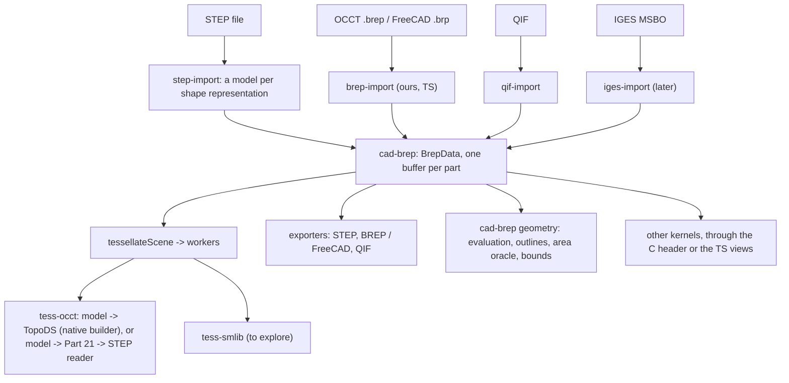

# The B-rep model: plan

A plan, nothing built: a parsed, format-neutral in-memory B-rep per part, to replace the STEP subset as what the scene holds, what backends mesh and what exporters write. Background: `future.md` ("Across formats", "OCCT BREP", "QIF", "IGES", "JT"), `backends.md` (the BRL-CAD and SMLib evaluations, which both assumed this model), `step.md`, `corpus_checks/step_geometry.log` (the corpus's census). Open decisions are listed at the end; each goes to the user in turn.

## Goals and limits

- **What it holds:** a part's curves (3D and 2D), surfaces and topology, parsed: every geometric value a number in a typed array, every reference an index. Not PMI, kinematics, CSG, features, construction history, tessellated geometry (that stays a source level of detail, `step.md`), names or appearance (they stay in the scene, keyed by source ids as now).
- **Coverage:** everything the corpus's B-rep, surface-model and wireframe representations use, plus what OCCT's BREP, QIF's and IGES's MSBO B-reps hold that the model can hold exactly (`future.md`, "Across formats"), plus the Part 42 kinds modern exporters plausibly write (offsets, swept surfaces, Bezier forms, composite and trimmed curves). Implicit curves and blends (XT, Part 42's implicit curves), locally refined splines, Dupin cyclides: out, an importer approximates them with a diagnostic or drops them.
- **Consumers:** our backends (OCCT rebuilt to read it; SMLib, truck or BRL-CAD wrappers possibly), kernels outside cad-io-js (booleans, blends: OCCT, SMLib), our exporters (STEP, BREP, FreeCAD, QIF), and our own geometry code (outlines, the area oracle, bounds, checks).
- **Not a kernel:** the model stores and evaluates; it doesn't heal, sew, intersect or compute p-curves. Repairs of imperfect input go into building it (CLAUDE.md: in memory, each with a diagnostic and an opt-out); what a kernel needs beyond that (p-curves, edge ranges, tolerances) its wrapper computes.

## The flows

## Rules the model fixes

These are what every importer, backend and exporter can rely on; each is a decision (below) where alternatives exist.

1. **Parameterizations are Part 42's, angles in radians.** Every curve and surface kind is parameterized as ISO 10303-42 defines it (a line by its vector's magnitude, a circle by angle from the placement's x axis, a cone with v along the axis, `(R + v tan a)` the radius), so STEP p-curves and trim parameters carry over unchanged. STEP files in degrees get their angular parameters converted at import (trimmed curves' parameters on conics, p-curves' u on cylinders, cones, spheres and tori, v on spheres and tori: affine, exact). Formats with other parameterizations convert affinely where they can (OCCT's cone: `v_occt = v_step / cos a`; QIF's `scaleU`, `turnedV`, `domain`) and drop p-curves where they can't, with a diagnostic; backends convert to their kernel's in their wrapper.
2. **Placements are complete:** origin, axis and reference direction orthonormal, the defaults Part 42 derives for absent ones filled in (`build_axes`), directions unit with a magnitude kept where it parameterizes (lines, extrusions). A non-orthogonal or zero direction is fixed with a diagnostic.
3. **Geometry in the part's length unit**, as the scene keeps it now (transforms carry millimetres); the part's uncertainty (STEP's context uncertainty) beside it.
4. **Specialized B-spline forms are explicit:** `UNIFORM_*`, `QUASI_UNIFORM_*`, `BEZIER_*` and `PIECEWISE_BEZIER_KNOTS` get the knots OCCT's `StepToGeom` gives them (read in its source: uniform 0, 1, 2, ... all of multiplicity 1; quasi-uniform 0, 1, 2, ... with degree + 1 at the ends; Bezier, which OCCT reads as one segment, as Part 42's piecewise form, the same for one segment; not yet compared with Part 42's text, which we don't have, nor numerically: phase 4's OCCT comparison will), rational and non-rational one kind with optional weights; knots distinct with multiplicities, repeated knot values folded (multiplicities summed, with a diagnostic).
5. **P-curves sit on coedges** (a face's use of an edge), as in OCCT, QIF and IGES: STEP's `SURFACE_CURVE` and `SEAM_CURVE` associate their p-curves with the coedges of the faces on whose surfaces they lie (a seam's two by matching each p-curve's ends to the coedge's direction: that needs evaluation, so until phase 3 a seam's p-curves are left off its uses, with an info diagnostic: 54 corpus parts); an edge whose curve is a bare `PCURVE` has no 3D curve.
6. **Every face, edge and vertex has a source id**, unique within its part (STEP `#id`s; QIF ids; IGES directory pointers; for BREP, OCCT's explorer order from 1): what meshes, `faceMaterials`, measures, picking and failures are keyed by, as now.
7. **What a source leaves out stays absent** (NaN or -1): 3D curves (JT, IGES parameter-space trims), p-curves, edge parameter ranges (STEP edges are bounded by vertices only), tolerances. Nothing is computed at import that a consumer might do differently.
8. **Deterministic:** the same source gives the same bytes (rows in the order the source's structure is walked: STEP's representation items as written, each one's geometry and topology depth first).

## The data: `BrepData` (built: `packages/cad-brep`)

One `ArrayBuffer` per part, the format defined by `packages/cad-brep/src/layout.ts` (tables, columns, kinds, each kind's pool layout) and mirrored for C and C++ by the generated `include/cad_brep.h` (`gen/header.ts`; a test checks it's current and compiles a C and a C++ reader that must see what the TypeScript views see). The buffer: the magic `CBR1` (the digit is the version), a column count, each column's byte offset and element count, then the columns, 8-byte aligned, little-endian. One buffer is what crosses to a worker (transferred), what is hashed for the cache key, what is copied into a backend's memory, and what a C or Rust reader maps, so no backend parses JSON or text. Buffers are immutable: an edit (a boolean, a blend) is a client's own form converted back into a new buffer that replaces the part's. TypeScript reads it through typed views (`d.edge.curve[i]`); nothing in it is a JavaScript object, so a large model costs no garbage collection and no per-entity overhead (roadmap: large files in the browser).

- **Tables:** `part` (one row: unit, uncertainty), `pool` (per owning table: `curveReal`, `curveInt`, `surfaceReal`, `surfaceInt`, `loopReal`, `itemReal`), `curve` and `surface` (kind, offsets into their pools, id; curves also `dim`, 2 for p-curves' geometry), `vertex`, `edge`, `coedge`, `loop`, `face`, `shell` with `faceUse`, `body` with `member`, `item` (the part's roots). Variable-length data has a pool per owning table and shells and bodies their own use tables, so the bytes depend only on each table's row order, not on how a builder interleaves tables: the same rows give the same bytes, and a JSON round trip gives them back exactly.
- **References** are row indices (-1 none); geometry refers only to earlier rows of its own table (so no cycles), surfaces to curves freely (curves never refer to surfaces). A face's loops, a loop's coedges, a shell's face uses and a body's members are contiguous ranges each owned by one row. NaN marks an absent real (ids, tolerances, ranges, trims).
- **Kinds** are small integers fixed by the format; TypeScript has them as `const` objects (no enums: erasable syntax only).

**Curve kinds** (2D or 3D, the same layouts with 2 or 3 per point): line (point, unit direction, magnitude), circle, ellipse, hyperbola, parabola (placement and their Part 42 parameters), B-spline (degree, closed and self-intersecting as Part 42's `LOGICAL`s, its curve form, knots, multiplicities, poles, weights if rational), polyline, trimmed (basis, each trim as a parameter and a point where the source gives them, the master representation, sense), composite (segments with same sense and transition), offset (basis, distance, a reference direction in 3D). A `SURFACE_CURVE`, `SEAM_CURVE` or `INTERSECTION_CURVE` isn't a kind: its 3D curve is the edge's, its p-curves the coedges' (rule 5).

**Surface kinds:** plane, cylinder, cone, sphere, torus (a degenerate torus with its `select_outer`), B-spline (degrees, knots and multiplicities both ways, the pole grid u-major, weights if rational, closed flags, form), linear extrusion (swept curve, direction, magnitude), revolution (swept curve, axis), offset (basis, distance, self-intersecting), rectangular trimmed (basis, u1, u2, v1, v2, senses), surface-curve swept and fixed-reference swept (Part 42's swept surfaces carry no parameter range). A `CURVE_BOUNDED_SURFACE` in a geometric set is a face (an item) with its basis surface and its boundaries as loops of edges without vertices.

**Topology:** STEP's, OCCT's, QIF's and IGES MSBO's share one shape (`future.md`): vertex, edge (3D curve or none, start and end vertices or none, sense along the curve, a degenerate flag, optional range and tolerance), coedge (an edge's use in a loop: forward, reversed, internal or external, an optional p-curve and range), loop (edge, vertex or poly; outer, inner or unknown bound; sense), face (surface, sense, loops; none: natural bounds, as QIF's `hasOuter` false and OCCT's natural restriction), shell (closed, open or a face set: IGES's unsewn trimmed surfaces are a face set whose faces share no edges), body (a solid's shells, the outer first; a sheet's shells; a wire's edges).

**Instances inside a part:** an item can place another item with a transform (STEP mapped items within a representation; OCCT compounds of located shapes). Locations deeper than items (OCCT can locate any sub-shape) are baked into the geometry at import, a copy per distinct pair of sub-shape and accumulated location (decision 6).

**Outside the buffer:** per-entity strings (names some formats give faces or edges), when a source needs them, in a side map by table and row; appearance stays in the scene.

## The TypeScript API (`cad-brep`, a core package with no dependencies)

Built (phase 1):

- `BrepBuilder`: `addCurve`, `addSurface`, `addVertex`, `addEdge`, `addFace` (with its loops and coedges), `addShell`, `addBody`, `addItem`, each taking the row as a plain object (`types.ts`) and returning its index; `finish()` gives `BrepData`. It throws on what would make the buffer unreadable (references forward or out of range, wrong dimensions, missing values): its caller's bugs.
- `openBrep` (views of a buffer, header checked), `rowCount`, and the columns themselves for code walking large models; `decode` (`decode.curve(d, i)`, `decode.face(d, i)`, ...) giving the rows back as the objects the builder took; `brepToJson` / `brepFromJson` (every row decoded; not an exchange format).
- `validateBrep`: the format's rules and Part 42's constraints on values, as diagnostics (at most `MAX_DIAGNOSTICS`), never throwing: references and pool ranges, ownership of every range, loops joined where both vertices are known (internal and external coedges excepted), B-spline knot vectors against their poles and degrees, unit directions and orthonormal placements (`UNIT_TOLERANCE`), radii, angles and the degenerate torus, singular transforms; duplicate source ids are warnings. Not checked: what needs evaluation (vertices on their curves, p-curves on their edges).

To come: geometry (phase 3): evaluation of every curve and surface kind (points, derivatives, normals; Piegl and Tiller for B-splines), closed-form inverses for the elementary kinds; on these, `faceOutlines` (from `step-import`'s `outlines.ts`, made format-neutral), the vertex box, validation of vertices on curves, and the area oracle (`corpus_checks/area_oracle.ts`, moved onto the model and so onto every format). Hashing (phase 5) through `cad-scene`'s `sha256` over the buffer.

## Scene and tessellator changes

- `Brep` holds `model: BrepData`, built at import (decision 2); `payload` and `rootId` go, and with them every reference to the source file, so the importer's caller can drop the file once `importStep` returns. A backend that reads a format itself (OCCT's STEP reader) gets that format written from the model (a STEP subset by the geometry writer, phase 4), not the source's bytes. `vertexBox` and `outline` come from the model. An edited part's buffer replaces `model`; its meshes and measures are dropped, and faces the edit makes need ids that don't collide with the source's.
- `TessellationRequest` takes `model` (the buffer) or `step` data (a subset); `TessellatorInfo` lists the inputs a backend takes. The host writes the subset, not the backend: `tess-occt` is LGPL and mustn't include the AGPL writer, and phase 4 leaves its wrapper unchanged. `cad-scene` has no dependencies, so `tessellateScene` takes the writer as an option (`toStep`, from `step-export`, passed by `stepconv`, the viewer and the checks) and an option choosing the route per backend (the default decision 8). The result is unchanged (face ids are the model's source ids).
- `tess-cache` keys on the model's hash for model requests (caches made from subsets miss once).
- `tess-workers` transfers the buffer (a model built for the request is dropped after it).

## Backends

- **OCCT, step 1: model -> Part 21 -> its STEP reader.** The STEP exporter's geometry writer (below) writes the model as a bare subset and the existing wrapper meshes it unchanged. No C++ work; every format whose model STEP can hold (QIF, IGES MSBO, BREP without per-entity tolerances) is meshed at once; and comparing it with the subset route over the corpus checks the importer and the writer together.
- **OCCT, step 2: a native builder.** `occt_tessellate_model` in `occt_tess.cpp` builds the `TopoDS_Shape` from the buffer through OCCT's public API (`Geom_*`, `Geom2d_*`, `BRep_Builder`), then `ShapeFix_Shape` and `BRepMesh` as now. It must do what OCCT's STEP translation does before healing, written by us from the standard and the API's documentation (never from `StepToTopoDS`'s source: `licensing.md`): vertex parameters on curves by projection (`GeomAPI_ProjectPointOnCurve`), edge ranges, the Part 42 -> OCCT cone conversion of p-curves, seams (two coedges of one edge in a face), degenerate edges at poles and apexes for vertex loops, tolerances from the uncertainty or the entities'. It skips Part 21 text and the STEP reader's work, and carries what STEP can't (tolerances per entity, BREP's p-curves). Kept beside the STEP route, which stays the oracle and the fallback.
- **SMLib (to explore):** a C++ wrapper reading the buffer by `cad_brep.h` into SMLib's B-rep; SMLib rebuilds UV trims from 3D edges where p-curves are absent (`backends.md`); its exact face areas (any surface) extend the area oracle to B-spline faces.
- **truck (optional):** a wrapper reading the buffer instead of ruststep's parse (no more failed parses of `()`); its STEP workarounds (`backends.md`, truck, 2, 7, 8, 10) partly move into the STEP importer as fixes for every consumer.

## Exporters

- **STEP** (`step-export`, new, AGPL and TypeScript only: no backend involved): one geometry writer (a part's model as Part 42 geometry and topology) under two callers, the tessellation route (a bare shape representation, phase 4) and the file exporter (phase 6), so every corpus run of the Part 21 route exercises the export's geometry, and a writer bug shows in both. The exporter: the scene's products, occurrences, styles and units, and each part's model written as AP242 geometry and topology (the source's `#` ids where the model has them, others after the largest, renumbered only on collision; Part 42's general forms: explicit-knot B-splines, `SURFACE_CURVE`s where coedges have p-curves).
- **BREP and FreeCAD:** our own writer from the model once p-curves and tolerances exist, else OCCT writes it (`BRepTools` after the native builder) in the wrapper.
- **QIF:** our own writer; p-curves optional, ids kept.

## Coverage, from the corpus and beyond

From `step_geometry.log`: faces `ADVANCED_FACE`, `FACE_SURFACE`; surfaces plane, cylinder, cone, sphere, torus, degenerate torus, B-spline (plain, rational, quasi-uniform), linear extrusion, revolution, rectangular trimmed, curve-bounded; curves line, circle, ellipse, hyperbola, parabola, B-spline (plain, rational, quasi-uniform), polyline, trimmed, composite, surface curve, seam curve, p-curve (2D lines, B-splines, trimmed curves); representations advanced B-rep, plain shape representation, manifold surface, geometrically bounded surface and wireframe, faceted B-rep. Beyond the corpus: offset curves and surfaces (OCCT BREP, IGES 140, OCCT's STEP reader), Bezier and uniform forms, intersection curves, swept surfaces, `ORIENTED_FACE`, `ORIENTED_CLOSED_SHELL`, `BREP_WITH_VOIDS`, `POLY_LOOP`, `VERTEX_LOOP`, mapped items with mirroring operators, tolerances per entity, internal and external orientations, unsewn faces. Out: PMI and draughting geometry, CSG (one plant file), construction history, tessellated items (a source level), implicit curves and blends, locally refined splines.

## Phases

1. **`cad-brep`** (built): the layout and `cad_brep.h`, the builder, views, JSON, validation; unit tests on hand-built models (a solid with shared edges, a seam with its two p-curves, natural bounds, a vertex loop at a pole, a cone's degenerate apex edge, a void, poly loops, wires, unsewn faces, geometric sets, instances, every kind); a C and a C++ reader; mutation checks (57 mutants, 2 equivalent survivors: decoders differing only on buffers validation rejects).
2. **STEP -> model** (`step-import`), per shape representation on the closure it already computes, with rules 1-8 and the fixes as diagnostics. Corpus check `brep_corpus.ts`: every part converts; counts by kind equal the census; every face, edge and vertex id is there; `validateBrep` clean or explained; build time and model size against `buildSubset`. Built incrementally, a part at a time with `onProgress`'s `parts` reporting each, yielding between parts so a page or worker can show it. Peak memory and time of the whole import measured on the largest models (LMP1's 271 MB STEP, the corpus's largest files) against today's import; if it crashes or nearly does, ways of trading speed for memory are put to the user then.
   - **Built** (`step-import/src/brep.ts`, `importStep`'s `models`, off by default until phase 5; a part's model in `Part.brep.model`). `sceneFromStep` is synchronous and reports `parts` per representation, which reaches a page when the import runs in a worker; no yielding was added.
   - **The corpus** (`corpus_checks/brep_corpus.log`): all 517 files, 3,258 B-rep parts; 86,141 faces (3,156 of them curve-bounded surfaces), 219,308 edges, 138,828 vertices. Every face, edge and vertex of each part's closure is in its model but what diagnostics say was left out (4 faces, 12 edges, 20 vertices, all in broken files: `bug29478.stp`, `bug22871_null-swept-curve.stp`, `bug24383_224013.stp`, `bug29979_firetherm_12.step`, `bug32314_corrupted.stp`). `validateBrep`: 22 loops whose coedges don't join, all the files' own (`bug29979_firetherm_12.step`: consecutive edges 260 mm apart; `trj3_s1-al-214.stp`, Alias: loops of two parallel trim lines and no edges joining them), kept as written. 154 parts have faces with more than one `FACE_OUTER_BOUND` (`bug30790.step`'s tubes, `bug32239.STEP`, `2.stp`, the bicycle, ...; Part 42 allows one): read as bounds of unknown kind, an info diagnostic. Every model round-trips through JSON to the same bytes. Planted bugs: a face dropped from every 10th part's model (312 parts) and an edge moved to another vertex (107 parts), all caught.
   - **Cost:** the corpus's models are 113 MB against 324 MB of subsets; building them adds 4-7 s to an 8.5 s import of the whole corpus. LMP1 (1,251 parts, 64,187 faces, 87.5 MB of models; Apple M4, low power mode off, back to back twice): 13.9-16.2 s and 3.6-4.0 GB peak resident without models, 18.5-18.8 s and 4.2-4.4 GB with. A reader of its own per part matters: through the importer's shared `Reader` its cache of bound instances kept 2 GB more (22.5 s, 5.8 GB peak). The file is still held (until phase 5), so the memory the model should save isn't measured yet: 2.45 GB of heap after the import either way, mostly the file, its index and the semantics, which the scene's `payload` and `outline` closures keep alive.
3. **Geometry:** evaluation, outlines and the area oracle on the model; the oracle's results on the model equal its results on the file for all 63,901 trusted faces (an independent check of the conversion: rules 1, 2 and 5 above all).
4. **STEP writing and OCCT step 1:** the geometry writer; model -> Part 21 -> OCCT against the subset route over the corpus, face by face (ids, triangles, measures, validity, failures, time); every difference classified. The writer is a second source of bugs on this route, so it is checked on its own: (a) unit tests per entity kind with expected text written from the standard, not from the code, and mutation checks; (b) every written subset bound against the AP242 dictionary with value checks, no diagnostics; (c) written and read back, the same model table by table (catches asymmetries between writer and importer, not misconceptions they share, such as a sense inverted both ways); (d) OCCT on the original bytes against OCCT on the written text, independent of both: points at the same parameters, measures, validity, each face's mesh normals (inverted senses). (c) passing with (d) failing points to a shared misconception or a loss in conversion. Once the native builder exists (phase 7), three routes localize a difference: original against written text is the importer or writer, written text against native the builder.
5. **Scene integration:** `Brep.model` built at import, `payload` gone, requests, cache, workers, viewer, `stepconv`.
6. **The STEP exporter** (products, styles, units) and its round trip, STEP -> scene -> STEP -> scene, checked in three layers, since a check of the model against itself is blind to bugs in the normalization both passes share: (1) the models equal table by table, rows paired by source id, reals bit-exact but for angles from degree files (a few rounding steps); (2) OCCT, independent of our importer, reads the original and the written file: points of every face's surface and every edge's curve at the same parameters equal (Part 42's parameterizations make the same parameters the same points; this catches wrong implied knots, line magnitudes, ellipse axes, degree conversion), through an evaluation entry in a probe build of the wrapper, and face measures and meshes compared face by face; (3) the area oracle, reading STEP through `step-parser` alone, on both files. Expected differences classified, not failed: what the model doesn't keep (entities no face reaches, dangling references, p-curves on surfaces no face uses), rebuilt `SURFACE_CURVE`s, `FACE_SURFACE`s written as `ADVANCED_FACE`s (or kept as `FACE_SURFACE` where an advanced face can't hold their geometry).
7. **OCCT step 2**, the native builder, against step 1 over the corpus.
8. **BREP / FreeCAD import and export** (our BREP parser into the model; `future.md`), then **QIF**; IGES MSBO when taken up.
9. **SMLib** as a backend, if the evaluation goes on.

## Open decisions

To put to the user one at a time, in this order (each changes what follows):

1. **The storage form (decided, 2026-11-07):** one typed buffer per part, read through views (above). Editing isn't the buffer's business: a client that edits B-reps converts the buffer to a form of its own (a kernel's, or objects), and puts the result back as a new buffer replacing the part's. Rejected: a TypeScript object graph serialized to a buffer only for backends (natural to traverse and modify, but several times the memory on large models and a serialization step per request), and both forms kept side by side (two forms to keep in step).
2. **When the model is built (decided, 2026-11-07):** at import, for every part, incrementally with progress; the file is then dropped (nothing in the scene refers to it). Peak memory during import is the known cost, to be measured on the largest models (phase 2) before anything is done about it. Rejected: on demand per part from the file kept in memory (as subsets are built now: a fast import, but the file held for the session and a model built per request), and an option between the two (two paths to test).
3. **Canonical parameterizations (decided, 2026-11-07):** Part 42's (rule 1). OCCT's differ (its source, checked): a line's parameter is distance where Part 42's is scaled by the vector's magnitude; an ellipse's first semi-axis must be the major one (OCCT swaps the axes and shifts the parameter by pi/2); a cone's v runs along the generatrix (`ElSLib::ConeValue`: `v_occt = v_step / cos a`); its STEP reader leaves parabolas' and hyperbolas' trim parameters unconverted. Angles always in radians, degree files converted at import (pi/180 isn't exact: about one rounding step per value, so a degree file written back doesn't repeat its digits). Rejected: each file's own angle unit kept per part (exact values, but every consumer converting, and missing it only on the rare degree files, as the area oracle once did); OCCT's parameterizations (closer to the primary backend, BREP and FreeCAD files, but STEP import and export would convert, and the area oracle, outlines and the QIF and IGES mappings, worked out against Part 42, redone).
4. **Normalization against fidelity (decided, 2026-11-07):** STEP's specialized forms are folded into the general ones and the original form isn't kept (rule 4; quasi-uniform, uniform and Bezier B-splines with explicit knots, rational ones as weights, `FACE_SURFACE` as `ADVANCED_FACE` where its geometry allows), so STEP is written back in the general forms. Round trips are checked on the models and the geometry, not the text (phase 6). Rejected: the general form plus a byte per row naming the source's form, so the writer could repeat it (cheap, but writer branches to test), and each form kept as it is (every consumer handling each).
5. **The STEP writer's ids (decided, 2026-11-07):** the source's `#` ids kept where the model has them, new entities (rebuilt surface curves, contexts, products) numbered after the largest, renumbering only where ids collide (parts from several sources or edited parts written together). Round trips pair rows by id, and face ids stay stable across STEP -> STEP. Rejected: fresh ids in a deterministic order (simpler, but round-trip checks pairing rows by walking both models, and face ids changing each time). (Copying an unchanged STEP part's subset bytes went with decision 2: the file is dropped.)
6. **Locations (decided, 2026-11-07):** on items only (STEP needs no more: it places only representations and mapped items; QIF transforms only components; IGES's are baked into geometry anyway). Deeper locations (OCCT's located sub-shapes, from patterns and transforms without copies) are baked at import, one copy per distinct pair of sub-shape and accumulated location: OCCT's sameness is the shape and its location together, so the copies keep exactly the sharing OCCT means. Rejected: a location on every use, as OCCT has (BREP round-trips its instancing, but every consumer composing transforms and flipping orientations under mirrors, and kernels without located sub-shapes baking them in their wrappers anyway).
7. **OCCT's route (decided, 2026-11-07):** model -> Part 21 -> OCCT's STEP reader first (phase 4), then the native builder (phase 7); the Part 21 route stays as the native builder's oracle and fallback, and is what "operating from a STEP subset" now means (a subset written from the model). Its hazard, bugs in our STEP writer, is checked as phase 4 says. Rejected: the native builder only (one faster, more faithful route, but the hardest piece first, judged against a route that reads the file rather than the model, so a difference can't be pinned on builder or importer; and no model meshing until it's done).
8. **OCCT's default route** once phase 7 is measured against phase 4: the native builder or the Part 21 route (with the file dropped, the source's own bytes are no longer a choice).
