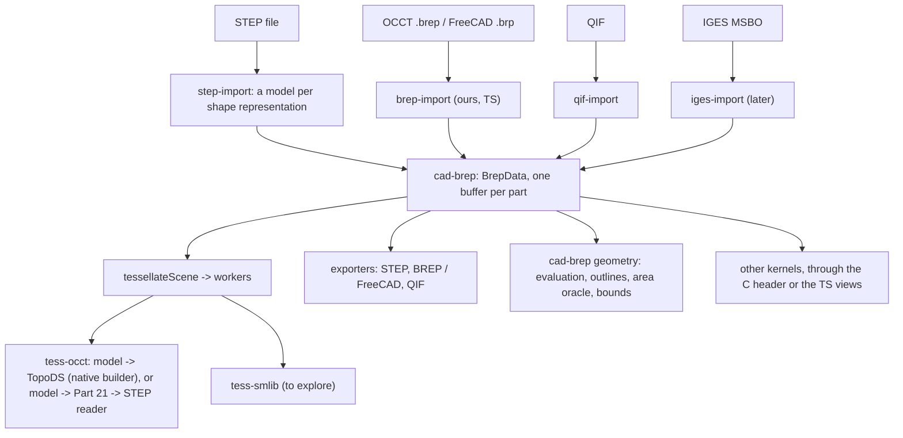

# The B-rep model: plan

A plan, nothing built: a parsed, format-neutral in-memory B-rep per part, to replace the STEP subset as what the scene holds, what backends mesh and what exporters write. Background: `future.md` ("Across formats", "OCCT BREP", "QIF", "IGES", "JT"), `backends.md` (the BRL-CAD and SMLib evaluations, which both assumed this model), `step.md`, `corpus_checks/step_geometry.log` (the corpus's census). Open decisions are listed at the end; each goes to the user in turn.

## Goals and limits

- **What it holds:** a part's curves (3D and 2D), surfaces and topology, parsed: every geometric value a number in a typed array, every reference an index. Not PMI, kinematics, CSG, features, construction history, tessellated geometry (that stays a source level of detail, `step.md`), names or appearance (they stay in the scene, keyed by source ids as now).
- **Coverage:** everything the corpus's B-rep, surface-model and wireframe representations use, plus what OCCT's BREP, QIF's and IGES's MSBO B-reps hold that the model can hold exactly (`future.md`, "Across formats"), plus the Part 42 kinds modern exporters plausibly write (offsets, swept surfaces, Bezier forms, composite and trimmed curves). Implicit curves and blends (XT, Part 42's implicit curves), locally refined splines, Dupin cyclides: out, an importer approximates them with a diagnostic or drops them.
- **Consumers:** our backends (OCCT rebuilt to read it; SMLib, truck or BRL-CAD wrappers possibly), kernels outside cad-io-js (booleans, blends: OCCT, SMLib), our exporters (STEP, BREP, FreeCAD, QIF), and our own geometry code (outlines, the area oracle, bounds, checks).
- **Not a kernel:** the model stores and evaluates; it doesn't heal, sew, intersect or compute p-curves. Repairs of imperfect input go into building it (CLAUDE.md: in memory, each with a diagnostic and an opt-out); what a kernel needs beyond that (p-curves, edge ranges, tolerances) its wrapper computes.

## The flows

## Rules the model fixes

These are what every importer, backend and exporter can rely on; each is a decision (below) where alternatives exist.

1. **Parameterizations are Part 42's, angles in radians.** Every curve and surface kind is parameterized as ISO 10303-42 defines it (a line by its vector's magnitude, a circle by angle from the placement's x axis, a cone with v along the axis, `(R + v tan a)` the radius), so STEP p-curves and trim parameters carry over unchanged. STEP files in degrees get their angular parameters converted at import (trimmed curves' parameters on conics, p-curves' u on cylinders, cones, spheres and tori, v on spheres and tori: affine, exact). Formats with other parameterizations convert affinely where they can (OCCT's cone: `v_occt = v_step / cos a`; QIF's `scaleU`, `turnedV`, `domain`) and drop p-curves where they can't, with a diagnostic; backends convert to their kernel's in their wrapper.
2. **Placements are complete:** origin, axis and reference direction orthonormal, the defaults Part 42 derives for absent ones filled in (`build_axes`), directions unit with a magnitude kept where it parameterizes (lines, extrusions). A non-orthogonal or zero direction is fixed with a diagnostic.
3. **Geometry in millimetres**, as the scene is (decision 33): an importer scales every length by its source's unit (`brep-reference.md` lists them, p-curves on a surface's length parameters among them); the part's uncertainty (STEP's context uncertainty) beside it, in millimetres too.
4. **Specialized B-spline forms are explicit:** `UNIFORM_*`, `QUASI_UNIFORM_*`, `BEZIER_*` and `PIECEWISE_BEZIER_KNOTS` get the knots OCCT's `StepToGeom` gives them (read in its source: uniform 0, 1, 2, ... all of multiplicity 1; quasi-uniform 0, 1, 2, ... with degree + 1 at the ends; Bezier, which OCCT reads as one segment, as Part 42's piecewise form, the same for one segment; not yet compared with Part 42's text, which we don't have, nor numerically: phase 4's OCCT comparison will), rational and non-rational one kind with optional weights; knots distinct with multiplicities, repeated knot values folded (multiplicities summed, with a diagnostic).
5. **P-curves sit on coedges** (a face's use of an edge), as in OCCT, QIF and IGES: STEP's `SURFACE_CURVE` and `SEAM_CURVE` associate their p-curves with the coedges of the faces on whose surfaces they lie (a seam's two by Part 42's rule that the face lies to the left of each use in (u, v), to the right where the face's or the bound's sense turns it over: each use takes the p-curve with the other on its left, its direction of travel the p-curve's tangent turned by the use's orientation and the edge's same_sense, since a p-curve shares its 3D curve's parameter; where that can't be told, or would give both uses one p-curve, neither keeps one, with an info diagnostic; two p-curves on one surface that coincide, at five points of the first's range or three of an unbounded one, are one curve given twice and every use takes it: CATIA writes an edge between two faces on one closed surface so, `pr1db.stp`, where without it OCCT meshed the part with a non-manifold edge); an edge whose curve is a bare `PCURVE` has no 3D curve.
6. **Every face, edge and vertex has a source id**, unique within its part (STEP `#id`s; QIF ids; IGES directory pointers; for BREP, OCCT's explorer order from 1): what meshes, `faceMaterials`, measures, picking and failures are keyed by, as now.
7. **What a source leaves out stays absent** (NaN or -1): 3D curves (JT, IGES parameter-space trims), p-curves, edge parameter ranges (STEP edges are bounded by vertices only), tolerances. Nothing is computed at import that a consumer might do differently.
8. **Deterministic:** the same source gives the same bytes (rows in the order the source's structure is walked: STEP's representation items as written, each one's geometry and topology depth first).

## The data: `BrepData` (built: `packages/cad-brep`)

Every kind's meaning in full, for backends and editors: [`brep-reference.md`](brep-reference.md).

One `ArrayBuffer` per part, the format defined by `packages/cad-brep/src/layout.ts` (tables, columns, kinds, each kind's pool layout) and mirrored for C and C++ by the generated `include/cad_brep.h` (`gen/header.ts`) and for Rust by the generated `include/cad_brep.rs` (`gen/rust.ts`; decision 26); a test checks both are current and compiles a C, a C++ and a Rust reader that must see what the TypeScript views see. The buffer: the magic `CBR1` (the digit is the version), a column count, each column's byte offset and element count, then the columns, 8-byte aligned, little-endian. One buffer is what crosses to a worker (transferred), what is hashed for the cache key, what is copied into a backend's memory, and what a C or Rust reader maps, so no backend parses JSON or text. Buffers are immutable: an edit (a boolean, a blend) is a client's own form converted back into a new buffer that replaces the part's. TypeScript reads it through typed views (`d.edge.curve[i]`); nothing in it is a JavaScript object, so a large model costs no garbage collection and no per-entity overhead (roadmap: large files in the browser).

- **Tables:** `part` (one row: the uncertainty), `pool` (per owning table: `curveReal`, `curveInt`, `surfaceReal`, `surfaceInt`, `itemReal`, `copyPath`), `curve` and `surface` (kind, offsets into their pools, id; curves also `dim`, 2 for p-curves' geometry), `vertex`, `edge`, `coedge`, `loop`, `face`, `shell` with `faceUse`, `body` with `member`, `item` (the part's roots). Variable-length data has a pool per owning table and shells and bodies their own use tables, so the bytes depend only on each table's row order, not on how a builder interleaves tables: the same rows give the same bytes, and a JSON round trip gives them back exactly.
- **References** are row indices (-1 none); geometry refers only to earlier rows of its own table (so no cycles), surfaces to curves freely (curves never refer to surfaces). A face's loops, a loop's coedges, a shell's face uses and a body's members are contiguous ranges each owned by one row. NaN marks an absent real (tolerances, ranges, trims), 0 an absent id (ids are `u32`, 1 to 2^32 - 1).
- **Kinds** are small integers fixed by the format; TypeScript has them as `const` objects (no enums: erasable syntax only).

**Curve kinds** (2D or 3D, the same layouts with 2 or 3 per point): line (point, unit direction, magnitude), circle, ellipse, hyperbola, parabola (placement and their Part 42 parameters), B-spline (degree, closed and self-intersecting as Part 42's `LOGICAL`s, its curve form, knots, multiplicities, poles, weights if rational), polyline, trimmed (basis, each trim as a parameter and a point where the source gives them, the master representation, sense), composite (segments with same sense and transition), offset (basis, distance, a reference direction in 3D). A `SURFACE_CURVE`, `SEAM_CURVE` or `INTERSECTION_CURVE` isn't a kind: its 3D curve is the edge's, its p-curves the coedges' (rule 5).

**Surface kinds:** plane, cylinder, cone, sphere, torus (a degenerate torus with its `select_outer`), B-spline (degrees, knots and multiplicities both ways, the pole grid u-major, weights if rational, closed flags, form), linear extrusion (swept curve, direction, magnitude), revolution (swept curve, axis), offset (basis, distance, self-intersecting), rectangular trimmed (basis, u1, u2, v1, v2, senses), surface-curve swept and fixed-reference swept (Part 42's swept surfaces carry no parameter range). A `CURVE_BOUNDED_SURFACE` in a geometric set is a face (an item) with its basis surface and its boundaries as loops of edges without vertices.

**Topology:** STEP's, OCCT's, QIF's and IGES MSBO's share one shape (`future.md`): vertex, edge (3D curve or none, start and end vertices or none, sense along the curve, optional range and tolerance), coedge (an edge's use in a loop: forward, reversed, internal or external, an optional p-curve and range), loop (edge or vertex, run as listed; outer, inner or unknown bound, more than one outer allowed as files have them, with a warning), face (surface, sense, loops; none: natural bounds, as QIF's `hasOuter` false and OCCT's natural restriction), shell (closed or open by its edges, what the source declared beside it: closed, open or a face set, as IGES's unsewn trimmed surfaces are), body (a solid's shells, the outer first; a sheet's shells; a wire's edges). The builder takes a source's further forms (loops and uses against their listing, poly loops, degenerate edges) and writes these (`brep-reference.md`, "The canonical model").

**Instances inside a part:** none in a model: one coordinate system per part (decisions 28 and 35). A source's instances and transforms within a part (OCCT compounds of located shapes; STEP's mapped items are placed by the scene instead) go to the builder as instance items and transforms, which it bakes into copies of the rows, fresh ids for the copies (decision 29); locations deeper than items (OCCT can locate any sub-shape) likewise, a copy per distinct pair of sub-shape and accumulated location (decision 6).

**Outside the buffer:** per-entity strings (names some formats give faces or edges), when a source needs them, in a side map by table and row; appearance stays in the scene.

## The TypeScript API (`cad-brep`, a core package with no dependencies)

Built (phase 1):

- `BrepBuilder`: `addCurve`, `addSurface`, `addVertex`, `addEdge`, `addFace` (with its loops and coedges), `addShell`, `addBody`, `addItem`, each taking the row as a plain object (`types.ts`) and returning its index; `finish()` gives `BrepData`. It throws on what would make the buffer unreadable (references forward or out of range, wrong dimensions, missing values): its caller's bugs.
- `openBrep` (views of a buffer, header checked), `rowCount`, and the columns themselves for code walking large models; `decode` (`decode.curve(d, i)`, `decode.face(d, i)`, ...) giving the rows back as the objects the builder took; `brepToJson` / `brepFromJson` (every row decoded; not an exchange format).
- `validateBrep`: the format's rules and Part 42's constraints on values, as diagnostics (at most `MAX_DIAGNOSTICS`), never throwing: references and pool ranges, ownership of every range, loops joined where both vertices are known (internal and external coedges excepted), B-spline knot vectors against their poles and degrees, unit directions and orthonormal placements (`UNIT_TOLERANCE`), radii, angles and the degenerate torus, singular transforms; duplicate source ids are warnings. Not checked: what needs evaluation (vertices on their curves, p-curves on their edges).

Built (phase 3):

- Geometry (`geometry.ts`): an evaluator per curve or surface row (`curveEvaluator`, `surfaceEvaluator`; `curveEvaluatorOf` for curves not yet in a buffer, as an importer has them): points, first derivatives, natural ranges and periods by Part 42's parameterizations; B-splines by Piegl and Tiller (A2.1, A2.3), rational through homogeneous coordinates; closed-form inverses for lines, conics and the elementary surfaces; nearest-point search otherwise (`nearestParam`, by knot spans and refining several local minima, since a curve can come back near itself; `nearestParams` on surfaces); `edgeParams`, an edge's parameters from start to end (periods added the way `sameSense` says, a whole turn for one vertex, a whole closed B-spline; on a curve that closes without a period a vertex at the junction is either end, whichever runs the edge the way `sameSense` says: `trj4_s1-ec-214.stp`). The inverses have two branches where the surface reaches across its axis: past a cone's apex (R + v tan a negative) a point's u is its angle plus pi (`screw.step`); inside a spindle torus (minor radius over major) it is reached with R + r cos v negative, so the inverse takes the branch whose tube circle the point is on; and a sphere's point is also at (u + pi, pi - v), with v 2 pi periodic as a point, which files' p-curves use (`bm2_pe_t4-A.stp`). Our choices where Part 42's text isn't known to us: a polyline's segment k over [k, k + 1] (as OCCT reads it), a composite curve's segment k over [k, k + 1] mapped linearly onto the segment's range (OCCT never parameterizes them), offsets as OCCT's (the basis plus d times the unit of tangent x reference direction). Swept surfaces with a directrix aren't evaluated.
- Outlines (`outlines.ts`, `faceOutlines`): each face's edges along their 3D curves (lines by their ends, polylines by their corners, conics stepped by the deflections, others subdivided until each midpoint is within the linear deflection; at most 512 points an edge), an edge with only a p-curve through its surface, poly loops' polygons; Brep.outline's shape. `step-import`'s own outlines (from the file) draw implicit-knot B-splines with more poles than a Bezier segment as straight lines (`trj2_as1-id-203.stp`'s quasi-uniform curves); these replace them in phase 5.

To come: the vertex box from the model (the importer's is the file's `VERTEX_POINT`s'); validation of vertices on curves and p-curves on their edges in the library (today a corpus check, `brep_geometry.ts`); hashing (phase 5) through `cad-scene`'s `sha256` over the buffer.

## Scene and tessellator changes

Built (phase 5):

- `Brep` holds `model: BrepData`, built at import for every B-rep part (decision 2), with `format` (the source's), `vertexBox` and `outline` (from the model: `cad-brep`'s `faceOutlines`). `payload` and `rootId` are gone, and nothing in the scene refers to the source file, so the importer's caller drops it once `importStep` returns. The outline closures are made outside `sceneFromStep` (`outlineOf`): made inside, they shared its scope's context with closures reaching the file, its index and the semantics, which kept all of it alive (LMP1: 2.5 GB of heap after the import, against 21 MB; a test checks the importer's model is collected). An edited part's buffer replaces `model`; its meshes and measures are dropped, and faces the edit makes need ids that don't collide with the source's.
- `TessellationRequest`'s `format` `'cad-brep'` carries the model's bytes (`data`, a view of the buffer); `TessellatorInfo.formats` lists what a backend takes. `tessellateScene` sends every B-rep part as a model request and, to a backend that takes no models, none: an error diagnostic says how many parts weren't meshed and what the backend takes.
- `step-export`'s `StepTessellator` (decision 9) sits between the cache and the backend (`CachedTessellator` -> `StepTessellator` -> a pool or a backend): for a backend that reads STEP (OCCT, truck) it writes each model as STEP (`stepPartBytes`) and passes that on, its diagnostics first, prefixed `writing STEP:`; requests in other formats, and backends that take models, pass through. Its version is the backend's with `, STEP writer N` (`STEP_WRITER_VERSION`), so a changed writer misses the cache; a backend that takes models keeps its own info. `stepconv`, the viewer and the corpus checks chain it.
- `tess-cache` keys on the request's bytes, the model's (meshes cached from subsets miss once). `tess-workers` copies requests to its workers (the scene keeps its models).
- AP242 tessellated geometry is always read by `step-import` (decision 10).

## Backends

- **OCCT, step 1: model -> Part 21 -> its STEP reader.** The STEP exporter's geometry writer (below) writes the model as a bare subset and the existing wrapper meshes it unchanged. No C++ work; every format whose model STEP can hold (QIF, IGES MSBO, BREP without per-entity tolerances) is meshed at once; and comparing it with the subset route over the corpus checks the importer and the writer together.
- **OCCT, step 2: a native builder.** `occt_tessellate_model` in `occt_tess.cpp` builds the `TopoDS_Shape` from the buffer through OCCT's public API (`Geom_*`, `Geom2d_*`, `BRep_Builder`), then `ShapeFix_Shape` and `BRepMesh` as now. It must do what OCCT's STEP translation does before healing, written by us from the standard and the API's documentation (never from `StepToTopoDS`'s source: `licensing.md`): vertex parameters on curves by projection (`GeomAPI_ProjectPointOnCurve`), edge ranges, the Part 42 -> OCCT cone conversion of p-curves, seams (two coedges of one edge in a face), degenerate edges at poles and apexes for vertex loops, tolerances from the uncertainty or the entities'. It skips Part 21 text and the STEP reader's work, and carries what STEP can't (tolerances per entity, BREP's p-curves). Kept beside the STEP route, which stays the oracle and the fallback.
- **SMLib (to explore; README backlog, Tessellation):** a C++ wrapper reading the buffer by `cad_brep.h` into SMLib's B-rep; SMLib rebuilds UV trims from 3D edges where p-curves are absent (`backends.md`); its exact face areas (any surface) extend the area oracle to B-spline faces.
- **truck (optional; phase 11, decision 30):** its wrapper reads the buffer (`native/src/model.rs`, through the generated `cad_brep.rs`), models only; its STEP route, ruststep's parse and the STEP-only workarounds (`backends.md`, truck: 2, 4, 6, 7, 8) gone, the model fixing what they fixed.

## Exporters

- **STEP** (`step-export`, new, AGPL and TypeScript only: no backend involved): one geometry writer (a part's model as Part 42 geometry and topology) under two callers, the tessellation route (a bare shape representation, phase 4) and the file exporter (phase 6), so every corpus run of the Part 21 route exercises the export's geometry, and a writer bug shows in both. The exporter: the scene's products, occurrences, styles and units, and each part's model written as AP242 geometry and topology (the source's `#` ids where the model has them, others after the largest, renumbered only on collision; Part 42's general forms: explicit-knot B-splines, `SURFACE_CURVE`s where coedges have p-curves).
- **BREP and FreeCAD (README backlog, Import):** our own writer from the model once p-curves and tolerances exist, else OCCT writes it (`BRepTools` after the native builder) in the wrapper.
- **QIF:** our own writer; p-curves optional, ids kept.

## Coverage, from the corpus and beyond

From `step_geometry.log`: faces `ADVANCED_FACE`, `FACE_SURFACE`; surfaces plane, cylinder, cone, sphere, torus, degenerate torus, B-spline (plain, rational, quasi-uniform), linear extrusion, revolution, rectangular trimmed, curve-bounded; curves line, circle, ellipse, hyperbola, parabola, B-spline (plain, rational, quasi-uniform), polyline, trimmed, composite, surface curve, seam curve, p-curve (2D lines, B-splines, trimmed curves); representations advanced B-rep, plain shape representation, manifold surface, geometrically bounded surface and wireframe, faceted B-rep. Beyond the corpus: offset curves and surfaces (OCCT BREP, IGES 140, OCCT's STEP reader), Bezier and uniform forms, intersection curves, swept surfaces, `ORIENTED_FACE`, `ORIENTED_CLOSED_SHELL`, `BREP_WITH_VOIDS`, `POLY_LOOP`, `VERTEX_LOOP`, mapped items with mirroring operators, tolerances per entity, internal and external orientations, unsewn faces. Out: PMI and draughting geometry, CSG (one plant file), construction history, tessellated items (a source level), implicit curves and blends, locally refined splines.

## Phases

1. **`cad-brep`** (built): the layout and `cad_brep.h`, the builder, views, JSON, validation; unit tests on hand-built models (a solid with shared edges, a seam with its two p-curves, natural bounds, a vertex loop at a pole, a cone's degenerate apex edge, a void, poly loops, wires, unsewn faces, geometric sets, instances, every kind); a C and a C++ reader; mutation checks (57 mutants, 2 equivalent survivors: decoders differing only on buffers validation rejects).
2. **STEP -> model** (`step-import`), per shape representation on the closure it already computes, with rules 1-8 and the fixes as diagnostics. Corpus check `brep_corpus.ts`: every part converts; counts by kind equal the census; every face, edge and vertex id is there; `validateBrep` clean or explained; build time and model size against `buildSubset`. Built incrementally, a part at a time with `onProgress`'s `parts` reporting each, yielding between parts so a page or worker can show it. Peak memory and time of the whole import measured on the largest models (LMP1's 271 MB STEP, the corpus's largest files) against today's import; if it crashes or nearly does, ways of trading speed for memory are put to the user then.
   - **Built** (`step-import/src/brep.ts`, behind `importStep`'s `models` until phase 5 built it at every import; a part's model in `Part.brep.model`). `sceneFromStep` is synchronous and reports `parts` per representation, which reaches a page when the import runs in a worker; no yielding was added.
   - **The corpus** (`corpus_checks/brep_corpus.log`): all 517 files, 3,258 B-rep parts; 86,141 faces (3,156 of them curve-bounded surfaces), 219,308 edges, 138,828 vertices. Every face, edge and vertex of each part's closure is in its model but what diagnostics say was left out (4 faces, 12 edges, 20 vertices, all in broken files: `bug29478.stp`, `bug22871_null-swept-curve.stp`, `bug24383_224013.stp`, `bug29979_firetherm_12.step`, `bug32314_corrupted.stp`). `validateBrep`: 22 loops whose coedges don't join, all the files' own (`bug29979_firetherm_12.step`: consecutive edges 260 mm apart; `trj3_s1-al-214.stp`, Alias: loops of two parallel trim lines and no edges joining them), kept as written. 154 parts have faces with more than one `FACE_OUTER_BOUND` (`bug30790.step`'s tubes, `bug32239.STEP`, `2.stp`, the bicycle, ...; Part 42 allows one): kept as the file has them, each an outer loop, the face's other bounds inner, with a warning (and `validateBrep`'s, 3,182 faces), so OCCT reading the model as STEP sees what it sees in the file. Every model round-trips through JSON to the same bytes. Planted bugs: a face dropped from every 10th part's model (312 parts) and an edge moved to another vertex (107 parts), all caught.
   - **Cost:** the corpus's models are 108 MB against 324 MB of subsets (113 MB before ids were `u32`, phase 10); building them adds 4-7 s to an 8.5 s import of the whole corpus. LMP1 (1,251 parts, 64,187 faces, 87.5 MB of models; Apple M4, low power mode off, back to back twice): 13.9-16.2 s and 3.6-4.0 GB peak resident without models, 18.5-18.8 s and 4.2-4.4 GB with. A reader of its own per part matters: through the importer's shared `Reader` its cache of bound instances kept 2 GB more (22.5 s, 5.8 GB peak). The file was still held then: 2.45 GB of heap after the import either way, mostly the file, its index and the semantics, which the scene's `payload` and `outline` closures kept alive (phase 5 for what's left).
3. **Geometry:** evaluation, outlines and the area oracle on the model.
   - **Built** (`cad-brep`'s `geometry.ts` and `outlines.ts`; `step-import` gives each seam use the p-curve with the other on its left in (u, v), so the face is to the left of both).
   - **The area oracle on the model** (`corpus_checks/area_model.log`): it shares only the integral with the oracle on the file, so it checks the conversion independently (rules 1, 2 and 5 above all). Of 86,141 faces, 63,893 are trusted by both and all agree (largest relative difference 5.7e-8); 51 more are trusted on the model only (46 edges with a vertex at a closed B-spline's junction, which the file's oracle can't place; 5 quasi-uniform curves it doesn't read), 6 on the file only (the model's error bound too large). Faces reaching edges off their surface are untrusted by both (`off-surface`: `backends.md`).
   - **The model's geometry against itself** (`corpus_checks/brep_geometry.log`): 409,011 vertices on their edges' curves, 389,210 on their faces' surfaces and 18,739 p-curves along their edges (on surfaces with closed-form parameters); 94-97% of each within 1e-7 mm, and 33, 22 and 1 over 0.1 mm. The two worst examined are in the files themselves (`trj3_s1-al-214.stp`'s edge #784 starts 1 mm past its B-spline's end, read from the file; `bug29979_firetherm_12.step`'s face #35147 reaches, through an `ORIENTED_EDGE` of an `ORIENTED_EDGE`, an edge 262 mm away); the others over 0.1 mm weren't examined one by one. Planted bugs: a p-curve line moved sideways in every 10th part, seen in 10 of 10; a vertex moved 0.01, seen in 308 of 308.
4. **STEP writing and OCCT step 1:** the geometry writer; model -> Part 21 -> OCCT against the subset route over the corpus, face by face (ids, triangles, measures, validity, failures, time); every difference classified. The writer is a second source of bugs on this route, so it is checked on its own: (a) unit tests per entity kind with expected text written from the standard, not from the code, and mutation checks; (b) every written subset bound against the AP242 dictionary with value checks, no diagnostics; (c) written and read back, the same model table by table (catches asymmetries between writer and importer, not misconceptions they share, such as a sense inverted both ways); (d) OCCT on the original bytes against OCCT on the written text, independent of both: points at the same parameters, measures, validity, each face's mesh normals (inverted senses). (c) passing with (d) failing points to a shared misconception or a loss in conversion. Once the native builder exists (phase 7), three routes localize a difference: original against written text is the importer or writer, written text against native the builder.
   - **Built** (`step-export`: `stepGeometry`, `stepPart`, `stepPartBytes`): a part's model as one bare shape representation in Part 21 (its context millimetres or the unit asked for, SI or conversion-based, radians, the uncertainty), rows written in table order with their source ids, new entities after the largest, only what the items reach. Its forms: SEAM_CURVE and SURFACE_CURVE where uses have p-curves (a seam's two in row order, so they read back in order), ADVANCED_FACE where Part 42's rules hold (the surface elementary, B-spline or a sweep of such a curve, every edge an EDGE_CURVE of a line, conic, polyline or B-spline with such p-curves) else FACE_SURFACE, CURVE_BOUNDED_SURFACE for a face whose edges have no vertices, the representation ADVANCED_BREP_SHAPE_REPRESENTATION for advanced solids alone, a geometrically bounded one (wireframe or surface) for geometry alone, else SHAPE_REPRESENTATION with loose items in the model's order. What the source lacked is written unset as it had it (40 curves `bug26451_Test_STEP.stp` refers to without defining, `bug31292.stp`'s missing vertex, `bug22871_null-swept-curve.stp`'s unreadable curve as a SURFACE_CURVE with p-curves and no `curve_3d`), so OCCT sees the same defect; STEP has no face bounded by its surface's extent, so such faces are written with no bounds (3 corpus faces, as their sources have them). Not written: tolerances per entity, parameter ranges, degenerate flags (diagnostics), item transforms and instances (errors; STEP import makes none). Unit tests write the expected text from Part 42's attribute order (each curve and surface kind, topology, units, ids, diagnostics), bind every written fixture against AP242, and read each back; 41 mutants all caught.
   - **The corpus** (`corpus_checks/step_route.log`; 13 min): all 3,258 parts written (281 MB, 4.7 s; their subsets 324 MB). (b) Binding finds only the sources' own defects written as they were. (c) Read back, every part is its original model but for last bits (1,122 parts; at most 4.4e-16 relative: directions normalized again, units through metres); 102 parts lose p-curves no coedge uses (seams whose uses couldn't be told apart). (d) Of 86,141 faces OCCT meshes from both, 86,002 have the same triangles, measured area, validity and orientation; meshing takes the same time (364 s each way; `bug24024_slow_import.stp`'s largest part takes about 61 s, within the 120 s default limit). The 139 others: 69 are the directions' last bits (OCCT given the subset with its directions normalized and placements' x made orthogonal meshes them exactly as from the model), 27 are placements without a ref_direction (OCCT's own x, not Part 42's: `backends.md`, OCCT; `nist_ctc_04_asme1_rd.stp`, `bug27693_cornetta-step.stp`, `trj6_k1-ct-203.stp`), 2 are `bug22871`'s unreadable curve, and 41 aren't explained: 14 of `bug30790.step`'s tubes (their faces have several outer bounds, but the model keeps them, so not that), 22 elsewhere that differ only in triangles (OCCT's measures equal), 5 in OCCT's measured area by over 1e-6, on faces off their surfaces. It found an importer bug: a torus with a negative major radius was read as its absolute value without turning its faces over (`step.md`), giving the rest of the torus (3 files).
   - **Planted bugs** (on the first 100 files): cones' semi-angles converted twice, seen by (d) at 25 of 25 faces; a face turned over in the model or in the written text, seen by (c) in every part but by (d) at 3 faces of 39 and 38: OCCT turns a face against its closed shell back, so only (c) checks senses there. Over the whole corpus (parts picked by a hash, about one in 10, since the check runs files at once): 315 parts planted, seen by (c) in 307, the 8 others' face without vertices (a `CURVE_BOUNDED_SURFACE`, which can't be turned over in STEP: the writer says so), by (d) at 184 faces. Not done here: OCCT's points at the same parameters from both files (phase 6's probe does it for the STEP round trip).
5. **Scene integration:** `Brep.model` built at import, `payload` gone, requests, cache, workers, viewer, `stepconv`.
   - **Built** (above, "Scene and tessellator changes"; decisions 9 and 10): `Brep.model` at every import, `payload`, `rootId`, `importStep`'s `models` and `tessellated` gone, `step-import`'s outlines from the file deleted (`cad-brep`'s from the model instead); model requests, `StepTessellator` in `stepconv`, the viewer and the checks. Nothing keeps the file once the scene is made: the importer's outline closures (`outlineOf`), `stepconv`'s import (`importScene`: a dead local of its suspended async frame kept the file through meshing and export) and the viewer's import worker (`loadModelIn` takes its input out of a holder) each have a test that the file is collected. Found on the way, both fixed in the importer: `bug29478.stp`'s only face lost, its B-spline surface's `REPRESENTATION_ITEM()` missing its name (bound with `''`, as OCCT does: `step.md`); and two p-curves on one surface that coincide taken for a seam's and dropped, which made `pr1db.stp`'s part (CATIA) non-manifold in OCCT (rule 5).
   - **The corpus** (16 logs rerun): every difference from the logs before explained. The meshes are the subsets' but for what `step_route.log` classifies (86,014 of 86,146 faces the same; the coincident p-curves also fixed `trj2_f1-db-214.stp` and `trj3_t2-db-214.stp`); `stepconv_corpus.log` without problems (7 before: a part of `bug30790.step` missing from two formats); glTF and three.js the same 17,741,539 triangles; every round trip the same; truck better from the model as STEP (2,996 parts ok against 2,922; complete and on OCCT's geometry 86.4% against 83.5%), its workarounds unneeded. The logs before weren't consistent: `bug24024_slow_import.stp`'s part (241,084 triangles, 64 s at 0.5 rad) timed out under the old 60 s limit in some runs. Worse than before: `bug30790.step`'s part 17 is no longer a closed solid (its faces with several outer bounds, among phase 4's unexplained), so 3MF leaves it out.
   - **Cost** (Apple M4, low power mode off, against the commit before, back to back twice): LMP1 imports in the same time (19.1-19.5 s, the models built either way) and peak memory (4.1-4.7 GB); after the import the scene holds 21 MB of heap and its 88 MB of models, against 2.46 GB and 496 MB with the file held. The corpus imports in 17.6 s (11.8 s without models). OCCT meshes the corpus as fast from the models as STEP as from the subsets (`backend_speed.log`: 155 s against 157 s).
Between phases 5 and 6, the corpus checks' work, since the phases after add checks of their own: several files at once (`runner.ts`), rounds sharing a fresh mesh cache (`round.ts`), and meshing profiles (coarse for the checks that only consume meshes, medium for those of meshing itself).

6. **The STEP exporter** (products, styles, units) and its round trip, STEP -> scene -> STEP -> scene, checked in three layers, since a check of the model against itself is blind to bugs in the normalization both passes share: (1) the models equal table by table, rows paired by source id, reals equal but for last bits (angles from degree files; directions, normalized again when read; units and uncertainties, through metres: phase 4 measured at most 4.4e-16 relative); (2) OCCT, independent of our importer, reads the original and the written file: points of every face's surface and every edge's curve at the same parameters equal (Part 42's parameterizations make the same parameters the same points; this catches wrong implied knots, line magnitudes, ellipse axes, degree conversion), through an evaluation entry in a probe build of the wrapper, and face measures and meshes compared face by face; (3) the area oracle, reading STEP through `step-parser` alone, on both files. Expected differences classified, not failed: what the model doesn't keep (entities no face reaches, dangling references, p-curves on surfaces no face uses), rebuilt `SURFACE_CURVE`s, `FACE_SURFACE`s written as `ADVANCED_FACE`s (or kept as `FACE_SURFACE` where an advanced face can't hold their geometry).
   - **Built** (`step-export`'s `export.ts` and `tessellated.ts`; decisions 11 and 12): `exportStep(scene, opts)`, Part 21 in chunks, deterministic, what `step-import` reads written back:
     - **Structure:** a product (`PRODUCT`, its formation, definition and shape) per component placed, written first in the scene's order (a reader numbers products in the file's order), and per leaf product (a part reference's `product`, else one made for it, named after the part, or at the top after the placement, since a top product has no NAUO for the name); each component's placements as a `NEXT_ASSEMBLY_USAGE_OCCURRENCE` with its `CONTEXT_DEPENDENT_SHAPE_REPRESENTATION` and an `ITEM_DEFINED_TRANSFORMATION` between the child's origin placement and one among the parent's items; a component's own parts unmoved by a plain `SHAPE_REPRESENTATION_RELATIONSHIP`, and those moved, named, or one of several of a part in it as placed products (OCCT follows no transformation outside an occurrence: written that way, it read nothing of `trj8_c2-ac-214.stp`'s and `bug32049_sp7_04dx_242.stp`'s parts; a relationship has no name; a reader takes a representation once); the top's roots and root parts as top products, inside one assembly made for them, named after the file, where one is moved or styled per placement; external references as the CAx-IF's `DOCUMENT_FILE` and `APPLIED_DOCUMENT_REFERENCE`. Placements rigid: a mirror, scale or shear written as its rotation with a warning.
     - **Geometry:** each part's model by the phase 4 writer as its own representation, an origin placement among its items; ids shared by the whole file (`stepIds`): source ids kept, the second of two parts sharing one renumbered (6 corpus models); every representation in one unit, the export's (phase 12: by default `Scene.sourceUnit`, else millimetres). In AP214, a conversion-based unit's dimensions derived (`*`, as its edition 3 has them; real files write them, and OCCT reads both).
     - **Styles** (a material a `PRESENTATION_STYLE_ASSIGNMENT` with a fill colour, a rendering with `SURFACE_STYLE_TRANSPARENT`, 0 for opaque since a reader takes what a style leaves out from what contains its item, and a curve style): a part's colour, the one all its placements show if they agree, on its items, a geometric set's elements in the set's place, and where its items aren't all solids on each face without its own too (OCCT passes a solid's style to its faces, not a set's or a surface model's: `trj8_c2-ac-214.stp`, `Checking_Fixture_Clamping.STEP`); `faceMaterials` on their faces; a component's colour on its representation (AP242; AP214 styles only items, so there an override of each instance); a part hidden wherever it's placed an `INVISIBILITY` of its styled items; what differs per placement (a reference's colour or visibility, the scene's overrides, the viewer's hiding) a `CONTEXT_DEPENDENT_OVER_RIDING_STYLED_ITEM`, its context the placements' relationships from the top, a single reference made a placed product to be in it; layers; a `MECHANICAL_DESIGN_GEOMETRIC_PRESENTATION_REPRESENTATION` per representation context.
     - **Tessellated** (AP242): a part without a B-rep, and with `meshes` a B-rep part's mesh (its tessellated level, related to its representation, faces linked to the B-rep's): a `TRIANGULATED_FACE` per source face with a `COORDINATES_LIST` of its own (one for a part would be one instance, one string, of millions of numbers), triangles in no face's range a face of their own, in a `TESSELLATED_SOLID` where the part is closed, else a `TESSELLATED_SHELL`; curve and point sets; the level's deflections as accuracy parameters; the mesh's edges in the shell or solid (decision 20).
     - **The importer:** a part is hidden when every item it draws is invisible, placements among its items aside (the written origin placement made hidden parts visible).
     - **Callers:** `stepconv` (`.stp`, `.step`; `--step-schema`, `--step-meshes`; nothing meshed without the latter) and the viewer's Export (STEP, its schema and the meshes beside B-reps).
     - **The corpus** (`corpus_checks/step_roundtrip.log`, AP242; AP214 the same but for its 6 tessellated parts left out): (1) every placed part at the same path with the same names, world transform, visibility and every face's colour, every model the same but for last bits and the renumbered ids; (2) OCCT (`occt-import-js`) on the written files: 139,447 of 139,589 placed B-rep vertices among OCCT's meshes (the rest missing from its reading of the original too, but 2 of `bug22871_null-swept-curve.stp`'s, whose unreadable curve OCCT heals otherwise), 5,432 of 5,692 meshes coloured as one instance of the part in the scene, the rest OCCT's reading (`step.md`): 248 whose faces OCCT gives no colours of their own in either file (the mesh's colour the same in both, or none in the original: the bicycle's 131 grey in ours, uncoloured in the original), 8 whose colours it reads in both files otherwise than `step-import`, 3 in `trj6_as1-td-214.stp` (a solid beside a curve set in its representation, which OCCT leaves uncoloured but where another representation gives the solid a label, as the original's validation properties do) and 1 in `bug25381_test_assembly_invisible.step` (a face coloured in one instance, written as a `CONTEXT_DEPENDENT_OVER_RIDING_STYLED_ITEM`, which OCCT reads only on a whole representation); OCCT's two readings paired by name, then where names differ (raw non-ASCII names decoded otherwise; a solid labelled `SOLID` in the original only) by their boxes; (3) the area oracle: 63,899 faces trusted on both files, all agreeing. Planted bugs: `PLANT=move` in 42 files, seen by (1) in 42 and (2) in 41 (not in a file of tessellated geometry, which `occt-import-js`'s OCCT doesn't read); `colour` in 31, (1) 31, (2) 30 (likewise); `angle` in 15, (1) and (3) 15, (2) 9 (a cone's angle moves no vertex). What OCCT reads otherwise, told apart: 9 files OCCT places otherwise in the original than `step-import` (placements among items taken as coordinate systems, `OCC22238_test.stp`'s frames, Alibre's; `step.md`), 4 with no geometry OCCT reads (tessellated, `bug30790.step`). 3.4 min (`round.ts`: CHILDREN 3).
     - **OCCT's points at the same parameters** (layer (2d)): `tess-occt`'s probe (`native/occt_probe.cpp`, built by `build-probe.sh` into `dist/occt_probe.mjs`, for checks only) reads a bare representation as the wrapper does but without shape processing, keeps each face and edge by its STEP id, gives each face a parameter box (its vertices projected onto its surface, since healing, which adds p-curves, is off) and each edge its range, and evaluates their surfaces and curves at given parameters. Each B-rep part's representation is read from both files and evaluated at the same parameters, a grid in the original's boxes and along its ranges: OCCT's own parameterizations apply to both alike, so this sees geometry the importer and writer get wrong alike on every surface kind, B-splines and sweeps included, which the area oracle doesn't take. Over the corpus: 3,257 parts, 1,129,956 points, 1,121,022 within 1e-12 of their part's size and none over 1e-9 but where the original places a conic or elementary surface without a `ref_direction` (43 parts: OCCT takes its own x axis there, the writer Part 42's, so the same geometry starts its parameters elsewhere; `backends.md`) or the written part has the face or edge under another id (7, the renumbered); the farthest otherwise 4.7e-12. `PLANT=angle` is now seen by (2) in 15 files of 15 (by the vertices alone, 9). Tests: the probe on the corpus's cube and a 1 x 2 x 3 box (u and v not swapped), 5 planted bugs caught.
     - **Per-instance styles** by `PRESENTATION_STYLE_BY_CONTEXT` (OCCT's files): read by `step-import` (decision 21) into the scene's overrides, so written as the practice has them.
7. **OCCT step 2**, the native builder, against step 1 over the corpus.
   - **Plan** (not built). `occt_tess.cpp` gets an entry taking a part's buffer (`cad_brep.h`) in place of Part 21 text; `OcctTessellator` takes models (`formats` with `cad-brep`, so `StepTessellator` passes them through) when asked for the native route (an option, then the default by decision 8). The builder makes OCCT's shapes through its public API, then the same healing and meshing as now:
     - **Geometry:** each curve and surface kind as its `Geom_*` / `Geom2d_*` counterpart, Part 42's parameterizations mapped to OCCT's affinely where they differ (a line's magnitude, an ellipse whose first semi-axis is the minor one, a cone's v along the generatrix, an extrusion's v by its vector, a parabola's and hyperbola's parameters), p-curves likewise on the surfaces whose parameters change (cones, extrusions); polylines and composites as B-splines (OCCT has no composite curve), trimmed curves as trimmed curves; Part 42's swept surfaces, which OCCT's API has no counterpart for, not built.
     - **Topology:** vertices, edges with their curves and ranges (each vertex's parameter by projection onto the edge's curve, the range oriented by the edge's sense), wires from loops, a seam as one edge used twice by a face, degenerate edges at poles and apexes for vertex loops, poly loops as polygons, faces with their surfaces' senses, shells, solids with voids, wires and points; tolerances from the part's uncertainty where the model has none per entity.
     - **Face ids:** each face built with its source id, followed through healing (its history) as the STEP route follows the transfer's bindings.
     - **Provenance (`licensing.md`):** written from Part 42 and OCCT's API documentation (its headers); what OCCT's STEP translator (`StepToGeom`, `StepToTopoDS`) does to the geometry before healing follows the translator (decision 15), each step found by comparing the two routes (the probe, dumps of the shapes before healing) and the builder's note naming it.
     - **Steps:** (a) solids and sheets of elementary and B-spline faces with line, conic and B-spline edges (the bulk of the corpus); (b) p-curves, seams, degenerate edges, vertex and poly loops; (c) the rest of the kinds (offsets, extrusions, revolutions, rectangular trimmed surfaces, trimmed, composite and offset curves, polylines, curve-bounded faces, geometric sets, wires, points); (d) the corpus check: every part meshed by both routes and compared face by face as `step_route.ts` compares subsets and models (faces by id, triangles, OCCT's measures and validity, mesh area, orientation, failures, time), with the probe's points on the two routes' shapes, and planted bugs; then decision 8 is put with the measurements.
   - **Decided:** a part the builder can't build (decision 13), the healing after building (decision 14), the translator's steps before healing (decision 15).
   - **Step (a), built**. `tess-occt`: `native/occt_build.cpp` (the builder), `occt_tess.cpp`'s `occt_tessellate_model` (build, heal, follow the ids through healing's replacements, mesh as the STEP route does), `OcctTessellator({ route: 'native' })` (formats `cad-brep` then `step`; builder warnings and errors as `native builder:` diagnostics). What healing needs from the builder to give the STEP route's result, each found by comparing the routes and dumping the two shapes before and after healing: shapes at 1e-7 with the uncertainty healing's tolerance; B-spline data as the reader takes it and closed B-spline faces' surfaces in periodic form (decision 15); a surface for each face (`backends.md`). The builder ignores the model's p-curves until step (b). Over the corpus, the 2,829 parts it builds (of the 3,258 B-rep parts; the rest fail naming the kind, decision 13: curve, face, point and surface items 199, extrusions and revolutions 78, vertices that don't project onto their curve or come in the wrong order 61, vertex loops 40, edges without a 3D curve or vertex 41, wire bodies 4, faces without loops 3, degenerate tori 2, a trimmed curve 1): 54,515 of 54,867 faces the same as the STEP route's (triangles and mesh area to 1e-6); 279 with other triangles but the area within 1e-3 and 370 with OCCT's areas a little apart (last bits, faces at a sphere's pole); 73 with another area, of which 58 have p-curves in the model (step (b)), 9 in `bug25415_part_of_...stp`, 4 in the bicycle (#23723, the seam case in `backends.md`), 2 tori in `trj4_k1_top-tu-214.stp`. Faces used reversed (`ORIENTED_FACE`) the STEP route loses (`backends.md`); entities without a source id none on either route (decision 23). Tests (`test/native.test.ts`): the test models, every curve kind every way round (edge, loop, face, use), the B-spline cases the reader adjusts, a surface in periodic form, a sphere cap both ways, five corpus files, face by face against the STEP route (ids, triangles, area, the side faced, edges, OCCT's measures). Mutation checks: 41 planted bugs, 35 caught; the 6 left change nothing healing doesn't redo (a solid's shell senses, shells' and wires' closed flags, a clamped closed B-spline made periodic, vertex tolerances), and the builder's own raising of vertex tolerances, among them, was taken out.
   - **Step (b), built**: loops and edges as OCCT's STEP translator makes them (decision 15). Edges: the vertices' parameters by `ShapeAnalysis_Curve::Project`, put in order within a bounded curve's ends by `StepToTopoDS_GeometricTool::UpdateParam3d`, the vertices' tolerances raised to their distances from the curve, a line beside its vertices by the same distance at both ends moved through them, `BRepLib_MakeEdge` and the translator's ways round its failures (a closed edge's two vertices one, an edge of no length a line between its vertices, a null edge at one vertex left out), two vertices at one point merged; the model's p-curves on faces other than planes, converted as the translator converts them (`GeomConvert_Units::DegreeToRadian`: a cone's v), a seam's two by its uses' orientations, edges' ranges on the face projected where every edge of a loop has one, then the translator's checks; vertex loops left out on planes and tori, natural bounds on a sphere or B-spline surface where they're the face's only loop, otherwise a degenerate edge; poly loops as lines with their p-curves, edges shared by their corners' vertex rows (decision 24); faces without loops bare, for healing's natural bounds; the model's degenerate edges left out for healing to make OCCT's own (decision 25). The wrapper is now compiled with `-DNo_Exception`, as OCCT's libraries are (`backends.md`), the STEP route the same on 1,885 sample parts. Over the corpus: 2,907 parts built of 3,258 (2,906 in the run, and `trj7_k1-id-214.stp` #44 after it: an edge of no length that `BRepLib_MakeEdge` marks degenerated, once taken for the model's; the rest by kind: curve, face, point and surface items 203, extrusions and revolutions 86, edges without a 3D curve or vertex 41, trimmed p-curves 13, wire bodies 4, degenerate tori 3, a trimmed curve 1); 66,444 of the run's 66,461 faces the same as the STEP route's; the rest: 11 with other triangles within 1e-3 in area and 22 with OCCT's areas a little apart (last bits), 2 tori in `trj4_k1_top-tu-214.stp` with other triangles of the same area, and `trj9_ap209-mp.stp`'s faces shared by two solids (AP209's adjacent boxes), which the native route keeps with their ids in both and the STEP route's healing copies without (6 of its 24 faces with no id). Found on the way: a part (`bug32049_sp7_10nx_242.stp` #2882) ran out of bounds in OCCT (`Geom_BSplineCurve::Segment` while healing bounded a solid) when closed edges on closed B-spline curves made periodic took their ranges from the projection alone; the translator's way above ends it (the exact cause not found). Tests: the edge-making cases (a line beside its vertices, two vertices at one point, a vertex beyond its curve's end), the loop kinds (no loops, vertex loops on each kind of surface, a cone's degenerate apex, a tetrahedron of poly loops one said the other way round, its edges shared), and nine corpus files. Mutation checks: 29 planted bugs, 12 caught; the 17 left change nothing healing doesn't redo: the model's p-curves (8: dropped, unconverted, wrong, a seam's swapped; decision 16), the degenerate edges' (2: the STEP route no oracle there, the cone's area right either way), a poly loop's sense on a plane (healing orients planar wires by containment), the translator's precision (2), the vertices' tolerances (1), merging two vertices at one point (BRepLib's fallback for a closed edge does the same), the closed edge's retry (unreachable once they're merged), and the edge's range, which `BRepLib_MakeEdge` sets itself.
   - **Step (c), built**: the remaining kinds, as OCCT's STEP translator makes them, in five parts each checked over the corpus. (c1) curve items as edges over their whole range (a composite's segments each an edge with the composite's id), point items as vertices with their ids, wire bodies' edges; trimmed curves (each trim by its parameter or its point as the master representation says, clamped, equal trims round a closed curve). (c2) face items: a curve-bounded face (its edges without vertices) on its surface, natural bounds first where its loops are all inner, each loop a wire of an edge per segment from its 3D curve (the p-curve added unparameterized) or its p-curve alone, put in order by `ShapeFix_Wire`; surface items as faces over their natural bounds where bounded; an OCCT exception losing the item alone; healing's natural bounds off for a part with face or surface items (the model doesn't say which representation a part came from; those come only from geometric sets, for which the STEP route turns them off). (c3) extrusions, surfaces of revolution, offset and rectangular-trimmed surfaces, offset curves (3D and 2D), trimmed p-curves, degenerate tori (as plain ones, `select_outer` set aside, as the translator reads them: the torus's parameters reach each point of either part once, off the axis, so a face's loops settle which part it's on, as the demo model `ohmm-ap242.step`'s faces on the inner part show; a warning only for a face bounded by the torus alone, which healing bounds by the whole surface, both parts. Rejected: a warning for every degenerate torus, and dropping it altogether). Where the translator leaves Part 42's parameters unconverted (a parabola's trims; p-curves and trims on extrusions, revolutions, offset and trimmed surfaces), the builder maps them to OCCT's (decision 3): the STEP route is wrong there. (c4) edges with p-curves alone, bare between their vertices (healing makes the 3D curve). (c5) items moved by their transforms (similarities: OCCT holds no other), instances sharing the shapes of the items they place (no corpus part has either: tested against the transform). Not built: a composite curve as an edge's curve (none in the corpus). Over the corpus: 3,257 of 3,258 parts built (the last, `bug31292.stp` #62, has an edge without a vertex; the STEP route reads no shape from it either); 86,051 of 86,146 faces the same as the STEP route's, all 3,705 curves and the 59 parts' points the same; the rest: last bits (33 with other triangles within 1e-3 in area), the 2 tori of `trj4_k1_top-tu-214.stp` and 2 of `trj4_k1_geo-tu-214.stp` (the same model), `trj9_ap209-mp.stp`'s shared faces (above), `bug30790.step`'s tiny faces of revolution and B-spline surfaces between tiny circles (49: healing builds them otherwise on each route, OCCT's own areas apart, the STEP route's meshes of them already bad), `bug24383_224013.stp`'s 4, where the area oracle sides with the native route (a plane face 46.911 exact, 46.876 native, 30.556 by the STEP route), and `bug22871_null-swept-curve.stp`'s 2, which the STEP route can't mesh. Tests: curve items trimmed and offset (a line of magnitude 2, an ellipse whose first semi-axis is the minor one, a parabola, trims by points and by parameters, a trim beyond its curve, an offset line) by their ends; trimmed surface items over an extrusion, a revolution and an offset plane by their areas and places; curve-bounded faces (an implicit outer bound with a hole, segments out of order, a lone boundary on a sphere); faces on extrusions, revolutions, offset and trimmed surfaces against the STEP route; a transform (a turn and a mirror) and an instance against the transform; 20 corpus files with curves and points compared too. They found the builder turning an ellipse whose first semi-axis is the minor one the other way from the translator (x along the old y, where the translator takes x ^ z) while shifting its parameter by the translator's pi/2, so such an ellipse's trims came out half a turn off (edges, ranged by their vertices, never showed it); fixed, 2D too. Mutation checks: 30 planted bugs, 21 caught; the 9 left change nothing: the trims' preference where the mutant falls through to the same parameter, a composite segment's and a wire body's senses (no points change), a curve-bounded boundary's order (healing orders it anyway), a surface item in periodic form (the same natural bounds), and a p-curve-only edge's p-curve (4: the extrusion's map, a 2D trim's sense and offset, its vertices' order), whose 3D curve healing doesn't build on either route (the edge drops out of OCCT's perimeter, the face meshed from its surface and other edges).
   - **Step (d), the corpus check** (`corpus_checks/native_route.ts`, `native_route.log`; 10 min): every B-rep part through both routes in one pool (the native route's backend, which takes both formats), (a) meshed and compared face by face as `step_route.ts` compares (faces by id, failures, triangles, OCCT's measured area and validity, mesh area, orientation), curves and loose points by id, time; (b) OCCT's points on every face's surface and every edge's curve at the same parameters from both routes' shapes before healing (the probe's `occt_probe_build`: the builder's shape by source ids), the parameters from the STEP route's (each face's box from its vertices, each edge's range). Over the corpus: 3,256 of 3,258 parts built (`bug31292.stp` #62 above; `bug24024_slow_import.stp` #76247 at the medium profile runs out of WebAssembly's 2 GB after 28 s natively, while the STEP route holds at 1.2 GB and hadn't finished after an hour, timing out in the pool; at 0.5 rad both mesh it in 1.2 GB; why they differ not found). (b): 1,141,386 points, none over 1e-9 of the part's size apart (7 over 1e-12, 44 over 1e-15, the rest exact); the native route's shapes have every face and edge the STEP route's have, and also 14,756 edges of curve-bounded faces by their segments' ids (OCCT's reader binds no shape to a segment). The builder gives those ids after `ShapeFix_Wire` joins the segments, following its replacements (its context): given to the edges as made, an id outlived an edge the fix replaced, and whichever edge came next at that address took it, so the count varied from run to run (a test gives a face's segments out of order). (a): 83,904 faces meshed by both, 83,726 the same; 3,705 curves and 59 parts' loose points the same; a part none of whose faces meshes counts as failed (cad-scene's `failedPart`: an error and no triangles), so the log counts 3,255 built and 83,903 faces, `bug26451_Test_STEP.stp` #12210's one face failing on both routes; meshing 918 s by the STEP route, 824 s natively (summed per part over the pool's workers, low power mode off). The 178 others: `bug30790.step`'s 86, `trj9_ap209-mp.stp`'s shared faces, `bug24383_224013.stp` and `bug22871_null-swept-curve.stp` (step (c)); last bits (other triangles within 1e-3 in area, or the same triangles with mesh areas over 1e-6 apart); and OCCT's own measured area over 1e-6 apart where the meshes agree: on surfaces of revolution, extrusions and small B-spline faces of the `k1` model (`trj4_k1_*-tc`, `-tu`, `trj5_k1-tc`, `trj6_k1-td`) and on spheres of NIST CTC 04, the native route's the nearer every time it was checked (the area oracle on CTC 04's four spheres: 13.081958 exact, 13.081969 native, 13.082039 by the STEP route, and so on; fine meshes, which agree between the routes, on three `trj4_k1_top-tc` faces: 0.391797 meshed, 0.391787 native, 0.391766 STEP route). Planted bugs in the native route's model only, in about one part in 10: `PLANT=angle` (cones' semi-angles converted twice), 408 faces, seen by (a) at all, by (b) at 405 (the 3 left have every vertex on the cone's reference circle, v = 0, where the semi-angle doesn't move a point); `PLANT=nudge` (the first elementary surface moved along its axis by 1e-7 of the part's size, which the plant takes from the vertices and the surfaces' locations, curve-bounded faces having no vertices), 289 faces, seen by (b) at all, by (a) at 42; `PLANT=sense` (a face turned over), seen by (a) at 184 of 315 (healing turns the rest back to agree with their closed shells, as in `step_route.ts`), by (b) at none (geometry only). The probe's new entry: 9 planted bugs, all caught by `test/probe.test.ts`. Decision 8 then made the native route the default.
8. **Phase 6's loose ends**, revisited before Mesh again: what the STEP exporter doesn't do yet (phase 6's "Not done"), each put to the user as it comes: (a) **built** (decision 19): faces and shells used reversed written as AP242's advanced B-rep allows, no `ORIENTED_FACE` (tests: `reversedUses` in `cad-brep`'s test models, compared on both OCCT routes; a face used both ways styled and layered in both copies; planted bugs all caught; `step_roundtrip.ts`, `step_route.ts` and `native_route.ts` rerun, nothing changed by it: the corpus has no reversed face use, its voids are used reversed already; `step_roundtrip.ts` (2d)'s geometry placed without a `ref_direction` now told apart on loose curves too, two composite circles among them); (b) **built** (decision 20): tessellated edges (a test of every kind and one on no face, read back with ids and points; the strips into each face checked; planted bugs caught; `step_roundtrip.ts` the same); (c) **built** (decision 21): per-instance styles by `PRESENTATION_STYLE_BY_CONTEXT` read in files OCCT wrote, then written as overrides are (a test of nested and twice-placed occurrences, a face, invisibility and a context that isn't an occurrence's, with and without OCCT's header; 11 planted bugs caught; `scene_occt.ts`: the four corpus files that have them, all OCCT's, now coloured as OCCT colours them but for `bug25381_test_assembly_invisible.step`'s box in a subassembly, which `occt-import-js` shows uncoloured (`step.md`); `step_roundtrip.ts` rerun); (d) **built** (decision 22): `trj6_as1-td-214.stp`'s 3 meshes OCCT leaves uncoloured in the written file, OCCT's reading, recorded and told apart by `step_roundtrip.ts`, the writer unchanged (the other 9 meshes once counted with them `bug31670_russian.stp`'s, which OCCT reads alike from both files under names it decodes otherwise; the check's (2c) made to require OCCT's two readings to agree, which found the bicycle's 131 meshes OCCT colours from our file and not from the original, and `bug25381_test_assembly_invisible.step`'s face colour per instance; `PLANT=colour` seen as before); (e) **built** (decision 23): the STEP route's ids read back as the model's (`StepTessellator`, by `stepPartBytes`'s `largest` and `sourceIds`), as the native route reports them (tests: `withoutIds` in `cad-brep`'s test models, faces used both ways and entities without ids, on both OCCT routes, their comparison no longer mapping the STEP route's unknown ids itself; every field mapped, a face's copy, a source id two entities share, against a fake backend; 12 planted bugs caught, the two that first survived (the id-less entries, which the map didn't need, and a shared source id, untested) closed by narrowing the map and a test; `step_route.ts` and `native_route.ts` rerun); (f) **built** (decision 24): poly loops' corners vertex rows, shared as the source shares its points, written back shared, so OCCT joins faceted faces on both routes (no corpus file has a `POLY_LOOP`: tests of hand-built models only; `MAGIC` `CBR2`; tests: the importer's corners shared between faces and with `VERTEX_POINT`s, the first of several, whatever the order read; the writer's corners as `VERTEX_POINT`s' points or `CARTESIAN_POINT`s with the vertices' ids, read back; a tetrahedron's six edges shared on both OCCT routes; validation of the corners; planted bugs all caught but one, giving each of a native poly edge's ends a vertex of its own, which OCCT's healing merges again, so nothing it meshes changes; `step_roundtrip.ts` rerun); (g) **built** (decision 25): the model's degenerate edges (from formats that have them; `step-import` makes none) left out by the native builder and by the writer, OCCT's healing making its own on both routes (how the writer wrote one made no difference to the STEP route; the native builder's own, given its coedge's p-curve and range, made `BRepCheck_Analyzer` throw on the face, so it was reported unsound); the test cone's loop, clockwise in (u, v) and so inside out, made counter-clockwise, in `cad-brep`'s test models too; tests: the cone meshed alike by both routes, sound, its apex without an id; the writer's loops without the edge, a pole's loop a `VERTEX_LOOP`, read back; planted bugs caught but one, the builder's explicit leaving out, which its edges' rule for an edge with no curve and one vertex does too; `step_roundtrip.ts` rerun. Each with tests, planted bugs and `step_roundtrip.ts` rerun.
9. **Mesh again from the models** (**built**: `docs/viewer.md`, Loading; a part that fails then shown as a load shows it, the user's choice over keeping its old mesh; a part's detail nodes keep their ids by segment, the rest dead; tests: `meshModelIn` on a kept scene, detail ids by segment and dead nodes found by nothing (Select by ID too), the browser check's mesh again in place (no import, never fewer parts meshed, failures outlined as a load shows them) and its Mesh again steps waiting by load number; planted bugs caught but one, made equivalent by the ids kept, its code removed): the viewer's Mesh again (new settings, or a backend chosen) meshes the import worker's scene again, the B-rep models it already keeps for export, instead of importing the file again: no parsing or model building, and the page then needs the file's bytes only to save the original and to recover a lost import worker (README backlog, Viewer: the page keeping no copy of the file). Incremental: each part keeps the meshes it has, shown and pickable, until its new ones arrive, which then replace them part by part, so the model never goes blank or half-empty while it's meshed again.
10. **Ids as `u32`, 0 for none:** every table's `id` column `u32` in place of `f64` with NaN for none. It holds every id of the formats we know: QIF's (`QIFIdType`, `xs:unsignedInt` matching `[1-9][0-9]*`: 1 to 2^32 - 1, which `i32` with -1 can't hold and 2^32 - 1 as none would collide with), STEP's (instance numbers from 1 in practice: no corpus file defines `#0`), IGES's directory pointers and OCCT BREP's explorer order (from 1); half the bytes, and the type C and C++ readers want (the native builder casts today's `f64` ids to `int`). An id 0 or one above 2^32 - 1 in a source is read as none, an error where the model uses it. A format change: `MAGIC` `CBR3` (cached meshes miss), `cad_brep.h` regenerated, the builder, decoders, JSON and validation (absent is 0; `id?: number` in `types.ts` unchanged), `step-import`, `step-export`'s id handling (new entities numbered after the largest id), `tess-occt`'s builder, wrapper and probe; tests, planted bugs, and `brep_corpus.ts`, `step_roundtrip.ts` and `native_route.ts` rerun.
   - **Built.** The builder refuses an id a `u32` can't hold, and 0 (the caller's to leave out); `step-import` reads an instance `#0` the model is built from as none, an error (the geometry depends on it; a `#0` the model doesn't reach says nothing); the parser takes no id above 2^32 - 1. `tess-occt`'s wrapper gives its id arrays as `uint32` with 0 for none on both routes (an export, `occt_ids_u32`, says so, and the adapter refuses a module without it), the builder's and probe's maps by `uint32_t`. The corpus: `brep_corpus`, `step_roundtrip` and `native_route` the same but for timings; the models 108 MB for 113 MB.
11. **truck reading the model:** `tess-truck`'s wrapper (`native/src/lib.rs`) takes a part's `cad-brep` buffer and builds truck's geometry and topology from it, in place of ruststep's parse of Part 21 text (Backends, truck), so truck takes models itself, `StepTessellator` passes them through, and meshing a model needs no STEP package with either backend. The buffer read in Rust by the layout `cad_brep.h` states (bindings generated from `src/layout.ts` beside the header, with a test that they're current, or written by hand). The STEP-only workarounds go: ruststep's failed parses (6), and those the model already fixes at import (2, 7, 8; `backends.md`, truck); the rest stay (shells built by the wrapper, volume signs, NaN geometry left out, unclamped B-splines clamped, reversed faces): the model keeps a B-spline's knots as the source gives them (rule 7), so clamping is truck's to do. Kinds truck has no geometry for fail their faces with a diagnostic, as now. Checked as phase 7 checked OCCT's: a corpus check meshing each part both ways, face by face, with planted bugs; then whether truck keeps its STEP route is put to the user with the measurements, as decision 8 was for OCCT.
   - **Built** (decisions 26 and 30). `native/src/model.rs` builds truck's shells from the model's rows through the generated `include/cad_brep.rs`, each kind as truck-stepio builds it from STEP (placements' x made orthogonal to their axes again as truck-stepio makes them: the model's are orthonormal only to rounding, and truck's meshes follow the last bit, a tenth of `bug30790.step`'s faces meshing otherwise without it); an edge with only p-curves is its first p-curve on its face's surface, as truck-stepio reads such a surface curve; parabolas and hyperbolas built right where truck-stepio's conversion of an edge on one is wrong. Kinds truck has no geometry for leave their faces out, said; items other than untransformed solid and sheet bodies are listed as skipped; ids in results u32, 0 for none. **Checked before the STEP route went** (`truck_route.ts`, removed with it): over the corpus (517 files, 3,258 parts), 75,678 faces meshed by both routes, every one with the same triangles, areas, orientation and corners' normals; the routes' geometry (a probe in the module evaluating each face's surfaces at its boundary's parameters and each edge's curves along their ranges) coinciding exactly at all 267,576 faces and edges compared; 344 faces meshed natively that the STEP route couldn't convert (`trj4_d2-pe-214.stp`'s edges among them), none by the STEP route only; parts meshed 3,008 to 3,010 natively against 2,996 (timeouts at 60 s vary run to run). Planted bugs in the native route's model: a cone's angle converted twice seen at 331 of 408 faces, a face turned over at 300 of 315, a cylinder 1 % wider at 131 of 138; those missed (sampled) faces neither route meshes, a part timing out, or a face truck's own fixes turn back. The meshes alone saw 163, 296 and 29: truck's meshes follow their faces' boundaries, and hide a surface wrong where its boundary isn't, hence the probe, and the unit tests' oracle now (cad-brep's evaluators: every mesh point on its face's surface, its normal as the face faces, every edge point on its curve from its start vertex to its end, no shell or face reversed by truck's fixes in a correct model). Planted bugs in `model.rs` caught by the unit tests: 23 of 26; equivalent, two lengths along straight directions (a swept line's, an extrusion's: truck meshes them the same at any parameter scale) and the placements' orthonormalization (the last bits only, invisible once the STEP route went). In the generated module: 6 of 6. Then the STEP route was removed (decision 30): `truck_occt`, `cache_check`, `truck_bench` and `backend_speed` send truck models (the subsets' checks the parts of their source files, 26 of 187 subsets no part of their files' scenes and left out); `truck_occt` against its log of truck reading STEP, both backends now reading the model: parts meshed 2,980 for 2,968, faces missing 1,220 for 1,417 (285 not converted for 484), parts complete and on OCCT's geometry 2,686 for 2,670, the 10 degenerate tori's faces meshed, 3 more faces facing opposite to OCCT's in the same 32 parts and 2 surfaces of revolution short (OCCT's side changed too, its native route for its STEP route; not traced).
12. **Millimetres throughout, and a unit chosen at every export** (built; decisions 31-34): every model in millimetres, as the scene is (rule 3), so no consumer scales by a part's unit and models from files in different units compare and combine directly; a written file keeps the source's unit only as the export's default (accepted: the source's unit is no longer kept per part).
   - **Import:** `step-import` scales every length by its representation's unit as it builds the model, as `brep-reference.md`'s list has them ("Lengths"): points, radii, semi-axes, focal distances, offset distances, line and extrusion magnitudes (their parameters, distance over magnitude, stay), trim points, tolerances, the uncertainty; not knots, weights, angles or parameters. A surface's length parameters (a plane's u and v, a cylinder's and cone's v; an offset's or rectangular trim's as its basis's) scale its p-curves and rectangular trims, by the same per-coordinate scale (`Scale`) that makes radians of degrees: an extrusion's v and a revolution's are not lengths (the plan had them so; the magnitude and the profile's parameter scale instead). A conic or 2D offset p-curve under an unequal scale is left out with a warning (decision 34; none in the corpus). AP242 tessellated meshes are read in millimetres (in double precision, before the origin is subtracted), origins and vertex boxes too, and transforms are millimetres to millimetres (`rescaled`: the scalings at either end folded into one ratio, so one unit's transforms keep every bit). The other importers likewise (decision 32): 3MF's meshes by its model unit in `buildMesh`, its transforms' translations; our glTF and three.js files of earlier versions carrying a part's unit scaled by it (`scalePart`).
   - **Format:** the part table's `unit` column dropped (`CBR4`, the C and Rust headers regenerated; decision 33), with `Part.unit` in the scene (decision 32); `tessellateScene`, the viewer, the native builder (whose 1e-7 is now millimetres, as OCCT's STEP reader at its default unit) and the corpus checks lose their unit handling. truck isn't scale-invariant (`backends.md`): a part from a file in another unit now meshes as the same part in millimetres would.
   - **Export:** a `unit` (millimetres per unit) in every exporter (`exportStep`, `stepPart`, `threemf`, `glb` and `gltfJson`, `threejsChunks`), `stepconv --unit mm|cm|m|in|ft` and the viewer's export dialog (`LENGTH_UNITS` in `cad-scene`), the defaults decision 31's. STEP writes every representation in the one unit (`step-export`'s geometry writer divides every length, 2D curves per scale their uses need, the first under its id; a unit within 1e-9 of a named one written as it), 3MF its vertices and translations in it (one of its six units), glTF and three.js by their top nodes' turn (`yUpFrame`), our extras saying it (`fileUnit`).
   - **Tests:** the writer against an independent table of Part 42's length attributes at three units over every model kind and every 2D kind on planes, cylinders, cones and spheres (copies, the first's id, conics left out on cylinders, the uncertainty); the importer against the oracle (`packages/step-import/test/unit-oracle.ts`, from `brep-reference.md`'s list) on a fixture of every kind in centimetres and inches; each exporter's unit read back (STEP, 3MF, glTF with and without our extras, three.js, a mesh part as tessellated STEP), `stepconv --unit`, the viewer's request, the legacy units. Mutation checks: 73 mutants, all caught (one more, in the writer's copies' ids, was equivalent: the code it pointed at was simplified away).
   - **Corpus:** `unit_scale.ts` (new): over 517 files, every one of 3,258 B-rep models as the oracle says (16.3 M reals), the plants all seen (8 of 8 p-curves, 116 of 116 knots, 42 of 42 placements); 58 2D rows no coedge uses and 4 parts in 3 files of several length units counted apart (their placements and source unit not checked); translations compared to 1e-12 of the largest (one that should be 0 is composed placements' rounding). The census before building: of 3,264 parts, 370 not in millimetres (inch, cm, m, foot), their p-curves on cylinders and cones lines and B-splines only, conic p-curves on planes alone, no 2D offsets. The round (every check, `corpus_checks/*.log`), against the version before: meshes of parts in millimetres the same at the medium profile (2,867 of 2,867), 97 of the 370 in other units otherwise (their triangles 19.08 M for 19.68 M: OCCT, like truck, isn't scale-invariant), so the meshing checks' counts move on those files alone; `area_model` all 63,894 faces trusted by both oracles agreeing (the file's oracle converted to millimetres); `step_roundtrip` every placed part and model the same, (2d) none over 1e-9 of the part's size, (3) all 63,899 agreeing, and with `UNIT=mm` (every file not in millimetres written in another unit) the same (OCCT's parameters that are lengths scaled by the check: lines', parabolas', a plane's, a cylinder's and cone's v, an extrusion's, a revolution's curve's), `PLANT=angle` seen in 15 of 15 files; `native_route` (b) 1,140,789 points, none over 1e-9; `roundtrip_corpus` every form the same, with `UNIT=in` too, but `bug25381_test_assembly_invisible.step`'s 3MF (the same before this phase: README backlog); `threemf_corpus` no problems, the units read as written (mm 361, cm 30, inch 111, m 13, foot 2); `step_route` (the model written in the part's own unit, as its subset is) 83,225 of 83,904 faces meshed the same from both for 83,401, the faces newly differing all in files not in millimetres (their numbers through millimetres and back the same but for last bits, 2,105 parts read back exactly for 2,136), its plants seen as before (`sense` and `text` on those files, by (d) at the same 2 of 6 faces as the version before). Found on the way: the 3MF writer's vertices not the shortest text of their float32 (`float32Text` given the quotient unrounded), fixed and tested exactly. Composite curve items are told apart in `native_route` and `step_roundtrip` (2d): their segments are edges sharing the item's id, the probe keeps one per id, and which one OCCT gives first changes with the unit (its 1e-7 joining the segments is absolute).
13. **Rigid placements, and models without transforms** (built; decisions 27-29, 35-37): **The scene's placements** hold a rotation and a translation only. An importer splits each transform into its rigid part and its stretch (the polar decomposition: a mirror, a scale, a shear), keeps the rigid part as the placement and bakes the stretch into the part's geometry, one copy of the part per distinct stretch (a part placed ten times with one mirror shares one mirrored copy); the tree says a placement's part is a stretched copy, and of what (metadata). Meshes bake exactly: positions transformed, normals by the inverse transpose, triangles' order turned over under a mirror. **The B-rep model** holds no transforms: an item's transform and instance items go (the `transform` column and the `instance` kind; a format change, `MAGIC` bumped, headers regenerated); the builder takes instances and transforms as input and bakes them, one copy of the instanced rows per instance (decision 35: no importer makes in-model instances today, `step-import` placing STEP's mapped items in the scene; decision 6's rule for deeper locations, for OCCT BREP's import to use). A rotation, a mirror and an even scale bake exactly for every kind (placements turned and moved, radii and distances scaled); a mirror also turns over what it reverses: faces' senses against their surfaces, loops' directions, shells' and members' senses as the kinds need (enumerated kind by kind in `brep-reference.md` before building, the error-prone part); a non-uniform scale or a shear on a B-rep (no STEP AP has one) is refused with a diagnostic, the item left out, rather than converted to rational B-splines (offset curves and surfaces would have no exact form). **Ids** (decision 29): rows used once keep their source id; every copy of a row an instance duplicates, the first included, gets a fresh id above the file's largest instance id (so never a real entity's), in a fixed order (item, then row), none (0, a warning) past 2^32 - 1; a new table lists each copy's fresh id, the source id it copies and the instances it came through (the `MAPPED_ITEM` ids, outermost first). Consumers: meshes, picking, hiding, measures, failures and the cache by the fresh id (each copy on its own); Details names both (`#91234: a copy of #123, through mapped item #456`); Select by ID with a source id selects every copy (as a product id selects every placement), with a fresh id that copy; Copy IDs copies source ids; colours looked up by source id through the table (a style on the mapped item applying to its copy); diagnostics name the source id; the STEP writer writes copies as entities of their own (decision 23's fresh ids), mapped-item instancing not written back. **Checks:** a mirrored and a scaled instance baked against OCCT's STEP route on the same file (its located shapes: points, orientation, areas); the corpus's mapped items (`brep_corpus`'s counts with instances expanded); mesh imports with mirrored, scaled and sheared nodes against their meshes placed by the old transforms; planted bugs (a mirror not turning a face's sense, a loop not reversed, a copy keeping its source id, a copy's colour lost).
   - **The model** (decisions 35-37): the item `transform` column and the `instance` kind gone, a `copy` table and a `copyPath` pool in (`MAGIC` `CBR5`, the headers regenerated); the builder bakes items given with a transform or as instances in `finish` (`copy.ts`, `transform.ts`; `brep-reference.md`, "Transforms", enumerated kind by kind before building): every curve keeps its parameter and every surface its (u, v) up to a signed factor per coordinate, so p-curves take their surface's map; under a mirror every loop turns, and a face turns where its surface's own normal turns against the mapped one (planes, B-splines, extrusions, revolutions; cylinders, cones, spheres and tori reflect their v instead). Draws at one transform share rows (two items sharing an edge keep sharing it: a first version copying per item split them, found by the tests); rows reached at several transforms get fresh ids, the copies table saying of what and through which instances. Not exact, and left out: a conic p-curve on a cylinder, cone, sphere or torus under a mirror (decision 36, a warning), a swept surface's face under a mirror (decision 37, an error), any item under a non-similarity (an error). `transformBrep` bakes a whole model. The native builder, truck's reader and the STEP writer lost their transform code (a baked copy is written as entities of its own).
   - **The scene** (decision 27): `cad-scene`'s `rigidPlacements` (`rigid.ts`), called by every importer: each placement's stretch (the polar decomposition's, a mirror put in the stretch) baked into copies of what it places, components per distinct stretch (the first in place), parts per distinct stretch (meshes exactly, the B-rep by `transformBrep` where a similarity, else left out with an error), a part placed at one stretch only stretched in place; `Part.stretched` saying what was baked and of which part. Placements rotations to `TRANSFORM_TOLERANCE` left as they are (every one in the corpus). glTF's and three.js's metres, in their top frames before, now end up in the meshes (millimetres, as decision 32 has every mesh); the importers of our files keep measures as read. The viewer: a placed part's Details say `Stretched: a mirrored copy of nut`, Model Details' `Stretched parts` counts them, the export dialog's transform warnings gone (nothing to warn of).
   - **Scenes built by hand** (decisions 38, 39): `validate` reports a placement that isn't rigid (`isRigid`, to `TRANSFORM_TOLERANCE`); `assertRigid` throws on one, called by `exportView`, each mesh writer (glTF, three.js, 3MF, sync and async) and `exportStep`, so every exporter refuses such a scene; their per-format handling went (glTF's shear count and warning, three.js's `matrixAutoUpdate` for a shear, the STEP writer's rotation-alone placements with a warning), and the viewer's per-part edge-grid scale (always 1 now). `SceneBuilder` (`scene-builder.ts`) builds a scene a row at a time, throwing on a placement that isn't rigid or a reference to a row not added yet; `finish` a snapshot. Exporters' fixtures that placed a part at a scale of 25.4 place it turned (or hold the inch in the mesh); the importers' tests of mirrored and sheared files write them by editing a rigid file's transforms. Planted bugs: 26, 20 caught at first; five survivors closed by four more cases (a bottom-row entry, a translation not finite, a root occurrence, a component's lists in the snapshot) and `edgeJobs` taken out to test; one equivalent (the STEP writer's x made orthogonal to z: Part 42 projects `ref_direction` itself).
   - **Tests:** the bake against the evaluators, not the per-kind rules (points, curves, surfaces, p-curves through their surfaces, normals, which side of each coedge the face lies, tolerances) on every kind and the test models at a mirror, a turn with a scale and a move, and both; ids, copies, nesting, a second bake, the refusals; `rigidPlacements` against the scene before it (world points, normals by the inverse transpose, triangles facing out, B-rep vertices, measures, copies shared, fold-back, a cycle, a stretch handed down over a turn); importers' fixtures made rigid (placements that scaled by 25.4 now meshes in millimetres). Planted bugs: 28 of 28 in the bake, 16 of 16 in the scene pass, the browser check's Details. **Checked against OCCT** (`corpus_checks/bake_occt.ts`, new): each part baked at the three transforms against OCCT's mesh of it as it is, mapped: under a mirror nothing differs beyond OCCT's precision but loose geometry (OCCT ignores a loose face's sense, a loose surface has none); with a scale, OCCT's measures and a few small faces' meshes move (it isn't scale-invariant). OCCT applying the transform itself (the old native route's located shapes) isn't an oracle: it turned some mirrored parts inside out. Over the corpus (484 files up to 3 MB, 927 parts, 100,311 faces a transform): under the mirror every face that isn't loose geometry the same but on two models, and those OCCT's, the bake's normals Q times the original's at every face there: the s1 head back (its five exports' 12 faces each), where OCCT meshes a sphere face of the original about 3.2 times its area and turns the original's shell over while the mirrored copies mesh as their geometry says, and `Checking_Fixture_Clamping.STEP` #5594 (two faces meshed short of OCCT's own measured area, less short mirrored; two faces' validity by handedness). Planted bugs (a copy moved, a scale off) seen in 16 of 16 planted parts each, on a sample of the corpus. **The round:** every corpus log rerun the same but for timings, `bug24024_slow_import.stp` meshing within its time limit this time (the load-dependent timeout in the README backlog: `roundtrip_corpus` and `threemf_corpus` count it) and `unit_scale` checking fewer reals (models hold no item transforms; every model as its oracle says).
14. **A canonical model: topology normalized at import** (built; decisions 40-45): a stated set of invariants every model holds, listed in `brep-reference.md` before building, which `validateBrep` enforces, importers produce, the STEP writer writes (STEP is a superset, so round trips read back) and backends assume (OCCT's builder and truck's reader shrink; truck's remaining STEP-only workarounds go). The test for each: exact (no tolerance, no evaluation beyond what import does) and removing a case from every backend; anything needing a tolerance is healing, not normalization, and stays out (sewing coincident edges, merging nearby vertices, removing small edges and sliver faces, orienting closed shells by volume), at most an opt-in pass later. Accepted: the source's structure isn't kept where it's normalized away (its shell grouping, its oriented uses), beyond metadata where noted. **Done at import:** (1) loops run with their bound: a loop against it reversed (its coedges in reverse order, each orientation turned), `loop.sense` dropped; (2) face uses forward: a face use's and a shell member's reversal baked into the face, a face used both ways (a wall shared by two solids) copied, the copy's id by decision 29, `faceUse.sense` and `member.sense` dropped; (3) poly loops as edge loops of line edges, an edge per pair of corners shared between faces by its corners (as OCCT's builder does now), the poly loop kind dropped; (4) an edge's trimmed curve unwrapped to its basis (the edge's vertices trim it; the edge's sense turned where the trim runs against the basis), an edge's composite curve split into an edge per segment with vertices at the joins; (5) a face's rectangular-trimmed surface unwrapped to its basis where the face has loops (its sense turned where a trim reverses a direction), and offset planes, cylinders, cones, spheres and tori as the analytic surfaces they are; (6) unclamped B-splines clamped to their valid range by knot insertion (exact; rule 7 then keeps knots as the source gives them only where they're clamped; truck's clamping goes); (7) degenerate edges left out of loops (decision 25's rule moved from both OCCT routes to import; the `degenerate` flag dropped, kernels making their own); (8) shells by topology: the faces of a body's open shells that share edges merged into one shell per connected group, a declared shell's disconnected faces split, and each shell closed if every edge is used exactly twice and in opposite directions, else open (`faceSet` dropped; the source's shell kind kept as metadata). **Decided when the phase started:** (9) the source's outer and inner labels kept, a face's one outer loop listed first (decision 40); (10) curve-bounded faces made ordinary where their segments meet within the model's uncertainty, a vertex at each such join (decision 41); (11) a sheet whose shells are all closed by topology made a solid, the source's kind kept as metadata (decision 42). **Kept:** a face against its surface (`face.sameSense`) and an edge against its curve (`edge.sameSense`), since dropping them reparameterizes surfaces and curves and remaps every p-curve, and every kernel takes them; coedges' orientations (intrinsic); faces bounded by their surface alone, vertex loops at poles, edges with p-curves and no 3D curve (making them explicit is a kernel's work, and inexact). **The scene:** empty assemblies dropped (decision 44); a part that mixes a body with loose geometry kept whole (decision 45); deduplicating identical parts by a geometric hash left as an optimization, not a normalization. **Format:** `loop.sense`, `faceUse.sense`, `member.sense`, the poly loop kind, the degenerate flag and `faceSet` go (a format change, `MAGIC` bumped, headers regenerated), with phases 12 and 13's. **Checks:** each normalization against the model before it on both backends' routes (the same faces, areas and orientation; the native route's checks read the normalized model on both routes, so stay comparable); the corpus's open shells merged and their closed counts against `scene_occt`'s; planted bugs per normalization (a loop reversed without its coedges' orientations, a copied face keeping its source id, a composite split with a gap, a merged shell called closed with an edge used once); the comparisons with OCCT reading the original file reclassified where its healing normalizes otherwise.
   - **Step A, the topology** (rules 1-3, 7-9, 11; decisions 40, 42, 43): the format `CBR6` (loop, face use and member senses, the edge flags, the poly loop kind and its pool gone; shells' kind by topology with `declared` beside it, bodies' `declared`); `cad-brep`'s `canonical.ts`, run by the builder's `finish` on the topology it keeps as given: loops as listed, reversed uses baked into faces (a face used both ways copied, the copy's ids fresh in the copies table), poly loops as shared line edges, degenerate edges out of loops, the one outer loop first, shells rebuilt by shared edges and closed by them, a sheet of one closed shell a solid. `validateBrep` checks each rule. The OCCT builder, truck's reader and the STEP writer lost the senses, poly loops and degenerate edges (the writer writes a solid's shells as closed shells, noting one its edges don't close); truck now meshes faceted faces. Tests: each rule against what it says the rows become, the result valid and rebuilt to the same bytes (`canonical.test.ts`); 46 planted bugs caught, two survivors real bugs (a copy's loop given two fresh ids; a second `finish` numbering copies differently), fixed. Against the code before, over the corpus (516 files up to 50 MB, 3,232 parts, 74,509 faces, OCCT's native route): every face the same (measured area and validity, mesh area, facing) but 406, all seven exports by one system of the k1 key (`trj*_k1*-ct-*`), a closed sheet facing inward: meshed inside out before (volume -8,891 mm^3), right way out now that it's a solid (OCCT orients solids). No face in the corpus is used both ways (no copies); decision 29's consumers stay in the backlog. Validation's 12 unjoined loops in `trj3_s1-al-214.stp` are the file's (the same before).
   - **Step B, the geometry** (rules 4-6): B-splines clamped by knot insertion in the builder's `addCurve` and `addSurface` (`clamp.ts`; 2,096 curves and 82 surfaces in the corpus), the same curves over their valid ranges, so ranges and p-curves stand (truck's clamping gone); an edge with both vertices on a trimmed curve moved to its basis, turned where the trim runs against it (2 in the corpus); a face with loops on a rectangular trim keeping both directions moved to its basis (22). Not yet, none in the corpus: composite edge curves split, offsets of analytic surfaces as analytic ones, trims reversing a direction; edges without vertices (10,303 curve-bounded segments) keep their trims until step C joins them. Tests: clamping against an independent Cox-de Boor evaluation of the unclamped original (curves, a rational one, one end already clamped; a surface each way), within 1e-12; 20 planted bugs, 19 caught after more cases, the last equivalent (a knot inserted at an existing one, into either span). Against step A over the corpus: every face the same (measured area and validity, facing) but 21 whose meshes' areas moved by at most 2e-4 (OCCT sampling the same geometry from the new knots).
   - **Step C, the curve-bounded joins** (rule 10, decision 41, the uncertainty as the threshold): consecutive segments of a curve-bounded face meeting within the part's uncertainty share a vertex at the midpoint (its tolerance the gap), their trims unwrapped to their edges' ranges (rule 4); left as segments, said: a face with a join farther apart or a segment of no ends of its own; unsaid: one whose loops are all inner (`implicit_outer`, decision 18). Every curve-bounded face in the corpus is loose (3,156, a geometric set's), so the STEP writer writes every loose face (a face item in no shell) as a `CURVE_BOUNDED_SURFACE`, its segments' curves trimmed to their edges' ranges, no vertices written (a geometric set can hold no other face), and the OCCT builder builds one as its translator builds a `CURVE_BOUNDED_SURFACE`, its segments trimmed to their ranges, so both routes stay alike. The importer now passes the builder's diagnostics on. Not needed: a marker for the source's form (the face's placement says it) or the segments' transition codes (every one in the corpus `.CONTINUOUS.`, which the writer writes). Tests: the joins (exact and within the uncertainty, a segment against its basis and used reversed, a closed one, one of only a p-curve), what's left and why, loose faces written and read back the same, ranges included; 18 planted bugs, all caught (four after a writer test for loose faces), a first version's bug found by the tests (a segment against its basis taken backwards). Against step B over the corpus: no face's mesh changed; 3,137 of the 3,156 loose faces joined, 19 left as segments with joins wider than the uncertainty (12 in `wgehaeuse_surface.stp`, 7 in `bm2_pe_t4-B.stp`). Truck meshes no face items, so gains nothing here.
   - **The scene** (decisions 44, 45): `cad-scene`'s `dropEmptyAssemblies`, run by every importer after `rigidPlacements`: a component with no parts, no external reference and only such children removed with its occurrences (a cycle isn't empty), the rest renumbered, overrides' paths renumbered or, inside a removed one, dropped, an info diagnostic saying how many. 105 of the corpus's 788 components go; seven files (`xr1-db-214_0`, `_1`, `_2`, `_6`, `bug29241`, `mat`, `bug26461_test_ap227`) held nothing else, so import empty. Parts mixing a body with loose geometry: kept whole, nothing to build.
   - **Fixes from the round:** a joined segment without a range takes the parameters its ends were taken at (a p-curve-only one, on its use): without, the STEP writer found a range from the vertices, off the curves by half the gap, so every round trip moved the joins (18 parts read back otherwise, 80 faces of `wgehaeuse_surface.stp` meshed otherwise by OCCT from the written file); rule 8 splits a shell by its `declared` kind, not its kind, so a model given to a builder again (JSON) comes out the same (`bug32314_corrupted.stp`'s shells swapped places); `unit_scale`'s oracle notes apart a length within 1e-12 of the model's size but not its own last bits (values the builder computes near zero: joined vertices, their gaps as tolerances, clamped poles). Tests for each; 7 planted bugs, 6 caught, one equivalent (a range overwritten by the one the ends were taken at).
   - **The round,** against phase 13's logs: (1) the k1 key's seven closed sheets, solids now: `step_route` and `step_roundtrip` see OCCT mesh the original inside out (410 faces with bug30790's 4), and `truck_occt` sees truck mesh them inside out where OCCT's healing (the native route's, as its STEP reader's) turns the solid outward (406 faces; the model's shells face into the material; orienting by volume is healing, kept out of the model, decided 2026-11-13: an opt-in pass in the README backlog); (2) clamping: 186 triangles fewer in the export view, all in the files whose B-splines were clamped, none in the k1 files; (3) the joins: `brep_geometry` measures 14,675 more vertices (none beyond 0.1 mm), `area_model` trusts 1,305 curve-bounded faces the file's oracle can't, `native_route`'s faces as in phase 13, `step_route`'s but for the k1 sheets and 22 faces of the files with clamped B-splines (OCCT meshing the clamped form a little otherwise than the source's; step B's 21), and 9,328 more curve rows read back (the writer's trims of loose faces' segments, read back, unwrapped and left unreached); `step_roundtrip` reads back all but 5 models the same, three of `wgehaeuse_surface.stp` by a few last bits (its circles' axes normalized again on reading move the ends a joined vertex is computed from) and `bug33665.step`'s shell of one boundless face (its kind the source's, open; written in a solid as a `CLOSED_SHELL`, it reads back closed); (4) shells: 1,757 more open, the sheets' `CLOSED_SHELL`s of `bug30790.step` and `bug26451_Test_STEP.stp`, whose faces share no edges, split into a shell a face; 17 solids' shells not closed by their edges, the writer's new warning; the 22 rectangular trims of `trj4_k1_geo-tc-214.stp` no longer reached; (5) empty assemblies: 105 components fewer, seven files empty (`roundtrip_corpus` compares 509); (6) `bake_occt`: a mirrored loose face of `trj4_k1_geo-tc-214.stp` (two) meshed and measured by OCCT as its complement on its surface of revolution (136.8 against 45.6), OCCT ignoring a loose face's sense as before, its rectangular trim no longer clipping it; (7) `unit_scale`: 3,257 of 3,258 models as the oracle says, `trj4_k1_geo-tc-214.stp` joining differently ten times as large (no uncertainty, the default join an absolute 1e-6 mm).
   - **Deferred to the README backlog:** the rules with no example in the corpus or in `test_corpus/models/` (composite edge curves split, offsets of analytic surfaces as analytic ones, rectangular trims reversing a direction), each with the first importer that brings one.

## Open decisions

To put to the user one at a time, in this order (each changes what follows):

1. **The storage form (decided, 2026-11-07):** one typed buffer per part, read through views (above). Editing isn't the buffer's business: a client that edits B-reps converts the buffer to a form of its own (a kernel's, or objects), and puts the result back as a new buffer replacing the part's. Rejected: a TypeScript object graph serialized to a buffer only for backends (natural to traverse and modify, but several times the memory on large models and a serialization step per request), and both forms kept side by side (two forms to keep in step).
2. **When the model is built (decided, 2026-11-07):** at import, for every part, incrementally with progress; the file is then dropped (nothing in the scene refers to it). Peak memory during import is the known cost, to be measured on the largest models (phase 2) before anything is done about it. Rejected: on demand per part from the file kept in memory (as subsets are built now: a fast import, but the file held for the session and a model built per request), and an option between the two (two paths to test).
3. **Canonical parameterizations (decided, 2026-11-07):** Part 42's (rule 1). OCCT's differ (its source, checked): a line's parameter is distance where Part 42's is scaled by the vector's magnitude; an ellipse's first semi-axis must be the major one (OCCT swaps the axes and shifts the parameter by pi/2); a cone's v runs along the generatrix (`ElSLib::ConeValue`: `v_occt = v_step / cos a`); its STEP reader leaves parabolas' and hyperbolas' trim parameters unconverted. Angles always in radians, degree files converted at import (pi/180 isn't exact: about one rounding step per value, so a degree file written back doesn't repeat its digits). Rejected: each file's own angle unit kept per part (exact values, but every consumer converting, and missing it only on the rare degree files, as the area oracle once did); OCCT's parameterizations (closer to the primary backend, BREP and FreeCAD files, but STEP import and export would convert, and the area oracle, outlines and the QIF and IGES mappings, worked out against Part 42, redone).
4. **Normalization against fidelity (decided, 2026-11-07):** STEP's specialized forms are folded into the general ones and the original form isn't kept (rule 4; quasi-uniform, uniform and Bezier B-splines with explicit knots, rational ones as weights, `FACE_SURFACE` as `ADVANCED_FACE` where its geometry allows), so STEP is written back in the general forms. Round trips are checked on the models and the geometry, not the text (phase 6). Rejected: the general form plus a byte per row naming the source's form, so the writer could repeat it (cheap, but writer branches to test), and each form kept as it is (every consumer handling each).
5. **The STEP writer's ids (decided, 2026-11-07):** the source's `#` ids kept where the model has them, new entities (rebuilt surface curves, contexts, products) numbered after the largest, renumbering only where ids collide (parts from several sources or edited parts written together). Round trips pair rows by id, and face ids stay stable across STEP -> STEP. Rejected: fresh ids in a deterministic order (simpler, but round-trip checks pairing rows by walking both models, and face ids changing each time). (Copying an unchanged STEP part's subset bytes went with decision 2: the file is dropped.)
6. **Locations (decided, 2026-11-07; items' to go by decision 28, phase 13):** on items only (STEP needs no more: it places only representations and mapped items; QIF transforms only components; IGES's are baked into geometry anyway). Deeper locations (OCCT's located sub-shapes, from patterns and transforms without copies) are baked at import, one copy per distinct pair of sub-shape and accumulated location: OCCT's sameness is the shape and its location together, so the copies keep exactly the sharing OCCT means. Rejected: a location on every use, as OCCT has (BREP round-trips its instancing, but every consumer composing transforms and flipping orientations under mirrors, and kernels without located sub-shapes baking them in their wrappers anyway).
7. **OCCT's route (decided, 2026-11-07):** model -> Part 21 -> OCCT's STEP reader first (phase 4), then the native builder (phase 7); the Part 21 route stays as the native builder's oracle and fallback, and is what "operating from a STEP subset" now means (a subset written from the model). Its hazard, bugs in our STEP writer, is checked as phase 4 says. Rejected: the native builder only (one faster, more faithful route, but the hardest piece first, judged against a route that reads the file rather than the model, so a difference can't be pinned on builder or importer; and no model meshing until it's done).
8. **OCCT's default route (decided, 2026-11-11):** the native builder (`OcctTessellator()`; `route: 'step'` for the Part 21 route, kept as its oracle in `native_route.ts` and for a host's OCCT build without the builder), no fallback between them. Measured by `native_route.ts` (phase 7 step (d)): the same parts built (3,256 of 3,258; `bug24024_slow_import.stp` #76247 failing on both at medium), 83,726 of 83,904 faces meshed the same, the native route's area integral the nearer wherever they differ and an oracle could judge, meshing 824 s against 918 s (STEP writing on the host besides), the boundary edges of curve-bounded faces keeping their ids, and none of our STEP writer's gaps (OCCT leaving out `ORIENTED_FACE`s, crashing on `OFFSET_CURVE_2D` p-curves) in the way; so `cad-brep`, `cad-scene` and `tess-occt` mesh a model with no STEP package. Rejected: the Part 21 route by default (the route the earlier checks used, but slower, with the writer's losses); the native route falling back to the Part 21 route on a failed part (no corpus part it would rescue, no kind known that the reader reads and the builder doesn't: a composite curve as an edge's curve fails on both; one route per request, as decision 13 has it, and a cache key that doesn't depend on which route ran). Found on the way: a face several solids share (`trj9_ap209-mp.stp`) is meshed once in each under its one id on the native route (the STEP route's healing gave the second copy none), so `faceFailures` judged it excess against its area; a face's measures now carry its uses (`FaceMeasures.uses`, from the model's face uses, kept in our extras) and its triangles are judged against its area times them.
9. **Where the model is written as STEP for OCCT (decided, 2026-11-08):** on the host, by a tessellator in `step-export` between the cache and the backend (`tess-cache` -> the writer -> `tess-workers`), so requests carry the model, the cache keys on the model's bytes and only a miss writes STEP; the STEP exporter uses the same writer. Rejected: in the workers, by the same wrapper loaded as their backend (writing in parallel, off the calling thread; the writer in the worker bundle), and the plan's first form, the writer passed to `tessellateScene` (`toStep`) and requests carrying STEP (writing even on cache hits, unless keyed on the model).
10. **`importStep`'s `tessellated: 'backend'` (decided, 2026-11-08):** removed (with `stepconv`'s `--tessellated-by-backend` and the viewer's setting): AP242 tessellated geometry is always read by `step-import`, since the model doesn't hold it and nothing keeps the file. Rejected: a subset kept for such parts when asked (the file held, a second kind of request), and tessellated faces in the model (a layout piece, a writer and importer work: a phase of its own).
11. **The schema the STEP exporter writes (decided, 2026-11-10):** AP242 by default, AP214 (`AUTOMOTIVE_DESIGN`) by option for older readers (`stepconv` and the viewer's export dialog); the geometry, assembly and style entities are in both, tessellated geometry only in AP242. Rejected: AP242 alone (the newest, and what the tessellation route writes, but some older readers refuse its schema name), AP214 alone (what most files and OCCT's writer use, read by nearly everything, but no tessellated geometry); AP203 left aside (edition 1 has no presentation at all, so no colours or hidden placements, and both editions expect configuration-management entities, approvals, people, dates, security classification, that we'd have to invent; its readers nearly all read AP214), possible later as an option.
12. **Parts without a B-rep in a STEP export (decided, 2026-11-10):** written as AP242 tessellated geometry (`TRIANGULATED_FACE`s, a face per source face, in a `TESSELLATED_SHELL`, or `TESSELLATED_SOLID` where the part is closed; curves as `TESSELLATED_CURVE_SET`s, points as `TESSELLATED_POINT_SET`s), which `step-import` reads back as source levels; and by option a B-rep part's mesh beside its B-rep (AP242 allows both on one product), for readers that can't mesh B-reps. Under AP214, which has no tessellated geometry, they're left out with a warning. Rejected: leaving mesh-only parts out with a warning (exact geometry only, nothing approximate in a STEP file, but a scene from a mesh format exported as empty products); tessellated mesh-only parts without the option for B-rep parts' meshes.
13. **A part the native builder can't build (decided, 2026-11-10):** a face on geometry OCCT's API can't hold (Part 42's `SURFACE_CURVE_SWEPT_SURFACE` and `FIXED_REFERENCE_SWEPT_SURFACE`) is dropped, with a diagnostic naming it, the rest of the part built; OCCT's STEP reader drops such a face too, silently, meshing the rest (both kinds tried, written by our writer; the control, a face without loops on a cylinder, is kept). A part using a kind the builder doesn't do yet fails, with an error diagnostic: one route per request, gaps loud, the native route usable once it covers every kind OCCT reads, and the corpus check comparing only the parts it builds until then. Rejected: such a part going the STEP route (the native route usable part by part as the builder grows, but two routes in one request); every part with anything unbuildable going the STEP route, swept faces included (where OCCT drops them silently anyway).
14. **The healing after the native builder (decided, 2026-11-10):** the STEP route's own (OCCT's default STEP shape processing, with the same special case for geometric sets' faces), so the comparison with step 1 measures the builder alone and decision 8 compares like with like. Rejected: only what meshing needs (p-curves added, edges same-parameter, wires fixed: less change to the geometry, maybe faster, but builder and healing differences mixed, and faces healing now rescues may fail); the STEP route's by default with the minimal set by option (two configurations to test).
15. **The STEP translator's steps before healing, in the native builder (decided, 2026-11-10):** followed, calling the OCCT API the translator calls where it calls it (`tess-occt` is LGPL with the Open CASCADE exception, as OCCT is, so following its source there is no licence risk), each step found by comparing the routes over the corpus; the builder's provenance note says so. The first found: a B-spline face's surface put in periodic form where closed (`ShapeAlgo`'s `ConvertToPeriodic`), without which healing splits a ring between two circles on a closed rational B-spline (1,036 faces in the corpus) into two empty faces; with it the B-spline data as the reader takes it (repeated knots merged, a curve's end multiplicities above degree + 1 cut with their poles, knots in periodic form as periodic, a closed curve of degree 2 or more periodic). Rejected: our own rule from the geometry and Part 42 for which curves and surfaces to make periodic, calling the same API (the provenance note unchanged, but edge cases different from the STEP route, to be found and classified).
16. **The model's p-curves in the native builder (decided, 2026-11-10):** given to OCCT as its STEP translator gives a file's (converted by `GeomConvert_Units`, a seam's two by its uses' orientations, ranges projected where a loop's every edge has one, the translator's checks), though over the corpus a build leaving them to healing gives exactly the same result (OCCT's check of each against its 3D edge drops any that don't fit, and healing remakes them), so 8 planted bugs in that code are explained as equivalent rather than caught: faithful to the translator, and ready for sources where healing can't remake them (edges without a 3D curve, step (c); degenerate edges). Rejected: leaving every p-curve to healing until edges without a 3D curve need them (about 150 lines less).
17. **Continuity across edges** (open; for when OCCT BREP import, a BREP writer or B-rep operations start): OCCT's BREP keeps, per edge and pair of faces, the continuity between them (`C0` to `CN`, `G1`, `G2`), which blends, booleans and OCCT's own tools read; the model has no place for it, so a BREP read and written loses it and consumers recompute it. Alternatives: a column per edge (one continuity, enough for an edge between two faces, not a non-manifold one), a table of (edge, face, face, continuity) rows (any number of face pairs), or not kept (computed by whoever needs it, from the faces' normals along the edge). STEP and QIF carry none, so only BREP sources would fill it.
18. **A face whose loops are all inner** (open; for when QIF import starts): QIF's `hasOuter` false means the surface's own extent is the outer bound and every loop a hole, as STEP's `CURVE_BOUNDED_SURFACE` with `implicit_outer` does, which the importer writes as loops all `inner` and the native builder takes as the surface's natural bounds first. Today only curve-bounded faces state that meaning; a face with loops all `unknown` leaves the consumer to find the outer loop. Alternatives: a general rule (loops all `inner`, none `outer`: the surface's extent is the outer bound, on bounded surfaces only), or a face flag saying so explicitly (a layout change, and `inner` loops without it would mean the outer bound is missing).
19. **Faces and shells used reversed in the STEP writer (decided, 2026-11-11):** written into the faces, never as an `ORIENTED_FACE`: a face used reversed is an `ADVANCED_FACE` (or `FACE_SURFACE`) with its `same_sense` and its bounds' orientations negated, the same face the other way round, keeping its ids; a face used both ways (AP209's solids sharing faces) is written twice, the second turned over with new ids after the largest (decision 5), styles and layers on both. A solid's outer shell is never an `ORIENTED_CLOSED_SHELL` (its faces turned over where it's used reversed) and a void always one with orientation false (its faces turned over where it's used forward), as AP242's `advanced_brep_shape_representation` requires (WR2: only advanced faces in a solid's shells; WR3, WR4); sheets keep `ORIENTED_OPEN_SHELL`s. Why: OCCT's reader leaves out `ORIENTED_FACE`s (`backends.md`), and inside a solid they break WR2. Cost: a face used both ways reads back as two faces, its second copy under a new id. Rejected: the same except faces used both ways kept as `ORIENTED_FACE`s in a plain `SHAPE_REPRESENTATION` (sharing and ids kept, those faces lost to OCCT); leaving `ORIENTED_FACE`s (invalid AP242 in solids, lost to OCCT).
20. **A mesh's edges in a STEP export (decided, 2026-11-11):** written as the CAx-IF tessellation practice has them (section 5.4.2): an edge whose points are all on two faces' (a seam: one face's, twice) a `TESSELLATED_CONNECTING_EDGE` on face1's coordinates list with a line strip into each face's, `smooth` unknown (a mesh doesn't know); the rest (free and degenerate edges, an edge on no face) a `TESSELLATED_EDGE`, on a face's list where one holds its points, else on its own; all in the shell or solid, ids kept (decision 5). Read back (`step-import`) a connecting edge is shared and a plain one free: seams and degenerate edges lose their kinds, which STEP doesn't have. Rejected: plain `TESSELLATED_EDGE`s only (every edge in a shell reads back free, against the practice and our reader); none (a reader makes edges from the faces' boundaries: their ids, edges inside faces and the seam and degenerate kinds lost).
21. **Instance styles by `PRESENTATION_STYLE_BY_CONTEXT` (decided, 2026-11-11):** OCCT's writer gives an instance its colour or invisibility by an overriding styled item whose style's context is a shape representation defining the occurrence's placement shape (SDR -> PDS -> NAUO), and its reader reads them so; Part 46 makes such a style a presentation context's (a view's) and the styling practice uses `CONTEXT_DEPENDENT_OVER_RIDING_STYLED_ITEM` instead. `step-import` reads them as OCCT does only in files OCCT wrote (`FILE_NAME`'s preprocessor or originating system naming Open CASCADE, so applications built on it too): an override on every path through the occurrence, the item's face where it's a face, an info diagnostic each; elsewhere, and where the context isn't one occurrence's, they're ignored (a warning in OCCT's files). The exporter writes them as the practice has them. Rejected: read in every file (against Part 46 where another writer means a view); never read (four corpus files, all OCCT's, coloured otherwise than OCCT colours them).
22. **A solid beside loose geometry in a written representation (decided, 2026-11-11):** written as the model has it, one representation holding the solid and its loose curves and points; OCCT (`occt-import-js`) leaves such a solid uncoloured unless something else gives it a label of its own (the original `trj6_as1-td-214.stp`'s representation of the solid alone for validation properties; without it OCCT leaves the original uncoloured too), recorded in `step.md` and told apart by `step_roundtrip.ts`. Rejected: the loose geometry in a related representation (OCCT colours it, but `step-import` reads a related representation as another part, so the round trip would split the part unless the importer merged them, which changes how existing files import); an extra representation of the solid alone under a `SHAPE_ASPECT`, as the original's (carries nothing, only for OCCT's reader).
23. **Ids on the STEP route (decided, 2026-11-11):** the writer gives fresh ids, above the model's largest source id, to entities without a source id, to one whose source id another entity has, and to the second copy of a face used both ways (decision 19); OCCT reports them as entity ids. `StepTessellator` reads them back as the native route has them: an id above the largest is null unless the writer made it for an entity with a source id (`sourceIds`: a taken id, a face's copy), which it becomes; measures under null dropped, a face's copies measured once (the face's own, sound if every copy is: `FaceMeasures.uses` counts its uses). Edges OCCT's healing copies for a second sheet sharing a face have no id on the STEP route and no counterpart on the native route. Rejected: the writer's ids left as they are (consumers of the STEP route, truck until phase 11 and the checks, see ids no source has).
24. **Poly loops' points (decided, 2026-11-11):** a poly loop's corners are vertex rows (by index in `pool.loopInt`), not coordinates: `step-import` makes one per `CARTESIAN_POINT` (the `VERTEX_POINT`'s vertex where one is on that point, the first in the file, so the corner joins the edges there), the writer writes a corner that is only a corner as a `CARTESIAN_POINT` with the vertex's id and one that is also a vertex as the `VERTEX_POINT`'s point, and the native builder makes one edge per pair of corner rows; so the source's sharing comes back on both routes, coinciding but distinct points staying apart. What's lost: a point's own id where it's both a corner and a `VERTEX_POINT`'s point (the model keeps the `VERTEX_POINT`'s). Rejected: the writer sharing points by exact coordinates (no layout change, but joining coinciding distinct points the source kept apart); a table of points apart from vertices (STEP's distinction kept, but a second kind of point for every reader and editor).
25. **The model's degenerate edges on OCCT's routes (decided, 2026-11-11):** left to OCCT's healing on both: the native builder leaves them out of its wires, the STEP writer out of its loops (STEP has none; a loop of nothing else a `VERTEX_LOOP` at its vertex), and healing makes OCCT's own where a wire needs one; the routes then mesh alike, and a degenerate edge's id is lost on both (healing replaced it on the STEP route already). Found: the native builder's edge, given the coedge's p-curve and range, made `BRepCheck_Analyzer` throw on its face (`NCollection_DataMap::Find`), which was reported unsound. Rejected: finding and fixing that, keeping the id on the native route (open-ended, for ids only the native route would keep).
26. **The layout for Rust readers (decided, 2026-11-12):** `include/cad_brep.rs`, generated from `layout.ts` by `gen/rust.ts` as the C header is by `gen/header.ts`: the magic, the column order and element types, the kinds as constants, `Brep::open` (copying the buffer into 8-byte words and checking its header) and a typed slice per column; a test checks it's current and compiles a reader (`test/reader.rs`) that must see what the TypeScript views see. Rejected: bindgen on `cad_brep.h` at build time (one source for every language, but a new pinned build dependency, libclang, and the header gives the element types only in comments), and a reader written by hand checked against `layout.ts` by a test (simplest, drift caught only by that test).
27. **Rigid placements in the scene (decided, 2026-11-12):** a placement is a rotation and a translation; an importer bakes each transform's stretch (mirror, scale, shear: the polar decomposition's) into a copy of the part per distinct stretch, keeping the rigid part as the placement. Consumers (picking, sections, normals, deflections, measures, bounds, the edge grid) then preserve distances and angles, and every format's placements hold them (STEP's rigid ones too, where a mirrored placement is written today as its rotation alone). Rejected: affine placements as now (instancing kept for every transform, but every consumer and exporter handling mirrors, scales and shears, and the formats that can't hold them losing them); baking the whole transform (a copy per placement, instancing lost for rigid ones too).
28. **No transforms in a B-rep model (decided, 2026-11-12):** one coordinate system per model; items' transforms and instances baked at import into copies of the rows, as decision 6 bakes deeper locations; mirrors and even scales exactly, non-uniform scales and shears refused on B-reps. Every backend and exporter then reads geometry as it is, with no composition or orientation turning under mirrors. Rejected: item transforms and instances as now (in-part instancing kept, at that cost to every consumer); measuring the corpus's instance items first (the copies' cost accepted unmeasured); converting a non-uniform scale or a shear to rational B-splines (exact for most kinds, but analytic kinds lost and offsets with no exact form, for transforms no STEP AP has).
29. **Ids of baked copies (decided, 2026-11-12):** rows used once keep their source id; every copy of an instanced row gets a fresh id above the file's largest instance id, deterministic, and a table maps it to its source id and the instances it came through; consumers key by the unique id and reach the file's ids through the table (Select by ID, Copy IDs, colours, diagnostics). Rejected: the first copy keeping the source id (no table for one instance, but that copy privileged and order-dependent, Select by ID by source finding it alone); source ids repeated with an instance column (closest to the file, but every consumer keyed by pairs); path ids (exact provenance, not a u32).
30. **truck reads models only (decided, 2026-11-12):** its STEP route (the model written by `step-export`, read by truck-stepio) removed once the model route matched it (phase 11: every face both meshed the same, the geometry the same at every point compared, 344 more faces meshed natively): ruststep's parse, the STEP-only workarounds and the comparing check (`truck_route.ts`, with the module's probe) go; the unit tests check meshes against the model's own geometry instead. Rejected: keeping `route: 'step'` as the native route's oracle, as OCCT's is kept (decision 8; a check against an independent reading, but code and a slower module kept for a backend that's optional and less robust than OCCT anyway).
31. **The default length unit of an export (decided, 2026-11-12):** STEP and 3MF, which name their unit, default to the source file's (`Scene.sourceUnit`), else millimetres, so a file in inches comes back in inches; a STEP file whose parts have different units comes out in one, the top assembly's. glTF and three.js default to metres, their convention, whatever the source; another unit there only when chosen, written by scaling (a file every conforming reader then takes as metres). Rejected: millimetres always for STEP and 3MF (predictable, but an inch file's values change on a round trip); the source's unit for glTF and three.js too (one rule for all formats, but every conforming reader shows a millimetre model 1000 times too large).
32. **No unit on parts (decided, 2026-11-12):** the scene's `Part.unit` goes with the model's: mesh importers (3MF, STEP's AP242 tessellated geometry, our glTF and three.js extras) scale positions to millimetres as they read them, so a part's levels (a B-rep's meshes beside the file's) share one unit and no consumer scales by a part's. An inch mesh written back in inches goes through `Float32` scaling twice, its coordinates possibly a bit off in the last place. Rejected: keeping `Part.unit` for meshes from files (their round trips exact, but every consumer still scaling, and a unit per level needed where a part has both).
33. **The model's unit column (decided, 2026-11-12):** dropped from the part table (`MAGIC` `CBR4`), the format itself saying millimetres and radians; the builder's `unit` option and `BrepJson`'s `unit` go. Rejected: a column fixed at 1 (room for other units later without a layout change, but a value no reader may use and some would multiply by).
34. **P-curves with no exact form in millimetres (decided, 2026-11-12):** a conic or 2D offset p-curve on a surface whose parameters scale unequally (a cylinder or cone, $(1, s)$, or with degrees, an angular surface) is dropped with a warning, as for degrees before, the coedge left without it for a backend to compute. The corpus has none (its p-curves on cylinders and cones are lines and B-splines in every unit; its conic p-curves are all on planes, in millimetre files). Rejected for now (in the README's backlog): stretched conics converted exactly (still conics: an ellipse or hyperbola with its parameter shifted, a parabola's mapped affinely, the map carried into trim parameters on them), which would serve the degrees case too.
35. **Instances and transforms in a model, by the builder (decided, 2026-11-12):** no importer makes in-model instances (`step-import` places STEP's mapped items as the scene's placements, and the corpus has none in models), so the format drops the item `transform` column and the `instance` kind, and `cad-brep`'s builder takes instances and transforms as input and bakes them into copies of the rows (brep-reference.md, "Transforms"), with decision 29's fresh ids and table of copies, for importers that instance within a part (OCCT BREP's located shapes, decision 6) to use. Checked on fixtures. Rejected: dropping them from the builder too, the copies' table left until an importer needs it (less code now, decision 29 waiting).
36. **Conic p-curves under a mirror (decided, 2026-11-12):** a mirror reflects the $(u, v)$ of cylinders, cones, spheres and tori, so a 2D conic on one would run against its edge's parameter: left out with a warning, the coedge without a p-curve, as decision 34 leaves out conics under an unequal scale (none in the corpus: its conic p-curves are on planes, whose $(u, v)$ a mirror keeps). Rejected: converting it to a rational B-spline (exact, but its parameter isn't the conic's, so the edge's and the coedge's parameters would need re-mapping too).
37. **Swept surfaces under a mirror (decided, 2026-11-12):** a face on a curve-swept or fixed-reference-swept surface is left out of a mirrored copy with an error (its profile is held in a moving frame whose handedness the mirror changes; nothing evaluates these kinds, no backend meshes them, none in the corpus). Rejected: mirroring the profile in its frame from Part 42's definitions (exact, but untestable until something evaluates them).
38. **Non-rigid placements are a caller's bug (decided, 2026-11-13):** a scene's placements are rigid by contract (decision 27: every importer makes them so); `validate` reports a placement that isn't a rotation and a translation (to `TRANSFORM_TOLERANCE`), and every exporter throws on one, its per-format handling of mirrors, scales and shears removed. A scene built by hand runs `rigidPlacements` first, or is built with the `SceneBuilder` (decision 39). Rejected: exporters baking a non-rigid scene themselves (one result for every format, but a contract broken silently); keeping each exporter's handling (formats that hold mirrors writing them, the rest noting what they lose: per-format code for a case no importer produces).
39. **A scene builder (decided, 2026-11-13):** `cad-scene`'s `SceneBuilder`, as `cad-brep`'s `BrepBuilder`: adding parts, components, occurrences, part references, materials, layers and overrides, each placement's transform checked (a rotation and a translation, else it throws) and each reference to a row added before; `finish` gives the `Scene`. Beside the plain objects, which stay writable (and are what importers build). Rejected: a checked constructor of transforms alone (`placement(matrix)`: simple, but nothing stops a raw matrix); a strict wrapper of proxies that throws on assignment (catches it where written, at a cost on every access, and a typed array changed in place slips past).
40. **Outer and inner loops in the canonical model (decided, 2026-11-13):** the source's labels kept; where exactly one loop is `outer`, it's listed first; several `outer` (bands on closed surfaces, where no loop encloses another: 3,182 faces in 8 corpus files) or all `unknown` (3,256 faces with several loops) stay as they are, and consumers find the outer loop where they need one, as OCCT does. Exact. Decision 18 stays open until QIF import. Rejected: deciding one outer loop per face from the loops' winding on the surface (settles decision 18, but an evaluation with tolerances near degenerate loops, and undefined on bands: healing, not normalization); dropping the labels for loops oriented with the face on their left (the cleanest model, as Parasolid and ACIS hold faces, but a format change losing the source's labels, and orientation alone doesn't say what a band on a closed surface covers).
41. **Curve-bounded faces made ordinary where their segments meet (decided, 2026-11-13):** at import, a shared vertex at each join of a curve-bounded face's boundary segments whose ends (their curves at their trims) meet within the model's uncertainty, at the point between them, its tolerance the gap; a join farther apart keeps the vertexless edges, with a warning. The corpus: 14,756 segments in 15 files, their joins within 1e-3 mm at 14,623, within 0.1 mm at 106 more, farther at 27 (up to 750 mm, a broken boundary), against uncertainties of 0.002-0.05 mm. Rejected: a vertex at every join, its tolerance however large the gap (no edge without vertices ever, but a fictional vertex on a broken boundary); keeping them as they are (exact, no threshold, but every backend handles the case). Without an uncertainty, 1e-6 mm, absolute (decided, 2026-11-13): the same in every part, near OCCT's confusion tolerance; so a part read in a larger unit can join fewer (`trj4_k1_geo-tc-214.stp` ten times as large, 40 vertices fewer, the one model `unit_scale` flags). Rejected: relative to the part's size (scale-invariant, but a huge part joins wide gaps in millimetres, and the size must be known before the joins); relative to the ends' coordinates (rounding-level gaps only: more faces left as segments).
42. **Closed sheets made solids (decided, 2026-11-13):** a sheet body whose shells are all closed by topology (item 8's test: every edge used exactly twice, in opposite directions) is made a solid at import, the source's kind kept as metadata; 21 in the corpus, in 21 files (the `trj7_k1` key exports among them, which other systems export as solids). Exact; the shells' orientation taken as given (an inward-facing closed shell would make an inside-out solid: finding that needs a volume's sign, healing, for an opt-in pass). Rejected: keeping them sheets (the source's kind exact, but every consumer wanting a solid, section caps or a boolean, repeats the test).
43. **The normalizations in the builder (decided, 2026-11-13):** `BrepBuilder.finish` makes the model canonical, as it bakes transforms: its input keeps the source's forms (loop, face use and member senses, poly loops, degenerate edges, face sets, trimmed and composite edge curves, wrapper surfaces), the buffer holds only canonical ones, so every importer and every model built by hand is canonical by construction, and `validateBrep` checks it. Rejected: in `step-import` (a smaller builder, but each importer repeats the rewriting, and a model built by hand can break the rules); a separate `canonicalize` pass (testable alone, but the buffer would have to hold the forms it removes, keeping the columns the phase drops).
44. **Empty assemblies dropped at import (decided, 2026-11-13):** a component with nothing drawn beneath it (no parts, no external reference, every child such a component) is removed with its occurrences, by a `cad-scene` pass every importer runs (as `rigidPlacements`), overrides' paths renumbered, an info diagnostic saying how many; the corpus has 207 (167 with nothing at all, 40 with only empty children) in about 45 files. Rejected: keeping them (the source's tree as it is, exporters pruning them by default and keeping them on request, but every consumer handling nodes with nothing beneath).
45. **Parts that mix a body with loose geometry kept whole (decided, 2026-11-13):** a part stays one source representation, its mesh holding triangles, edges, curves and points together, as every consumer already handles; the corpus has 22 mixing a body with loose curves, points or surfaces, 49 more mixing only loose kinds. Rejected: splitting the body from the loose geometry, a part each placed where the original was (each part one kind, but a product's picking and hiding touching two parts, and a STEP round trip writing two representations); splitting every kind (the most uniform scene, the most structure changed).
