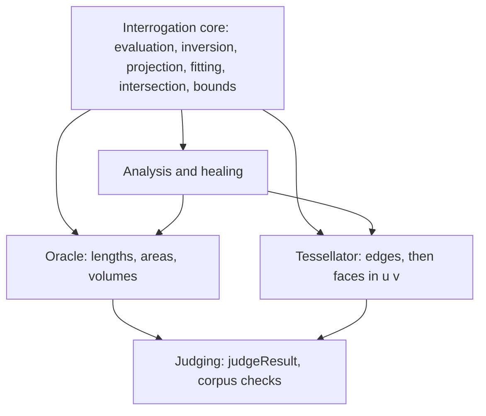
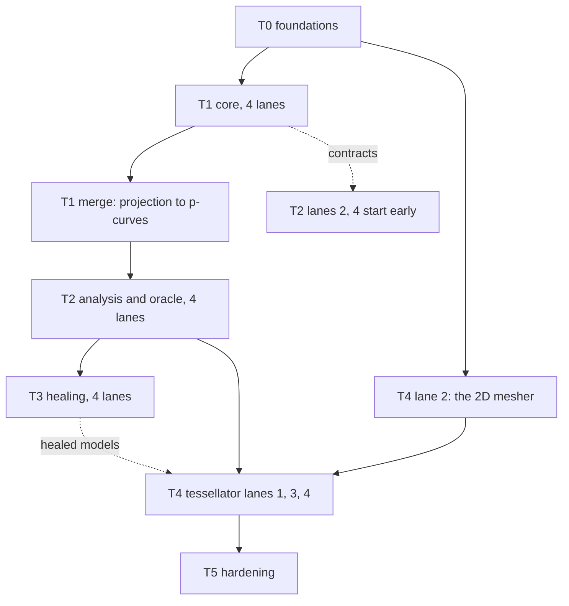

# Our own tessellator and oracle: scope and strategy

A design note for the work after OCCT and SMLib are taken as close to every part as they'll go: a tessellator of our own, independent of OCCT, truck and SMLib and not derived from their code, an oracle of exact measures (lengths, areas, volumes) covering every kind, and what both need beneath them, shape interrogation and healing. It says what each piece must do, why, in what order they're built, and the decisions to be put to the user one at a time. Nothing here is built yet; what exists is in [`shape-interrogation.md`](shape-interrogation.md) (our evaluators and inverses), [`backends.md`](backends.md) (the area oracle, the join, the fill, the fallback), and [`healing.md`](healing.md) (what OCCT's and SMLib's healers do, and how each backend makes missing p-curves).

## Why

- **The backends' limits are their own.** What's left after OCCT, SMLib, the exact join, the per-face fallback and the sliver fill (`backends.md`): 5 of the user's 1,954 parts incomplete, 12 of the corpus's 3,258, most of them faces to mesh again or model defects. Each backend's failures come from inside it (SMLib's tessellator has no fixed-boundary mode, so its retried faces don't meet their neighbours; OCCT's healing grows tolerances without bound and interpolates p-curves unchecked between samples; neither sews), and we can't fix them there (no forks, no upstream reports).
- **Watertight by construction.** Meshing each edge once and every face against those points makes meshes meet exactly along model edges, the user's rule (exact joins, not tolerance merging), without a join pass after the fact.
- **The oracle doesn't cover a fifth of the faces.** Over the corpus (`area_occt.log`) it trusts 63,880 of 82,989 faces' areas (77 %); 18,591 are unsupported, 16,342 of them B-spline surfaces, 1,938 extrusions and revolutions. It has no lengths and no volumes, so it can't judge a mesh's volume or orient a solid's shells on the model (`backends.md`, "Solids' shells facing into the material": the meshes are turned instead, the model left as the source has it).
- **Later uses need it.** The scene is to support geometry processing on loaded B-reps (booleans, other operations) and B-rep exports: those need the same interrogation, healed models and exact measures.

## The pieces

### 1. The interrogation core

What every other piece calls. Today (`shape-interrogation.md`): evaluators for every kind, closed-form inverses for lines, conics and elementary surfaces, and sampled searches with Newton or bisection (`nearestParam`, `nearestParams`) that nothing guarantees.

- **Evaluation with derivatives** to second order on every curve and surface kind (offset, swept, revolved and extruded surfaces, composite and trimmed curves included), with their singular places marked: poles, apexes, a zero offset normal, a revolution's axis crossing.
- **Point inversion, global and guarded:** branch and bound on conservative bounds (a span's control-point hull), then Newton or Gauss-Newton once a minimum is isolated; periods and seams resolved (a closed surface's two parameters for a point on its seam); results with how sure they are.
- **A 3D curve to a p-curve:**
  - exact where a table allows: every kind on a plane (an affine map of points or control points), the iso-lines of elementary surfaces (a circle coaxial with a cylinder, cone, sphere or torus, a generatrix, a meridian: 2D lines), conics whose image in (u, v) is a conic where the parameterizations agree;
  - else a fit, its error measured against the 3D curve between its samples, not only at them (OCCT's healing checks only at its 23 samples, `healing.md`);
  - seams (both p-curves of a seam edge), poles and degenerate ends handled.
- **2D curve interpolation and fitting** with error control, and the B-spline tools under it: knot insertion, subdivision into Bezier pieces, degree elevation, reparameterization.
- **Bounds:** boxes and hulls per span for pruning; derivative or curvature bounds per span, so sampling can guarantee a chord's deviation (a deflection honoured by construction, not by checking afterwards).
- **2D intersection and classification** in a face's (u, v): curve against curve, a loop's self-intersection, a point in a loop, loops' nesting. Trim validation, wire orientation and the triangulation need them.
- **3D line and ray intersection** with surfaces (and faces, trimmed): classifying a point against a solid, for shells' orientation and voids' nesting; picking on exact geometry later.
- **Arc length and its inverse** (the parameter at a length), for sampling by length and for the oracle.
- **Robust predicates** for 2D geometry (orientation, in-circle) in adaptive precision, for the triangulator.
- **Out of scope here:** surface-surface intersection (booleans need it; neither tessellation nor the oracle does).

### 2. Analysis and healing

Analysis before any fix: a report of every problem in a model (each check `validate.ts` doesn't make yet: p-curves against 3D curves, vertices against curves and surfaces, gaps between consecutive edges, loops' orientation and nesting in (u, v), shells' closure and orientation), so the fixes are chosen by what the corpus and the user's models hold, as the canonical model's rules were. Then fixes, as a pass on the model, on by default with one switch to turn all of it off ("Decisions to make"; the README backlog's item; phase 14 kept healing out of the canonical model, since each fix needs a tolerance or geometry), each with a diagnostic, an opt-out, and the tolerance it grew recorded:

- **Missing p-curves** made by the core; **same-parameter** measured (a p-curve against its 3D curve), the deviation recorded as the edge's tolerance rather than hidden.
- **Wires:** order, connection, orientation in (u, v) (SMLib's loop repair is disabled, so our SMLib builder does some of this itself today; `healing.md`).
- **Seams, poles, degenerate edges:** a missing seam added, edges split at seams, apex and pole edges where a face needs them.
- **Gaps:** coincident vertices merged and edges sewn within a stated tolerance (neither backend sews on import), tolerances grown and reported, never silently.
- **Small edges and slivers:** kept and said, or removed; the sliver fill (`fillFaces`) covers the mesh side today.
- **Shells and solids:** orientation by point classification or an exact volume's sign, voids nested and turned to face into the void, closed sheets solids (canonical rule 11 already).
- **A tolerance policy** carried through: the model's uncertainty, what healing grows, what the tessellator honours and the oracle assumes.

### 3. The oracle

Independent of the tessellator (a check that shares the code under test is blind to its bugs: `CLAUDE.md`, "Testing"): measures from the exact geometry by integration, never from a mesh.

- **Lengths:** adaptive Gauss-Legendre on the curve's speed with an error estimate; closed forms for lines and circles.
- **Areas:** Green's theorem over the boundary where the area element has an antiderivative in closed form (today's planes, cylinders, cones, spheres, tori; extrusions and revolutions by their profiles); for B-splines and the rest, either an iterated integral (an inner integral of the area element along v, by Gauss-Legendre per knot span, driven along the boundary) or adaptive cubature over cells of the trimmed (u, v) domain (which needs the core's 2D classification). Both with error estimates; the trust flags as today.
- **Volumes:** the divergence theorem over a closed, consistently oriented shell, reducing to face integrals of the same kind as the area's ($V = \frac{1}{3}\oint\!\oint \mathbf{x}\cdot\mathbf{n}\,dA$); its sign settles orientation on the model; centroids and moments from the same machinery. It needs healed shells: an open shell has no volume.
- **References** to check it by: closed-form shapes in tests (and their scaled, mirrored and moved copies), OCCT's measures (`BRepGProp`) and SMLib's, classified rather than counted.

### 4. The tessellator

- **Edges first:** each model edge sampled once in 3D, within the deflections by the core's bounds, shared by every face using it; its points' (u, v) on each face through the edge's p-curve or the core's inversion.
- **Faces in (u, v):** constrained Delaunay triangulation with the boundary fixed, refined by the error measured in 3D (chord to surface, normal angle), with a metric for the (u, v) distortion (a thin cylinder, a stretched B-spline); seams unwrapped, poles meshed as fans, whole closed surfaces (a sphere, a torus with no edge loops) meshed by their natural bounds; inner loops, curve-bounded faces.
- **Normals** from the surface, **orientation** by the face's sense; **measures** the oracle's.
- **One face again**, inside its neighbours' fixed edges: what the per-face fallback, the join and the sliver fill do today becomes a property of the mesher.
- **The same interface:** a `TessellationResult` per part, so `judgeResult`, the open-edge check, the corpus checks against OCCT and SMLib, the cache and the browser check apply as they are; a backend behind `FallbackTessellator` like the others, primary once it's better.

## The order

1. **The core:** inversion, projection to p-curves, 2D fitting, 2D intersection and classification, bounds. Measured against today's `nearestParam` and `nearestParams` (`brep_geometry`) and OCCT's, on the corpus, with planted bugs.
2. **The oracle:** lengths, then B-spline areas (the 16,342 unsupported faces), extrusions and revolutions, then volumes. It's the judge the tessellator will be measured by, so it comes first.
3. **Analysis, then healing:** the report over the corpus and the user's models; fixes in the order the report says matter.
4. **The tessellator:** planes and elementary surfaces, then B-splines; compared face by face with OCCT and SMLib (`smlib_occt`'s classification), then end to end (`e2e.ts`).

The phases below break these into work that up to four agents can do at once.

## Phases

### How parallel work is organized

- **A phase starts with its contracts.** One agent (the phase's lead) writes the interfaces its lanes meet at (TypeScript types or headers, function signatures, the data each lane produces and consumes, the error and provenance fields) and a stub or reference implementation of each, small and obviously right if slow (a dense sampling where the lane will write a search), committed before the lanes start. Lanes then code against the contract and test against the stubs, so none waits for another.
- **Each lane owns its files.** A lane works in its own checkout (a sandbox, on this machine or another) and branch and touches only its own module and tests; it commits and pushes its branch to GitHub often, so no work lives on one disk, and others fetch it from there; shared files (the package index, `CLAUDE.md`, the README, this note) change only at the merge, by the lead. So lanes merge without conflicts but in the index.
- **Each lane delivers checked work:** unit tests on shapes with closed-form answers, planted bugs one at a time (survivors closed or explained), a corpus check where the lane's function meets real data, and a provenance header per module (the paper, specification or summary it's written from: "Independence and clean room").
- **The merge** is the lead's: lanes merged one at a time, the whole test suite and the phase's corpus checks after each, the contract amended where a lane found it wrong (the other lanes told, their work adjusted before they merge).
- **Lanes are independent by construction, not by hope:** where one lane's output is another's input, the second works from the stub until the merge, and the merge replaces the stub. Phases overlap where noted: a lane of the next phase can start once the contract it needs exists.

### Phase T0: foundations (one agent)

- **Decided before T0:** the language, the rigor and where derived values live ("Decisions to make").
- **The packages:** one per piece (decided): the interrogation core, the oracle, analysis and healing, and the tessellator `tess-cadio`, each with its C++ under `native/`, built to WebAssembly as `tess-occt` and `tess-smlib` are, and its TypeScript layers beside it; the core's C++ a library the others compile in. So each piece can be used alone (the oracle judging the other backends now; a B-rep kernel of our own later), at the cost of the core repeated in each module and the model and the analysis buffer passed between modules. The alternative was one package and module with a library per piece (one build, shared memory, the oracle's independence from the tessellator by a link rule). Their build and test wiring.
- **The shared types:** curve and surface queries (evaluation with derivatives, bounds, inversion results with how sure they are), 2D loops in (u, v), the derived data and its provenance (given, measured, healed), error bounds.
- **The reference shapes:** a test library of models with closed-form answers (lengths, areas, volumes, normals, parameters) for every curve and surface kind, at several scales, mirrored and moved (the existing `cad-brep` test models extended), and the catalogue of degenerate and ambiguous cases ("Degenerate and ambiguous cases") with the answers each query must give, which every lane tests against.
- **The result types for degeneracy:** in, out and on; crossings, tangencies and overlap intervals; inversions with their certainty and alternatives; the record of shared decisions.
- **The check skeleton:** a corpus check per phase, empty until its lanes fill it.

### Phase T1: the interrogation core (four lanes)

The contracts are `packages/cad-geom/native/include/cad_geom/` (`vec.h`, `result.h`, `interval.h`, `model.h`, `curve.h`, `surface.h`, `predicates.h`, `geom2d.h`, `numerics.h`), each with a reference implementation in `native/src/`, slow and simple (lines, circles, polylines and B-splines; planes, cylinders, spheres and B-splines; inversion by dense sampling; plain floating-point predicates), checked against `cad-brep`'s evaluators. Precision far from the origin is a rule of every evaluator (`curve.h`): no derivative or difference formed from absolute coordinates, the local origin (a span's pole centroid, a placement's origin) added to the point only, measured necessary (a B-spline 1e6 mm out on absolute poles: speeds 1e-10 off, arc length not converging at 1e-13; on its span's centroid 6e-13, converging). Each lane owns the sources it replaces: curves `curve*.cpp`, surfaces `surface*.cpp`, 2D geometry `geom2d*.cpp` and `predicates*.cpp`, numerics `numerics*.cpp` and `interval.h`; a header changes only at a merge.

| Lane | Owns | Contract it fills |
|---|---|---|
| 1. Curves | evaluation with derivatives for every curve kind (composite, trimmed, offset included), span bounds (hulls, derivative bounds), arc length and its inverse, point inversion on curves (global: branch and bound on hulls, then guarded Newton) | the curve query interface |
| 2. Surfaces | evaluation to second derivatives for every surface kind (offset, revolved, extruded, swept), singular points (poles, apexes, axes), closedness and periodicity, point inversion on surfaces (branch and bound, Gauss-Newton), seam handling | the surface query interface |
| 3. 2D geometry | robust predicates (adopted or our own: "Dependencies"), 2D curve-curve and self-intersection, point in loop, loop nesting and orientation, for exact 2D curves (lines, conics, B-splines) | 2D classification |
| 4. Numerics | the B-spline toolkit (knot insertion, subdivision into Bezier pieces, degree elevation), 2D interpolation and fitting with error control, Bernstein root isolation, quadrature rules, the arithmetic (expansions, a double-double type) | the numerics interface the other three call |

Lanes 1 and 2 call lane 4's toolkit through its contract (today's `geometry.ts` evaluators as the stub). **Then, at the merge, one lane:** 3D curve to p-curve projection (the exact table, then tracing by continuation, the fit checked against the 3D curve), which needs all four. Checks: `brep_geometry` against the new inversions, OCCT's points as a reference (running OCCT is allowed), the reference shapes at every scale.

### Phase T2: analysis and the oracle (four lanes)

| Lane | Owns | Needs |
|---|---|---|
| 1. Analysis | the derived data ("The input"): measured deviations, edge and coedge ranges, outer loops, adjacency, continuity per edge and face pair, provenance; stored as decided in T0 | T1's inversion and projection |
| 2. Lengths and areas | the oracle's lengths, and areas for every surface kind (free-form by the method decided: iterated boundary integral or cubature over (u, v) cells), with error estimates and trust flags | T1's curves, surfaces and 2D classification |
| 3. Volumes | the divergence theorem over closed shells, centroids and moments, orientation by the volume's sign | lane 2's face integrals (through a contract for an integrand over a face, written first) |
| 4. Point classification | 3D line and ray intersection with trimmed faces, a point against a solid, shells' nesting (which shell is inside which) | T1's surfaces and 2D classification |

Lane 2's package is `cad-oracle` (C++ on cad-geom's core, `native/include/cad_oracle/oracle.h` its contract): edge lengths (cad-geom's `arcLength` over the face API's edge parameters), perimeters, and areas of planes, cylinders, cones, spheres and tori (Green's theorem with the closed-form antiderivative, the 3D edge curves by the closed-form inverse, adaptive Gauss-Kronrod per span) and of extrusions and revolutions (the antiderivative closed in the profile, over the face API's loops), with the flags; `faceIntegral` (lane 3's contract, an integrand of the point and the area vector) on the same faces, by the same engines (`closed.h`, `swept.h`) with H numeric (a composite Gauss-Legendre rule along v, smooth in v, its panels doubled until H settles at the loops' samples), the area riding along as the last component to pick the multiple of the whole surface where the result is known modulo it. Free-form surfaces (B-splines, offsets, rectangular trims) by the iterated boundary integral (`free.h`): the inner integral along the direction that isn't periodic, from b0 at a pole row the face holds (by its loops' net winding, or a gap of the face API's loops along it), else the face's lowest b; where both directions are periodic, from a cut just below the face in the largest gap of its b, each crossing of the cut ending a piece of the loop and the cut's stretches inside the face adding the whole period's inner integral along them; a result known modulo the whole surface (two poles, both periodic) reduced by the area's. Where the surface isn't sound on the strips from b0 (an offset folding, a singular evaluation), the inner direction in bands, each band's top row taken as the cut's (its stretches by its crossings, or the face API's classification where a periodic row has none), doubling to 64 (flagged `cells`). The outer rule is cut at the p-curves' breaks (a projection's pieces' too, from the face API: without its fit's knots the adaptive rule needed 97,000 evaluations on one piece) and where the loops cross the surface's knot lines; the inner rule's panels are set per span between the surface's breaks, a span not settled at 64 integrated adaptively (a patch folding nearly onto itself, |n| near 0, ec_turbine-A #11708: 100 s with fixed panels, 2.8 s so), and the outer rule never asked for better than H's own error. An integrand can vanish on a face but for rounding (a volume's on a plane through its c): each component's absolute tolerance is set from its size near the face (the caller's `scale`, else probed at points off the face, n along each axis), and the inner rule settles against that: a tolerance below the integrand's rounding is never met, and the bisection that confines a projected p-curve's kinks then repeats the failure at every level (hours a face). Checked by the reference shapes at every variant, built faces (pole joints, the other nappe, a torus face across v = +/-pi, revolutions with one, two or no poles; B-spline sphere caps, zones and lunes, torus patches and bands across both seams, a cylinder periodic in v only, a planar patch with a projected hole, an offset folding off its face, `test/free.test.ts`), today's oracle (`area-oracle.ts`) and OCCT's measures classified by OCCT's mesh, free-form faces against OCCT's and SMLib's measures (`corpus_checks/oracle_corpus.ts`; results in `backends.md`'s area oracle). cad-geom's revolution lists no pole where a line profile crosses its axis (the line's range is unbounded, so `closeInFact` has no side to collapse): the oracle finds it in closed form; the tessellator may need it too.

Lane 4, point classification (decided): three layers. The line against a surface in cad-geom (`surface.h`'s `intersectLine`, built): branch and bound on parameter rectangles as inversion's, a rectangle solved where the surface is transversal to the line all over it (|d . n| at least `kLineMargin`, 1e-3, from the partials' boxes, the Jacobian's taken piecewise between breaks so a root on a knot line is proven) by interval Newton (Krawczyk's operator on the line's normal plane, over the rectangle widened by 1e-3 of its size, past a periodic seam too, so roots on shared sides are proven by both and merged), else split down to a contact size (1e-6 of the range's 3D size): contacts are tangencies, conservative ("within tol or too near to tell"), and planes, and cylinders and cones along a generator, answer in closed form (overlaps; a line clear of a cylinder). A line lying in another kind (an extrusion's or a B-spline cylinder's ruling) runs out the budget, said so. The ray against a trimmed face (each crossing classified by the face API) and the point against a closed shell by parity (rays from a fixed set of directions, the first with every hit a clean crossing deciding; a debug option checks a second ray agrees, which the corpus check uses) in cad-oracle, with shells' orientation (`ShellSide`, shared with the volume's sign: `src/shell-side.ts`) and nesting; parity now, winding numbers later; orienting the B-rep itself is healing's step, proposed separately. Alternatives: all three layers in cad-geom (the face API's loops given a C++ contract), several rays required to agree in production.

Lane 2 can start its lengths, and lane 4 its ray-surface intersection, once T1's curve and surface contracts exist, before T1 merges. Checks: `area_occt` and `area_model` extended to every kind (against OCCT's and SMLib's measures, classified), volumes against closed forms and OCCT's, lane 3's and lane 4's orientations against each other (two independent methods), the analysis report over the corpus and the user's models.

**Then, wiring (one lane, not yet done):** `cad-oracle` replaces cad-scene's TypeScript area oracle (`area-oracle.ts`, elementary surfaces only) wherever the library uses one: the measures backends' results carry and `tessellateScene` corrects (`oracleMeasures`, `ORACLE_DISAGREE`), and the judging of meshes that sends faces to the fallback (`fallback.ts`), judging a face's mesh only where `trusted(m, 1e-3)` (the judging threshold, decided: `ORACLE_RELATIVE`'s successor; the area's error, its boundary's bound included, within 1e-3 of it), in the tessellation workers and the browser as the backends run; and what users see (the viewer's face measures, the CLI's) becomes the oracle's area with its error estimate (`FaceMeasure.area.error`, the boundary's bound included), with the flags no estimate covers (sphereSide, loose, orientation, winds, noLoops) said beside it as notes, not a trusted or untrusted verdict; a solid's shells are then oriented on the model, where today the meshes are turned (`orientResult`), by two independent methods checked against each other: the volume's sign (lane 3) and point classification (lane 4, as OCCT and SMLib orient: a point inside the solid by rays against the trimmed faces), the latter not built yet. Until then `cad-oracle` runs only in the corpus checks (`oracle_corpus`, `heal_effect`).

### Phase T3: healing (four lanes, a pass on the model, on by default)

Its order and contents set by T2's analysis report (what the corpus and the user's models need most); likely lanes:

| Lane | Owns |
|---|---|
| 1. Curves on surfaces | missing p-curves, same-parameter measured and fixed, p-curve ends bridged to their vertices, tolerances grown and recorded where edges lie off their surfaces (every face the face API calls `invalidModel` for it: `pcurve_corpus`'s gap section lists them by file and part) |
| 2. Loops | order, connection and orientation in (u, v); outer loops; seams, poles and degenerate edges added where a face needs them |
| 3. Gaps | coincident vertices merged and edges sewn within a stated tolerance, small edges and sliver faces kept and said or removed; edges of one loop within the tolerance of each other near a shared vertex merged up to where they part (`VW.step` #2407's face #294279: edges 85 and 13 meet nearly tangent and run 0.0004 to 0.006 mm apart over their last 0.08 mm, inside the face's tolerance of 0.02 mm, crossing once in (u, v) when sampled finely) |
| 4. Shells and solids | orientation (T2's lanes 3 and 4), voids nested and turned to face into the void, the healed model's validation |

Where the pass runs (as built, cad-heal's `healScene`): at the end of step-import's `importStep` (`ImportOptions.heal`, its progress the import's `healing` phase), after rigid placements, so exports carry the healed models; in `stepconv` after the import, in the backend's worker pool (or one without a backend where nothing is meshed; on the main thread with `-j 0`), `--heal`, `--no-heal`, `--heal-on`, `--heal-off`; in the viewer between the scene and the meshing, in the meshing pool's workers (**Heal B-reps**, its fixes under **Healing fixes**, `?heal=`, `?healOn=`, `?healOff=`, `?healFit=`; Mesh again with other healing settings heals the models again in place, from the source's values their analyses keep). Parts heal in parallel through tess-workers' jobs (`PoolTessellator.run` with cad-heal's `healJob`), the result byte for byte the serial one's, diagnostics in the parts' order. Whether importers heal unless told is one constant, cad-heal's `HEAL_BY_DEFAULT` (false until the trace is fast). Each fix its own module with its diagnostic and opt-out, independent of the others' code; the lead orders them in the pass at the merge (gaps before loops before shells, likely) and checks the pass is idempotent (healing a healed model changes nothing). Checks: the analysis report before and after, the backends' meshes of healed models (OCCT, SMLib), the round trip through STEP.

### Phase T4: the tessellator (four lanes)

| Lane | Owns | Needs |
|---|---|---|
| 1. Edges | each model edge sampled once in 3D within the deflections (guaranteed by T1's bounds), its points' (u, v) on each face through p-curves or inversion; seams and degenerate edges | T1, T2's analysis |
| 2. The 2D mesher | constrained Delaunay triangulation with a fixed boundary and refinement (adopted or our own: "Dependencies"), driven by a size and metric function it's given; knows nothing of surfaces | the metric contract only |
| 3. Surface criteria | per surface kind, the error in 3D of a triangle in (u, v) (chord to surface, normal angle), the metric for (u, v) distortion, seams unwrapped, poles as fans, whole closed surfaces | T1's surfaces |
| 4. The backend | the `Tessellator` interface (requests, `TessellationResult` with faces, edges, measures from the oracle), workers, one face meshed again inside fixed edges, the corpus checks against OCCT and SMLib (`smlib_occt`'s classification adapted) | the contracts of 1-3, stubs until the merge |

Lane 2 is the most independent (pure 2D, testable on its own) and can start as soon as T0 is done. Planes and elementary surfaces first; B-splines once they pass. Checks: watertightness by construction (`openEdges` finds none), `judgeResult` on every part, areas against T2's oracle, end to end (`e2e.ts`) against OCCT then SMLib.

What the mesher (`tess-cadio`'s `cdt.cpp`, `mesh2d.cpp`) needs that isn't obvious:

- **Cavities Delaunay in the new point's metric.** Inserting metric circumcentres with Euclidean Bowyer-Watson cavities rebuilds triangles that are slivers in the metric, so anisotropic refinement never ends (a unit square at aspect 10: 385,810 points for about 4,600). The in-circle test runs on points mapped by the Cholesky factor of the metric at the new point (Borouchaki and George), with the cavity made star-shaped from the point.
- **No fused multiply-add, no libm in decisions.** clang fuses on arm64 and WebAssembly can't, and `acos` or `tan` differ between C libraries; either makes refinement decide differently per target. The angle test is the sine of the smallest angle from the metric's cross product and square roots; the threshold's sine and the off-centre's tangent are series of our own.
- **A relative floor for points near a vertex:** a tenth of the triangle's shortest metric edge (or of a metric unit if shorter). A fixed floor blocks refinement wherever the metric's size exceeds the features.
- **Ungor's off-centre** at height (l/2) / tan(minAngle/2) over the edge; tan(minAngle) puts points nearer the edge than circumcentres do, and more of them.
- **Split requests only where they're needed:** a segment is wanted split when the triangle refused for encroaching it is still in the mesh and either the segment is longer than sqrt 2 in its endpoints' averaged metric, or `accept()` still refuses that triangle, or the segment is longer than 4 times that triangle's longest edge (a long fixed chord under a fan of slivers whose candidates all encroach it, which nothing else ever splits). Any encroachment alone reports the next segment along, round after round, without converging. A candidate that leaves the domain names the segment the ray from the triangle's centroid crosses first (a straight walk through the triangulation, `firstConstraint`), under the same rule; without it, a face narrower than its boundary chords' sagitta (strips 0.003 wide on a sphere of radius 4.5 at 0.1 mm: triangles with every corner on the boundary, their facets 80 degrees off the surface's normals) keeps its refused triangles and asks no split.
- **Edge spacing from the face too:** a chord on a curve of radius r strays s^2 / 8r, so an edge sampled coarser than the deflection allows leaves triangles that can never pass; and a straight edge on a curved face (a cylinder's seam) needs spacing near the width the face's triangles must have, or its skinny neighbours encroach it.

- **The edges' angle as the tangent's turn:** every C'(t) over a span lies within s max|C''| / 2 of C'(mid), so any two tangents are within 2 asin of that over |C'(mid)|; a span passes when s max|C''| <= 2 |C'(mid)| sin(angle / 2), nearly exact on an arc, and one that fails is split into as many pieces as the turn sampled at 9 tangents asks for, with a tenth to spare (the bound's own count over a long B-spline span is several times too many, its pieces bounded again passing far sooner), at most as many as the bound asks and none with a length bound under the floor of 10 x the tolerance; a cut within the tolerance of the one before or of the span's end is dropped (equal parameter steps near a nearly vanishing speed make chords far shorter than their bounds).
- **A sample where a span passes over a pole:** an edge a little off its surface can have its foot at a pole inside a span (`offPoleArc`'s arc, 7e-4 inside its sphere, under the north pole), the free coordinate then jumping by about half a period between the span's samples and its unwrapping a toss-up that flips with where the samples fall; such a span (a jump over a quarter period) gets a sample at its point nearest the pole when that point's foot is the pole, so the loop crosses the pole line the face's way and the cut is decided on samples a later split can't change.
- **Poles as fans (`part.cpp`):** a run of a face's boundary points at a pole or apex (on its row in (u, v)), between regular points on one side of the row (neither all but on the row itself: a sample inverted to the pole from an edge a little off its surface leaves the pole line as it is), is replaced by a ring of points at one radius from the row, and the ring's chain (the run's neighbours at its ends) is joined to the pole in 3D by triangles made outside the mesher, in pieces of at most 22.5 degrees about the pole (the angle measured about the surface's own singular point: the run's sample there may be off it by the part's uncertainty, an edge a little off its surface passing through the pole by that tolerance, `offPoleArcLoose`). The pole line is one point in 3D, so a triangle the mesher finds well shaped in (u, v) can have its two other corners on one meridian: the slivers it refused and refined towards without end. The ring is the pole's (`poles.cpp`, by "A pole's ring" below): each face's poles by case, the radius by the rule, one reach per pole across the part's faces, and the ring cut into the curves through the pole (`EdgeMesh::cutRings`) before any face is meshed, so the run's neighbours are the curves' crossings of the ring; the ring in pieces by the edge rules (`ringPieces`), and an end off the row by over half as much again (a curve whose crossing at the shared reach is farther out in this face's fixed coordinate) reached along its own row of the free coordinate. The pole is a point of its own per fan, the run's edge sample there where it has one. The ring is fixed: the mesh's requests to split its segments are ignored, and the refinement rounds never refill the edges' spans inside it.
- **Natural extents (`edges.cpp`):** a face with no edge loops (none, or vertex loops only: `pr_3-sy`'s whole torus and sphere) is its surface's natural extent where that closes: periodic in one direction with poles at both ends of the other (a sphere, a B-spline ball either way round), one loop along both pole lines and the two copies of a pseudo-edge from pole to pole; periodic both ways with no singularity (a torus), one loop of the two copies each of a closed pseudo-edge along each direction, meeting at one corner. The cuts lie half a period from the vertex loops' points, which the mesh keeps as points. A B-spline face with no edge loops is its whole knot rectangle (a face without bounds is the whole surface, and a B-spline's is bounded), closed in neither or one direction: four sides, each a pseudo-edge along its iso-line or, where the side is a collapsed row, a pole line; a closed direction's two sides one pseudo-edge (the cut) used twice, the other sides closed pseudo-edges. Anything else (a whole plane, cylinder or cone) stays unsupported.
What the surface criteria (`tess-cadio`'s `criteria.cpp`) do:

- **A local, anisotropic metric:** at each (u, v) the principal curvatures and directions (the second fundamental form against the first); along each direction the size the smaller of sqrt(6 d / |k|) (an equilateral triangle's centroid strays h^2 |k| / 6), angle / |k| and the face's 3D extent; in 3D sum e_i e_i^T / h_i^2, which is conservative in every direction between them, pulled back to (u, v). Where the parameterization degenerates (a pole) the point's own is skipped. Its sizes at most 1000 apart: in 3D on elementary surfaces (through the first fundamental form, the grid's metric at its nodes and the point's own at the point, a pole's in (u, v)); in (u, v) on free-form ones, where the ratio is the 3D one times the parameterization's distortion, and it also stands in for the surface's twist, which the metric doesn't model (how fast the principal directions turn: long triangles along them leave a twisting surface). In (u, v) on a cylinder of radius r it capped the size along the axis at a few times across (as1_motor's 22.6 m cylinder at 8.66 mm, its straight edges in thousands of segments).
- **Graded:** the metric on a 17 x 17 grid over the face's (u, v) box, each node intersected with its neighbours' grown by their distance (Borouchaki, Hecht and Frey: M / (1 + 0.5 L)^2), a query the grid's interpolated, intersected with its own point's. The intersection is by the symmetric form (Cholesky of one, eigenvectors of the other in its frame): the form by A^-1 B's eigenvectors loses all precision when the two are nearly proportional (a 10^14 metric on a sphere's cap).
- **No boundary fit:** the edges' own sampling by derivative bounds already comes out finer than the faces ask (Meusnier: an edge's curvature is at least the surface's normal curvature along it); where a face wants more (a cylinder's straight edges beside triangles round it) the split rounds do it, up to 48 (the user's choice: on a9's 656 parts 48 rather than 24 mended 19 faces and failed none new, past-deflection 27 -> 16, for 4.8% more CPU, firetherm #168383 111 -> 217 s; earlier, up to 24 at the first that asks for no split, so the cap costs only where faces still refine; on a subset of 406 parts 8 rounds failed 49 faces and 24 failed 15, at about half the CPU, refinement converging instead of thrashing).
- **accept()'s deviation bounded where the bound is tight:** on planes, cylinders and B-splines by the second derivative bounds over the triangle's (u, v) box (|S - L| <= (1/2)(a_u du^2 + a_v dv^2) at the triangle's smallest enclosing circle in coordinates scaled by a_u = M_uu + M_uv e, a_v = M_vv + M_uv / e, e = Dv / Du), on spheres exactly (R less the centre's distance to the triangle); sampled elsewhere (the centroid and edges' middles), the faces so judged counted in the diagnostics and in `cadio_corpus`. Sampled first even where bounded (it never overestimates, so its refusals are sound, and it spares the bound the many large triangles refinement refuses), then the bound over the whole box, then, only where that isn't enough, over the box cut at the surface's breaks and 2 x 2 (a B-spline's derivBound is its spans' hulls across a knot; within one span its centred form shrinks with the box). cad-geom's rational B-spline partials are bounded by the quotient rule in intervals as well as in magnitudes (the magnitudes lose the signs: 1.2 x loose at +-0.01 on a dome, the intervals 1.02 x). On cones and tori the magnitudes count S'''s tangential parts, which don't take a point off the surface, so they're bounded by their distance functions instead: g, the distance to the surface (or an upper bound on it) positive inside the solid, concave over the facet, so g(x) <= g(c) + grad g(c) . (x - c) at the centroid c, the most at a corner. A cone's g is the distance to its generator in the meridian plane (concave as the distance to the axis is convex; from inside the solid nappe the foot is always on the nappe's ray); a torus's is r less the distance to its core circle, concave only where the triangle stays on the outer half (t = s - R >= L at the centroid): on the inner half the Hessian's terms make the bound 5 x loose on a chord round the axis (it doubled the triangles), so there it samples. Each face whose triangles were ever sampled is counted (SurfaceCriteria::bounded is false once any was). The sampled measure, |S(x) - L(x)| at the barycentric (u, v), is at least the distance there, so it over-refines where S''s tangential part is large: on a cone near its apex 27 x (pr_3-sy's face 262, 3,199 triangles sampled, 117 bounded).
- **A triangle under 1e-4 of the deflection across is accepted:** at such sizes its facet's normal is rounding, and refinement chased one B-spline's degenerate spot to its point cap (trj7_k1-id's face 2160, 100,181 points in 257 triangles 1e-14 mm across).
- **The normals stay sampled** (the corners' within the angle of one another and of the facet's): a bound through |d(S_u x S_v)| / |S_u x S_v| runs far past the turn where the parameterization shrinks (2 / cos^2 v times it on a sphere: a hemisphere's 555 triangles became 40,918).
- **Near a pole the surface's distance itself:** a triangle with a corner within twice its size of a pole or apex that the bound or the sample refuses is judged by its points' distances to the surface instead (7 points, each to the nearest surface point a few damped Gauss-Newton steps from its barycentric (u, v) find, within 0.9 of the deflection), its face then counted as sampled: there a triangle wide in u is small in 3D, S's tangential part is large and a bound over its (u, v) box reaches far from it, so both refuse what is within the deflection (`bsplineDome` near its pole). An upper bound on the distance at each point, a sample over the triangle.
- **Apex-like rows, no normal to hold to:** a pole whose normals just off its row (at a thousandth of the deflection from it, over the face's runs along the row) spread by more than the angle is apex-like (`poles.cpp`, one measure for the fans and the criteria): a cone's apex, a B-spline's row collapsed at an angle (`Albatros` #787's face 5754, its normal's limit 61 degrees apart across 11 degrees about the point). Its fans are judged by their deviation alone (`SurfaceCriteria::acceptDeviation`): there's no normal at the point to hold a triangle's to. Outside the ring every check applies, `accept()` holding triangles near an apex to the angle as anywhere (its waiver within the deflection of such a point went with the fixed ring: refinement towards the point made needles whose facets stood on edge until the point cap, 200,245 triangles; the ring now keeps the mesher out of that zone). A sphere's or a dome's pole has one limit, its fans held to the angle. Where a ring is floored at half a small clearance (bsplineApexHole's, 5e-5 from the apex), the few triangles between it and the boundary, under 1e-4 mm, can still miss the angle there: the refinement floor takes them.
- **No area check on a facet's tilt:** with its corners on the surface and its normal within the angle of theirs, the patch a facet stands for is a graph over it and at least its area; a mesh's area exceeds its face's only where boundary chords stand for a region past the boundary curve: most where a boundary curve bends within the surface (a circle along a torus's top or bottom, its whole curvature 1 / R in the tangent plane), each chord then adding its circular segment, R^2 (a - sin a) / 2, to the face (a fillet torus of R 18 and r 1 in `r103ec` 2.4% over at medium, its top circle's 5 chords' segments 0.78 mm^2 of 25, the interior's flattening taking back 0.19; OCCT's mesh of it 0.24% under, its top circle in 7 chords, each turning about half the angle).

### Phase T5: hardening (up to four lanes)

**The coverage goal (decided):** every salvageable face of the corpus (`files.txt`) and the user's models (`test_corpus/models/`) meshed by our tessellator, healed where it needs to be: a face without our triangles is our defect, in the tessellator or in healing. Input beyond repair is recognised, said in a diagnostic with its cause, and meshed as far as it reasonably can be; what counts as beyond repair is a decision for the user, made on the corpus's examples, and the corpus checks count those faces apart from failures, every face and part accounted for by cause. Input from recent Parasolid kernels (the user's Onshape models) is all to be taken as correct and meshed one way or another, small faces (a face within its part's tolerance, LMP1 #1087410) included; for such faces, what OCCT and SMLib produce is a reference where they succeed (their meshes, never their source), not a limit: both fail on some of these faces, which is much of why this tessellator exists, and there ours must succeed without one.

The corpus and the user's models through the new tessellator, its failures classified (as `smlib_occt` classified SMLib's) and each class a lane: a fix and its test per class, merged one at a time. Then performance (the WebAssembly build, workers, the cache), the deflections honoured at every scale, and the decision, the user's, of when it becomes the primary backend, with OCCT and SMLib its fallbacks and references.

### Dependencies between phases

T3 and T4 can run side by side (eight lanes is more than the four wanted; so T3 first, or two of each), since the tessellator takes canonical models whether healed or not; healed models improve its results but aren't needed to build it.

## The input: the model, and what's derived from it

The tessellator (and the oracle and healing) take a part's B-rep model (`brep-reference.md`), canonical by construction. What they need that the model doesn't hold is derived from it, since the model keeps only what a source says (rule 7: what a source leaves out stays absent, so import is exact and a round trip faithful):

- **Tolerances as measured.** The model has a tolerance per vertex, edge and face and the part's uncertainty, `NaN` where the source gives none, which from STEP is nearly always (it gives the uncertainty alone; the exceptions are the vertices joining curve-bounded segments, whose tolerance is their gap); formats with tolerances per entity (OCCT BREP, Parasolid's) would fill them. What a mesher needs is how far the geometry actually disagrees: a vertex's distance from its edges' curves and its faces' surfaces, an edge's p-curves' deviation from its 3D curve (same-parameter), a loop's closing gaps. These are measured, kept beside the given tolerance, not in place of it (the source's claim and the measurement answer different questions); the tessellator takes the largest of the uncertainty, the given and the measured as the distance within which points are one, and healing that grows a tolerance says so by the measured value, the given one still visible.
- **Parameters:** each vertex's parameter on its edge's curve (the edge's range), each coedge's p-curve range, where the source doesn't give them (today `NaN`, every consumer searching again: the oracle through `edgeParams`).
- **The outer loop** of a face where the source doesn't say (decision 40 leaves it to consumers: 3,182 corpus faces with several `outer` loops, 3,256 with all `unknown`).
- **Continuity across each edge** (C0, G1, G2), per edge and pair of faces (so non-manifold edges too): normals shared across smooth edges, the angular deflection's meaning there, and decision 17 settled.
- **Surface and curve facts:** singular points (poles, apexes, a revolution's axis), whether a B-spline closes or is periodic in each direction, parameter domains, each face's (u, v) box.
- **Adjacency:** a vertex's edges, an edge's coedges and faces.
- **Results with their accuracy:** the oracle's measures, a shell's orientation sign, each with its error bound.
- **Provenance on every derived value:** given (from the source), measured (by analysis), or set by healing, so nothing computed passes for the source's.

They live in a companion analysis buffer (decided, (B) below), its rows keyed by the model's and tied by the model's hash to exactly the model it describes, so an edited or healed model never keeps stale analysis. The alternatives were:

- **(A) Analysis tables in the model's buffer:** optional tables, empty until a model is analysed; one format and one generated header for every consumer (C, Rust, TypeScript), a format version (`MAGIC`) bump.
- **(B) A companion analysis buffer**, its rows keyed by the model's: the canonical format untouched, the analysis versioned apart; consumers take two buffers.
- **(C) Computed inside each consumer:** no format change, but the oracle, healing, the tessellator and exporters can't share results, and each computes again.

## Independence and clean room

- **Independent of the three backends.** Our tessellator, oracle, healing and interrogation core use none of OCCT, truck or SMLib (usd-brep): not linked, not called, not ported. They stay what they are today, backends and references: the corpus checks compare against them, and a classification of where they and we differ decides who's right, by the standard and the evidence (`CLAUDE.md`).
- **Not derivative of their code** (OCCT is LGPL-2.1 with its exception; truck and SMLib are Apache-2.0, permissive, but the user keeps the code free of their expression too, so every future license stays open). The clean-room protocol (`docs/licensing.md`):
  - **Two sides.** The *reference* side may read the backends' source and writes only behavioural summaries: what a backend does, in prose, with the cases it handles and the constants it uses, never code, pseudocode that mirrors its structure, its comments or its identifiers (`healing.md` is one). The *implementing* side never reads the backends' source; it works from those summaries, the specifications (ISO 10303-42, the recommended practices) and the literature (Piegl and Tiller; Shewchuk; Patrikalakis, Maekawa and Cho; the papers each module cites).
  - **A new session implements.** The session (and its agents) that read OCCT's, truck's or SMLib's source for the summaries doesn't write this code; implementation starts in a fresh session whose agents are told not to open `third_party/OCCT`, `third_party/truck` or `third_party/usd-brep` (only the summaries in `docs/`), and say so in their commit messages.
  - **Provenance per module:** the paper, specification or summary each module is written from, in its header; constants justified independently (by measurement or the literature), not by what a backend uses.
  - **Running the backends is fine:** as oracles in tests and corpus checks, their outputs compared with ours; their behaviour may be described further whenever a summary is missing something, by the reference side.

## Degenerate and ambiguous cases

Real models are full of cases where the answer is not one isolated point or a clean yes or no, and where answering each query on its own (each sample projected alone, each intersection computed alone) gives answers that contradict each other. The core and everything on it is to be built for them from the start, not patched for them later:

### The cases

- **Overlapping curves.** Two p-curves (or 3D curves) that coincide, exactly or within the local tolerance, over a stretch of nonzero length: a seam's two uses, a boundary shared by two loops, an inner loop touching the outer along a side, a duplicate edge. An intersection that returns only points misses them or returns a cloud of near-tangent points; the result has to be intervals of overlap as well as crossings. (Skia's PathOps treats coincident runs as such: one reason it's among the candidates.)
- **Tangencies and near-tangencies:** curves that touch without crossing, or cross at a grazing angle within the tolerance: double roots, ill-conditioned crossings; a loop tangent to another (pinched faces), an inner loop touching the outer at a point.
- **Ambiguous projections.** A point or a curve at the same distance (exactly, or within the tolerance) from two places on a surface: a curve on a parabolic cylinder's plane of symmetry, off the surface, equidistant from its two folds; a point near a surface's focal set, where nearest points jump. Projecting each sample on its own can alternate between the branches and give a p-curve that zigzags across the surface.
- **Parameter singularities:** poles and apexes (u undefined; a p-curve through a pole jumps in u; normals undefined there), degenerate edges, B-spline surfaces with collapsed rows of control points, rational weights near zero, zero-speed points of curves (cusps, repeated control points) where arc length and Newton steps fail.
- **Periodicity:** a point on a seam has two (u, v); a curve along a seam, or crossing it; a full circle from a vertex to itself (its range 0 to 2 pi or nothing); loops winding around a periodic direction (bands with two "outer" loops, a torus's minor winding), where "inside" depends on the unwrapping.
- **Non-injective surfaces:** self-intersecting surfaces (a spindle torus, an offset surface past its curvature radius, a B-spline folding back), where one 3D point is two (u, v) and a triangle can be inside out in 3D though right in (u, v).
- **Sizes against tolerances:** edges shorter than the tolerance, vertices nearer each other than the tolerance, faces narrower than the deflection (slivers), gaps wider than the tolerance (loops that don't close, vertices off their curves), tolerances given smaller than what's measured, features tiny against a large part, coordinates far from the origin (where double precision runs short).
- **Topology on the edge of validity:** non-manifold edges (three or more faces) and vertices, an edge used once in a closed shell, coincident or duplicated faces, a point exactly on a loop or a face's boundary when classifying.

### How they're handled

- **Results that can say "on", "overlapping" and "ambiguous".** Classification answers in, out or on (within a stated tolerance); intersection returns crossings, tangencies and overlap intervals; inversion returns its point with how sure it is (unique, or several within the tolerance, with the alternatives). No query hides an ambiguity in a single number.
- **Decided once, shared everywhere.** Each geometric decision (where two loops meet, whether two points are one, which branch a curve is on) is made once and recorded, and every later query uses the record, so the mesh and the classification can't disagree with each other; topological consistency first, then geometry within tolerance (the approach of robust B-rep kernels and of Shewchuk's work on consistent predicates).
- **Tracing by continuation, not independent samples.** A projection of a curve onto a surface (and later an intersection curve) is traced: started from a point where the answer is unique by a margin (found by global search, at a vertex whose (u, v) is known, or where the edge's neighbouring faces fix it), then advanced along the curve by predictor (the tangent of the projection, from the implicit function theorem) and corrector (Newton) steps, the step shortened where the minimum's separation from other candidates shrinks, and a fold or branch point detected (the distance's Hessian going singular) and crossed or reported, the branch chosen to stay continuous and to land on the edge's other end's known (u, v). Global search seeds it and checks it; it doesn't replace it.
- **Exact predicates where answers are signs** (orientation, in-circle); tolerances everywhere else, from the model's (given, measured) and the part's uncertainty ("The input").
- **Simulation of simplicity for exact ties** (Edelsbrunner and Muecke, "Simulation of Simplicity", ACM Transactions on Graphics 9(1), 1990): a tool for the cases where a decision must come out one way or the other and the data make it an exact tie (cocircular or collinear points in the triangulator, events at one parameter, equal candidates). The inputs get a canonical order (by the model's rows, say), shuffled pseudorandomly with a fixed seed (deterministic, as the output must be; the shuffle avoids a spatial bias that a raw order such as by coordinate would put into the results), and every tie is broken as if the inputs were perturbed infinitesimally in that order, so all decisions stay mutually consistent. It settles exact ties only: a tie within a tolerance is a geometric question, decided by the tolerance or reported as above. Worth it where a consistent tie-break is all a component needs (the triangulator, a sweep's event order); maybe not elsewhere, for its cost in code and in time: a choice to make per component, the tool known to every lane.
- **Reported, not silently resolved.** An ambiguity that can't be settled within the tolerance is a diagnostic naming the entities, as the importer's are, and the result says what was assumed; healing (T3) is where a source's ambiguity is fixed, with its opt-out.
- **A catalogue of these cases as tests:** T0's reference shapes include one model for each case above (overlapping and tangent loops, a curve on a parabolic cylinder's symmetry plane, poles, seams, a spindle torus, slivers, far coordinates, non-manifold edges), with the answer each query must give; every lane tests its functions on them, and the corpus checks count how often each case occurs in real data.

## Dependencies

Libraries for specific subfunctions, each a decision for the user when its step comes, under these licenses (the user's rule, 2026-11-14, keeping future licensing open): permissive ones (MIT, BSD, ISC, Apache-2.0, Boost, zlib, public domain); MPL-2.0 (file-level copyleft: a file of theirs we modify, which is unlikely, is offered as source); and LGPL where the library is a module a consumer could replace, as `tess-occt` is (its own package and WebAssembly module, loaded through `init`, so a user can build and swap in their own). Not GPL or AGPL, and nothing with a non-commercial clause. Surveyed 2026-11-14, licenses checked on the repositories (an agent's survey, the main ones checked again by hand); what each is for, the leading candidates, and what to watch:

| Subfunction | Candidates (license) | Notes |
|---|---|---|
| Robust predicates (orientation, in-circle, in-sphere) | Shewchuk's `predicates.c` (public domain); `robust-predicates` (Unlicense, TypeScript port); georust `robust` (MIT/Apache, Rust); geogram's PCK (BSD-3: generated predicates, symbolic perturbation) | `robust-predicates`' y axis points down, so its `orient2d`'s sign is the opposite of Shewchuk's |
| 2D constrained Delaunay, with refinement | Spade (Apache-2.0 / MIT, Rust: exact predicates and Ruppert-style refinement by angle and area); geogram's `CDT_2d` (BSD-3: exact, intersects crossing constraints, no refinement); delaunator with Constrainautor (ISC, JS: no refinement, no Steiner points); artem-ogre's CDT (MPL-2.0: robust, Shewchuk's predicates, header-only, no refinement) | geogram's tree bundles tetgen (AGPL) and Triangle (non-commercial): build without them. Shewchuk's Triangle itself is excluded (non-commercial clause) |
| 2D curve intersection, classification, booleans | Skia's PathOps (BSD-3: exact quadratics, cubics and conics; heavy to extract); kurbo (Apache-2.0 / MIT, Rust: Bezier tools, arc length, nearest point, curve-line intersection, offsets; no booleans); flo_curves (Apache-2.0, Rust: cubic intersection and booleans, one maintainer); for polylines Clipper2 (Boost; the maintained repository is PolyClipping/Clipper2, the old one archived), Boost.Geometry (Boost), iOverlay (MIT/Apache) | none does trimmed NURBS p-curves directly: PathOps' conics cover rational quadratics, the rest by our own classification on the core's bounds |
| Convex hulls | our own (a 2D hull is a monotone chain on the robust `orient2d`); 3D if needed quickhull3d (MIT, JS) | Qhull's license is permissive but asks for notices of changes: not worth it |
| NURBS evaluation, knot insertion, degree elevation, projection, intersection | curvo (MIT, Rust: closest points on curves and surfaces, curve-curve and curve-surface intersection, adaptive tessellation; its dependencies permissive: nalgebra, spade, robust, argmin, gauss-quad); openNURBS (McNeel's own permissive terms: evaluation, knot insertion, degree elevation; large); tinynurbs (BSD-3, small, basics only); verb (MIT, abandoned since 2015: algorithms to read) | no permissive library does robust surface-surface intersection (not needed here) |
| Interval and extended arithmetic | Shewchuk's or geogram's expansion arithmetic (exact signs), a double-double interval type of our own by error-free transformations; Boost.Multiprecision `cpp_bin_float` (Boost: a slow, precise oracle mode) | **WebAssembly has no rounding modes**: interval libraries that switch the processor's rounding (Boost.Interval) give wrong enclosures there silently; outward rounding must be in software. QD (LBNL's BSD-like license) has a grant-back clause: flagged |
| Polynomial roots, nonlinear solves | cyPolynomial (MIT: bracketed real roots of any degree); Boost.Math's root finders (Boost: Newton, Halley, TOMS 748, cubic and quartic); Eigen's polynomial solver (MPL-2.0, unsupported module); Bernstein root isolation our own (Descartes' rule and de Casteljau subdivision) | |
| Quadrature | Boost.Math (Boost: adaptive Gauss-Kronrod, tanh-sinh, with error estimates); or our own Gauss-Legendre and Kronrod (tabulated nodes) | QUADPACK (public domain) as a reference |
| Spatial indexing | flatbush (ISC, JS, static); rbush (MIT, dynamic); nanoflann (BSD-2, C++, k-d tree) | |
| Later, around the mesh | Manifold (Apache-2.0: robust mesh booleans, watertightness, a wasm package); meshoptimizer (MIT, already a dependency of the glTF exporter's meshopt) | linear algebra: Eigen (MPL-2.0; some optional dependencies GPL: not to be enabled), nalgebra (Apache-2.0), glam (MIT/Apache), gl-matrix (MIT) or small solves of our own |

LGPL candidates, if a permissive or MPL one falls short (each in a module of its own, replaceable): GMP and MPFR (exact and arbitrary-precision arithmetic), MPFI and filib++ (intervals), CGAL's LGPL parts (its kernels and number types; most of CGAL, its triangulations among them, is GPL: excluded), mmg (remeshing). Their licenses to be checked again when considered.

Licensing duties to carry: Apache-2.0 dependencies' NOTICE files and patent terms kept with our distribution; MPL-2.0 files we modify offered as source; an LGPL module kept replaceable (its own package, built by a script a user can run, its license beside it); Rust dependency trees checked transitively (`cargo deny`); a library's license checked again when it's adopted (they change: Clipper2 moved, openNURBS' wording isn't a standard SPDX license).

## Decisions to make

Each to be put to the user when its step comes, with these alternatives and what's measured by then:

- **Language (decided):** C++ compiled to WebAssembly, with TypeScript layers where they fit, in the package `tess-cadio`: libraries for the subfunctions (Eigen, MPL-2.0, for any significant linear algebra), operator overloading (interval or exact arithmetic), speed, a toolchain we already use for OCCT and SMLib. The alternative was TypeScript throughout (one language, no build step, the evaluators already there).
- **Results across platforms (decided):** not bit-identical, and not made so: native builds and WebAssembly may differ in the last bits (each platform's libm, the compiler's fused multiply-add, Eigen's vectorized reductions), and a mesh may then differ in its triangles, as long as the differences are tiny and every check judges results with tolerances rather than by hashes across targets. Speed on each platform and a contained codebase come first: no vendored math library, no vectorization turned off for agreement. It stays a judgement call case by case: where a platform's behaviour changes a result meaningfully (a face that fails on one target and meshes on another, a verdict that flips), avoiding it is justified if its cost in speed and complexity is low, and the user decides. On one platform, the same input still gives the same bytes. Measured: native and WebAssembly meshes differed on 23 of 30 parts (2.stp #262: 6,398 triangles against 6,218), from libm (sin, cos, atan2, hypot, pow and others; Apple's __sincos_stret) and Eigen's NEON sums in the fit; vendoring musl's math under our own names and turning Eigen's vectorization off made them agree. The alternative was those two changes and a cross-target hash check.
- **Rigor (decided):** floating point with a posteriori error estimates, and interval arithmetic (outward rounding in software, since WebAssembly has none) only for the bounds that prune searches and guarantee deflections; signs (orientation, in-circle) by exact predicates. The alternative was certified results throughout (interval arithmetic everywhere: every bound holds, at several times the cost where it's used).
- **Where healing changes the model (decided):** a healing pass producing a healed model in the scene (run at the end of the importer, so exports carry it too), off by default for now, in the library, the viewer and the CLI (decided): measured at own-tessellator 1fce650 it helps every backend on the corpus's defective files (OCCT 157 faces gained and 5 lost, SMLib 3 and 0, ours 50 and 25, the oracle's trusted areas 65,449 -> 78,575), but on correct input (the user's Onshape models) it changes almost nothing (OCCT 43 -> 46 failed faces, SMLib 64 both ways, ours 2,310 -> 2,326) while adding to the load (a median 0.38 s a file against 0.22 s to import in the viewer's 8-worker pool, LMP1 79 s against 13.6 s), so it waits until it is cheaper on large models and no longer costs faces on correct ones; the alternative was on by default everywhere, for the defective files' gains. With healing on, the pass is so that every consumer sees the same repairs (the tessellators, the oracle, the exporters, later B-rep operations), as the repository's other fixes for imperfect input are; each fix with its diagnostic, and one blanket switch that turns all healing off (an option in the API, a CLI flag on every tool that imports, a checkbox in the viewer), the model then exactly as imported; with healing on, finer options turn particular fixes on or off. The alternatives were the pass opt-in (the model as imported unless asked) and healing inside the tessellator only (meshes healed, the model left as the source gives it, as `orientResult` does; every other consumer healing for itself or seeing the defects).
- **A source p-curve off its edge (decided):** healing replaces it with the projection where the projection is nearer to the edge's curve, measured both ways (the p-curve's points from the curve, and the curve's points from the p-curve's image), and grows the tolerance to what remains; elsewhere it keeps the source's p-curve and grows the tolerance; a p-curve whose image is within the tolerance but whose parameter isn't the curve's is reparameterized (an affine map of the range where that suffices, exact). Most edges past their tolerance are curves off their surfaces, which only growth fixes (about 11,000 of 12,100 in the corpus), so replacing changes few counts; it matters on gross defects that growth can't fix (`pr1db`'s p-curves collapsed along a surface's row, 25 to 100 mm from their semicircles), and measuring both ways finds 1,407 given p-curves farther than they look one way. The alternative was keeping every source p-curve and growing the tolerance to cover it.
- **How far healing grows a tolerance (decided):** without a cap, as OCCT's and SMLib's healers do (a gap over 1 mm alone stopped none of the backends; the corpus has 15 past 1 mm, up to 263 mm, the user's models 2.06 mm); whether such an edge is salvageable at all is the beyond-repair line's question, not the cap's. Each growth is reported by its ratio to the tolerance it started from (the shared tolerance function's, so 1e-5 mm or 1e-9 x the part's size where the part states none): a warning up to 5 x, an error past it unless the grown tolerance is still no more than 0.01 x the part's size (its vertices' box diagonal), since errors are what consumers stop on (the viewer's modal) and a gap that small against the part, however tight the stated tolerance, isn't worth stopping for. The alternatives were an absolute cap of 1 mm, a cap relative to the part's tolerance and one relative to its size, each leaving faces OCCT and SMLib mesh failed.
- **Growth healing calls an error is not a repair (decided):** a face with an edge, or a vertex its loops pass through, whose tolerance healing grows past its error limit (past 5x its starting tolerance, the larger of the given tolerance and the part's uncertainty, and past 0.01 of the part's bounding box diagonal) is input beyond repair: the mesher fails it at once, with a cause naming the edge and its growth, without sampling or meshing at that tolerance, and the corpus checks count it on the beyond-repair line; the part's other faces mesh as usual. Healing still grows the tolerance and says so, so the model records the gap. Measured on the corpus with healing on: `bug25415` #418's 13 faces of 14 (two line edges 2.39 and 0.44 mm off; 5 edges and 10 vertices flagged, a vertex grown from 1e-5 to 3.32 mm on a part 8.73 mm across, most edges' growth from their vertices; by flagged edges alone 7, by the uses whose own curves are off about 2) and `bug29979_firetherm_12` #174483's 10 (8.5 mm lines 20 to 200 mm off their faces, an edge grown from 1e-5 to 289 mm, after which the whole healed part ran past 600 s of CPU sampling its edges). The alternative was taking such growth as a repair, the mesher trying the faces at the grown tolerance: they stay our failures, and firetherm's part is lost to the CPU cap.
- **A stray B-spline pole (decided):** healing moves a 3D curve's pole back to its neighbours' common point where the pole lies far outside the part, its spans are a tiny fraction of the curve's range, and the poles on both sides coincide within the tolerance, the intent then unambiguous (`bug24383` #11's edge 3771 and its 14 copies: pole 1 at 3e7 mm in a first span 2.15e-6 wide, poles 0, 2 and 3 on the start vertex, the curve elsewhere the 0.25 mm arc its faces need); any other curve leaving its surface is reported, not repaired (the projection's `invalidModel`, the spike's distance and span found from each span's poles as well as samples). The alternative was reporting only, the faces then failed or left to a fallback.
- **Edges measured by tracing, once (decided):** where healing can't bound an edge's curve within its tolerance of a surface, it measures the distance by tracing the curve's projection from its ends (as the tessellator's projection does), not by global inversion of independent samples; the trace is fitted once, at the edge's tolerance, and the p-curve stored in the healed model, only where healing changes the edge (its tolerance grown, or the mesher's own projection failing on it), with its provenance (the measurements, where and why a trace stopped, in the analysis buffer), so every consumer and every export has it; the tessellator uses it rather than tracing again, and where it wants its boundary nearer than the edge's tolerance (a quarter of the deflection: parts whose tolerance is coarse against it) it corrects each sample by one local Newton step from the p-curve's (u, v), never refitting. Exports carry the healed scene, not the source as imported: the library is for CAD systems that mix imports, edits and native geometry, so the scene is to be as complete and correct as it can be made. The tessellator's fallback where no p-curve can be made continues from sample to sample locally, with global search only at the ends and where a step fails. The global search at an end is done once per vertex and face and kept while a pass runs (all its feet, with how sure they are; a stored p-curve's ends then give the vertex's (u, v) to later consumers), every coedge ending there on that face reading it; each coedge then picks its foot from them (a seam's side, a pole's free coordinate), and one whose curve ends farther from the vertex than the tolerance searches for itself. A trace that can't continue (no convergent step, a jump in the feet that isn't a seam's period, a pole line or a degenerate stretch) is reported with where and why, and counted in the corpus checks: how often that happens decides whether some fold crossing needs handling of its own, a real crossing being grounds for `invalidModel`. The alternatives were global inversion per sample (each point exact, the feet free to change sheets between samples, and the cost: 1.6 s a point on `trj6_b1`'s ribbons before the sub-net fix), the trace's feet stored in the analysis buffer for each consumer to fit at its own tolerance (the source's geometry left unchanged in the model, at the cost of fitting more than once), and one fit tighter than any profile needs (more control points everywhere, tied to the finest profile).
- **A curve off its surface's side (decided):** where an edge's curve runs outside its surface's (u, v) domain, its feet clamped to a side, the projection cuts the curve where its feet reach and leave the side: the stretches on the side are that side's iso-line exactly, the others projected alone, joined at the crossings. As built (`project_trace.cpp`): a segment past a side (by a quarter of tol, so a curve within a tolerance healing grew is cut as at its own) is first fitted whole within 64 spans and kept so where that fits it; else the stretches are found among the feet at the trace's nodes and 511 points between and cut where the curve is past a quarter of tol; feet clamped to a side are refined along it; a cut segment's fits share one fit's span cap by length, and where one runs into its share (feet rough along it) the segment is fitted whole as before; a cut piece's fit that converges yet measures past the curve's distance where it's worst by a quarter of its tolerance is cut there too (a feature its checks missed); the pieces are joined into one C0 cubic, so a segment is still one p-curve (cad-heal stores one). The p-curve stays inside the domain and its error is the gap itself (invalidModel), so healing grows the tolerance by exactly the gap. On the corpus 1,116 coedges in 40 files do this, 109 s of 262 s of all projection; fitted whole, the clamp's kinks drive a fit to hundreds of knots (Albatros #787 coedge 361: 972 poles, 6.4 s; cut, 77 poles, 35 ms). Alternatives: (A) cap the fit for such curves (a knot budget, or a fit tolerance at least the gap), cheapest but a coarser p-curve whose error exceeds the gap, so healing grows tolerances more; (C) project onto the surface extended past its side, a p-curve allowed outside the domain, which every consumer would then evaluate past it: only 139 of the 1,116 come within tolerance so extended, taking 4.9 s.
- **Missing p-curves at healing (decided):** the fix that makes the p-curves a source leaves out (by projection, stored in the healed model) is off by default, on by its own option; those uses are projected on demand where needed (`tess-cadio` while meshing, the face API), OCCT and SMLib make their own. On, healing is all projection, about 115 x the import's time on the user's largest models (LMP1 1,916 s against 16.7 s, VW 888 s against 2.7 s); off, healing costs nothing measurable beyond import there. The projection is to be made much faster, after which the default is to be on (the scene as complete as it can be made: "Edges measured by tracing, once"). The alternatives were on by default with healing in workers and its results cached, and on by default once the projection is faster.
- **A correct edge without a p-curve stays bare (decided):** an edge the source gives no p-curve whose curve healing finds within its tolerance of the surface (the face API's own projection at the edge's tolerance checked first, then the grid bound and the trace) is left as imported; the mesher projects it itself, its samples each moved to its own foot. Stored, healing's p-curve is taken as given, its samples off their 3D points by up to the fit's error, and small faces' triangles turn or loops cross: measured with the face API's projection stored, VW lost 97 faces healed against 8, bug31711 #11 10 against 0, rpbp 3 a file against 1. The `pcurveMissing` fix still stores a p-curve for every bare use, for consumers that want every one (B-rep operations such as Booleans), on by its own switch in the viewer and the CLI. To come: the mesher treating every p-curve, given or healed, as an approximation whose samples it moves to their feet, so healing's stored curves serve it as its own projections do (blocked on `bicycle` #2763: a curve wandering along its surface's side zigzags at its feet; an end 0.013 mm from its vertex). The alternative was storing every traced or checked p-curve, as the rule above had it. The three switches that store p-curves for bare uses (`pcurveMissingOnPlane`, `OnElementary`, `OnFreeForm`) stay off by default for now (decided): free-form alone, the one the oracle gains from, judges 3 to 6% more faces at 1e-3 under the trust rule, but on the user's models costs nearly 3 x the healing time (LMP1 254 -> 699 s of CPU), +23% model memory, and faces to the mesher's taking stored p-curves as given (16 gained, 25 lost); to revisit after the projection audit (projections kept in the analysis, or the oracle's own tighter) and the mesher treating every p-curve as an approximation.
- **Healing configurable per consumer, and idempotent (decided):** what healing makes depends on who consumes it (a mesher at some deflection, possibly finer than the fine profile; B-rep operations wanting every p-curve), so its choices are options with defaults, not constants: the fit tolerance of the p-curves it makes for bare uses (`HealOptions.pcurveFitTolerance`, default `PCURVE_FIT_TOLERANCE`, 0.0025 mm: `MESH_FIT` x the fine profile's deflection, or the edge's tolerance if tighter), and each fix on or off. Healing again starts from the model in memory, using the provenance its analysis records; no undo records and no copy of the model as imported are kept. The alternatives were a copy of each healed part's model as imported, healing again from it (at a second buffer a part), and undo records for every fix. As built (`healPart`'s `analysis` argument, `healScene` passing each part's):
- **Projections shared through the analysis (decided):** the projections healing makes of uses without p-curves, at the edge's tolerance (to measure how far a curve is off its surface), are kept in the analysis buffer, not the model, for the oracle and tess-cadio to read instead of projecting again: about 59 s a load of LMP1 healed (healing 126 s of such projections, the oracle 26 s of the same again, tess-cadio 33 s of fallbacks and single attempts at that tolerance), exports and the model unchanged, and the oracle can judge faces with bare uses without projecting. tess-cadio reads one only where its own tolerance is no tighter, so what it meshes from doesn't change. The alternatives were one projection at tess-cadio's tighter tolerance shared by all (its 447 s of tight attempts too, at about 3 x LMP1's healing time) and the duplication as it was.
  - **The provenance:** the analysis keeps the source's values healing replaces: `coedge.givenPcurve` (the source's p-curve row, which stays in the buffer: healing only appends curve rows), `coedge.givenRange`, `edge.givenRange` (pcurveReparam's snap overwrites a given range), `givenTolerance`; and one `healing` row: the fixes as a bitmask in `HEAL_FIXES` order, the fit tolerance, `HEAL_VERSION`, and `sourceCurves` (how many curve rows are the source's).
  - **Healing a healed model:** with the same fixes, fit tolerance and `HEAL_VERSION`, the model and analysis are given back as they are, nothing said. Otherwise the source's p-curves, ranges and tolerances go back first, then the new options' fixes run as on the source, so heal(heal(m, A), B) = heal(m, B) byte for byte, the model and its analysis, saying the same (`reheal.test.ts`; `corpus_checks/heal_again.ts` over the corpus). The exception: strayPole's moved poles have no old values kept (the healing row counts them, `strayPoles`), so they stay moved whatever B says, and B's healing says so in their fix's place: a warning, "strayPole: N stray poles moved by an earlier healing kept" (decided).
  - **No leak:** at the end of `healPart`, and after putting the source's values back, the curve rows healing appended that nothing references are dropped and the references renumbered (`compactCurves`); the source's rows are never dropped, so a source p-curve a fix replaced stays live through `givenPcurve`. A model healed again and again is the size of healing its source once with the last options. On LMP1 (Onshape gives no p-curves, so no fix replaces one) the kept rows cost nothing.
  - The viewer heals again in place when its healing settings change, never loading the file again for it (decided; `docs/viewer.md`). Re-healing automatically when a consumer asks for more than the model was healed for is not built yet.
- **A p-curve for every bare use, by surface kind (built, each off by default):** `pcurveMissingOnPlane` (the exact image by the plane's map), `pcurveMissingOnElementary` (cylinders, cones, spheres, tori) and `pcurveMissingOnFreeForm` (B-splines, swept, offset and trimmed surfaces), each its own switch, since the oracle needs none on elementary faces and the free-form ones cost most of the time and memory on Onshape models; `pcurveMissing`, the name of the one switch before, is an alias of the last two where people type fixes (`healOn=`, `--heal-on`: `FIX_ALIASES`), not a fix of `HEAL_FIXES`.
- **The triangulator (decided):** our own constrained Delaunay mesher in C++ on `predicates.h`, its refinement written for a metric of the (u, v) distortion (anisotropic triangles on thin cylinders and stretched B-splines), a fixed boundary and consistent tie-breaking, since no library here refines against a metric and that part is ours in any case. The alternatives were artem-ogre's CDT (MPL-2.0: a robust constrained triangulation, our refinement through its API) and geogram's `CDT_2d` (BSD-3: exact, crossing constraints resolved, its tree's AGPL and non-commercial parts excluded from the build); Spade is Rust, out with C++ chosen.
- **Boundary segments refinement would split (decided):** the mesher keeps the boundary fixed and returns the segments it wanted split (`splitWanted`, with the point it would have inserted); the caller splits the model edge there and meshes both faces that use it again, so neighbours stay matched. The alternatives were reporting them only (the triangles stay rejected) and the mesher splitting its own segments (simplest, but the face's boundary no longer matches its neighbour's). Edge sampling still sets its spacing from the deflection along each edge (a chord on a curve of radius r strays s^2 / 8r), so splits are the exception.
- **Native and WebAssembly results (decided):** they needn't be the same bytes; the WebAssembly build is what ships, and tests compare the two (and any two results) by tolerances that don't care about last-bit differences, so the C library's `sin`, `cos` and the rest stay allowed. Code may still avoid them where a decision would flip on a bit (the mesher's angle test uses square roots), and both builds compile with `-ffp-contract=off`. The alternative was byte-identical results on both targets, which needs elementary functions of our own throughout `cad-geom`.
- **P-curves ending off their vertices (decided):** a p-curve whose end lands past the tolerance from its vertex (1 to 99 times it in the corpus: `OCC8228`, `OCC623`, `r0901_ec`) is bridged, as OCCT's healing does, but by healing (T3, lane 1), with its diagnostic, opt-out and the grown tolerance recorded; until then the face API reports such a face `invalidModel` and the tessellator leaves it to the other backends. The alternatives were leaving such faces invalid for good, and bridging inside the face API or the tessellator (the meshes recovered, the model not healed for other consumers).
- **The angle along an edge (decided):** the curve turns no more than the profile's angle across each chord, as the faces' corners' normals turn no more than it across a triangle. OCCT's chords turn about half the angle (measured: 12, 24, 48 and 96 points on a circle at 60, 30, 15 and 7.5 degrees where the angle sets the spacing), so where the angle and not the deflection sets the spacing (small holes, fillets, bosses) ours has about half OCCT's points at the same profile (a 0.5 mm hole at medium: about 27 against 48), and boundary chords that bend within their surface add more area (r103ec #9's tori: +1.7% and +2.4% against OCCT's -0.2%). The alternatives were each chord within the angle of the tangent at its ends (half B's points again, the edges' chords disagreeing with the faces' triangles by a factor of two) and OCCT's half-angle turn (its density, but the angle not meaning what it says). Whether the profiles' angles should change (they are about twice some other CAD systems' at similar linear deflections, perhaps from being tuned against OCCT's halving) is in `backends.md`'s backlog.
- **Edges off their surfaces (decided):** an edge's chords are within the deflection of the edge's own curve, so a triangle beside an edge whose curve lies off the face's surface (within the model's tolerance) may be up to the deflection plus that gap from the surface; the gap is the model's own disagreement, usually far below the deflection. The alternative was sampling edges to the deflection less the gap, every triangle then within the deflection of every surface it touches, at more points, and impossible where a gap nears the deflection (it would need a cap and a diagnostic).
- **Slivers aren't closed in fact (decided):** cad-geom's `closeInFact` treats a direction as closed when the surface's opposite sides match within the tolerance, but only where the surface's extent across that direction is large against the tolerance; a sliver narrower than that is degenerate, not closed, its two sides real boundaries (healing's to merge or drop). Closing one gives its p-curves and loops a false period: `trj7_b1` and `trj8_b1` have 48 B-spline faces each 0.3-0.8 mm across at a part uncertainty of 1 mm, which closed made traces jump whole periods (56 s on one coedge) and geom2d see joints a period apart. The alternative was closing them and keeping only the foot solver on one copy. The same holds for poles: a side collapsed within the tolerance is a pole only where the surface is that large along it (its longest iso-curve along the side), so a strip narrower than that along the side isn't given a pole; on the corpus this changes the poles of 308 of 227,252 faces and no closures, and of the 77 long, narrow strips among them, 15 fewer fail (21 to 6), with fewer flipped triangles (22 to 5 on the faces both mesh) and areas as close to OCCT's. The alternative for poles was keeping every collapsed side a pole and handling a loop at such a pole in the tessellator.
- **The tolerance an edge is judged by (decided):** the largest of the part's uncertainty (1e-5 mm where the part states none: the value modern kernels state most, Onshape's on 61% of its parts, against the corpus's stated values from 1e-13 to 1 mm, mostly 1e-3 to 1e-2; it clears 87 coedges in the 12 corpus files that state none and changes no face that was valid), the face's or edge's tolerance and 1e-9 x the part's size (its vertices' box diagonal), one function in `cad-geom` that the face API, the projection and `tess-cadio` share. Below that the model claims a precision its own numbers can't resolve (2.5e-11 off at a stated 1e-13: 728 of the corpus's 2,671 coedges off their surfaces past their tolerance, in 48 parts); gaps past it are real (1,943 coedges, 135 parts, 79 files) and stay `invalidModel` until healing grows their tolerances, recorded, with a diagnostic and an opt-out. The alternatives were staying strict (all 2,671 invalid until healing) and retrying at a looser tolerance and flagging it (the repair inside the face API, not healed for other consumers).
- **The refinement floor (decided):** no refinement by any criterion below the larger of the part's tolerance and 0.1 x the deflection, one rule for edges (sampled no finer than it and never split below it, even where a refused triangle asks; the mesher treats such a span as frozen and breaks the triangle from inside: "A segment the floor won't split" below), faces (a triangle whose surface patch, by its bound rather than its corners, is no larger than it accepted outright) and angle-only refinement. Below the deflection's tenth, refinement can't change whether the mesh is within the deflection; below the tolerance, the model can't say where its surface is. It replaces three floors that differed (edges 10 x the tolerance, faces 1e-4 x the deflection, angle-only refinement 0.05 x the shortest boundary segment). The alternatives were the larger of 10 x the tolerance and 0.1 x the deflection (on a part with a coarse tolerance, LMP1's 0.13 mm, a floor of 1.3 mm, so a fillet under about 1 mm in one chord, past the deflection) and that with its tolerance term capped at the deflection. A pole's ring has its own floor, the deflection (below), since it's a radius, not a refinement. Where a criterion refuses what no refinement above the floor fixes, refusals are counted by reason and the criterion is relaxed where it judges what doesn't matter, rather than the floor lowered. Splits below the floor on a refused triangle's request (down to the part's tolerance) were allowed until the mesher could break such triangles itself; on a subset (every 15th part, 406) the exception fired on 7 parts, and without it their failed faces were the same, no worst deviation higher and refused triangles fewer or equal per part. The alternatives were that exception and splits below the floor on request without the tolerance's limit.
- **A refused triangle beside a short boundary segment (decided):** where a refused triangle can be broken only by splitting a boundary segment much shorter than itself (its insertion points outside the domain or encroaching that segment), the mesher breaks the triangle itself, across its longest interior side or by a point inside the domain, rather than asking for the segment's split; the split rounds' one midpoint per segment per round barely helps such a triangle (`arm`'s half cylinder #1239, fans 28 mm long on 1.5 mm arc segments, 19.7 x the deflection after every round; `LMP1`'s strip #1038058). As built (`mesh2d.cpp`): a triangle whose candidates (the off-centre and its halvings toward the centroid) are all refused, or placed only within 5% of the centroid, while encroaching only segments shorter than a quarter of its longest edge in the metric, gets a point at its centroid instead, where that is clear and not too near a corner; with the mirror rule above (a segment over 4 times the triangle's longest edge is asked split). On `LMP1` #1038058 it leaves no triangle refused (1.99 x the deflection without it); on `arm` #1239 it changes nothing (1.36 x either way, after the adaptive halving). The alternatives were splitting the requested segment to the refused triangle's size at once, and more split rounds.
- **A refused sliver broken at its worst point:** on elementary surfaces, a triangle the criteria refuse for its distance from the surface whose every candidate fails (circumcentre outside the domain, halvings within 5% of the centroid, the centroid break not applying) is broken at the inside point they find farthest from the surface (SizeField::worstPoint: the centroid, near each edge's middle, toward each corner), cleared as any candidate is and kept a tenth of the triangle's least height in the metric from a vertex (a tenth of its shortest edge, the other candidates' floor, rules out every point of a sliver). Long slivers along a cylinder, the 3D floor's, whose circumcentres fall beside the boundary, split it to the floor without being cured (Kuka #4099). Not on free-form surfaces, where the point, off where the curvature metric expects points, turned triangles against the surface (projector-lift's B-splines, 0 to 6 faces failed).
- **A face meshed past its deflection (decided):** our tessellator is to need no fallback; meanwhile an option counts a face failed when its mesh's largest deviation exceeds a factor times the deflection asked, the factor configurable and 1.0 by default (the deflection asked is the limit; a larger factor is the caller's slack), so such a face is reported (and goes to a fallback where one is configured) rather than delivered as if within its deflection; coverage counts it as ours failed either way. The deviation is judged against the larger of the deflection and the face's tolerance (the shared tolerance function's, as edges are judged), since the floor stops refinement at the tolerance and the model's boundary is known no better than it: a part stating a tolerance above the deflection gets a mesh within its tolerance, coarser than the deflection asked (183 of the 931 faces past 1.1 x the deflection in the corpus pass so). The alternatives were judging against the deflection alone (such faces failed for what the floor forbids refining) and the larger only within the tolerance of the boundary, the deflection inside.
- **The mesher's minimum angle (decided):** an option (PartOptions::minAngle, in the metric), 10 degrees by default and clamped at 30 (at 40 refinement ran away on spheres, 1,550 -> 401,067 triangles). Exports for viewing and slicers need watertight meshes, not well-shaped ones; OCCT and SMLib ship 5-6% of their triangles under 1 degree (run 3's survey, 245,108 faces all three mesh); finite-element uses can ask for more. On a subset of 406 parts: 10 degrees failed 43 faces against 20's 44 with 18% fewer triangles and 8.5% less CPU; below 5 failures climb (51 at 5, 68 at 1, 128 at 0), from slivers along the boundary that refinement can't break (a midpoint split and a forced centroid helped below 5 but cost faces at 10 and 20). The alternatives were 20 degrees (the earlier fixed value) and lower defaults, about 1 degree, once the slivers are handled.
- **Creases inside a face (decided):** a face's interior C0 lines (a B-spline's knots of multiplicity at least the degree, an extrusion's or revolution's profile breaks) where the normals either side differ by more than the profile's angle are found on every face (cad-geom, from the knots and two normals at points along the line: negligible inside the mesher) and given to the mesher as interior constraint segments in (u, v), sampled by the edge rules, so no triangle straddles a crease; they aren't model edges. The corpus has 6,019 such lines, 8 past 15 degrees (`trj3_s1-al` #6704's six faces, `trj5_k1-al` #826, `trj6_k1-al` #791). Near-creases (C1 but sharply curved) are left to the angle rule; finding them on demand where a face stalls on the angle, and re-meshing with them, is in the backlog. The alternatives were near-creases on every face (about 50-70 ms a face sampled, a bound filter unmeasured) and no crease handling.
- **A face at its point cap (decided):** a face whose refinement reaches its point cap (maxPointsPerFace) fails, with its own cause, rather than shipping a mesh of hundreds of thousands of triangles where a few hundred would do (`trj3_s1-al` #6704's #1306 and #1307: 200,000 triangles each, within the deflection, their normals across an interior C0 crease past the angle); excess triangles and tiny ones are undesirable for viewing and export alike. The alternatives were keeping it with a warning and failing only where the deviation fails. To follow, for the user: stopping refinement driven by the angle alone once more triangles stop buying a proportionate fall in the angle's excess, an acceptance rule by the share of a face's area past the angle, creases met as constraints, and a cap tied to the face's size and the profile.
- **Narrow strips (to be pursued; the rule not yet decided):** a face narrow everywhere against the deflection (Kuka #28466, a B-spline strip about 0.07 mm wide whose needles tip once rounded) is to be meshed from its boundary samples alone, no interior points, and judged by its distance from the surface and the shipped facing check, falling back to the usual meshing where those fail. Width measured in 3D from the boundary-only triangulation's circumcircles (the Delaunay approximation of the medial axis, no medial-axis construction of its own), cross-checked by 2 x area / perimeter; holes and branches handled by that triangulation, poles and degenerate rows left to their own handling. The detection only chooses the strategy and the output's checks keep it sound. The threshold is to be set from a survey of the corpus, the user's models and synthetic strips, not fitted to the corpus.
- **Inside-out shells corrected in the model (decided):** healing turns a closed shell that faces into its material, in place in the scene's model (each of its faces' sense flipped, its loops reversed, the analysis's rows to match), with its diagnostic and its own fix switch, so every consumer (the tessellators, B-rep operations, the exporters) sees one consistent model: the scene is to be as self-consistent as it can be made, even where that alters what the source wrote. A shell is turned where its exact signed volume (the oracle's faceMoments) and point classification (lane 4's ShellSide) agree, a disagreement left as built and said as an error, one method unsure leaving the other to decide with a warning. Not by turning meshes from the model's sign: OCCT turns inside-out shells itself while meshing, so a mesh turned by the model's sign would come out inside out (trj3_s1-al-214 #6704's shell #54: the model's volume -7,769, OCCT's mesh +7,769). orientResult's mesh rule stays, for models not healed and as a safety net on healed ones, where a turn means a backend's mesh disagrees with the corrected model and is said as a warning naming the backend. The alternatives were the model turned only in the copy each backend meshes (exports keeping the source's orientation), meshes turned by the mesh's own sign checked against the exact volume, and turning by the model's sign only for backends that follow its normals.
- **A face that misses the normal angle on part of its area (decided):** it fails as before; no share of a face's area may miss the angle. The faces such a rule would keep are almost all faces with triangles turned against their surface, otherwise within the distance limit (125 of the 134 failing faces within max(d, tol) at medium, measured at t4-criteria 95d6052 with the failures switched off; the excess on their worst triangles a median 137 degrees, nearly reversed), so it would ship reversed facets, which no triangle may be ("Facet normals on thin triangles"); why triangles turn on such faces is to be found and fixed in the mesher instead. Faces at the point cap or past the deflection mostly miss the distance too (5 of 45 and 4 of 78 within), so the rule wouldn't keep them. The alternative was keeping a face within the distance limit if at most a fraction of its area (10% suggested) misses the angle: 109 of the 125 kept, a few nearly reversed triangles on each.
- **An edge far off its face (decided):** a use of an edge with no p-curve whose curve lies past both 100 edge tolerances and 10 deflections from its face's surface (projection invalidModel) fails the face, "a use of an edge whose curve is far off its face's surface", and the corpus checks count such faces as input beyond repair, apart from failures. On the corpus these are topology errors in the source: bug29979 #174483's edge #417105 is a bare line 152-200 mm off both its faces, its vertices too, on no surface of the part. Projecting such an edge anyway (as OCCT and SMLib appear to, their loops then following feet on the surface's nearest side) is a healing opt-in for the backlog, not the default: it invents a boundary the file doesn't give. The other alternative was healing that drops the edge and closes the loop through its neighbours' vertices.
- **Facet normals on thin triangles (decided):** a triangle thinner than the refinement floor (twice its area over its longest side at most the floor) isn't held to the angle between its facet's normal and its corners' (normalFacet): a facet that thin can't show its normal at the deflection, its direction rounding (`trj4_pm2` #21856's 14,563 such refusals, 97% thinner than the floor and all within the deflection); a facet turned against any corner's normal is still refused however thin, and its deviation and its corners' spread are still checked. A smooth pole's fans keep the angle ("A pole's ring"). With 24 split rounds on a subset of 406 parts: faces failed 17 -> 18, refused triangles -17%, triangles -12%, CPU -8.5%, triangles facing against a corner's normal 232 -> 205. The alternatives were waiving the facet test wholly on such triangles (it let turned-over triangles into closed meshes), waiving it in pole fans too, keeping the test everywhere and the mesher not making such needles.
- **A segment the floor won't split (decided):** a point the mesher would insert that encroaches only boundary segments the edges won't split (their span's chord within the refinement floor) is inserted rather than blocked, so a refused triangle whose longest side is such a segment, with every candidate inside its diametral circle, is still broken (`trj7_b1` #11336, a strip 0.85 mm across at a tolerance of 1 mm: 1.29 x the deflection, nothing refused with it). As built: the part marks each of a face's segments that is an edge's span no longer than the floor in 3D (`Domain2::frozen`, numbered as `SplitWanted` numbers them); the mesher skips their diametral circles in its encroachment test and never asks for them to be split (a candidate leaving the domain across one included). `arm` #1239 is unchanged by it (its segments are longer than its tolerance), `LMP1` #1038058 ends within the deviation limit. The alternatives were the floor giving way to the mesher's request (the runaway splitting it stopped) and leaving such faces failed.
- **A pole's ring (decided):** a pole is a point of the surface that is a whole row in (u, v) (a sphere's poles, a cone's apex, a spindle torus's apexes, a surface of revolution's profile on its axis, a B-spline's collapsed row, offsets of these), smooth (one normal's limit, a sphere's) or apex-like (the limit depending on the way to it). The face's region about it is meshed as fans inside a ring, a row of constant fixed coordinate, and by the mesher outside it, the ring a fixed boundary the mesher never asks split. By case: a pole outside the face's region needs nothing; a face with no loops is a fan (pole inside) or a strip; a pole inside a face whose boundary comes nowhere within the tolerance of it gets a large ring, half the clearance to the nearest boundary; a pole a boundary curve passes through or within the tolerance of gets the largest radius at which, together, the clearance to the boundary away from the pole is halved, the curves between the ring and the pole are straight within the deflection, and the fans pass the criteria, one fan per stretch of ring between those curves. An edge's portion within the model's tolerance of the pole is incident to it: its run from there out to the ring is bounded by the straight rule, not counted in the clearance (a later part of it that comes back near the pole is). A pole has one radius for all its faces (the smallest any asks for), so faces sharing an edge through it agree on where the edge crosses its ring; inside the ring such an edge is the straight span from the crossing to the pole, its samples there removed, and a face's cut (its own, not a model edge) is simply dropped there. In every case the fans must pass the criteria, the radius halved until they do. The ring is divided once by the edge rules (deflection, the edge's angle), with a vertex wherever a boundary curve crosses it or comes within the tolerance of it. Whether a pole is smooth or apex-like is measured (its normals' spread just off its row, the one measure the fans and the criteria share), not taken from the surface's kind: B-spline rows called poles are apex-like in a quarter of the corpus's cases. Normals are checked in a fan only at a smooth pole; outside the ring every check applies (a waiver for triangles touching the ring only if measurements show needles there). The radius is never below the deflection or half the clearance, whichever is smaller (min(d, clearance / 2)), even where a curve within the ring then misses the angle: everything within the deflection of the pole is within the deflection of it in any case, and a ring nearer other boundary than half the clearance could cross it (72 of the 4,614 rings with a boundary through their pole in the corpus and the user's models). The alternatives were the larger of the face's tolerance and the deflection, and capping the floor nearer the clearance itself (rings nearer d, thin triangles between them and the boundary). A fallback if curves through poles turn out to need it (not expected once the refinement floor holds on every edge): the ring's inside meshed by the mesher in a polar chart (r cos u, r sin u, r the distance from the pole's row), the pole one point in it and a curve through the pole a curve through its origin along its tangent, instead of a fan. Meshing the pole's row as a boundary in (u, v) and collapsing it afterwards was the way before the fans: a triangle well shaped in (u, v) there can be a sliver in 3D, and refinement by (u, v) circumcentres chased them without end. The alternatives considered were a measured rule (a ring's split undone if the face then refuses more triangles), fixing the refused slivers beside a small ring in the mesher, and the radius by the fan's criteria alone with the ring split where the mesh asks (its pieces doubled, the doubling stopped within a hundredth of the deflection of the pole: the rule before this one).
- **Each dependency** as its step comes: adopt, or write our own, by the table above. Decided so far: **robust predicates** adopted, Shewchuk's `predicates.c` (public domain; its expansion arithmetic assumes IEEE doubles rounded to nearest, which WebAssembly's are), wrapped by `predicates.h`; the alternative was our own from the same paper (control, and expansions shared with the numerics, at more risk in code that must be exact).
- **The oracle's area method for free-form surfaces (decided):** the iterated boundary integral, the area a loop integral of H du with H the area element integrated along the direction that isn't periodic from the face's lowest v, so the same code integrates volumes and moments; where the surface isn't sound off the face (an offset whose normal turns against its basis's, a singular evaluation) the fallback is bands along the inner direction, each clipped exactly against the loops by Green's theorem, doubled up to 64 where a strip still isn't sound, flagged `cells` (`cad-oracle`'s `free.h`). The alternative was cubature throughout (only the face's region evaluated, but on the tessellator's 2D classification, far slower, and as precise only with the integral inside every boundary cell). Measured on 345 B-spline faces of four corpus files (TypeScript prototypes over cad-geom's face API, `workdir/2026-11-19_area-methods/`): the integral converged to 1e-8 on 317 (a median of 512 evaluations, about 10 ms a face), the rest needing adaptive panels; it needs the surface sound over the strip between v0 and the loop, outside the face, and its pole rows, windings and double periods handled (96 faces needed a closing run along a pole row). Cubature without clipping was 7e-4 to 1.2e-2 off at depth 4 (0.8 to 5.7 s a face), converging only linearly at the boundary; at an oracle's precision it needs the boundary cells clipped against the loops and integrated by Green's theorem locally, on geom2d's classification, which the tessellator shares; it evaluates nothing outside the face.
- **When the oracle trusts a face's area (decided):** where its area's error plus, over the face's uses, each p-curve's deviation from its 3D curve times the edge's length is within the trust threshold times the area, whatever the p-curve's source (given by the file, stored by healing, or the face API's projection), and no other flag is set: the boundary in (u, v) moves at most that deviation, so the area at most that sum. A given p-curve's deviation is its distance from the curve, measured in the p-curve's own parameter along the use (each point against its nearest on the curve, the feet going one way, the ends against the edge's), since STEP doesn't make a p-curve share its edge's parameter (a B-spline p-curve on [0, 1] under an arc); evaluating it at the edge's parameter refused such faces. Measured on 25 corpus files as imported, chosen for projected faces: the bound would trust 1,122 of the 4,062 faces flagged only for a projected boundary, none of them past 1e-4 of both OCCT's and SMLib's measures, the 863 comparable ones within 1e-9 of the area with healing's p-curves stored; while healed areas trusted unconditionally then disagreed with both references by over 1e-4 on about 318 faces of those files. The alternatives were lifting the projected-boundary flag under the bound alone (healed p-curves trusted as before) and the flag as it was. The threshold is the caller's: the corpus checks' 1e-6; for judging meshes (`faceFailures`, which compares a mesh's area with the face's within several percent) 1e-3, so that more faces can be judged at all. What reaches a user (the viewer's measures, the CLI) is the area with its error estimate, the boundary's bound folded in, not a trusted or untrusted verdict; what no estimate covers (a sphere's side, a loose face's side, loops against the face's sense) is said beside it.
- **Ray classification or volume sign** for orienting shells on the model, once both exist.
- **Where derived values live (decided):** a companion analysis buffer keyed by the model's rows and tied to it by the model's hash ("The input": B), so the canonical model stays exactly as imported and the oracle, healing and the tessellator share one record. The alternatives were analysis tables in the model's buffer (A: one object, but source and derived facts in one format and a format bump per new analysis) and values computed in each consumer (C: no format work, nothing shared outside the module).

## Platform differences

What makes a native build's results differ from WebAssembly's, found so far (the rule: "Results across platforms"). Measured on macOS arm64 (Apple's clang and libm) against the pinned Emscripten (musl's libm), on a9's 30 parts and the demo models' 121, by hashing each stage (edge samples, their (u, v), surface evaluations, the criteria's metrics and verdicts, the meshes) on both targets and finding the first difference. Linux's glibc is untested.

- **libm.** sin, cos, atan2, hypot, pow, cbrt, exp, log, acos and acosh return different last bits for some inputs on the two (a million inputs a function hashed); sqrt agrees, being correctly rounded everywhere. On Apple, clang also merges a sin and a cos of one argument into `__sincos_stret` (4 places in cad-geom), and folds calls on constants through the host's correctly rounded routines. The first divergence on `ohmm-ap242.step` #1132 was a metric's last bits, through the surface evaluation's trigonometry and the criteria's `std::hypot`. Kept: musl's math linked natively removed it.
- **Eigen's vectorization.** In `numerics_fit.cpp`'s least squares (cad-geom's only use of Eigen, the fit of a projected p-curve), NEON sums the products two at a time natively and WebAssembly sums them one at a time, so a fit differs in its last bits; on `Iron` #42 the 34th projection's fit error differed in the 12th digit, moving one boundary (u, v) by an ulp. Kept: turning the vectorization off removed it.
- **Fused multiply-add.** clang fuses a * b + c on arm64 by default; WebAssembly can't. Avoided: every build of cad-geom, cad-oracle and tess-cadio passes `-ffp-contract=off`, and the mesher's decisions use no libm (its angle test the sine from a cross product and square roots, its thresholds' sine and tangent series of our own). Kept because fusing buys nothing: measured natively with the flag dropped from the C++ (clang's default), Kuka #4099 and sit-stand #1628 ran within noise of the kept build and a9's 656 parts 2.4% slower, with failed faces 317 -> 318, triangles +0.17% and 5 margin faces' verdicts flipping either way. Shewchuk's `predicates.c` needs the flag in any case: its exactness rests on error-free sums and products that fusing breaks.

Effect: with the first two kept, native and WebAssembly meshes differed on 23 of a9's 30 parts, by a few percent of their triangles at most (`2.stp` #262: 6,398 against 6,218); no face found failing on one target and meshing on the other.

A strict mode may come later: an option for bit-identical results across platforms at a cost in speed and complexity. The fixes measured here are what it would start from: our own copy of the math functions above under our own names (musl's, MIT, linked natively, made 0 of the 30 parts differ), Eigen's vectorization off in the fit, and fused multiply-add off as now; with a cross-target check hashing each stage, which caught both causes. Since fused multiply-add and vectorization are compile-time choices, such a mode would be a separate build of the modules, not a runtime switch.

## Cases to inspect

Particular files, parts and faces, by what they show, for the user to look at in the viewer (each backend, healing on and off) when drawing the line between input beyond repair and input to mesh. Parts are STEP instance ids of the part's shape (`#n`), faces their `ADVANCED_FACE` ids; files are in `test_corpus/files.txt` unless under `test_corpus/models/`. Each entry says what was measured, at which profile and commit where it matters; `corpus_checks/coverage_corpus.log` has the whole list of faces by cause.

### Input that looks beyond repair

Faces whose edges lie far off their surfaces, checked independently (dense points of each 3D curve inverted over the surface's whole box), healing growing their tolerances past its error limit (so beyond repair by that rule):
- `bug29979_firetherm_12.step` part #174483, 10 faces, its line and circle edges 7.5 to 263 mm off: #128930 (edge #274916, 163 mm), #131755 (#115892, 179), #195244 and #271606 (#53724, 22.5 and 84.6), #279826 and #311928 (#417105, a vertical 8.5 mm line, 200 and 179), #334072 (#274916, 136.5), #35147 (#307458, a circle, 262.5), #36207 (#115892, 125.6), #367230 (#307458, 7.47). Bare lines with no p-curves, vertices off too; healing grows one tolerance to 289 mm, and the healed part then runs past 600 s of CPU. OCCT and SMLib mesh all ten, presumably by projecting the curves; their triangles not yet looked at.
- `bug25415` part #418, planes #125 and #94: two line edges 2.39 and 0.44 mm off on a part 8.73 mm across, uncertainty 1e-5; healing grows a vertex to 3.32 mm. SMLib's mesh is 2.39 mm from the curve too.

Not beyond repair, for contrast: `bug24383_224013.stp` #11's 30 faces are far off as written only through a stray pole, which healing moves; `LMP1.step` #172428 #1039682 and #172434 #1039897 were our trace following a spurious branch, fixed.

### Where OCCT or SMLib seem wrong and ours right

- `Median_cx-fs01_bicycle.stp` face #21557: a B-spline tube band between two full circles (two outer bounds) less a lens-shaped hole. Ours 3,512 mm^2 exact, 3,510 meshed; OCCT's mesh 401 (STEP route) and 386 (native), its measure 132; SMLib's measure 637. The bicycle's shell closes to 0.16 with ours (of 119,063 mm^2), open by 149 with OCCT's mesh of this face (`docs/backends.md`).
- `bug24593_285330.stp` part #13: 6 B-spline faces OCCT meshes with 43 to 65% of their area past the angle, 3 of them past d. Ours fails them for 5 to 15 triangles turned against the surface (within d, 0.2% of their area past the angle, with the failure off).

### Faces ours fails

The user's models (`test_corpus/models.txt`, 31 files, 205,297 faces) at own-tessellator 09580ac, medium: ours fails 2,310 faces as imported (1.13%), none beyond repair, both references meshing nearly all of them. 2,019 are in parts over 120 s of CPU even alone: `Kuka` #4099 (1,569 faces) and `sit-stand` #1663 (150 in each file). LMP1's #1063482 and #1063486 (part #172878) fold where edge #563481's curve runs into a sphere's pole and out on the same meridian, its samples straddling the pole. The rest by file: `LMP1.step` 118 (45 turned, 42 crossing or through their own point, 19 past d); `VW` 22 (8 crossings on cones such as #299550, 7 past d at 1.03 to 2.53 x); `arm` cylinders #1197, #1198, #1239 (ap242 #1189, #1190, #1231) past d at 1.03 to 1.8 x; `lightarm` #91488 and #92840 (a hole at the seam) crossing, #91497 turned; `shady-v3` cone #47694 and cylinder #47751 past d at 1.18 and 1.01 x; one turned triangle each on `cnc-box` cone #35599, `ohmm` #50251, `Iron` #3388, `LaPavoni` #31484; `Kuka` torus #27420 past d at 1.02 x. With healing on, 2,326.

- Triangles turned against the surface on faces otherwise within max(d, tol): 125 faces at medium (t4-criteria 95d6052, the failures off), being fixed. The worst, `bug30014.stp` part #61091 face #125217: a strip 5e-4 wide in u against 1 in v, slivers edge-on to the surface, 98.7% of its area past the angle, 654 triangles against OCCT's 25 and SMLib's 15. `LMP1.step` face #1042701: 275 turned triangles near a pole, of 125,340.
- Turned triangles shipped at a pole, open (the user's decision on checkFacing's pole exemption: it skips a triangle with a corner within the face's tolerance of a pole, and never judges a pole's fans): `VW.step` (the user's) #2452's B-spline #298974, 174 deg, its corner 5e-7 from a pole tess-cadio's closed surface has and the raw surface doesn't (so coverage's probe, reading the raw surface, counts it); #2472's #300207 (90.2 deg, a ring piece 0.017 from the cut's crossing on the edge); `LMP1.step` #172878's #1064039 (90.3 deg). Measured: exempting only within the part's tolerance changes nothing (it equals the face's there); only a corner at the pole point (1e-6) fails 7 more VW faces and 21 more LMP1 ones for one fewer shipped. Collapsing a fan row's points within the refinement floor regresses (238 -> 248 over 656 parts); tighter, it mends nothing.
- Turned as shipped (positions float32 minus the part's origin, checkFacing's test; refinement judging the same way mends what it can), 12 faces that fail for it: `Kuka.step` (the user's) part #4099's B-spline #28466, 333 of its 648 triangles: a strip about 0.07 mm wide (edges #17149 and #17064 both along v about 1), all needles across it whose facets the rounding tips over; the narrow-strip case (a face one row of triangles across from its boundary alone, judged by its distance), which the user may want as a rule. And 1 to 3 triangles each: `bug29979_firetherm_12.step` #206858's #271489, #68034, #91190; `Median_cx-fs01_bicycle.stp` #2016's #16363; `trj4_pm2-ec-214.stp` #5727's #22120; `trj6_pm4-ec-203.stp` #23172's #22516; `LMP1.step` #172482's #1046289 and #172522's #1049756; `rpbp-ap242.step` #2686's #48709; `VW.step` #2393's #290997 and #291000.
- `trj4_k1_top-pe-214.stp` part #4779, extrusions #1529 and #1759: 3 triangles turned each, against an edge's end span along v = 0 long in the metric (49 and 107 units, u from 1.0 to 2 pi and 3 pi) and short in 3D (just past the refinement floor), which tess-cadio freezes as too short for a point past the edge's near-end drop (EdgeMesh::endSpanFrozen): the mesher inserts past it and turns triangles there. Before that freeze they meshed, the span asked split every round and the split dropped.
- `trj3_s1-al-214.stp` part #6704: 13 faces, pole and boundary faults, after its six creased faces were fixed.
- `bug24383_224013.stp` part #11: 63 faces as imported. 30 of them have uses "far off" their surfaces as written: each curve's first pole is about 3e7 mm out, inside a first knot span 2e-6 long, which healing's stray-pole fix moves; 33 cross their boundary within a hair of a vertex whose two edges' (u, v) ends disagree.
- `as1_motor.step` parts #3728 (14 faces) and #6322 (19).
- The demo models (`test_corpus/demo/`) at medium: `ohmm-ap242.step` fails 3 of 2,593 faces, #50243 (part #1179, a B-spline, one triangle turned beside a segment within the floor) and the planes #51019 (part #1199) and #51056 (part #1200), their boundaries crossing themselves in (u, v); `rpbp-ap242.step` fails none of 2,561. Each part under 1 s.

- The user's models: `arm` (`test_corpus/models/`) `arm-ap242.step` part #114, cylinders #1190 and #1189 just past their deflection (1.12 and 1.03 x d, a refused triangle whose candidates all fail); `sit-stand` (`test_corpus/models/`, all three files) cylinder #40120 (part #1663) past its deflection at 1.45x, kept 1,900 triangles at 1.94 x d (OCCT 239 within d, SMLib 253); `LMP1.step` #172690's torus #1056598, triangles turned, kept 23,256 within d with 60.5% of its area past the angle (OCCT 1,080).
- Faces refined to the point cap far past what they need (own-tessellator a5357bf, kept at 600 s of CPU): `t4mec.stp` #472, a B-spline, 202,894 triangles still 40 x d and 92.6% of its area past the angle (OCCT 7,586, SMLib 3,584); `trj4_pm2-ec-214.stp` #21856 and `trj6_pm4-ec-203.stp` #22252, one B-spline, 214,109 at 8.85 x d (OCCT 512); `as1_motor.step`'s large cylinders (radii 2 to 46 m), 266k to 299k triangles (OCCT 1,690 to 2,548), the metric's anisotropy floored in (u, v) instead of in 3D.

- Faces ours counts as meshed far past their deflection (coverage run 6's survey, own-tessellator 8b488fc): `LMP1.step` (`test_corpus/models/`) #173586's B-spline #1098369 and #173479's #1091901, both 2,337 x d by the sampled deviation (about 234 mm), where SMLib is within (0.46 x) and OCCT 39 and 43 x: the measure's fault, not the mesh's. The face is closed in u, its worst triangle across the seam, and cad-geom's global invertSurface returns the domain's corner (1, 0), 233.7 mm off, for a point a seeded inversion finds 1.3e-5 from the surface.

- Meshed faces with triangles turned in the output that the facing check passed (coverage run 6, by checkFacing's own test on the output's normals): 38 faces, 94 triangles, among them the user's `cnc-box` cones (6 faces, 1 triangle each) and `VW.step` (8 faces, #298974 among them), `bug29979_firetherm_12.step` #174483's B-splines (up to 46 a face) and `trj4_pm2-ec-214.stp` #22120; list in the coverage lane's workdir, 2026-11-21_turned_meshed.txt.

### Parts ours is slow on

Faces whose refinement converges slowly or not at all (own-tessellator 1adc689 and later; the split rounds' cap 24 then), worth a look at their curvature and parameterization:
- `bug24593_281946.stp` part #13, B-splines #50, #53, #56, #59 and #62: 24 rounds for 393 triangles, all failing with triangles turned; each round mends its refusals, but the face meshed again from scratch has about as many new ones elsewhere.
  - Geometry (all five alike): bicubic B-splines 79 x 33 mm; curvature radius 0.036 mm median, 0.010 mm least (curvature 27 and 98 /mm: under d across the whole face); in v 59 knot spans from 0.002 to 2.1 mm in 3D (a ratio of 1,020); the parameter directions 34 deg from parallel at worst (least sine 0.56). Quick B-splines (VW, LMP1) have curvature 0.3 to 1.5 /mm and span ratios up to 103.
- `bug26889_export.step` part #33, face #1854: runs to its point cap (200,820 triangles) inside the face in every meshing, 74 s.
  - #1854: degree 3 x 11, 77 x 351 mm; a degenerate row near one side, |S_v| down to 3.7e-9 against 2.1 (the directions near parallel, least sine 0.003), the curvature there up to 2e16 /mm; elsewhere ordinary (0.84 /mm median).
- `Kuka.step` (`test_corpus/models/`) part #4099: cylinder #28051 (a band 29 mm high, radius about 101, its boundary circle in 72 spans of 8.8 mm, triangles beside it refused at 5 to 1,010 x d), #27713 (300 to 500 split requests a round), #27706, #27716, #27889, #28102.
  - All six plain (constant speed, uniform curvature) long narrow bands: cylinders #28051 632 x 21 mm (R 101), #27713 560 x 4.1 mm (R 89.5), #27706 311 x 10.7 mm (R 121), #27889 369 x 7.5 mm (R 173), #28102 987 x 6.2 mm (R 158); cone #27716 744 x 14 mm (R 119).
- `VW.step` part #2404, face #294090 (asking 10 to 38 splits a round from round 10 on).
  - #294090: a plain cylinder, R 40.25, 252 x 39 mm.
- `bug29979_firetherm_12.step` part #168383: cones #223558, #501415 and #106722, B-spline #15503.
  - Plain cones, long narrow bands: #223558 278 x 1.2 mm (R 95), #501415 and #106722 250 x 6.1 mm (R 161); B-spline #15503 (degree 2 x 1, flat across) a strip 142 x 0.155 mm, under 2 d wide.
- `OCC8228.stp` part #10: cylinders #35465 and #56634, torus #75991.
  - Plain: cylinder #35465 54 x 49 mm (R 433), cylinder #56634 4 x 23 mm (R 8), torus #75991 1,010 x 99 mm (radii 132.5 and 71).
- `bug26451_Test_STEP.stp` part #13270: cylinder #19367.
  - #19367: a plain cylinder (R 82), a strip 71 x 0.39 mm, under 4 d wide.

What stands out (each face sampled at OCCT's mesh of it, against quick same-kind faces at own-tessellator 8b488fc): two B-spline sets have odd fine geometry, bug24593's (curvature radius under d over the whole face, with tiny knot spans) and bug26889's (a degenerate row); the elementary faces are plain, and many are long narrow bands, but quick faces include narrow strips too (LMP1's cones 0.28 to 0.9 mm wide and 24 to 57 mm long), so their slowness isn't in the surface's curvature or parameterization: what sets them apart is their length (250 to 1,000 mm on radii of 80 to 175 mm, against quick strips 22 to 146 mm on radii under 40), which leaves their boundary and neighbours to look at.

Over 120 s of CPU each, alone, at medium (own-tessellator a5357bf):
- `t4mec.stp` #9 (125 s), `sit-stand` (`test_corpus/models/`, all three files) #1663 (175 s), `as1_motor.step` #3728 (154 s, a third in the triangulation): the B-spline deviation bounds, mostly.
- Over 300 s: `as1_motor.step` #1070, `bm2_ec_exhaust-A.stp` #9, `trj4_pm2-ec-214.stp` #5727, `trj6_pm4-ec-203.stp` #23172.
- Edge projection: `trj6_b1-ec-214.stp` #10 (134 s) and `bug29979_firetherm_12.step` #206858 (over 300 s).

## What exists to build on

- `cad-brep`'s evaluators and closed-form inverses (`geometry.ts`), `edgeParams`, `faceOutlines`, the clamping of B-splines (`clamp.ts`), the bake of similarities (`bake.ts`).
- `cad-scene`'s area oracle (`area-oracle.ts`: Green's theorem, extrapolation, trust flags), the judge (`judgeResult`, `faceFailures`), the join, the fill and the orientation passes, `openEdges`.
- The corpus (517 files, 3,258 parts) and the user's models (31 STEP files), the corpus checks with committed logs, OCCT and SMLib as references, and `healing.md`'s account of how each does what we'd be replacing.
