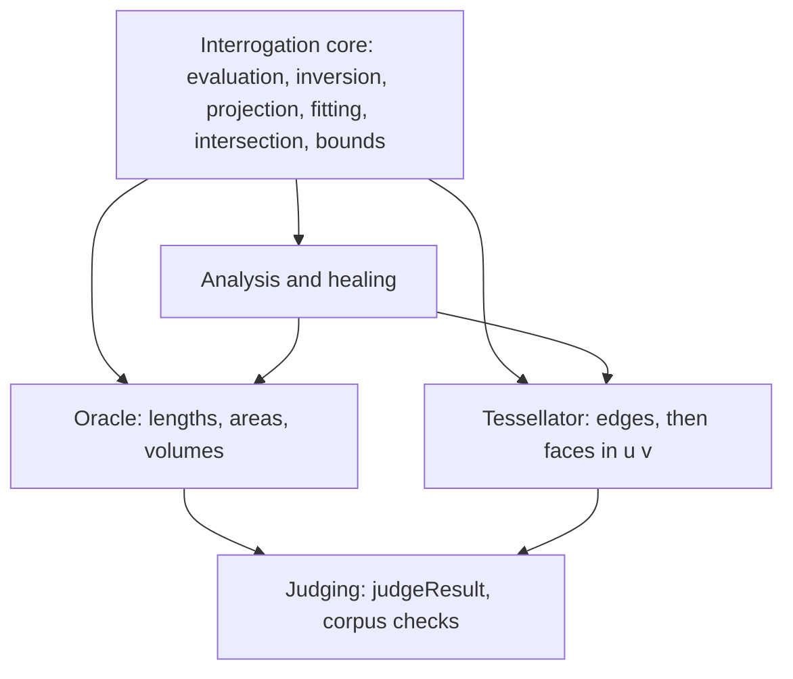

# Our own tessellator and oracle: scope and strategy

A design note for the work after OCCT and SMLib are taken as close to every part as they'll go: a tessellator of our own, an oracle of exact measures (lengths, areas, volumes) covering every kind, and what both need beneath them, shape interrogation and healing. It says what each piece must do, why, in what order they're built, and the decisions to be put to the user one at a time. Nothing here is built yet; what exists is in [`shape-interrogation.md`](shape-interrogation.md) (our evaluators and inverses), [`backends.md`](backends.md) (the area oracle, the join, the fill, the fallback), and [`healing.md`](healing.md) (what OCCT's and SMLib's healers do, and how each backend makes missing p-curves).

## Why

- **The backends' limits are their own.** What's left after OCCT, SMLib, the exact join, the per-face fallback and the sliver fill (`backends.md`): 5 of the user's 1,954 parts incomplete, 12 of the corpus's 3,258, most of them faces to mesh again or model defects. Each backend's failures come from inside it (SMLib's tessellator has no fixed-boundary mode, so its retried faces don't meet their neighbours; OCCT's healing grows tolerances without bound and interpolates p-curves unchecked between samples; neither sews), and we can't fix them there (no forks, no upstream reports).
- **Watertight by construction.** Meshing each edge once and every face against those points makes meshes meet exactly along model edges, the user's rule (exact joins, not tolerance merging), without a join pass after the fact.
- **The oracle doesn't cover a fifth of the faces.** Over the corpus (`area_occt.log`) it trusts 63,880 of 82,989 faces' areas (77 %); 18,591 are unsupported, 16,342 of them B-spline surfaces, 1,938 extrusions and revolutions. It has no lengths and no volumes, so it can't judge a mesh's volume or orient a solid's shells on the model (`backends.md`, "Solids' shells facing into the material": the meshes are turned instead, the model left as the source has it).
- **Later uses need it.** The scene is to support geometry processing on loaded B-reps (booleans, other operations) and B-rep exports: those need the same interrogation, healed models and exact measures.

## The pieces

### 1. The interrogation core

What every other piece calls. Today (`shape-interrogation.md`): evaluators for every kind, closed-form inverses for lines, conics and elementary surfaces, and sampled searches with Newton or bisection (`nearestParam`, `nearestParams`) that nothing guarantees.

- **Evaluation with derivatives** to second order on every curve and surface kind (offset, swept, revolved and extruded surfaces, composite and trimmed curves included), with their singular places marked: poles, apexes, a zero offset normal, a revolution's axis crossing.
- **Point inversion, global and guarded:** branch and bound on conservative bounds (a span's control-point hull), then Newton or Gauss-Newton once a minimum is isolated; periods and seams resolved (a closed surface's two parameters for a point on its seam); results with how sure they are.
- **A 3D curve to a p-curve:**
  - exact where a table allows: every kind on a plane (an affine map of points or control points), the iso-lines of elementary surfaces (a circle coaxial with a cylinder, cone, sphere or torus, a generatrix, a meridian: 2D lines), conics whose image in (u, v) is a conic where the parameterizations agree;
  - else a fit, its error measured against the 3D curve between its samples, not only at them (OCCT's healing checks only at its 23 samples, `healing.md`);
  - seams (both p-curves of a seam edge), poles and degenerate ends handled.
- **2D curve interpolation and fitting** with error control, and the B-spline tools under it: knot insertion, subdivision into Bezier pieces, degree elevation, reparameterization.
- **Bounds:** boxes and hulls per span for pruning; derivative or curvature bounds per span, so sampling can guarantee a chord's deviation (a deflection honoured by construction, not by checking afterwards).
- **2D intersection and classification** in a face's (u, v): curve against curve, a loop's self-intersection, a point in a loop, loops' nesting. Trim validation, wire orientation and the triangulation need them.
- **3D line and ray intersection** with surfaces (and faces, trimmed): classifying a point against a solid, for shells' orientation and voids' nesting; picking on exact geometry later.
- **Arc length and its inverse** (the parameter at a length), for sampling by length and for the oracle.
- **Robust predicates** for 2D geometry (orientation, in-circle) in adaptive precision, for the triangulator.
- **Out of scope here:** surface-surface intersection (booleans need it; neither tessellation nor the oracle does).

### 2. Analysis and healing

Analysis before any fix: a report of every problem in a model (each check `validate.ts` doesn't make yet: p-curves against 3D curves, vertices against curves and surfaces, gaps between consecutive edges, loops' orientation and nesting in (u, v), shells' closure and orientation), so the fixes are chosen by what the corpus and the user's models hold, as the canonical model's rules were. Then fixes, as an opt-in pass on the model (the README backlog's item; phase 14 kept healing out of the canonical model, since each fix needs a tolerance or geometry), each with a diagnostic, an opt-out, and the tolerance it grew recorded:

- **Missing p-curves** made by the core; **same-parameter** measured (a p-curve against its 3D curve), the deviation recorded as the edge's tolerance rather than hidden.
- **Wires:** order, connection, orientation in (u, v) (SMLib's loop repair is disabled, so our SMLib builder does some of this itself today; `healing.md`).
- **Seams, poles, degenerate edges:** a missing seam added, edges split at seams, apex and pole edges where a face needs them.
- **Gaps:** coincident vertices merged and edges sewn within a stated tolerance (neither backend sews on import), tolerances grown and reported, never silently.
- **Small edges and slivers:** kept and said, or removed; the sliver fill (`fillFaces`) covers the mesh side today.
- **Shells and solids:** orientation by point classification or an exact volume's sign, voids nested and turned to face into the void, closed sheets solids (canonical rule 11 already).
- **A tolerance policy** carried through: the model's uncertainty, what healing grows, what the tessellator honours and the oracle assumes.

### 3. The oracle

Independent of the tessellator (a check that shares the code under test is blind to its bugs: `CLAUDE.md`, "Testing"): measures from the exact geometry by integration, never from a mesh.

- **Lengths:** adaptive Gauss-Legendre on the curve's speed with an error estimate; closed forms for lines and circles.
- **Areas:** Green's theorem over the boundary where the area element has an antiderivative in closed form (today's planes, cylinders, cones, spheres, tori; extrusions and revolutions by their profiles); for B-splines and the rest, either an iterated integral (an inner integral of the area element along v, by Gauss-Legendre per knot span, driven along the boundary) or adaptive cubature over cells of the trimmed (u, v) domain (which needs the core's 2D classification). Both with error estimates; the trust flags as today.
- **Volumes:** the divergence theorem over a closed, consistently oriented shell, reducing to face integrals of the same kind as the area's ($V = \frac{1}{3}\oint\!\oint \mathbf{x}\cdot\mathbf{n}\,dA$); its sign settles orientation on the model; centroids and moments from the same machinery. It needs healed shells: an open shell has no volume.
- **References** to check it by: closed-form shapes in tests (and their scaled, mirrored and moved copies), OCCT's measures (`BRepGProp`) and SMLib's, classified rather than counted.

### 4. The tessellator

- **Edges first:** each model edge sampled once in 3D, within the deflections by the core's bounds, shared by every face using it; its points' (u, v) on each face through the edge's p-curve or the core's inversion.
- **Faces in (u, v):** constrained Delaunay triangulation with the boundary fixed, refined by the error measured in 3D (chord to surface, normal angle), with a metric for the (u, v) distortion (a thin cylinder, a stretched B-spline); seams unwrapped, poles meshed as fans, whole closed surfaces (a sphere, a torus with no edge loops) meshed by their natural bounds; inner loops, curve-bounded faces.
- **Normals** from the surface, **orientation** by the face's sense; **measures** the oracle's.
- **One face again**, inside its neighbours' fixed edges: what the per-face fallback, the join and the sliver fill do today becomes a property of the mesher.
- **The same interface:** a `TessellationResult` per part, so `judgeResult`, the open-edge check, the corpus checks against OCCT and SMLib, the cache and the browser check apply as they are; a backend behind `FallbackTessellator` like the others, primary once it's better.

## The order

1. **The core:** inversion, projection to p-curves, 2D fitting, 2D intersection and classification, bounds. Measured against today's `nearestParam` and `nearestParams` (`brep_geometry`) and OCCT's, on the corpus, with planted bugs.
2. **The oracle:** lengths, then B-spline areas (the 16,342 unsupported faces), extrusions and revolutions, then volumes. It's the judge the tessellator will be measured by, so it comes first.
3. **Analysis, then healing:** the report over the corpus and the user's models; fixes in the order the report says matter.
4. **The tessellator:** planes and elementary surfaces, then B-splines; compared face by face with OCCT and SMLib (`smlib_occt`'s classification), then end to end (`e2e.ts`).

Each step a phase of its own, with its record in this note and its own corpus check.

## Decisions to make

Each to be put to the user when its step comes, with these alternatives and what's measured by then:

- **Language:** TypeScript (one language throughout, no build step, the evaluators already there) or C++ compiled to WebAssembly (speed, operator overloading for interval or exact arithmetic, as the interrogation note says rigorous work suggests; a toolchain we already use for OCCT and SMLib).
- **Rigor:** certified results (interval arithmetic, bounds that hold), or floating point with a posteriori error estimates (faster, simpler, the oracle's way today).
- **Where healing changes the model:** an opt-in pass producing a healed model (what every consumer and exporter could use), or inside the tessellator only (meshes healed, the model left as the source gives it, as `orientResult` does today).
- **The triangulator:** our own constrained Delaunay mesher, or a library under the clean-room and license rules (`licensing.md`).
- **The oracle's area method for free-form surfaces:** the iterated boundary integral, or cubature over (u, v) cells.
- **Ray classification or volume sign** for orienting shells on the model, once both exist.

## What exists to build on

- `cad-brep`'s evaluators and closed-form inverses (`geometry.ts`), `edgeParams`, `faceOutlines`, the clamping of B-splines (`clamp.ts`), the bake of similarities (`bake.ts`).
- `cad-scene`'s area oracle (`area-oracle.ts`: Green's theorem, extrapolation, trust flags), the judge (`judgeResult`, `faceFailures`), the join, the fill and the orientation passes, `openEdges`.
- The corpus (517 files, 3,258 parts) and the user's models (31 STEP files), the corpus checks with committed logs, OCCT and SMLib as references, and `healing.md`'s account of how each does what we'd be replacing.
