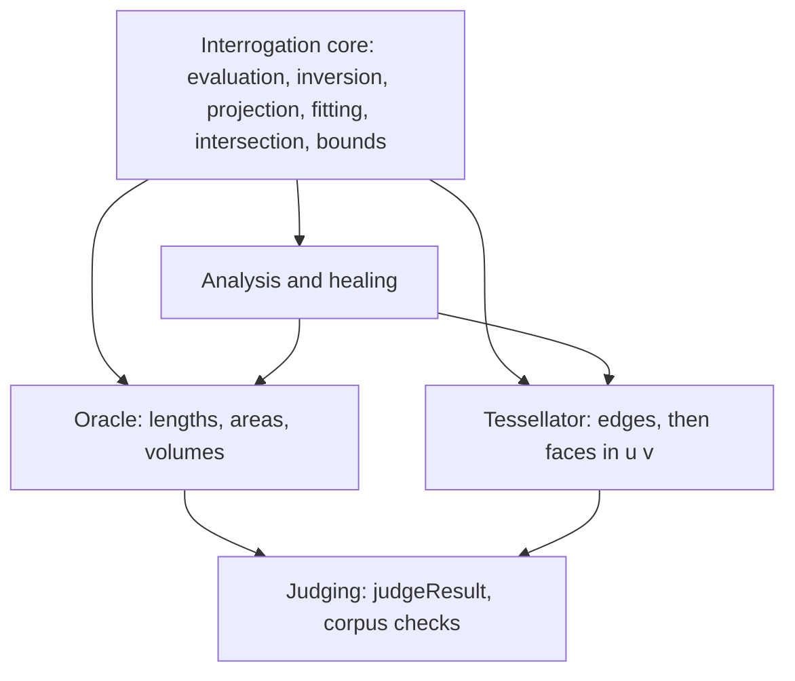
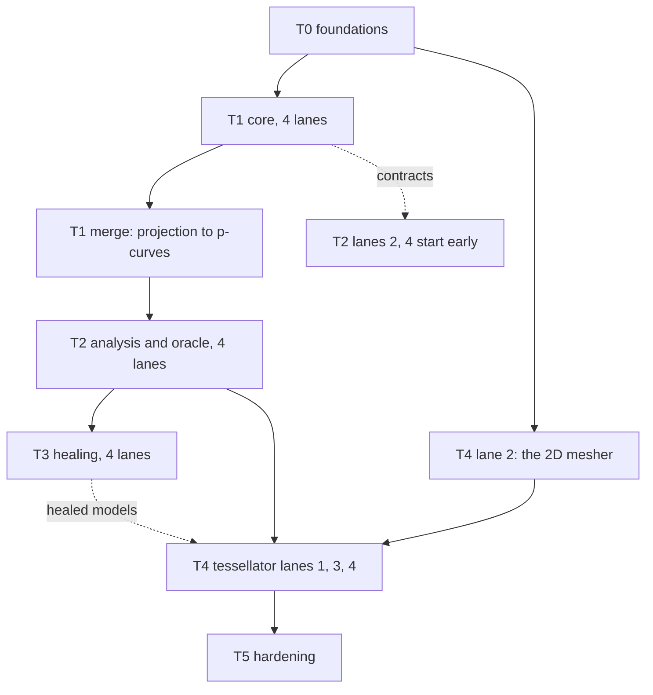

# Our own tessellator and oracle: scope and strategy

A design note for the work after OCCT and SMLib are taken as close to every part as they'll go: a tessellator of our own, independent of OCCT, truck and SMLib and not derived from their code, an oracle of exact measures (lengths, areas, volumes) covering every kind, and what both need beneath them, shape interrogation and healing. It says what each piece must do, why, in what order they're built, and the decisions to be put to the user one at a time. Nothing here is built yet; what exists is in [`shape-interrogation.md`](shape-interrogation.md) (our evaluators and inverses), [`backends.md`](backends.md) (the area oracle, the join, the fill, the fallback), and [`healing.md`](healing.md) (what OCCT's and SMLib's healers do, and how each backend makes missing p-curves).

## Why

- **The backends' limits are their own.** What's left after OCCT, SMLib, the exact join, the per-face fallback and the sliver fill (`backends.md`): 5 of the user's 1,954 parts incomplete, 12 of the corpus's 3,258, most of them faces to mesh again or model defects. Each backend's failures come from inside it (SMLib's tessellator has no fixed-boundary mode, so its retried faces don't meet their neighbours; OCCT's healing grows tolerances without bound and interpolates p-curves unchecked between samples; neither sews), and we can't fix them there (no forks, no upstream reports).
- **Watertight by construction.** Meshing each edge once and every face against those points makes meshes meet exactly along model edges, the user's rule (exact joins, not tolerance merging), without a join pass after the fact.
- **The oracle doesn't cover a fifth of the faces.** Over the corpus (`area_occt.log`) it trusts 63,880 of 82,989 faces' areas (77 %); 18,591 are unsupported, 16,342 of them B-spline surfaces, 1,938 extrusions and revolutions. It has no lengths and no volumes, so it can't judge a mesh's volume or orient a solid's shells on the model (`backends.md`, "Solids' shells facing into the material": the meshes are turned instead, the model left as the source has it).
- **Later uses need it.** The scene is to support geometry processing on loaded B-reps (booleans, other operations) and B-rep exports: those need the same interrogation, healed models and exact measures.

## The pieces

### 1. The interrogation core

What every other piece calls. Today (`shape-interrogation.md`): evaluators for every kind, closed-form inverses for lines, conics and elementary surfaces, and sampled searches with Newton or bisection (`nearestParam`, `nearestParams`) that nothing guarantees.

- **Evaluation with derivatives** to second order on every curve and surface kind (offset, swept, revolved and extruded surfaces, composite and trimmed curves included), with their singular places marked: poles, apexes, a zero offset normal, a revolution's axis crossing.
- **Point inversion, global and guarded:** branch and bound on conservative bounds (a span's control-point hull), then Newton or Gauss-Newton once a minimum is isolated; periods and seams resolved (a closed surface's two parameters for a point on its seam); results with how sure they are.
- **A 3D curve to a p-curve:**
  - exact where a table allows: every kind on a plane (an affine map of points or control points), the iso-lines of elementary surfaces (a circle coaxial with a cylinder, cone, sphere or torus, a generatrix, a meridian: 2D lines), conics whose image in (u, v) is a conic where the parameterizations agree;
  - else a fit, its error measured against the 3D curve between its samples, not only at them (OCCT's healing checks only at its 23 samples, `healing.md`);
  - seams (both p-curves of a seam edge), poles and degenerate ends handled.
- **2D curve interpolation and fitting** with error control, and the B-spline tools under it: knot insertion, subdivision into Bezier pieces, degree elevation, reparameterization.
- **Bounds:** boxes and hulls per span for pruning; derivative or curvature bounds per span, so sampling can guarantee a chord's deviation (a deflection honoured by construction, not by checking afterwards).
- **2D intersection and classification** in a face's (u, v): curve against curve, a loop's self-intersection, a point in a loop, loops' nesting. Trim validation, wire orientation and the triangulation need them.
- **3D line and ray intersection** with surfaces (and faces, trimmed): classifying a point against a solid, for shells' orientation and voids' nesting; picking on exact geometry later.
- **Arc length and its inverse** (the parameter at a length), for sampling by length and for the oracle.
- **Robust predicates** for 2D geometry (orientation, in-circle) in adaptive precision, for the triangulator.
- **Out of scope here:** surface-surface intersection (booleans need it; neither tessellation nor the oracle does).

### 2. Analysis and healing

Analysis before any fix: a report of every problem in a model (each check `validate.ts` doesn't make yet: p-curves against 3D curves, vertices against curves and surfaces, gaps between consecutive edges, loops' orientation and nesting in (u, v), shells' closure and orientation), so the fixes are chosen by what the corpus and the user's models hold, as the canonical model's rules were. Then fixes, as a pass on the model, on by default with one switch to turn all of it off ("Decisions to make"; the README backlog's item; phase 14 kept healing out of the canonical model, since each fix needs a tolerance or geometry), each with a diagnostic, an opt-out, and the tolerance it grew recorded:

- **Missing p-curves** made by the core; **same-parameter** measured (a p-curve against its 3D curve), the deviation recorded as the edge's tolerance rather than hidden.
- **Wires:** order, connection, orientation in (u, v) (SMLib's loop repair is disabled, so our SMLib builder does some of this itself today; `healing.md`).
- **Seams, poles, degenerate edges:** a missing seam added, edges split at seams, apex and pole edges where a face needs them.
- **Gaps:** coincident vertices merged and edges sewn within a stated tolerance (neither backend sews on import), tolerances grown and reported, never silently.
- **Small edges and slivers:** kept and said, or removed; the sliver fill (`fillFaces`) covers the mesh side today.
- **Shells and solids:** orientation by point classification or an exact volume's sign, voids nested and turned to face into the void, closed sheets solids (canonical rule 11 already).
- **A tolerance policy** carried through: the model's uncertainty, what healing grows, what the tessellator honours and the oracle assumes.

### 3. The oracle

Independent of the tessellator (a check that shares the code under test is blind to its bugs: `CLAUDE.md`, "Testing"): measures from the exact geometry by integration, never from a mesh.

- **Lengths:** adaptive Gauss-Legendre on the curve's speed with an error estimate; closed forms for lines and circles.
- **Areas:** Green's theorem over the boundary where the area element has an antiderivative in closed form (today's planes, cylinders, cones, spheres, tori; extrusions and revolutions by their profiles); for B-splines and the rest, either an iterated integral (an inner integral of the area element along v, by Gauss-Legendre per knot span, driven along the boundary) or adaptive cubature over cells of the trimmed (u, v) domain (which needs the core's 2D classification). Both with error estimates; the trust flags as today.
- **Volumes:** the divergence theorem over a closed, consistently oriented shell, reducing to face integrals of the same kind as the area's ($V = \frac{1}{3}\oint\!\oint \mathbf{x}\cdot\mathbf{n}\,dA$); its sign settles orientation on the model; centroids and moments from the same machinery. It needs healed shells: an open shell has no volume.
- **References** to check it by: closed-form shapes in tests (and their scaled, mirrored and moved copies), OCCT's measures (`BRepGProp`) and SMLib's, classified rather than counted.

### 4. The tessellator

- **Edges first:** each model edge sampled once in 3D, within the deflections by the core's bounds, shared by every face using it; its points' (u, v) on each face through the edge's p-curve or the core's inversion.
- **Faces in (u, v):** constrained Delaunay triangulation with the boundary fixed, refined by the error measured in 3D (chord to surface, normal angle), with a metric for the (u, v) distortion (a thin cylinder, a stretched B-spline); seams unwrapped, poles meshed as fans, whole closed surfaces (a sphere, a torus with no edge loops) meshed by their natural bounds; inner loops, curve-bounded faces.
- **Normals** from the surface, **orientation** by the face's sense; **measures** the oracle's.
- **One face again**, inside its neighbours' fixed edges: what the per-face fallback, the join and the sliver fill do today becomes a property of the mesher.
- **The same interface:** a `TessellationResult` per part, so `judgeResult`, the open-edge check, the corpus checks against OCCT and SMLib, the cache and the browser check apply as they are; a backend behind `FallbackTessellator` like the others, primary once it's better.

## The order

1. **The core:** inversion, projection to p-curves, 2D fitting, 2D intersection and classification, bounds. Measured against today's `nearestParam` and `nearestParams` (`brep_geometry`) and OCCT's, on the corpus, with planted bugs.
2. **The oracle:** lengths, then B-spline areas (the 16,342 unsupported faces), extrusions and revolutions, then volumes. It's the judge the tessellator will be measured by, so it comes first.
3. **Analysis, then healing:** the report over the corpus and the user's models; fixes in the order the report says matter.
4. **The tessellator:** planes and elementary surfaces, then B-splines; compared face by face with OCCT and SMLib (`smlib_occt`'s classification), then end to end (`e2e.ts`).

The phases below break these into work that up to four agents can do at once.

## Phases

### How parallel work is organized

- **A phase starts with its contracts.** One agent (the phase's lead) writes the interfaces its lanes meet at (TypeScript types or headers, function signatures, the data each lane produces and consumes, the error and provenance fields) and a stub or reference implementation of each, small and obviously right if slow (a dense sampling where the lane will write a search), committed before the lanes start. Lanes then code against the contract and test against the stubs, so none waits for another.
- **Each lane owns its files.** A lane works in its own checkout (a sandbox, on this machine or another) and branch and touches only its own module and tests; it commits and pushes its branch to GitHub often, so no work lives on one disk, and others fetch it from there; shared files (the package index, `CLAUDE.md`, the README, this note) change only at the merge, by the lead. So lanes merge without conflicts but in the index.
- **Each lane delivers checked work:** unit tests on shapes with closed-form answers, planted bugs one at a time (survivors closed or explained), a corpus check where the lane's function meets real data, and a provenance header per module (the paper, specification or summary it's written from: "Independence and clean room").
- **The merge** is the lead's: lanes merged one at a time, the whole test suite and the phase's corpus checks after each, the contract amended where a lane found it wrong (the other lanes told, their work adjusted before they merge).
- **Lanes are independent by construction, not by hope:** where one lane's output is another's input, the second works from the stub until the merge, and the merge replaces the stub. Phases overlap where noted: a lane of the next phase can start once the contract it needs exists.

### Phase T0: foundations (one agent)

- **Decided before T0:** the language, the rigor and where derived values live ("Decisions to make").
- **The packages:** one per piece (decided): the interrogation core, the oracle, analysis and healing, and the tessellator `tess-cadio`, each with its C++ under `native/`, built to WebAssembly as `tess-occt` and `tess-smlib` are, and its TypeScript layers beside it; the core's C++ a library the others compile in. So each piece can be used alone (the oracle judging the other backends now; a B-rep kernel of our own later), at the cost of the core repeated in each module and the model and the analysis buffer passed between modules. The alternative was one package and module with a library per piece (one build, shared memory, the oracle's independence from the tessellator by a link rule). Their build and test wiring.
- **The shared types:** curve and surface queries (evaluation with derivatives, bounds, inversion results with how sure they are), 2D loops in (u, v), the derived data and its provenance (given, measured, healed), error bounds.
- **The reference shapes:** a test library of models with closed-form answers (lengths, areas, volumes, normals, parameters) for every curve and surface kind, at several scales, mirrored and moved (the existing `cad-brep` test models extended), and the catalogue of degenerate and ambiguous cases ("Degenerate and ambiguous cases") with the answers each query must give, which every lane tests against.
- **The result types for degeneracy:** in, out and on; crossings, tangencies and overlap intervals; inversions with their certainty and alternatives; the record of shared decisions.
- **The check skeleton:** a corpus check per phase, empty until its lanes fill it.

### Phase T1: the interrogation core (four lanes)

The contracts are `packages/cad-geom/native/include/cad_geom/` (`vec.h`, `result.h`, `interval.h`, `model.h`, `curve.h`, `surface.h`, `predicates.h`, `geom2d.h`, `numerics.h`), each with a reference implementation in `native/src/`, slow and simple (lines, circles, polylines and B-splines; planes, cylinders, spheres and B-splines; inversion by dense sampling; plain floating-point predicates), checked against `cad-brep`'s evaluators. Precision far from the origin is a rule of every evaluator (`curve.h`): no derivative or difference formed from absolute coordinates, the local origin (a span's pole centroid, a placement's origin) added to the point only, measured necessary (a B-spline 1e6 mm out on absolute poles: speeds 1e-10 off, arc length not converging at 1e-13; on its span's centroid 6e-13, converging). Each lane owns the sources it replaces: curves `curve*.cpp`, surfaces `surface*.cpp`, 2D geometry `geom2d*.cpp` and `predicates*.cpp`, numerics `numerics*.cpp` and `interval.h`; a header changes only at a merge.

| Lane | Owns | Contract it fills |
|---|---|---|
| 1. Curves | evaluation with derivatives for every curve kind (composite, trimmed, offset included), span bounds (hulls, derivative bounds), arc length and its inverse, point inversion on curves (global: branch and bound on hulls, then guarded Newton) | the curve query interface |
| 2. Surfaces | evaluation to second derivatives for every surface kind (offset, revolved, extruded, swept), singular points (poles, apexes, axes), closedness and periodicity, point inversion on surfaces (branch and bound, Gauss-Newton), seam handling | the surface query interface |
| 3. 2D geometry | robust predicates (adopted or our own: "Dependencies"), 2D curve-curve and self-intersection, point in loop, loop nesting and orientation, for exact 2D curves (lines, conics, B-splines) | 2D classification |
| 4. Numerics | the B-spline toolkit (knot insertion, subdivision into Bezier pieces, degree elevation), 2D interpolation and fitting with error control, Bernstein root isolation, quadrature rules, the arithmetic (expansions, a double-double type) | the numerics interface the other three call |

Lanes 1 and 2 call lane 4's toolkit through its contract (today's `geometry.ts` evaluators as the stub). **Then, at the merge, one lane:** 3D curve to p-curve projection (the exact table, then tracing by continuation, the fit checked against the 3D curve), which needs all four. Checks: `brep_geometry` against the new inversions, OCCT's points as a reference (running OCCT is allowed), the reference shapes at every scale.

### Phase T2: analysis and the oracle (four lanes)

| Lane | Owns | Needs |
|---|---|---|
| 1. Analysis | the derived data ("The input"): measured deviations, edge and coedge ranges, outer loops, adjacency, continuity per edge and face pair, provenance; stored as decided in T0 | T1's inversion and projection |
| 2. Lengths and areas | the oracle's lengths, and areas for every surface kind (free-form by the method decided: iterated boundary integral or cubature over (u, v) cells), with error estimates and trust flags | T1's curves, surfaces and 2D classification |
| 3. Volumes | the divergence theorem over closed shells, centroids and moments, orientation by the volume's sign | lane 2's face integrals (through a contract for an integrand over a face, written first) |
| 4. Point classification | 3D line and ray intersection with trimmed faces, a point against a solid, shells' nesting (which shell is inside which) | T1's surfaces and 2D classification |

Lane 2's package is `cad-oracle` (C++ on cad-geom's core, `native/include/cad_oracle/oracle.h` its contract): edge lengths (cad-geom's `arcLength` over the face API's edge parameters), perimeters, and areas of planes, cylinders, cones, spheres and tori (Green's theorem with the closed-form antiderivative, the 3D edge curves by the closed-form inverse, adaptive Gauss-Kronrod per span) and of extrusions and revolutions (the antiderivative closed in the profile, over the face API's loops), with the flags; `faceIntegral` (lane 3's contract, an integrand of the point and the area vector) on the same faces, by the same engines (`closed.h`, `swept.h`) with H numeric (a composite Gauss-Legendre rule along v, smooth in v, its panels doubled until H settles at the loops' samples), the area riding along as the last component to pick the multiple of the whole surface where the result is known modulo it. Free-form surfaces (B-splines, offsets, rectangular trims) by the iterated boundary integral (`free.h`): the inner integral along the direction that isn't periodic, from b0 at a pole row the face holds (by its loops' net winding, or a gap of the face API's loops along it), else the face's lowest b; where both directions are periodic, from a cut just below the face in the largest gap of its b, each crossing of the cut ending a piece of the loop and the cut's stretches inside the face adding the whole period's inner integral along them; a result known modulo the whole surface (two poles, both periodic) reduced by the area's. Where the surface isn't sound on the strips from b0 (an offset folding, a singular evaluation), the inner direction in bands, each band's top row taken as the cut's (its stretches by its crossings, or the face API's classification where a periodic row has none), doubling to 64 (flagged `cells`). The outer rule is cut at the p-curves' breaks (a projection's pieces' too, from the face API: without its fit's knots the adaptive rule needed 97,000 evaluations on one piece) and where the loops cross the surface's knot lines; the inner rule's panels are set per span between the surface's breaks, a span not settled at 64 integrated adaptively (a patch folding nearly onto itself, |n| near 0, ec_turbine-A #11708: 100 s with fixed panels, 2.8 s so), and the outer rule never asked for better than H's own error. An integrand can vanish on a face but for rounding (a volume's on a plane through its c): each component's absolute tolerance is set from its size near the face (the caller's `scale`, else probed at points off the face, n along each axis), and the inner rule settles against that: a tolerance below the integrand's rounding is never met, and the bisection that confines a projected p-curve's kinks then repeats the failure at every level (hours a face). Checked by the reference shapes at every variant, built faces (pole joints, the other nappe, a torus face across v = +/-pi, a torus band between two whole parallels bounded either way (each loop's v is unwrapped on its own, so a loop winding u can sit a turn of v off the others, which moves every integral by whole tori: the result is reduced modulo the whole torus by the area, as a sphere's, and such a face is never flagged `orientation`; LaPavoni #5855's rolled lip, face #32934, was flagged on the wrong half, and healing's faces step turned it, making the shell cross itself), revolutions with one, two or no poles; B-spline sphere caps, zones and lunes, torus patches and bands across both seams, a cylinder periodic in v only, a planar patch with a projected hole, an offset folding off its face, `test/free.test.ts`), today's oracle (`area-oracle.ts`) and OCCT's measures classified by OCCT's mesh, free-form faces against OCCT's and SMLib's measures (`corpus_checks/oracle_corpus.ts`; results in `backends.md`'s area oracle). cad-geom's revolution lists no pole where a line profile crosses its axis (the line's range is unbounded, so `closeInFact` has no side to collapse): the oracle finds it in closed form; the tessellator may need it too.

Lane 4, point classification (decided): three layers. The line against a surface in cad-geom (`surface.h`'s `intersectLine`, built): branch and bound on parameter rectangles as inversion's, a rectangle solved where the surface is transversal to the line all over it (|d . n| at least `kLineMargin`, 1e-3, from the partials' boxes, the Jacobian's taken piecewise between breaks so a root on a knot line is proven) by interval Newton (Krawczyk's operator on the line's normal plane, over the rectangle widened by 1e-3 of its size, past a periodic seam too, so roots on shared sides are proven by both and merged), else split down to a contact size (1e-6 of the range's 3D size, at least tol): contacts are tangencies, conservative ("within tol or too near to tell"); a rectangle transversal all over is split on to 1e-6 of the contact size before it's a contact (it holds one root at most, and Krawczyk's test settles it once small against the curvature: at the contact size alone, a line along the normal of a surface curved within a few tol, a narrow face's small cylinder, came out a tangency, so shellSide's offset was never clear: bug24593 #13's #325 and 98 other faces of the corpus' 181; the floor ends a root on a non-periodic range's side, which Krawczyk's test can't prove, in a few dozen splits), and planes, and cylinders and cones along a generator, answer in closed form (overlaps; a line clear of a cylinder). A line lying in another kind (an extrusion's or a B-spline cylinder's ruling) runs out the budget, said so. The ray against a trimmed face in cad-oracle (`Oracle::rayFace`, built: a broad phase first, a line missing the face's box skipping it unbuilt (the box its surface's bound over a finite domain, else for a plane, cylinder, cone or extrusion, linear in v along each u, its edges' and vertices' boxes and a cone's apex, widened by twice the tolerances; none for another unbounded surface), so a ray on a large shell builds only the faces near it (VW #2472's first shellSide 16.0 s to 0.46 s, natively); each contact classified by the face API at its tolerance for the face, a crossing on the boundary its own kind, a tangency at the tolerance widened by half its span, an overlap kept; `RayFace::clean()` whether parity may count it) and the point against a closed shell by parity (`classify`, built: 26 directions, a cube's faces, edges and corners turned by a fixed rotation off a model's axes, at most 16 tried, the first with every hit a clean crossing beyond 2 x the tolerance of the point deciding; `Options::checkSecondRay` has a second agree, for the corpus check), with shells' orientation (`shellSide`, built: a point well inside the face, from a 17 x 17 grid over its loops' (u, v) box, else its surface's domain, classified in at the tolerance (else the first of 10 and 100 x it that's settled: loops with gaps wider than it, OCC623 #11's #14726) and not on (a distance test) at 100, else 10 x it (classified in at those, points off narrow faces came out in: trj3_s1-al #6704's #1342, bug24593 #13's #262, bug24594 #13's #48), else, a face narrower than that, a point in at the tolerance itself, settled there (not on at it, so farther than it from the boundary; a point invalidModel there, its loops with gaps wider than the tolerance, not taken), for shellSide only, nesting's points staying well inside (a point just inside a narrow face lies nearer the other shells); moved eps along the face's normal, halved up to four times where the segment back through the face meets another face; unknown where the point off the other side, its offset clear too, classifies the same (a free check where both are classified; healing turning a good shell is the worst outcome); unknown where the face, or a face whose surface the rays meet within its box, has its loops running against its sense (its measure flagged orientation), a ray through it counting its complement, only those faces measured (measuring the whole shell was most of a large free-form shell's time: VW #2472, 1,575 faces); healing's faces step turns the ones it can first; `ShellSide` in `src/shell-side.ts`, shared with the volume's sign, `RayShellSide` its rays) and nesting (`nesting`, built: points well inside up to 6 of each shell's faces, spread over them, against each other closed shell, held where all are inside, not where some are outside and none inside, else -2 (inside and outside: shells crossing or overlapping; inside and on: one touching the other from inside; a loud unknown rather than a depth from whichever face came first), the smallest holder the one held by the most of the others); parity now, winding numbers later; a divergence from OCCT, by `classify_corpus` with `OCCT=1` against `BRepClass3d_SolidClassifier` on the solids as the native builder makes them, unhealed: we classify by geometry, parity against one shell whatever its faces' senses, OCCT by orientation, so on a source's void that faces out (brep_wv1, tr8_bv1 and tr9_bv1's) and an outer shell that faces in a point just off a face is in the material by our rays and by the mesh's parity, out by OCCT; healing's orientation by ShellSide is meant to be judged by geometry, as ours; of the 316 differences listed (of 2,956 agreeing), a third opinion from our own mesh's parity at each point (5 rays, the mesh's deflection under a quarter of the point's offset: at 0.1 mm, coarser than many offsets, its chords lay on the wrong side of the points) sides with ours on 212 just outside a root shell that OCCT calls in (on 58 OCCT calls a point far outside the solid in too, taking it inside out; 154 are OCCT's near a face, mostly planes), and 71 on voids and 16 on outer shells are the orientation divergence above; on 3 (Median_cx-fs01_bicycle's balls with a flat: a sphere and a plane, no p-curves) OCCT and tess-cadio's mesh take the sphere's smaller side where the faces' senses and their shared edge make the solid the larger (the exact volume +32.97, not 0.54), ours right; 8 were left to look at; at 10 x the offset (`EPS_SCALE=10`) OCCT's "in" just outside a root shell grew (219 to 323 listed), not fewer, so it isn't its tolerance near faces, and the mesh's parity sides with ours on every one of the 128 new (all kinds of surface); orienting the B-rep itself is healing's step, proposed separately. Alternatives: all three layers in cad-geom (the face API's loops given a C++ contract), several rays required to agree in production.

Lane 2 can start its lengths, and lane 4 its ray-surface intersection, once T1's curve and surface contracts exist, before T1 merges. Checks: `area_occt` and `area_model` extended to every kind (against OCCT's and SMLib's measures, classified), volumes against closed forms and OCCT's, lane 3's and lane 4's orientations against each other (two independent methods), the analysis report over the corpus and the user's models.

**Then, wiring (one lane; the areas built, the shells' orientation not yet):** `cad-oracle` replaces cad-scene's TypeScript area oracle (`area-oracle.ts`, elementary surfaces only) wherever the library uses one: the measures backends' results carry and `tessellateScene` corrects (`oracleMeasures`, `ORACLE_DISAGREE`), and the judging of meshes that sends faces to the fallback (`fallback.ts`), judging a face's mesh only where `trusted(m, JUDGE_RELATIVE)` (the judging threshold, decided: `ORACLE_RELATIVE`'s successor; the area's error, its boundary's bound included, within 1e-2 of it, a third of the judge's 3 % short limit), in the tessellation workers and the browser as the backends run; and what users see (the viewer's face measures, the CLI's) becomes the oracle's area with its error estimate (`FaceMeasure.area.error`, the boundary's bound included), with the flags no estimate covers (sphereSide, loose, orientation, noLoops) said beside it as notes (a face flagged winds has a value where its area takes the seam's term, a torus's or a closed profile's revolution's loops winding v and cancelling, and none elsewhere: unsupported, with the reason, since the term the method leaves out is in no error), not a trusted or untrusted verdict; a solid's shells are then oriented on the model, where today the meshes are turned (`orientResult`), by two independent methods checked against each other: the volume's sign (lane 3) and point classification (lane 4, as OCCT and SMLib orient: a point inside the solid by rays against the trimmed faces), the latter not built yet. As built: the area oracle is injected (cad-scene's `setAreaOracle`), tess-workers' workers set cad-oracle's (`areaOracle`, judging at 1e-2 with the quadrature at 1e-6, not projecting coedges without p-curves until healing's projections can be reused: projecting, it cost 264 s on LMP1 against the TypeScript oracle's 12 s and OCCT's 72 s of meshing) on their first request with measures, tess-cadio's results carry it too, and `Part.measures` keeps each face's oracle area and error (`FaceMeasures.oracle`), which the viewer's Details shows; on the calling thread cad-scene's own stays (no wasm to load synchronously). The flags beside the value aren't shown yet. The shells' orientation waits on where its decision acts: the exact volume says which way the model's shell faces, but a mesh turned by it is wrong where the backend already turned the shell (OCCT's healing: `trj3_s1-al-214.stp` #6704's shell #54, its exact volume -7,769, OCCT's mesh +7,769), so it is to act on the model itself (for the user to decide).

### Phase T3: healing (four lanes, a pass on the model, on by default)

Its order and contents set by T2's analysis report (what the corpus and the user's models need most); likely lanes:

| Lane | Owns |
|---|---|
| 1. Curves on surfaces | missing p-curves, same-parameter measured and fixed, p-curve ends bridged to their vertices, tolerances grown and recorded where edges lie off their surfaces (every face the face API calls `invalidModel` for it: `pcurve_corpus`'s gap section lists them by file and part) |
| 2. Loops | order, connection and orientation in (u, v); outer loops; seams, poles and degenerate edges added where a face needs them |
| 3. Gaps | coincident vertices merged and edges sewn within a stated tolerance, small edges and sliver faces kept and said or removed; edges of one loop within the tolerance of each other near a shared vertex merged up to where they part (`VW.step` #2407's face #294279: edges 85 and 13 meet nearly tangent and run 0.0004 to 0.006 mm apart over their last 0.08 mm, inside the face's tolerance of 0.02 mm, crossing once in (u, v) when sampled finely) |
| 4. Shells and solids | orientation (T2's lanes 3 and 4), voids nested and turned to face into the void, the healed model's validation |

Where the pass runs (as built, cad-heal's `healScene`): at the end of step-import's `importStep` (`ImportOptions.heal`, its progress the import's `healing` phase), after rigid placements, so exports carry the healed models; in `stepconv` after the import, in the backend's worker pool (or one without a backend where nothing is meshed; on the main thread with `-j 0`), `--heal`, `--no-heal`, `--heal-on`, `--heal-off`; in the viewer between the scene and the meshing, in the meshing pool's workers (**Heal B-reps**, its fixes under **Healing fixes**, `?heal=`, `?healOn=`, `?healOff=`, `?healFit=`; Mesh again with other healing settings heals the models again in place, from the source's values their analyses keep). Parts heal in parallel through tess-workers' jobs (`PoolTessellator.run` with cad-heal's `healJob`), the result byte for byte the serial one's, diagnostics in the parts' order. Whether importers heal unless told is one constant, cad-heal's `HEAL_BY_DEFAULT` (false until the trace is fast). Each fix its own module with its diagnostic and opt-out, independent of the others' code; the lead orders them in the pass at the merge (gaps before loops before shells, likely) and checks the pass is idempotent (healing a healed model changes nothing). Checks: the analysis report before and after, the backends' meshes of healed models (OCCT, SMLib), the round trip through STEP.

### Phase T4: the tessellator (four lanes)

| Lane | Owns | Needs |
|---|---|---|
| 1. Edges | each model edge sampled once in 3D within the deflections (guaranteed by T1's bounds), its points' (u, v) on each face through p-curves or inversion; seams and degenerate edges | T1, T2's analysis |
| 2. The 2D mesher | constrained Delaunay triangulation with a fixed boundary and refinement (adopted or our own: "Dependencies"), driven by a size and metric function it's given; knows nothing of surfaces | the metric contract only |
| 3. Surface criteria | per surface kind, the error in 3D of a triangle in (u, v) (chord to surface, normal angle), the metric for (u, v) distortion, seams unwrapped, poles as fans, whole closed surfaces | T1's surfaces |
| 4. The backend | the `Tessellator` interface (requests, `TessellationResult` with faces, edges, measures from the oracle), workers, one face meshed again inside fixed edges, the corpus checks against OCCT and SMLib (`smlib_occt`'s classification adapted) | the contracts of 1-3, stubs until the merge |

Lane 2 is the most independent (pure 2D, testable on its own) and can start as soon as T0 is done. Planes and elementary surfaces first; B-splines once they pass. Checks: watertightness by construction (`openEdges` finds none), `judgeResult` on every part, areas against T2's oracle, end to end (`e2e.ts`) against OCCT then SMLib.

What the mesher (`tess-cadio`'s `cdt.cpp`, `mesh2d.cpp`) needs that isn't obvious:

- **Cavities Delaunay in the new point's metric.** Inserting metric circumcentres with Euclidean Bowyer-Watson cavities rebuilds triangles that are slivers in the metric, so anisotropic refinement never ends (a unit square at aspect 10: 385,810 points for about 4,600). The in-circle test runs on points mapped by the Cholesky factor of the metric at the new point (Borouchaki and George), with the cavity made star-shaped from the point.
- **No fused multiply-add, no libm in decisions.** clang fuses on arm64 and WebAssembly can't, and `acos` or `tan` differ between C libraries; either makes refinement decide differently per target. The angle test is the sine of the smallest angle from the metric's cross product and square roots; the threshold's sine and the off-centre's tangent are series of our own.
- **A relative floor for points near a vertex:** a tenth of the triangle's shortest metric edge (or of a metric unit if shorter). A fixed floor blocks refinement wherever the metric's size exceeds the features.
- **Ungor's off-centre** at height (l/2) / tan(minAngle/2) over the edge; tan(minAngle) puts points nearer the edge than circumcentres do, and more of them.
- **Split requests only where they're needed:** a segment is wanted split when the triangle refused for encroaching it is still in the mesh and either the segment is longer than sqrt 2 in its endpoints' averaged metric, or `accept()` still refuses that triangle, or the segment is longer than 4 times that triangle's longest edge (a long fixed chord under a fan of slivers whose candidates all encroach it, which nothing else ever splits). Any encroachment alone reports the next segment along, round after round, without converging. A candidate that leaves the domain names the segment the ray from the triangle's centroid crosses first (a straight walk through the triangulation, `firstConstraint`), under the same rule; without it, a face narrower than its boundary chords' sagitta (strips 0.003 wide on a sphere of radius 4.5 at 0.1 mm: triangles with every corner on the boundary, their facets 80 degrees off the surface's normals) keeps its refused triangles and asks no split.
- **Edge spacing from the face too:** a chord on a curve of radius r strays s^2 / 8r, so an edge sampled coarser than the deflection allows leaves triangles that can never pass; and a straight edge on a curved face (a cylinder's seam) needs spacing near the width the face's triangles must have, or its skinny neighbours encroach it.

- **The edges' angle as the tangent's turn:** every C'(t) over a span lies within s max|C''| / 2 of C'(mid), so any two tangents are within 2 asin of that over |C'(mid)|; a span passes when s max|C''| <= 2 |C'(mid)| sin(angle / 2), nearly exact on an arc, and one that fails is split into as many pieces as the turn sampled at 9 tangents asks for, with a tenth to spare (the bound's own count over a long B-spline span is several times too many, its pieces bounded again passing far sooner), at most as many as the bound asks and none with a length bound under the floor of 10 x the tolerance; a cut within the tolerance of the one before or of the span's end is dropped (equal parameter steps near a nearly vanishing speed make chords far shorter than their bounds).
- **A sample where a span passes over a pole:** an edge a little off its surface can have its foot at a pole inside a span (`offPoleArc`'s arc, 7e-4 inside its sphere, under the north pole), the free coordinate then jumping by about half a period between the span's samples and its unwrapping a toss-up that flips with where the samples fall; such a span (a jump over a quarter period) gets a sample at its point nearest the pole when that point's foot is the pole, so the loop crosses the pole line the face's way and the cut is decided on samples a later split can't change.
- **A curve crossing its neighbour within the tolerance at their vertex (`edges.cpp`'s dropCusps):** two edges can leave a vertex nearly tangent with one running past the other by less than the tolerance (LMP1 #172995's #1073191: a B-spline 0.0056 past a straight edge 0.15 from their vertex, the tolerance 0.0508), so the face's boundary crosses itself in (u, v) at its own samples, which no finer sampling mends. While a segment of one use within 8 of the junction crosses one of the other's, the sample nearest the vertex that lies within the tolerance of the other's points in 3D and outside the corner's wedge (from the vertex towards each use's first sample past the tolerance of the other, the face's way between them) is dropped from its edge, where the chord bridging it stays within the deflection; every use of the edge loses it. Inside the crossing both uses' samples lie within the tolerance of each other; a straight edge's lie on its own direction, and dropping them mends nothing. Over a9's 654 parts and 12 of the user's: the 4 LMP1 planes meshed, no face failing that didn't, 3 other parts' meshes changed (LaPavoni #5850, bug24383 #11, bug31711 #11: such corners' crossings that refinement's splits mended before; triangles 21,518,198 -> 21,518,200).
- **A pole's ring inside the tolerance (`edges.cpp`'s offPoles and cutRings, `poles.cpp`'s ringCuts):** a ring's reach can be under the part's tolerance (its floor the deflection, 0.1, at a tolerance of 0.151: LMP1 #172440's #1041642). Each crossing then lies within the refinement floor of the pole's own sample, which insertSample makes that sample, so no cut was made and the edge's span from the pole stayed whole (1.46 long there, crossing the edge beside it). Such a crossing goes in where it is (RingCut::exact), for all of a ring's cuts or none: none where an edge's approaches lie farther apart than the reach (one running along the pole: #1042701, approaches over 0.14 at a reach of 0.1), since a ring cut on some of its edges and not others leaves a chord off its row between them, and the fan and the mesher don't meet (#1042701 refined to its cap). An edge whose approach is already at the reach meets the ring as it is. And a use whose every sample lies at one pole (an edge shorter than the tolerance there, given as a curve: #1041642's 0.1 long) is left out of its loop's chain, the jump between its neighbours filling the pole line the face's way; projected, it ran the pole line anywhere, stretching the ring's run past where the next edge leaves (v to 1 and back to 0.708). Over a9's 654 parts and 12 of the user's against d51d331 (failed or past the limits): 136 -> 127, LMP1 #1041642, #1041644, #1042281 and trj3_s1-al #6704's #1344, #1347, #1367 meshed, none failing that didn't, 30 parts' meshes changed.
- **Poles as fans (`part.cpp`):** a run of a face's boundary points at a pole or apex (on its row in (u, v)), between regular points on one side of the row (neither all but on the row itself: a sample inverted to the pole from an edge a little off its surface leaves the pole line as it is), is replaced by a ring of points at one radius from the row, and the ring's chain (the run's neighbours at its ends) is joined to the pole in 3D by triangles made outside the mesher, in pieces of at most 22.5 degrees about the pole (the angle measured about the surface's own singular point: the run's sample there may be off it by the part's uncertainty, an edge a little off its surface passing through the pole by that tolerance, `offPoleArcLoose`). The pole line is one point in 3D, so a triangle the mesher finds well shaped in (u, v) can have its two other corners on one meridian: the slivers it refused and refined towards without end. The ring is the pole's (`poles.cpp`, by "A pole's ring" below): each face's poles by case, the radius by the rule, one reach per pole across the part's faces, and the ring cut into the curves through the pole (`EdgeMesh::cutRings`) before any face is meshed, so the run's neighbours are the curves' crossings of the ring; the ring in pieces by the edge rules (`ringPieces`), and an end off the row by over half as much again (a curve whose crossing at the shared reach is farther out in this face's fixed coordinate) reached along its own row of the free coordinate. The pole is a point of its own per fan, the run's edge sample there where it has one. The ring is fixed: the mesh's requests to split its segments are ignored, and the refinement rounds never refill the edges' spans inside it.
- **Seams and poles the source leaves unsaid (`edges.cpp`):** a loop of edges with no curve whose vertices are all at one pole is that pole, as a vertex loop there is (bug26451's drill points: a cone's apex given as a closed edge with no geometry, which has no samples to make a chain of). A seam use placed by inversion whose neighbours meet it only at poles (a lune's meridian on a sphere's seam) has no junction to settle its copy: where it and a placed neighbour have given p-curves, even ones parameterized otherwise, it takes the copy those p-curves put it at against that neighbour (trj4_k1_top-pe #4779's #3088), neighbours that disagree leaving it singular, and without them it stays singular: a guess there is the face's sense, which the seam side check is there to test. Where a loop's two uses of a seam meet at a pole with its coedges already turning a whole period between them (down the seam, round, back up: a face turned in the source, trj6_b1-ec #10's #18689), the jump there undoes that turn instead of making it two, and the loop is said to run against the face's sense, meshed as the sense has it.
- **Natural extents (`edges.cpp`):** a face with no edge loops (none, or vertex loops only: `pr_3-sy`'s whole torus and sphere) is its surface's natural extent where that closes: periodic in one direction with poles at both ends of the other (a sphere, a B-spline ball either way round), one loop along both pole lines and the two copies of a pseudo-edge from pole to pole; periodic both ways with no singularity (a torus), one loop of the two copies each of a closed pseudo-edge along each direction, meeting at one corner. The cuts lie half a period from the vertex loops' points, which the mesh keeps as points. A B-spline face with no edge loops is its whole knot rectangle (a face without bounds is the whole surface, and a B-spline's is bounded), closed in neither or one direction: four sides, each a pseudo-edge along its iso-line or, where the side is a collapsed row, a pole line; a closed direction's two sides one pseudo-edge (the cut) used twice, the other sides closed pseudo-edges. Anything else (a whole plane, cylinder or cone) stays unsupported. A face whose edge loops, two or more, are all holes (none winding round a period, each clockwise about the face's normal in (u, v)) is its surface's natural extent less them, the cuts placed in the widest gap between the holes so none crosses one (VW's (the user's) part #2446: ten sphere faces, pocket walls between two cylinders, each bounded by its two circles on them, were meshed as their two caps instead, the same area, wound against the cylinders: 1,953 edges used twice the same way); on a surface with no natural extent such a face fails, said so. A face is connected, so two such loops can only be holes. A single one is a hole too (decided) where it's a plain closed curve, no edge in it twice and no point on a pole line or a cut, on a sphere or a torus, and the face is oriented as its neighbours (some face shares one of its edges, every one that does uses it the other way, and none meeting it smoothly, their normals within acos 0.9 of each other's line, faces the other way: an unsewn surface model's senses aren't trusted, wgehaeuse_surface #71291's tori, no edge shared and half their tangent neighbours' normals against theirs, meshed as their loops' insides as OCCT does; at a crease normals tell nothing; trj5_k1 #10's #3638, a hemisphere its circle shared by no face, likewise; on a9's 656 parts it changes six faces, LMP1 #172535's, #172550's and #172910's tori, two each, from their loops' small side, about 380 mm^2, to the torus less it, about 2,810, as OCCT meshes them, failures and the rest the same): the side its direction and the face's sense say, not the smaller (the bicycle's `Median_cx-fs01_bicycle.stp` #1486, #1377, #1170: a ball with a flat, the sphere face meshed as the small cap before, 46.0 of 46.5 now); elsewhere a single one (through a seam or a pole, or on a plane) stays meshed as the loop has it: either a hole or a loop against a face turned in the source, healing's orientShells to settle.
- **A point in a face's loops (`geom2d.cpp`'s classify2):** by the nearest piece a ray in (u, v) meets, the side of it the point is on, periodic copies included. Three rules the corpus needed: a loop closed along a pole line doesn't wind around the period along it, so where its pieces and its closures along poles sum to whole periods there (a piece as given a period on: nist_ctc_04's cone #2286) the first closure along that line is moved by them (a whole sphere's loop, seam, pole, seam, pole, sums to 0 as it is); rays stop at the first pole line they would cross (beyond it is another sheet: a cone's other nappe, a spindle torus's other band, its two poles splitting a periodic v, as bug32239's #54190, a latitude circle whose copies past the poles made the whole torus in), a point beyond a pole line its boundary lies all on one side of is out (a cone's other nappe), and so is one in a band between pole lines across a period that the boundary doesn't enter, where it enters another (a spindle torus's other sheet: LMP1 #173136's #1078959, a wedge at one pole whose loop, closed along the pole line by the face API, turns once round u, so by its sense the other band was on its left and rays clipped at the poles took that whole sheet in), and one on a pole line, or on its copy a period over where the direction is periodic, is on wherever the boundary reaches that line, at any u (the line one point in space: wgehaeuse_surface's #60155), and otherwise on only where a point just off it is in by every rule above, the bands' too (else a spindle torus's pole the face doesn't reach came out on through the other sheet); and pieces met at one distance along the ray (within 1e-3 x the tolerance: a tie; a band narrower than the tolerance has its two sides told apart by distance, as bug27453's piattello #517) with opposite verdicts, running along each other, bound a region of no width (a sliver face's loop there and back, Kuka.step #4099's cone #28094, or a slit) and decide nothing, the ray going on past them (pieces crossing there decide nothing either, another ray tried). Without the last, a sliver's far points came out in by the pieces' order, and rays through the solid counted crossings on its surface kilometres off. A ray meeting a piece within the tolerance of its end (its nearer end where it's within the tolerance of both) judges by the pieces arriving at that joint and leaving it, past any lying all within the tolerance of where the ray meets it (so at the joint; near the meeting, not merely short: at a tolerance larger than a loop's pieces, a chain of them runs on past it, and taking them all left a 40-gon's centre unsettled); where every piece of the loop is that near (the loop all within a box 2 x the tolerance across), p, farther than the tolerance from it, is outside what that loop encloses, out past an outer loop and in past a hole by the loop's own signed area (contacts classified at a tangency's widened tolerance, else unsettled, set bug24383's rays aside): a ray passing within tol off a spike's tip of short pieces (Kuka.step #4099's plane #28100, its arc in, a piece of 0.008 at a tolerance of 0.118, a line out) met the short piece and the line, both running back, and called points 100 mm off in. A piece no longer than the tolerance was judged at its curve's start whichever end the ray met (bug24055's sliver #15612, 0.01 wide at 0.01, met past its far corner: in, 15 mm off). Such a far point's other rays mostly miss a small face: on a surface with no period, one ray meeting nothing puts it in the region unbounded in (u, v) (a region reaching a pole line is closed along it), out where the loops' signed area is positive and in where it is negative (holes alone: the face their complement), unsettled where its sign is within its error, as for a point no ray meets anything from (periodic, that is out, a ray along a period able to miss a band's loops); on a periodic one it comes out out but unsettled (noConvergence), and `rayFace` takes an unsettled classification as a boundary hit, setting that ray aside rather than counting it, which is conservative: no crossing is miscounted, at most another ray is tried (a point past the loops' box is out only where the region is bounded, not on a face whose loops bound a complement, so that shortcut waits for the outer loop's winding).
What the surface criteria (`tess-cadio`'s `criteria.cpp`) do:

- **A local, anisotropic metric:** at each (u, v) the principal curvatures and directions (the second fundamental form against the first); along each direction the size the smaller of sqrt(6 d / |k|) (an equilateral triangle's centroid strays h^2 |k| / 6), angle / |k| and the face's 3D extent; in 3D sum e_i e_i^T / h_i^2, which is conservative in every direction between them, pulled back to (u, v). Where the parameterization degenerates (a pole) the point's own is skipped, and on the criteria's grid every node on a pole's line is taken as degenerate whatever the point's own test says: a B-spline's collapsed row whose poles are a fitting's noise apart (`t4mec.stp` #472: 8 poles within 1.7e-3 mm on a sphere of radius 100) has |S_v| that noise rather than 0 and a curvature across it of 1 / the noise, whose sizes, graded over a grid cell, had the face expect 5.3M triangles where it needs about 1,200 (its cap scaling with them; with the rule it expects 1,233, and `t4mec.stp` #9 meshes in 5 s with none failed, against 8,792 s); on a9's 656 parts natively the failures the same (182), triangles -731, three parts changed (LMP1 #172768 and #172880 about -390 each, firetherm_12 #329592 +44); in a knot span whose 3D width is within the refinement floor, and that of the run of such spans it's in (a B-spline's knots a hair apart, bent sharply between them), it's the nearest wider span's, as no mesh resolves the span; a run wider than the floor together keeps its own (knots halving toward a side, LMP1 #172768's face 1060536: five spans of 0.02 to 0.04 mm under a floor of 0.15, its curvature all there, refined to the point cap without it), its normal curvature across it taken at most the run's mean, its normal's turn over its chord along the line that turns most (a double knot's span may bend sharply and back inside a run: LMP1 #172440's face 1042281, k 90 /mm over 0.003 mm, its normal 1.9 degrees apart across it, whose pointwise sizes 200 x below its neighbours' piled refinement's thin triangles along the knot to the point cap) (r0901_ec part #11's face 32955: |S_vv| 2742 over a last span of 8.5e-7 set sizes of 5e-4 mm along its whole top edge, 6,158 triangles standing across the surface, the area 54% over). Its sizes at most 1000 apart: in 3D on elementary surfaces (through the first fundamental form, the grid's metric at its nodes and the point's own at the point, a pole's in (u, v)); in (u, v) on free-form ones, where the ratio is the 3D one times the parameterization's distortion, and it also stands in for the surface's twist, which the metric doesn't model (how fast the principal directions turn: long triangles along them leave a twisting surface). In (u, v) on a cylinder of radius r it capped the size along the axis at a few times across (as1_motor's 22.6 m cylinder at 8.66 mm, its straight edges in thousands of segments).
- **Graded:** the metric on a 17 x 17 grid over the face's (u, v) box, each node intersected with its neighbours' grown by their distance (Borouchaki, Hecht and Frey: M / (1 + 0.5 L)^2), a query the grid's interpolated, intersected with its own point's. The intersection is by the symmetric form (Cholesky of one, eigenvectors of the other in its frame): the form by A^-1 B's eigenvectors loses all precision when the two are nearly proportional (a 10^14 metric on a sphere's cap).
- **Turned slivers mended after meshing (decided, `flip.h`, `part.cpp`):** a triangle turned as shipped (checkFacing's test) that refinement neither judges nor splits (within the floor: a boundary point off its surface within its tolerance, by more than the sliver's height, turns it however refined) is flipped with its neighbour across an interior edge (not a boundary, constraint or ring segment) where the quadrilateral is convex in (u, v) and both new triangles pass the criteria and face as shipped, a refused one then accepted (PartOptions::flipTurned); after every face is meshed, one the flip leaves whose apex is one of the mesher's own points and whose long edge is a boundary span where a split at the curve's point nearest the apex's projection would fall under the floor, has its apex collapsed onto the span's nearer end, kept only where every triangle at that point faces as shipped and is within max(d, tol) (PartOptions::collapseTurned). Faces at their point cap that failCapped fails are skipped (LMP1 #172440's two took 21,253 flips and twice the CPU). On a9's 656 parts with keepSteiner: failed 221 -> 207, none new, turned 73 -> 59, the CPU the same; flips 250, collapses 5 (LMP1 #173233 #1082381 by a flip, #172440 #1041915 and trj6_b1 #10 #6770 by collapses, #172482's #1046237 and #1046289 one each); measured with the interior snap below too, which mended none. Then any triangle still turned (refused needles the mesher couldn't break, and triangles under the floor turned by a boundary point off the surface within the tolerance): one of its corners that is the mesher's own point collapsed onto each of its neighbours, nearest first, kept where the same checks hold with the result manifold and no (u, v) area changing sign; once over the face's turned triangles, at most 2,048 tries a face (`part.cpp`'s collapseAround). It changes only faces that would fail for a turned triangle. On a9's 654 parts at a0bb586 (natively, under load, back to back): failed 181 -> 168, turned faces 45 -> 32, none new, triangles +8,452, CPU 2,691 -> 2,668 s (trj6_b1 #10, three faces with some 330 turned triangles each, 65 -> 73 s); with the per-face retry 179 -> 166. Snapping the apex onto its long edge instead (interior, or a boundary span split there) is in the README's backlog: never needed on the corpus.
- **A cut's spans split like an edge's:** a face's cut (the pseudo-edge across a periodic face's winding loops, `edges.h`) is one of its edges for refinement's split requests, found by its two ends among the face's boundary points: a straight cut is sampled at its ends alone, both of them its loops' points, so none of the face's boundary points named it and a request for its one span was dropped (silently: no edge's span, crease's segment or ring's). On a9's 654 parts (at 55b06dc) 13 faces in 8 parts asked for such a split; with it made, failed 184 -> 183 (LMP1 #172790's torus #1061562, 1.11 x d before), triangles +0.01%, three parts changed. A request still dropped, one naming a segment between two edges' samples that no edge's span is, is counted (FaceMesh::splitsDropped, tess-cadio's diagnostics' `splitsDropped`, a warning; `cadio_cases` fails a case whose face has one): two faces on the 654, LMP1 #172440's #1041642 and #1041644, both failing for crossings.
- **Crossing splits stop when they make crossings (`part.cpp`):** a face whose meshing is refused for segments that cross (or one through a point) has each span the refusal names split at its middle for the next round; it asks none once the pairs named have grown past 1.5 x the last refusal's at 3 refusals in a row. Where splits don't mend them the crossings grow by about 1.6 to 1.9 x a round, round after round: tubeGapOpen at 1e-3 mm (a tube open at its seam by 3e-5, over its tolerance, its cut through its edge's samples) went 191, 300, 514, 900, ... to some 190,000 a round, 42 minutes to fail as it fails at once at 0.01. The faces they mend grow so at most once in a row: of the 87 such faces on a9's 654 parts and the user's models that end meshed, the longest run of growths is 2 (VW #2400's #293030: 10, 12, 14, then mended), of growths past 1.5 x 1 (cadio_cases holds four of them); stopping at any growth cost four of them. On both sets every part's output is unchanged.
- **No boundary fit:** the edges' own sampling by derivative bounds already comes out finer than the faces ask (Meusnier: an edge's curvature is at least the surface's normal curvature along it); where a face wants more (a cylinder's straight edges beside triangles round it) the split rounds do it, up to 48 (the user's choice: on a9's 656 parts 48 rather than 24 mended 19 faces and failed none new, past-deflection 27 -> 16, for 4.8% more CPU, firetherm #168383 111 -> 217 s; earlier, up to 24 at the first that asks for no split, so the cap costs only where faces still refine; on a subset of 406 parts 8 rounds failed 49 faces and 24 failed 15, at about half the CPU, refinement converging instead of thrashing). A face meshed again from its fourth meshing on starts from its last mesh's points, in their order (PartOptions::keepSteiner, the default; from its boundary alone again where that fails or leaves a refused triangle): meshed from scratch each round, its leftover refusals land somewhere new each time (85 to 95% of them new, the count wandering), so a chain of rounds doesn't end; kept, they settle. On the 656 parts at 48 rounds it mended 6 faces and failed none new, rounds -14%, CPU -3%, Kuka #4099 48 rounds to 30 (failed 3 -> 2); seeding from the first re-meshing failed one more, and dropping the seeds near the last mesh's refused triangles mended 25 but failed 8 (3 on the user's models) and doubled as1_motor's CPU.
- **Seeds' order (an open finding):** the seeds go in in their given order, one heartbeat every 1024 (the loop's own; it had none, so the CPU limit couldn't fire in it). Along a Morton curve (each point's walk to its triangle a few steps rather than across the mesh: `t4mec.stp` #472's 3M seeds 1,000 to 1,500 s a meshing, sorted 5 to 10 s) the mesh changed on the 654 parts (a7a5675, at fa0738c, back to back): failed 181 -> 183 (LMP1 #172922's torus #1067843 1.49 x d, Kuka #4099's cylinder #28051 1.62 x d), triangles +3.9%, CPU +12.6%, LMP1 #172338's B-splines #1034581 and #1034572 1,498 -> 109,715 and 119,452 triangles each (their areas the same within 3e-6), three more LMP1 parts doubled; so it was reverted (#472 meshes in seconds since the pole rule). The instability is keepSteiner's ratchet, not refinement's own: seeds put back in another order than they were made in make another triangulation (each insertion Delaunay in its own point's metric), refinement adds points for thinness to it, and those are kept as the next meshing's seeds, never dropped, while the interior they crowd asks more boundary splits and so more meshings. On #1034581 meshings 1 to 7 (from the boundary) are the same in both orders; at the 8th its 420 kept points in their order give 1,066 points (a fresh mesh of the same boundary 1,054), along the curve 1,692 (636 inserted for thinness), and by the 49th 55,432 against a fresh mesh's 1,987. Each seeded meshing against a fresh one of its boundary on the 654 (3a11704, its last meshing seeded on 10,801 faces): in the given order inner points +0.5% in all, 225 faces over 1.2 x (with over 50 inner points), 3 over 2 x (Kuka #4099's #28691 and #28692 about 2 x), none over 5 x; along the curve 369, 57 and 11 (up to 84.6 x). Not yet changed; what would stop it: seeds dropped where the seeded mesh outgrows a fresh one, or points inserted for thinness not kept.
- **accept()'s deviation bounded where the bound is tight:** on planes, cylinders and B-splines by the second derivative bounds over the triangle's (u, v) box (|S - L| <= (1/2)(a_u du^2 + a_v dv^2) at the triangle's smallest enclosing circle in coordinates scaled by a_u = M_uu + M_uv e, a_v = M_vv + M_uv / e, e = Dv / Du), on spheres exactly (R less the centre's distance to the triangle); sampled elsewhere (the centroid and edges' middles), the faces so judged counted in the diagnostics and in `cadio_corpus`. Sampled first even where bounded (it never overestimates, so its refusals are sound, and it spares the bound the many large triangles refinement refuses), then the bound over the whole box, then, only where that isn't enough, over the box cut at the surface's breaks and 2 x 2 (a B-spline's derivBound is its spans' hulls across a knot; within one span its centred form shrinks with the box). cad-geom's rational B-spline partials are bounded by the quotient rule in intervals as well as in magnitudes (the magnitudes lose the signs: 1.2 x loose at +-0.01 on a dome, the intervals 1.02 x). On cones and tori the magnitudes count S'''s tangential parts, which don't take a point off the surface, so they're bounded by their distance functions instead: g, the distance to the surface (or an upper bound on it) positive inside the solid, concave over the facet, so g(x) <= g(c) + grad g(c) . (x - c) at the centroid c, the most at a corner. A cone's g is the distance to its generator in the meridian plane (concave as the distance to the axis is convex; from inside the solid nappe the foot is always on the nappe's ray); a torus's is r less the distance to its core circle, concave only where the triangle stays on the outer half (t = s - R >= L at the centroid): on the inner half the Hessian's terms make the bound 5 x loose on a chord round the axis (it doubled the triangles), so there it samples. Each face whose triangles were ever sampled is counted (SurfaceCriteria::bounded is false once any was). The sampled measure, |S(x) - L(x)| at the barycentric (u, v), is at least the distance there, so it over-refines where S''s tangential part is large: on a cone near its apex 27 x (pr_3-sy's face 262, 3,199 triangles sampled, 117 bounded). Every one of these measures the triangle on the surface's points at its corners; the shipped triangle has the boundary's own points there (an edge's curve within its tolerance of the surface), so its limit is d less what would take the output past the part's deviation check: a triangle whose corners as output lie g off the surface is held to min(d, max(d, the face's tolerance) - g), where g is under that (a boundary farther off is FaceMesh::offSurface's, which no refinement mends). On a9's 654 parts and the user's models it changed no face's verdict (failed and kept for their deviation the same; a few faces' turned counts by 1 to 3), CPU and triangles flat; it closes a hole the coverage lane found (LMP1 #172867's #1062558, a 10.5 mm triangle at 1.017 d as shipped with a corner on an edge 0.0124 off its cylinder), which on the meshes built since no longer arises.
- **A triangle under 1e-4 of the deflection across is accepted:** at such sizes its facet's normal is rounding, and refinement chased one B-spline's degenerate spot to its point cap (trj7_k1-id's face 2160, 100,181 points in 257 triangles 1e-14 mm across).
- **The normals stay sampled** (the corners' within the angle of one another and of the facet's): a bound through |d(S_u x S_v)| / |S_u x S_v| runs far past the turn where the parameterization shrinks (2 / cos^2 v times it on a sphere: a hemisphere's 555 triangles became 40,918).
- **Near a pole the surface's distance itself:** a triangle with a corner within twice its size of a pole or apex that the bound or the sample refuses is judged by its points' distances to the surface instead (7 points, each to the nearest surface point a few damped Gauss-Newton steps from its barycentric (u, v) find, within 0.9 of the deflection), its face then counted as sampled: there a triangle wide in u is small in 3D, S's tangential part is large and a bound over its (u, v) box reaches far from it, so both refuse what is within the deflection (`bsplineDome` near its pole). An upper bound on the distance at each point, a sample over the triangle.
- **Apex-like rows, no normal to hold to:** a pole whose normals just off its row (at a thousandth of the deflection from it, over the face's runs along the row) spread by more than the angle is apex-like (`poles.cpp`, one measure for the fans and the criteria): a cone's apex, a B-spline's row collapsed at an angle (`Albatros` #787's face 5754, its normal's limit 61 degrees apart across 11 degrees about the point). Its fans are judged by their deviation alone (`SurfaceCriteria::acceptDeviation`): there's no normal at the point to hold a triangle's to. Outside the ring every check applies, `accept()` holding triangles near an apex to the angle as anywhere (its waiver within the deflection of such a point went with the fixed ring: refinement towards the point made needles whose facets stood on edge until the point cap, 200,245 triangles; the ring now keeps the mesher out of that zone). A sphere's or a dome's pole has one limit, its fans held to the angle. Where a ring is floored at half a small clearance (bsplineApexHole's, 5e-5 from the apex), the few triangles between it and the boundary, under 1e-4 mm, can still miss the angle there: the refinement floor takes them.
- **No area check on a facet's tilt:** with its corners on the surface and its normal within the angle of theirs, the patch a facet stands for is a graph over it and at least its area; a mesh's area exceeds its face's only where boundary chords stand for a region past the boundary curve: most where a boundary curve bends within the surface (a circle along a torus's top or bottom, its whole curvature 1 / R in the tangent plane), each chord then adding its circular segment, R^2 (a - sin a) / 2, to the face (a fillet torus of R 18 and r 1 in `r103ec` 2.4% over at medium, its top circle's 5 chords' segments 0.78 mm^2 of 25, the interior's flattening taking back 0.19; OCCT's mesh of it 0.24% under, its top circle in 7 chords, each turning about half the angle).

### Phase T5: hardening (up to four lanes)

**The coverage goal (decided):** every salvageable face of the corpus (`files.txt`) and the user's models (`test_corpus/models/`) meshed by our tessellator, healed where it needs to be: a face without our triangles is our defect, in the tessellator or in healing. Input beyond repair is recognised, said in a diagnostic with its cause, and meshed as far as it reasonably can be; what counts as beyond repair is a decision for the user, made on the corpus's examples, and the corpus checks count those faces apart from failures, every face and part accounted for by cause. Input from recent Parasolid kernels (the user's Onshape models) is all to be taken as correct and meshed one way or another, small faces (a face within its part's tolerance, LMP1 #1087410) included; for such faces, what OCCT and SMLib produce is a reference where they succeed (their meshes, never their source), not a limit: both fail on some of these faces, which is much of why this tessellator exists, and there ours must succeed without one.

The corpus and the user's models through the new tessellator, its failures classified (as `smlib_occt` classified SMLib's) and each class a lane: a fix and its test per class, merged one at a time. Then performance (the WebAssembly build, workers, the cache), the deflections honoured at every scale, and the decision, the user's, of when it becomes the primary backend, with OCCT and SMLib its fallbacks and references.

### Dependencies between phases

T3 and T4 can run side by side (eight lanes is more than the four wanted; so T3 first, or two of each), since the tessellator takes canonical models whether healed or not; healed models improve its results but aren't needed to build it.

## The input: the model, and what's derived from it

The tessellator (and the oracle and healing) take a part's B-rep model (`brep-reference.md`), canonical by construction. What they need that the model doesn't hold is derived from it, since the model keeps only what a source says (rule 7: what a source leaves out stays absent, so import is exact and a round trip faithful):

- **Tolerances as measured.** The model has a tolerance per vertex, edge and face and the part's uncertainty, `NaN` where the source gives none, which from STEP is nearly always (it gives the uncertainty alone; the exceptions are the vertices joining curve-bounded segments, whose tolerance is their gap); formats with tolerances per entity (OCCT BREP, Parasolid's) would fill them. What a mesher needs is how far the geometry actually disagrees: a vertex's distance from its edges' curves and its faces' surfaces, an edge's p-curves' deviation from its 3D curve (same-parameter), a loop's closing gaps. These are measured, kept beside the given tolerance, not in place of it (the source's claim and the measurement answer different questions); the tessellator takes the largest of the uncertainty, the given and the measured as the distance within which points are one, and healing that grows a tolerance says so by the measured value, the given one still visible.
- **Parameters:** each vertex's parameter on its edge's curve (the edge's range), each coedge's p-curve range, where the source doesn't give them (today `NaN`, every consumer searching again: the oracle through `edgeParams`).
- **The outer loop** of a face where the source doesn't say (decision 40 leaves it to consumers: 3,182 corpus faces with several `outer` loops, 3,256 with all `unknown`).
- **Continuity across each edge** (C0, G1, G2), per edge and pair of faces (so non-manifold edges too): normals shared across smooth edges, the angular deflection's meaning there, and decision 17 settled.
- **Surface and curve facts:** singular points (poles, apexes, a revolution's axis), whether a B-spline closes or is periodic in each direction, parameter domains, each face's (u, v) box.
- **Adjacency:** a vertex's edges, an edge's coedges and faces.
- **Results with their accuracy:** the oracle's measures, a shell's orientation sign, each with its error bound.
- **Provenance on every derived value:** given (from the source), measured (by analysis), or set by healing, so nothing computed passes for the source's.

They live in a companion analysis buffer (decided, (B) below), its rows keyed by the model's and tied by the model's hash to exactly the model it describes, so an edited or healed model never keeps stale analysis. The alternatives were:

- **(A) Analysis tables in the model's buffer:** optional tables, empty until a model is analysed; one format and one generated header for every consumer (C, Rust, TypeScript), a format version (`MAGIC`) bump.
- **(B) A companion analysis buffer**, its rows keyed by the model's: the canonical format untouched, the analysis versioned apart; consumers take two buffers.
- **(C) Computed inside each consumer:** no format change, but the oracle, healing, the tessellator and exporters can't share results, and each computes again.

## Independence and clean room

- **Independent of the three backends.** Our tessellator, oracle, healing and interrogation core use none of OCCT, truck or SMLib (usd-brep): not linked, not called, not ported. They stay what they are today, backends and references: the corpus checks compare against them, and a classification of where they and we differ decides who's right, by the standard and the evidence (`CLAUDE.md`).
- **Not derivative of their code** (OCCT is LGPL-2.1 with its exception; truck and SMLib are Apache-2.0, permissive, but the user keeps the code free of their expression too, so every future license stays open). The clean-room protocol (`docs/licensing.md`):
  - **Two sides.** The *reference* side may read the backends' source and writes only behavioural summaries: what a backend does, in prose, with the cases it handles and the constants it uses, never code, pseudocode that mirrors its structure, its comments or its identifiers (`healing.md` is one). The *implementing* side never reads the backends' source; it works from those summaries, the specifications (ISO 10303-42, the recommended practices) and the literature (Piegl and Tiller; Shewchuk; Patrikalakis, Maekawa and Cho; the papers each module cites).
  - **A new session implements.** The session (and its agents) that read OCCT's, truck's or SMLib's source for the summaries doesn't write this code; implementation starts in a fresh session whose agents are told not to open `third_party/OCCT`, `third_party/truck` or `third_party/usd-brep` (only the summaries in `docs/`), and say so in their commit messages.
  - **Provenance per module:** the paper, specification or summary each module is written from, in its header; constants justified independently (by measurement or the literature), not by what a backend uses.
  - **Running the backends is fine:** as oracles in tests and corpus checks, their outputs compared with ours; their behaviour may be described further whenever a summary is missing something, by the reference side.

## Degenerate and ambiguous cases

Real models are full of cases where the answer is not one isolated point or a clean yes or no, and where answering each query on its own (each sample projected alone, each intersection computed alone) gives answers that contradict each other. The core and everything on it is to be built for them from the start, not patched for them later:

### The cases

- **Overlapping curves.** Two p-curves (or 3D curves) that coincide, exactly or within the local tolerance, over a stretch of nonzero length: a seam's two uses, a boundary shared by two loops, an inner loop touching the outer along a side, a duplicate edge. An intersection that returns only points misses them or returns a cloud of near-tangent points; the result has to be intervals of overlap as well as crossings. (Skia's PathOps treats coincident runs as such: one reason it's among the candidates.)
- **Tangencies and near-tangencies:** curves that touch without crossing, or cross at a grazing angle within the tolerance: double roots, ill-conditioned crossings; a loop tangent to another (pinched faces), an inner loop touching the outer at a point.
- **Ambiguous projections.** A point or a curve at the same distance (exactly, or within the tolerance) from two places on a surface: a curve on a parabolic cylinder's plane of symmetry, off the surface, equidistant from its two folds; a point near a surface's focal set, where nearest points jump. Projecting each sample on its own can alternate between the branches and give a p-curve that zigzags across the surface.
- **Parameter singularities:** poles and apexes (u undefined; a p-curve through a pole jumps in u; normals undefined there), degenerate edges, B-spline surfaces with collapsed rows of control points, rational weights near zero, zero-speed points of curves (cusps, repeated control points) where arc length and Newton steps fail.
- **Periodicity:** a point on a seam has two (u, v); a curve along a seam, or crossing it; a full circle from a vertex to itself (its range 0 to 2 pi or nothing); loops winding around a periodic direction (bands with two "outer" loops, a torus's minor winding), where "inside" depends on the unwrapping.
- **Non-injective surfaces:** self-intersecting surfaces (a spindle torus, an offset surface past its curvature radius, a B-spline folding back), where one 3D point is two (u, v) and a triangle can be inside out in 3D though right in (u, v).
- **Sizes against tolerances:** edges shorter than the tolerance, vertices nearer each other than the tolerance, faces narrower than the deflection (slivers), gaps wider than the tolerance (loops that don't close, vertices off their curves), tolerances given smaller than what's measured, features tiny against a large part, coordinates far from the origin (where double precision runs short).
- **Topology on the edge of validity:** non-manifold edges (three or more faces) and vertices, an edge used once in a closed shell, coincident or duplicated faces, a point exactly on a loop or a face's boundary when classifying.

### How they're handled

- **Results that can say "on", "overlapping" and "ambiguous".** Classification answers in, out or on (within a stated tolerance); intersection returns crossings, tangencies and overlap intervals; inversion returns its point with how sure it is (unique, or several within the tolerance, with the alternatives). No query hides an ambiguity in a single number.
- **Decided once, shared everywhere.** Each geometric decision (where two loops meet, whether two points are one, which branch a curve is on) is made once and recorded, and every later query uses the record, so the mesh and the classification can't disagree with each other; topological consistency first, then geometry within tolerance (the approach of robust B-rep kernels and of Shewchuk's work on consistent predicates).
- **Tracing by continuation, not independent samples.** A projection of a curve onto a surface (and later an intersection curve) is traced: started from a point where the answer is unique by a margin (found by global search, at a vertex whose (u, v) is known, or where the edge's neighbouring faces fix it), then advanced along the curve by predictor (the tangent of the projection, from the implicit function theorem) and corrector (Newton) steps, the step shortened where the minimum's separation from other candidates shrinks, and a fold or branch point detected (the distance's Hessian going singular) and crossed or reported, the branch chosen to stay continuous and to land on the edge's other end's known (u, v). Global search seeds it and checks it; it doesn't replace it.
- **Exact predicates where answers are signs** (orientation, in-circle); tolerances everywhere else, from the model's (given, measured) and the part's uncertainty ("The input").
- **Simulation of simplicity for exact ties** (Edelsbrunner and Muecke, "Simulation of Simplicity", ACM Transactions on Graphics 9(1), 1990): a tool for the cases where a decision must come out one way or the other and the data make it an exact tie (cocircular or collinear points in the triangulator, events at one parameter, equal candidates). The inputs get a canonical order (by the model's rows, say), shuffled pseudorandomly with a fixed seed (deterministic, as the output must be; the shuffle avoids a spatial bias that a raw order such as by coordinate would put into the results), and every tie is broken as if the inputs were perturbed infinitesimally in that order, so all decisions stay mutually consistent. It settles exact ties only: a tie within a tolerance is a geometric question, decided by the tolerance or reported as above. Worth it where a consistent tie-break is all a component needs (the triangulator, a sweep's event order); maybe not elsewhere, for its cost in code and in time: a choice to make per component, the tool known to every lane.
- **Reported, not silently resolved.** An ambiguity that can't be settled within the tolerance is a diagnostic naming the entities, as the importer's are, and the result says what was assumed; healing (T3) is where a source's ambiguity is fixed, with its opt-out.
- **A catalogue of these cases as tests:** T0's reference shapes include one model for each case above (overlapping and tangent loops, a curve on a parabolic cylinder's symmetry plane, poles, seams, a spindle torus, slivers, far coordinates, non-manifold edges), with the answer each query must give; every lane tests its functions on them, and the corpus checks count how often each case occurs in real data.

## Dependencies

Libraries for specific subfunctions, each a decision for the user when its step comes, under these licenses (the user's rule, 2026-11-14, keeping future licensing open): permissive ones (MIT, BSD, ISC, Apache-2.0, Boost, zlib, public domain); MPL-2.0 (file-level copyleft: a file of theirs we modify, which is unlikely, is offered as source); and LGPL where the library is a module a consumer could replace, as `tess-occt` is (its own package and WebAssembly module, loaded through `init`, so a user can build and swap in their own). Not GPL or AGPL, and nothing with a non-commercial clause. Surveyed 2026-11-14, licenses checked on the repositories (an agent's survey, the main ones checked again by hand); what each is for, the leading candidates, and what to watch:

| Subfunction | Candidates (license) | Notes |
|---|---|---|
| Robust predicates (orientation, in-circle, in-sphere) | Shewchuk's `predicates.c` (public domain); `robust-predicates` (Unlicense, TypeScript port); georust `robust` (MIT/Apache, Rust); geogram's PCK (BSD-3: generated predicates, symbolic perturbation) | `robust-predicates`' y axis points down, so its `orient2d`'s sign is the opposite of Shewchuk's |
| 2D constrained Delaunay, with refinement | Spade (Apache-2.0 / MIT, Rust: exact predicates and Ruppert-style refinement by angle and area); geogram's `CDT_2d` (BSD-3: exact, intersects crossing constraints, no refinement); delaunator with Constrainautor (ISC, JS: no refinement, no Steiner points); artem-ogre's CDT (MPL-2.0: robust, Shewchuk's predicates, header-only, no refinement) | geogram's tree bundles tetgen (AGPL) and Triangle (non-commercial): build without them. Shewchuk's Triangle itself is excluded (non-commercial clause) |
| 2D curve intersection, classification, booleans | Skia's PathOps (BSD-3: exact quadratics, cubics and conics; heavy to extract); kurbo (Apache-2.0 / MIT, Rust: Bezier tools, arc length, nearest point, curve-line intersection, offsets; no booleans); flo_curves (Apache-2.0, Rust: cubic intersection and booleans, one maintainer); for polylines Clipper2 (Boost; the maintained repository is PolyClipping/Clipper2, the old one archived), Boost.Geometry (Boost), iOverlay (MIT/Apache) | none does trimmed NURBS p-curves directly: PathOps' conics cover rational quadratics, the rest by our own classification on the core's bounds |
| Convex hulls | our own (a 2D hull is a monotone chain on the robust `orient2d`); 3D if needed quickhull3d (MIT, JS) | Qhull's license is permissive but asks for notices of changes: not worth it |
| NURBS evaluation, knot insertion, degree elevation, projection, intersection | curvo (MIT, Rust: closest points on curves and surfaces, curve-curve and curve-surface intersection, adaptive tessellation; its dependencies permissive: nalgebra, spade, robust, argmin, gauss-quad); openNURBS (McNeel's own permissive terms: evaluation, knot insertion, degree elevation; large); tinynurbs (BSD-3, small, basics only); verb (MIT, abandoned since 2015: algorithms to read) | no permissive library does robust surface-surface intersection (not needed here) |
| Interval and extended arithmetic | Shewchuk's or geogram's expansion arithmetic (exact signs), a double-double interval type of our own by error-free transformations; Boost.Multiprecision `cpp_bin_float` (Boost: a slow, precise oracle mode) | **WebAssembly has no rounding modes**: interval libraries that switch the processor's rounding (Boost.Interval) give wrong enclosures there silently; outward rounding must be in software. QD (LBNL's BSD-like license) has a grant-back clause: flagged |
| Polynomial roots, nonlinear solves | cyPolynomial (MIT: bracketed real roots of any degree); Boost.Math's root finders (Boost: Newton, Halley, TOMS 748, cubic and quartic); Eigen's polynomial solver (MPL-2.0, unsupported module); Bernstein root isolation our own (Descartes' rule and de Casteljau subdivision) | |
| Quadrature | Boost.Math (Boost: adaptive Gauss-Kronrod, tanh-sinh, with error estimates); or our own Gauss-Legendre and Kronrod (tabulated nodes) | QUADPACK (public domain) as a reference |
| Spatial indexing | flatbush (ISC, JS, static); rbush (MIT, dynamic); nanoflann (BSD-2, C++, k-d tree) | |
| Later, around the mesh | Manifold (Apache-2.0: robust mesh booleans, watertightness, a wasm package); meshoptimizer (MIT, already a dependency of the glTF exporter's meshopt) | linear algebra: Eigen (MPL-2.0; some optional dependencies GPL: not to be enabled), nalgebra (Apache-2.0), glam (MIT/Apache), gl-matrix (MIT) or small solves of our own |

LGPL candidates, if a permissive or MPL one falls short (each in a module of its own, replaceable): GMP and MPFR (exact and arbitrary-precision arithmetic), MPFI and filib++ (intervals), CGAL's LGPL parts (its kernels and number types; most of CGAL, its triangulations among them, is GPL: excluded), mmg (remeshing). Their licenses to be checked again when considered.

Licensing duties to carry: Apache-2.0 dependencies' NOTICE files and patent terms kept with our distribution; MPL-2.0 files we modify offered as source; an LGPL module kept replaceable (its own package, built by a script a user can run, its license beside it); Rust dependency trees checked transitively (`cargo deny`); a library's license checked again when it's adopted (they change: Clipper2 moved, openNURBS' wording isn't a standard SPDX license).

## Decisions to make

Each to be put to the user when its step comes, with these alternatives and what's measured by then:

- **Language (decided):** C++ compiled to WebAssembly, with TypeScript layers where they fit, in the package `tess-cadio`: libraries for the subfunctions (Eigen, MPL-2.0, for any significant linear algebra), operator overloading (interval or exact arithmetic), speed, a toolchain we already use for OCCT and SMLib. The alternative was TypeScript throughout (one language, no build step, the evaluators already there).
- **Results across platforms (decided):** not bit-identical, and not made so: native builds and WebAssembly may differ in the last bits (each platform's libm, the compiler's fused multiply-add, Eigen's vectorized reductions), and a mesh may then differ in its triangles, as long as the differences are tiny and every check judges results with tolerances rather than by hashes across targets. Speed on each platform and a contained codebase come first: no vendored math library, no vectorization turned off for agreement. It stays a judgement call case by case: where a platform's behaviour changes a result meaningfully (a face that fails on one target and meshes on another, a verdict that flips), avoiding it is justified if its cost in speed and complexity is low, and the user decides. On one platform, the same input still gives the same bytes. Measured: native and WebAssembly meshes differed on 23 of 30 parts (2.stp #262: 6,398 triangles against 6,218), from libm (sin, cos, atan2, hypot, pow and others; Apple's __sincos_stret) and Eigen's NEON sums in the fit; vendoring musl's math under our own names and turning Eigen's vectorization off made them agree. The alternative was those two changes and a cross-target hash check.
- **Rigor (decided):** floating point with a posteriori error estimates, and interval arithmetic (outward rounding in software, since WebAssembly has none) only for the bounds that prune searches and guarantee deflections; signs (orientation, in-circle) by exact predicates. The alternative was certified results throughout (interval arithmetic everywhere: every bound holds, at several times the cost where it's used).
- **Where healing changes the model (decided):** a healing pass producing a healed model in the scene (run at the end of the importer, so exports carry it too), on by default in the library, the viewer and the CLI (decided; at first off, while it cost far more than the import): measured at own-tessellator 1fce650 it helps every backend on the corpus's defective files (OCCT 157 faces gained and 5 lost, SMLib 3 and 0, ours 50 and 25, the oracle's trusted areas 65,449 -> 78,575), but on correct input (the user's Onshape models) it changes almost nothing (OCCT 43 -> 46 failed faces, SMLib 64 both ways, ours 2,310 -> 2,326) while adding to the load (a median 0.38 s a file against 0.22 s to import in the viewer's 8-worker pool, LMP1 79 s against 13.6 s), so it was off by default at first; it is on since its cost was measured again at own-tessellator d84471c, healing alone, one thread a part: 2,595 s over the corpus's 7,320 parts (orienting faces 40%, curves 27%, orienting shells 24%, stray poles 9%), a part's p50 17 ms and p95 1.2 s, 65 parts over 5 s (the slowest bug29979's #206858 at 131 s, 98 s of it curves); judging the meshes 105 s, 3.8% of import, healing and judging (3.1% with OCCT's meshing); the user's models healed in a pool of 8 and 3 workers (the viewer's desktop and phone counts) LMP1 72 and 168 s, sit-stand 18 s at both (one part), Kuka 16 s at both, VW 15 and 26 s, the rest under 5 and 9 s, against importing LMP1 in 15 s of CPU: a few minutes for the largest model on a phone is tolerable, with progress shown as it goes; the alternative was off by default until healing is cheaper on large models and costs no faces on correct ones. With healing on, the pass is so that every consumer sees the same repairs (the tessellators, the oracle, the exporters, later B-rep operations), as the repository's other fixes for imperfect input are; each fix with its diagnostic, and one blanket switch that turns all healing off (an option in the API, a CLI flag on every tool that imports, a checkbox in the viewer), the model then exactly as imported; with healing on, finer options turn particular fixes on or off. The alternatives were the pass opt-in (the model as imported unless asked) and healing inside the tessellator only (meshes healed, the model left as the source gives it, as `orientResult` does; every other consumer healing for itself or seeing the defects).
- **A source p-curve off its edge (decided):** healing replaces it with the projection where the projection is nearer to the edge's curve, measured both ways (the p-curve's points from the curve, and the curve's points from the p-curve's image), and grows the tolerance to what remains; elsewhere it keeps the source's p-curve and grows the tolerance, said as a warning, or as an info where the kept p-curve is off by at most max(the part's tolerance, 1e-3 mm) both ways (decided, as for tolerance growth: noise that small isn't worth a warning); a p-curve whose image is within the tolerance but whose parameter isn't the curve's is reparameterized (an affine map of the range where that suffices, exact). Most edges past their tolerance are curves off their surfaces, which only growth fixes (about 11,000 of 12,100 in the corpus), so replacing changes few counts; it matters on gross defects that growth can't fix (`pr1db`'s p-curves collapsed along a surface's row, 25 to 100 mm from their semicircles), and measuring both ways finds 1,407 given p-curves farther than they look one way. The alternative was keeping every source p-curve and growing the tolerance to cover it.
- **The oracle's measures kept in the analysis (decided):** healing measures every face of the healed model as judging does (cad-oracle's JUDGE_REL_TOL and JUDGE_PROJECT, on the model alone) and keeps it in the analysis's face rows: the area with its error and status, the flags, the perimeter, the boundary bound, the method, and the flux about the face's first solid shell's vertices' box centre (the shells step's volume terms), with the options in the analysis row (HEAL_VERSION 3). A judge given the analysis reads them where the analysis is of the model it judges (its hash) and the options are its own, so a mesh is judged without measuring again and the verdicts are the same; an edited model's analysis is refused by its hash. The viewer, which has the analysis, can show them. The alternatives were measuring in every judge as before, and a cache of measures outside the analysis.
- **A face its loose projections collapse (decided):** where a face's bare uses (no p-curves), projected at the face API's tolerance (the edges' own, up to 0.118 mm on Kuka), give a loop bounding next to nothing in (u, v) (its image's area on the surface under half the loop's vector area in 3D) while the exact feet of the loop's points bound a region (the image under half theirs), healing (`pcurveTight`, its own fix, on by default) gives those uses p-curves fitted within `pcurveFitTolerance`, or tighter by tens down to 1e-7 mm until the image keeps half the feet's area, said as a warning; a face no fit keeps is left, said as an info. Kuka #4099's #28466 is the case: a strip 0.0004 mm wide whose chains stand up to 0.00093 mm off it, the loose fit putting both along v = 1 while one's feet reach v = 0.99927; fitted at 0.0025 mm OCCT meshes it (4 triangles, 0.00898 mm^2, none as imported); tess-cadio still fails it, every triangle across a region 3e-7 mm wide a needle float32 rounding tips over (the narrow-strip case). The alternative was a ruled surface between its chains in place of the face's surface (built and dropped: it replaced the CAD system's surface, which does reach the face).
- **How far healing grows a tolerance (decided):** without a cap, as OCCT's and SMLib's healers do (a gap over 1 mm alone stopped none of the backends; the corpus has 15 past 1 mm, up to 263 mm, the user's models 2.06 mm); whether such an edge is salvageable at all is the beyond-repair line's question, not the cap's. Each growth is reported by its ratio to the tolerance it started from (the shared tolerance function's, so 1e-5 mm or 1e-9 x the part's size where the part states none): a warning up to 5 x, an error past it unless the grown tolerance is still no more than 0.01 x the part's size (its vertices' box diagonal), since errors are what consumers stop on (the viewer's modal) and a gap that small against the part, however tight the stated tolerance, isn't worth stopping for; and an info, not a warning, where the grown tolerance is at most max(the part's tolerance, 1e-3 mm) and it isn't an error (decided: a growth that small isn't worth a warning; as1-oc-214's five parts each warned of growths to under 1e-3 mm), the small growths and the rest said apart, one part able to say both, each with its own counts. The alternatives were an absolute cap of 1 mm, a cap relative to the part's tolerance and one relative to its size, each leaving faces OCCT and SMLib mesh failed.
- **Growth healing calls an error is not a repair (decided):** a face with an edge, or a vertex its loops pass through, whose tolerance healing grows past its error limit (past 5x its starting tolerance, the larger of the given tolerance and the part's uncertainty, and past 0.01 of the part's bounding box diagonal) is not judged at the grown tolerance: the mesher meshes it at the tolerance healing started from, the edge's samples kept as sampled (neither respaced nor split), and records how far off it is as a deviation defect ("An edge far off its face"); the part's other faces mesh as usual. Healing still grows the tolerance and says so, so the model records the gap. Measured on the corpus with healing on: `bug25415` #418's 13 faces of 14 (two line edges 2.39 and 0.44 mm off; 5 edges and 10 vertices flagged, a vertex grown from 1e-5 to 3.32 mm on a part 8.73 mm across, most edges' growth from their vertices; by flagged edges alone 7, by the uses whose own curves are off about 2) and `bug29979_firetherm_12` #174483's 10 (8.5 mm lines 20 to 200 mm off their faces, an edge grown from 1e-5 to 289 mm, after which the whole healed part ran past 600 s of CPU sampling its edges). The alternative was taking such growth as a repair, the mesher trying the faces at the grown tolerance: they stay our failures, and firetherm's part is lost to the CPU cap. Failing such faces at once as beyond repair was built first and replaced by the off-surface decision below.
- **An edge farther off its face than the mesh's deflection (decided: mesh it and flag how far off it is, by `docs/triage.md`'s distance criterion; "An edge far off its face"):** growth that healing calls a warning (past 5x its start but within 0.01 x the part's size) still has the mesh follow the edge that far off the surface. `bm2_ec_exhaust-A` #9: edge #4034's given p-curve 3.64 mm from its 3D curve on face #4061 (and #2950 on #3502, #2622 on #2491, #3760 on #3629, 3.6 to 3.77 mm), the part's uncertainty 0.015, its size 2,607 mm; healing keeps the p-curves (the projections no nearer) and grows the tolerances to 4.0 to 4.15 mm (267 to 277 x), a warning; a mesh of #4061 that ships has 5,537 triangles up to 3.78 mm off its surface, each touching that edge. Neither the face API (it takes given p-curves as they are; only uses it projects are placed or flagged) nor the analysis (coedge deviation 3.77, toleranceError 0) flags it, and with healing off, the default, the mesher gets no analysis; its own far-off rule (a projection off by more than 100 x the edge's tolerance and 10 x the deflection) runs only on uses without a p-curve. Counted with healing on over the corpus (7,320 parts; 9,496 edges grown past 5x, 16 of them errors): grown past 5x and past d = 0.1 mm, 31 edges in 11 parts, new beyond the errors bm2 #9 (4 edges), LMP1 #172651 (4, 2.27 mm, 11 x its 0.2) and #172945 (2, 1.54 mm), in both LMP1 files, bug28444 nist_ftc_06 #7107 (#5288, 1.02 mm, 205 x), bug25287 #2134 (#12600, 0.75 mm) and Albatros #787 (#799, #5704, 0.27 mm); past 5x and 1 mm, bm2 and the LMP1 and nist parts; past 100 x and 0.1 mm, 19 edges in 7 parts; past 100 x alone, 2,094 edges in 433 parts (mostly 1e-5 grown to 1e-3); past 0.001 x the size, 154 edges in 76 parts. By a given p-curve's deviation alone (what a mesher could measure at its own edge samples, healing off): past d, 18 edges in 6 parts (bm2, the two LMP1 parts in both files, Albatros), a lower bound (counted among edges grown past 5x); past 100 x the tolerance and 10 x d, bm2's 4 alone. The options were: fail such a face beyond repair, as for error-level growth (past 5x and past the face's deflection, by the analysis's tolerances where healing ran, by the mesher's own samples where it didn't); mesh it and flag how far off it is (chosen: a backend reports, it doesn't refuse); or leave it unflagged (the mesh follows the edge, a warning from healing where it ran).
- **A stray B-spline pole (decided):** healing moves a 3D curve's pole back to its neighbours' common point where the pole lies far outside the part, its spans are a tiny fraction of the curve's range, and the poles on both sides coincide within the tolerance, the intent then unambiguous (`bug24383` #11's edge 3771 and its 14 copies: pole 1 at 3e7 mm in a first span 2.15e-6 wide, poles 0, 2 and 3 on the start vertex, the curve elsewhere the 0.25 mm arc its faces need); any other curve leaving its surface is reported, not repaired (the projection's `invalidModel`, the spike's distance and span found from each span's poles as well as samples). The alternative was reporting only, the faces then failed or left to a fallback.
- **Edges measured by tracing, once (decided):** where healing can't bound an edge's curve within its tolerance of a surface, it measures the distance by tracing the curve's projection from its ends (as the tessellator's projection does), not by global inversion of independent samples; the trace is fitted once, at the edge's tolerance, and the p-curve stored in the healed model, only where healing changes the edge (its tolerance grown, or the mesher's own projection failing on it), with its provenance (the measurements, where and why a trace stopped, in the analysis buffer), so every consumer and every export has it; the tessellator uses it rather than tracing again, and where it wants its boundary nearer than the edge's tolerance (a quarter of the deflection: parts whose tolerance is coarse against it) it corrects each sample by one local Newton step from the p-curve's (u, v), never refitting. Exports carry the healed scene, not the source as imported: the library is for CAD systems that mix imports, edits and native geometry, so the scene is to be as complete and correct as it can be made. The tessellator's fallback where no p-curve can be made continues from sample to sample locally, with global search only at the ends and where a step fails. The global search at an end is done once per vertex and face and kept while a pass runs (all its feet, with how sure they are; a stored p-curve's ends then give the vertex's (u, v) to later consumers), every coedge ending there on that face reading it; each coedge then picks its foot from them (a seam's side, a pole's free coordinate), and one whose curve ends farther from the vertex than the tolerance searches for itself. A trace that can't continue (no convergent step, a jump in the feet that isn't a seam's period, a pole line or a degenerate stretch) is reported with where and why, and counted in the corpus checks: how often that happens decides whether some fold crossing needs handling of its own, a real crossing being grounds for `invalidModel`. The alternatives were global inversion per sample (each point exact, the feet free to change sheets between samples, and the cost: 1.6 s a point on `trj6_b1`'s ribbons before the sub-net fix), the trace's feet stored in the analysis buffer for each consumer to fit at its own tolerance (the source's geometry left unchanged in the model, at the cost of fitting more than once), and one fit tighter than any profile needs (more control points everywhere, tied to the finest profile).
- **A curve off its surface's side (decided):** where an edge's curve runs outside its surface's (u, v) domain, its feet clamped to a side, the projection cuts the curve where its feet reach and leave the side: the stretches on the side are that side's iso-line exactly, the others projected alone, joined at the crossings. As built (`project_trace.cpp`): a segment past a side (by a quarter of tol, so a curve within a tolerance healing grew is cut as at its own) is first fitted whole within 64 spans and kept so where that fits it; else the stretches are found among the feet at the trace's nodes and 511 points between and cut where the curve is past a quarter of tol; feet clamped to a side are refined along it; a cut segment's fits share one fit's span cap by length, and where one runs into its share (feet rough along it) the segment is fitted whole as before; a cut piece's fit that converges yet measures past the curve's distance where it's worst by a quarter of its tolerance is cut there too (a feature its checks missed); the pieces are joined into one C0 cubic, so a segment is still one p-curve (cad-heal stores one). The p-curve stays inside the domain and its error is the gap itself (invalidModel), so healing grows the tolerance by exactly the gap. On the corpus 1,116 coedges in 40 files do this, 109 s of 262 s of all projection; fitted whole, the clamp's kinks drive a fit to hundreds of knots (Albatros #787 coedge 361: 972 poles, 6.4 s; cut, 77 poles, 35 ms). Alternatives: (A) cap the fit for such curves (a knot budget, or a fit tolerance at least the gap), cheapest but a coarser p-curve whose error exceeds the gap, so healing grows tolerances more; (C) project onto the surface extended past its side, a p-curve allowed outside the domain, which every consumer would then evaluate past it: only 139 of the 1,116 come within tolerance so extended, taking 4.9 s.
- **Missing p-curves at healing (decided):** the fix that makes the p-curves a source leaves out (by projection, stored in the healed model) is off by default, on by its own option; those uses are projected on demand where needed (`tess-cadio` while meshing, the face API), OCCT and SMLib make their own. On, healing is all projection, about 115 x the import's time on the user's largest models (LMP1 1,916 s against 16.7 s, VW 888 s against 2.7 s); off, healing costs nothing measurable beyond import there. The projection is to be made much faster, after which the default is to be on (the scene as complete as it can be made: "Edges measured by tracing, once"). The alternatives were on by default with healing in workers and its results cached, and on by default once the projection is faster.
- **A correct edge without a p-curve stays bare (decided):** an edge the source gives no p-curve whose curve healing finds within its tolerance of the surface (the face API's own projection at the edge's tolerance checked first, then the grid bound and the trace) is left as imported; the mesher projects it itself, its samples each moved to its own foot. Stored, healing's p-curve is taken as given, its samples off their 3D points by up to the fit's error, and small faces' triangles turn or loops cross: measured with the face API's projection stored, VW lost 97 faces healed against 8, bug31711 #11 10 against 0, rpbp 3 a file against 1. The `pcurveMissing` fix still stores a p-curve for every bare use, for consumers that want every one (B-rep operations such as Booleans), on by its own switch in the viewer and the CLI. To come: the mesher treating every p-curve, given or healed, as an approximation whose samples it moves to their feet, so healing's stored curves serve it as its own projections do (blocked on `bicycle` #2763: a curve wandering along its surface's side zigzags at its feet; an end 0.013 mm from its vertex). The alternative was storing every traced or checked p-curve, as the rule above had it. The three switches that store p-curves for bare uses (`pcurveMissingOnPlane`, `OnElementary`, `OnFreeForm`) stay off by default for now (decided): free-form alone, the one the oracle gains from, judges 3 to 6% more faces at 1e-3 under the trust rule, but on the user's models costs nearly 3 x the healing time (LMP1 254 -> 699 s of CPU), +23% model memory, and faces to the mesher's taking stored p-curves as given (16 gained, 25 lost); to revisit after the projection audit (projections kept in the analysis, or the oracle's own tighter) and the mesher treating every p-curve as an approximation.
- **Healing configurable per consumer, and idempotent (decided):** what healing makes depends on who consumes it (a mesher at some deflection, possibly finer than the fine profile; B-rep operations wanting every p-curve), so its choices are options with defaults, not constants: the fit tolerance of the p-curves it makes for bare uses (`HealOptions.pcurveFitTolerance`, default `PCURVE_FIT_TOLERANCE`, 0.0025 mm: `MESH_FIT` x the fine profile's deflection, or the edge's tolerance if tighter), and each fix on or off. Healing again starts from the model in memory, using the provenance its analysis records; no undo records and no copy of the model as imported are kept. The alternatives were a copy of each healed part's model as imported, healing again from it (at a second buffer a part), and undo records for every fix. As built (`healPart`'s `analysis` argument, `healScene` passing each part's):
- **Projections shared through the analysis (decided):** the projections healing makes of uses without p-curves, at the edge's tolerance (to measure how far a curve is off its surface), are kept in the analysis buffer, not the model, for the oracle and tess-cadio to read instead of projecting again: about 59 s a load of LMP1 healed (healing 126 s of such projections, the oracle 26 s of the same again, tess-cadio 33 s of fallbacks and single attempts at that tolerance), exports and the model unchanged, and the oracle can judge faces with bare uses without projecting. tess-cadio reads one only where its own tolerance is no tighter, so what it meshes from doesn't change. The alternatives were one projection at tess-cadio's tighter tolerance shared by all (its 447 s of tight attempts too, at about 3 x LMP1's healing time) and the duplication as it was.
  - **The provenance:** the analysis keeps the source's values healing replaces: `coedge.givenPcurve` (the source's p-curve row, which stays in the buffer: healing only appends curve rows), `coedge.givenRange`, `edge.givenRange` (pcurveReparam's snap overwrites a given range), `givenTolerance`; and one `healing` row: the fixes as a bitmask in `HEAL_FIXES` order, the fit tolerance, `HEAL_VERSION`, and `sourceCurves` (how many curve rows are the source's).
  - **Healing a healed model:** with the same fixes, fit tolerance and `HEAL_VERSION`, the model and analysis are given back as they are, nothing said. Otherwise the source's p-curves, ranges and tolerances go back first, then the new options' fixes run as on the source, so heal(heal(m, A), B) = heal(m, B) byte for byte, the model and its analysis, saying the same (`reheal.test.ts`; `corpus_checks/heal_again.ts` over the corpus). The exception: strayPole's moved poles have no old values kept (the healing row counts them, `strayPoles`), so they stay moved whatever B says, and B's healing says so in their fix's place: a warning, "strayPole: N stray poles moved by an earlier healing kept" (decided).
  - **No leak:** at the end of `healPart`, and after putting the source's values back, the curve rows healing appended that nothing references are dropped and the references renumbered (`compactCurves`); the source's rows are never dropped, so a source p-curve a fix replaced stays live through `givenPcurve`. A model healed again and again is the size of healing its source once with the last options. On LMP1 (Onshape gives no p-curves, so no fix replaces one) the kept rows cost nothing.
  - The viewer heals again in place when its healing settings change, never loading the file again for it (decided; `docs/viewer.md`). Re-healing automatically when a consumer asks for more than the model was healed for is not built yet.
- **A p-curve for every bare use, by surface kind (built, each off by default):** `pcurveMissingOnPlane` (the exact image by the plane's map), `pcurveMissingOnElementary` (cylinders, cones, spheres, tori) and `pcurveMissingOnFreeForm` (B-splines, swept, offset and trimmed surfaces), each its own switch, since the oracle needs none on elementary faces and the free-form ones cost most of the time and memory on Onshape models; `pcurveMissing`, the name of the one switch before, is an alias of the last two where people type fixes (`healOn=`, `--heal-on`: `FIX_ALIASES`), not a fix of `HEAL_FIXES`.
- **The triangulator (decided):** our own constrained Delaunay mesher in C++ on `predicates.h`, its refinement written for a metric of the (u, v) distortion (anisotropic triangles on thin cylinders and stretched B-splines), a fixed boundary and consistent tie-breaking, since no library here refines against a metric and that part is ours in any case. The alternatives were artem-ogre's CDT (MPL-2.0: a robust constrained triangulation, our refinement through its API) and geogram's `CDT_2d` (BSD-3: exact, crossing constraints resolved, its tree's AGPL and non-commercial parts excluded from the build); Spade is Rust, out with C++ chosen.
- **Boundary segments refinement would split (decided):** the mesher keeps the boundary fixed and returns the segments it wanted split (`splitWanted`, with the point it would have inserted); the caller splits the model edge there and meshes both faces that use it again, so neighbours stay matched. The alternatives were reporting them only (the triangles stay rejected) and the mesher splitting its own segments (simplest, but the face's boundary no longer matches its neighbour's). Edge sampling still sets its spacing from the deflection along each edge (a chord on a curve of radius r strays s^2 / 8r), so splits are the exception.
- **Native and WebAssembly results (decided):** they needn't be the same bytes; the WebAssembly build is what ships, and tests compare the two (and any two results) by tolerances that don't care about last-bit differences, so the C library's `sin`, `cos` and the rest stay allowed. Code may still avoid them where a decision would flip on a bit (the mesher's angle test uses square roots), and both builds compile with `-ffp-contract=off`. The alternative was byte-identical results on both targets, which needs elementary functions of our own throughout `cad-geom`.
- **P-curves ending off their vertices (decided):** a p-curve whose end lands past the tolerance from its vertex (1 to 99 times it in the corpus: `OCC8228`, `OCC623`, `r0901_ec`) is bridged, as OCCT's healing does, but by healing (T3, lane 1), with its diagnostic, opt-out and the grown tolerance recorded; until then the face API reports such a face `invalidModel` and the tessellator leaves it to the other backends. The alternatives were leaving such faces invalid for good, and bridging inside the face API or the tessellator (the meshes recovered, the model not healed for other consumers).
- **The angle along an edge (decided):** the curve turns no more than the profile's angle across each chord, as the faces' corners' normals turn no more than it across a triangle. OCCT's chords turn about half the angle (measured: 12, 24, 48 and 96 points on a circle at 60, 30, 15 and 7.5 degrees where the angle sets the spacing), so where the angle and not the deflection sets the spacing (small holes, fillets, bosses) ours has about half OCCT's points at the same profile (a 0.5 mm hole at medium: about 27 against 48), and boundary chords that bend within their surface add more area (r103ec #9's tori: +1.7% and +2.4% against OCCT's -0.2%). The alternatives were each chord within the angle of the tangent at its ends (half B's points again, the edges' chords disagreeing with the faces' triangles by a factor of two) and OCCT's half-angle turn (its density, but the angle not meaning what it says). Whether the profiles' angles should change (they are about twice some other CAD systems' at similar linear deflections, perhaps from being tuned against OCCT's halving) is in `backends.md`'s backlog.
- **Edges off their surfaces (decided):** an edge's chords are within the deflection of the edge's own curve, so a triangle beside an edge whose curve lies off the face's surface (within the model's tolerance) may be up to the deflection plus that gap from the surface; the gap is the model's own disagreement, usually far below the deflection. The alternative was sampling edges to the deflection less the gap, every triangle then within the deflection of every surface it touches, at more points, and impossible where a gap nears the deflection (it would need a cap and a diagnostic).
- **Slivers aren't closed in fact (decided):** cad-geom's `closeInFact` treats a direction as closed when the surface's opposite sides match within the tolerance, but only where the surface's extent across that direction is large against the tolerance; a sliver narrower than that is degenerate, not closed, its two sides real boundaries (healing's to merge or drop). Closing one gives its p-curves and loops a false period: `trj7_b1` and `trj8_b1` have 48 B-spline faces each 0.3-0.8 mm across at a part uncertainty of 1 mm, which closed made traces jump whole periods (56 s on one coedge) and geom2d see joints a period apart. The alternative was closing them and keeping only the foot solver on one copy. The same holds for poles: a side collapsed within the tolerance is a pole only where the surface is that large along it (its longest iso-curve along the side), so a strip narrower than that along the side isn't given a pole; on the corpus this changes the poles of 308 of 227,252 faces and no closures, and of the 77 long, narrow strips among them, 15 fewer fail (21 to 6), with fewer flipped triangles (22 to 5 on the faces both mesh) and areas as close to OCCT's. The alternative for poles was keeping every collapsed side a pole and handling a loop at such a pole in the tessellator.
- **The tolerance an edge is judged by (decided):** the largest of the part's uncertainty (1e-5 mm where the part states none: the value modern kernels state most, Onshape's on 61% of its parts, against the corpus's stated values from 1e-13 to 1 mm, mostly 1e-3 to 1e-2; it clears 87 coedges in the 12 corpus files that state none and changes no face that was valid), the face's or edge's tolerance and 1e-9 x the part's size (its vertices' box diagonal), one function in `cad-geom` that the face API, the projection and `tess-cadio` share. Below that the model claims a precision its own numbers can't resolve (2.5e-11 off at a stated 1e-13: 728 of the corpus's 2,671 coedges off their surfaces past their tolerance, in 48 parts); gaps past it are real (1,943 coedges, 135 parts, 79 files) and stay `invalidModel` until healing grows their tolerances, recorded, with a diagnostic and an opt-out. The alternatives were staying strict (all 2,671 invalid until healing) and retrying at a looser tolerance and flagging it (the repair inside the face API, not healed for other consumers).
- **The refinement floor (decided):** no refinement by any criterion below the larger of the part's tolerance and 0.1 x the deflection, one rule for edges (sampled no finer than it and never split below it, even where a refused triangle asks; the mesher treats such a span as frozen and breaks the triangle from inside: "A segment the floor won't split" below), faces (a triangle whose surface patch, by its bound rather than its corners, is no larger than it accepted outright) and angle-only refinement. Below the deflection's tenth, refinement can't change whether the mesh is within the deflection; below the tolerance, the model can't say where its surface is. It replaces three floors that differed (edges 10 x the tolerance, faces 1e-4 x the deflection, angle-only refinement 0.05 x the shortest boundary segment). The alternatives were the larger of 10 x the tolerance and 0.1 x the deflection (on a part with a coarse tolerance, LMP1's 0.13 mm, a floor of 1.3 mm, so a fillet under about 1 mm in one chord, past the deflection) and that with its tolerance term capped at the deflection. A pole's ring has its own floor, the deflection (below), since it's a radius, not a refinement. Where a criterion refuses what no refinement above the floor fixes, refusals are counted by reason and the criterion is relaxed where it judges what doesn't matter, rather than the floor lowered. Splits below the floor on a refused triangle's request (down to the part's tolerance) were allowed until the mesher could break such triangles itself; on a subset (every 15th part, 406) the exception fired on 7 parts, and without it their failed faces were the same, no worst deviation higher and refused triangles fewer or equal per part. The alternatives were that exception and splits below the floor on request without the tolerance's limit.
- **A refused triangle beside a short boundary segment (decided):** where a refused triangle can be broken only by splitting a boundary segment much shorter than itself (its insertion points outside the domain or encroaching that segment), the mesher breaks the triangle itself, across its longest interior side or by a point inside the domain, rather than asking for the segment's split; the split rounds' one midpoint per segment per round barely helps such a triangle (`arm`'s half cylinder #1239, fans 28 mm long on 1.5 mm arc segments, 19.7 x the deflection after every round; `LMP1`'s strip #1038058). As built (`mesh2d.cpp`): a triangle whose candidates (the off-centre and its halvings toward the centroid) are all refused, or placed only within 5% of the centroid, while encroaching only segments shorter than a quarter of its longest edge in the metric, gets a point at its centroid instead, where that is clear and not too near a corner; with the mirror rule above (a segment over 4 times the triangle's longest edge is asked split). On `LMP1` #1038058 it leaves no triangle refused (1.99 x the deflection without it); on `arm` #1239 it changes nothing (1.36 x either way, after the adaptive halving). The alternatives were splitting the requested segment to the refused triangle's size at once, and more split rounds.
- **A refused triangle whose candidate lands on a vertex:** a triangle whose off-centre is clear but falls within the mesher's floor of a vertex already there (a tenth of its shortest edge in the metric) gets the same centroid break, whatever refused it: on a regular grid (sandbox5's sine sheets, poles a quarter wave apart) circumcentres land on vertices, and such triangles were left final, refused for their deviation, the L 200 W 5 A 0.5 sheet past its deflection at every d (742 refused at 0.1; 0.01 356 s and failed, now 62 s and meshed; 0.003 past 900 s, now 336 s). On a9's 656 parts: failed 195 -> 182 (turned 60 -> 44; 5 faces failing newly by changed paths, 2 a few % past the deflection, 3 turned), triangles +4%, CPU the same; on the anisotropic strip of mesh2d_test 40 points more, the share of thin triangles 51% -> 48%.
- **A refused sliver broken at its worst point:** on elementary surfaces, a triangle the criteria refuse for its distance from the surface whose every candidate fails (circumcentre outside the domain, halvings within 5% of the centroid, the centroid break not applying) is broken at the inside point they find farthest from the surface (SizeField::worstPoint: the centroid, near each edge's middle, toward each corner), cleared as any candidate is and kept a tenth of the triangle's least height in the metric from a vertex (a tenth of its shortest edge, the other candidates' floor, rules out every point of a sliver). Long slivers along a cylinder, the 3D floor's, whose circumcentres fall beside the boundary, split it to the floor without being cured (Kuka #4099). Not on free-form surfaces, where the point, off where the curvature metric expects points, turned triangles against the surface (projector-lift's B-splines, 0 to 6 faces failed).
- **A face meshed past its deflection (decided):** our tessellator is to need no fallback; meanwhile a face counts as failed when its mesh's largest deviation exceeds the deflection asked (PartOptions::checkDeviation, on by default; but kept with its defect: "A face kept with a small defect" below), the deflection asked the limit itself (the user, 2026-11-24, removing the configurable factor on it, 1.0 by default, the caller's slack), so such a face is reported (and goes to a fallback where one is configured) rather than delivered as if within its deflection; coverage counts it as ours failed either way. The deviation is judged against the larger of the deflection and the face's tolerance (the shared tolerance function's, as edges are judged), since the floor stops refinement at the tolerance and the model's boundary is known no better than it: a part stating a tolerance above the deflection gets a mesh within its tolerance, coarser than the deflection asked (183 of the 931 faces past 1.1 x the deflection in the corpus pass so). The alternatives were judging against the deflection alone (such faces failed for what the floor forbids refining) and the larger only within the tolerance of the boundary, the deflection inside.
- **The mesher's minimum angle (decided):** an option (PartOptions::minAngle, in the metric), 10 degrees by default and clamped at 30 (at 40 refinement ran away on spheres, 1,550 -> 401,067 triangles). Exports for viewing and slicers need watertight meshes, not well-shaped ones; OCCT and SMLib ship 5-6% of their triangles under 1 degree (run 3's survey, 245,108 faces all three mesh); finite-element uses can ask for more. On a subset of 406 parts: 10 degrees failed 43 faces against 20's 44 with 18% fewer triangles and 8.5% less CPU; below 5 failures climb (51 at 5, 68 at 1, 128 at 0), from slivers along the boundary that refinement can't break (a midpoint split and a forced centroid helped below 5 but cost faces at 10 and 20). The alternatives were 20 degrees (the earlier fixed value) and lower defaults, about 1 degree, once the slivers are handled.
- **Creases inside a face (decided):** a face's interior C0 lines (a B-spline's knots of multiplicity at least the degree, an extrusion's or revolution's profile breaks) where the normals either side differ by more than the profile's angle are found on every face (cad-geom, from the knots and two normals at points along the line: negligible inside the mesher) and given to the mesher as interior constraint segments in (u, v), sampled by the edge rules, so no triangle straddles a crease; they aren't model edges. The corpus has 6,019 such lines, 8 past 15 degrees (`trj3_s1-al` #6704's six faces, `trj5_k1-al` #826, `trj6_k1-al` #791). Near-creases (C1 but sharply curved) are left to the angle rule; finding them on demand where a face stalls on the angle, and re-meshing with them, is in the backlog. The alternatives were near-creases on every face (about 50-70 ms a face sampled, a bound filter unmeasured) and no crease handling.
- **A face at its point cap (decided):** a face whose refinement reaches its point cap (maxPointsPerFace) fails, with its own cause (but where its capped mesh's defects are small: "A face kept with a small defect" below), rather than shipping a mesh of hundreds of thousands of triangles where a few hundred would do (`trj3_s1-al` #6704's #1306 and #1307: 200,000 triangles each, within the deflection, their normals across an interior C0 crease past the angle); excess triangles and tiny ones are undesirable for viewing and export alike. The alternatives were keeping it with a warning and failing only where the deviation fails. To follow, for the user: stopping refinement driven by the angle alone once more triangles stop buying a proportionate fall in the angle's excess, an acceptance rule by the share of a face's area past the angle, creases met as constraints, and a cap tied to the face's size and the profile. To be pursued: the cap to scale with each face, a multiple of the triangles its own size metric expects (the integral of sqrt(det M) over its (u, v) on the criteria's grid), today's fixed cap a floor, so an undulating face that needs more isn't failed while a runaway past its own metric still is; the multiple to be set from the corpus, the user's models and synthetic undulating surfaces.
- **A face meshed again at a capped stretch (decided, the user, 2026-11-24: a backend's own retries are part of its normal flow, `docs/triage.md`):** a face whose mesh is far over its patch (its triangles' 3D area over their (u, v) area times |S_u x S_v| at each centroid past 1 + `retryRatio`, 0.1: a lantern, long triangles across a thin, curved band, LMP1 #172690's torus #1056598 at 40.19 mm^2 against the exact 28.586), and isn't a sliver narrower than its boundary's offset from the surface (its patch then saying nothing of it), or whose meshing failed (not on its boundary), is meshed again with its size metric's stretch (long size over short) capped at `retryStretch`, 16 (Deflections::stretchCap), keeping its first point cap; after the first meshings and again after the split rounds, which then run on (at most 16 more); kept where it is the better mesh (ok, and under the patch ratio it had), else the face meshed again on its own criteria (a retry that would refuse more triangles is kept too: LMP1 #172878's #1064893, 3.2 mm^2 a lantern, retried about 0.99 with 4 triangles turned, kept within the limits, the trade the user asked for; its case in cadio_cases says so). On a9's 654 parts against d51d331 (natively, under load, back to back): failed 116 both (faces past the limits are kept; past them 7 -> 5), triangles 0.971x, CPU 2,398 -> 2,179 s; on the faces whose area changes and the oracle trusts (589), more than 10% off 27 -> 1, worse by over a point and past 2% on 2 (VW #2404 #294148 0.7% -> 17.2%, a plane changed through its edges, the thin band the narrow-strip rule takes; sit-stand #1662 #40097 1.9% -> 3.8%), better on 45; #1056598 28.64. On the user's models (2,811 parts): failed 26 both (past the limits 4 -> 1), triangles 0.970x, CPU 1,586 -> 1,621 s; of 1,102 trusted faces changed, more than 10% off 55 -> 1, worse 13 (LMP1's #1074912, #1085738 and #1084142 about 0.5% -> 5.6%), better 132. Keeping a retry only where it also refused no more triangles kept far fewer (the models' faces more than 10% off 33 -> 17). Measured first as an experiment against grids of Steiner points (`t4-retry`): a grid kept on the retried faces, or oversampled and coarsened, did no better than the retry alone on areas and cost triangles.
- **The first triangulation in a developed plane (built, `t5-develop`):** mesh2's initial triangulation is Delaunay in raw (u, v) (cdt's build and segment recovery take no metric; only refinement's insertions do), so on a narrow strip of a large cylinder (u in radians, v in mm, the circumference R x shorter than it is) chords across the strip span tens to hundreds of boundary samples, refinement can't mend them from inside (their circumcentres off the strip) and asks the boundary split round after round: cylinders 222 s and cones 64 s of the user's models' 976 s of face meshing, the top 1% of faces 82% of it, 20 to 35 rounds and up to 3,000 x the expected triangles each. As built, each step measured on a9's 654 parts and the user's models: (1) a face's split request inside a pole's ring may shrink it whatever the pole's faces (the free-form exclusion only cost); (2) a lantern band past retryRatio meshed once more with its tilted triangles refused (`LanternField`), kept where ok and better or asking splits, off again where that meshing reaches its point cap: only with (3) under it (alone it failed 6 faces and cost 9.5% of the 654's CPU), on (3) the faces more than 10% off the oracle 27 -> 1 and 19 -> 1, none worse; (3) each face's (u, v) mapped by the affine of its mean first fundamental form for the first triangulation (`develop.h`, `PartOptions::develop`; the user's choice, every kind after its prerequisites), the domain's own points restored bit for bit (an arithmetic round trip missed the criteria's own-point lookup), faces with pole rings left out (one affine can't map a pole: trj3_s1-ac-214's sphere #2065 1.67 -> 2.29 d); a cone developed exactly instead (an isometry onto a plane sector, its apex in the face or not; firetherm #168383's apex cone 48 rounds and 178 s -> 11 and 20 s, LMP1's four 21-25 rounds -> 5). On own-tessellator 0eaf225: CPU 0.68 x and triangles 0.90 x on the user's models, none newly failed but Kuka #4099's narrow plane #27606, past the limits before on its neighbours' runaway samples, now its edges crossing (a9's narrow-strip case). The regressions the steps showed were defects the runaway hid (needles inserted within a boundary chord's sag, below the floor, turning as shipped: a9's candidate gate) and narrow faces whose area the deflection doesn't promise. Narrow cone bands, no longer split by a runaway, come out mild lanterns under retryRatio, 1-8% over their area: the user kept retryRatio at 0.1 (below). Not pursued: (4) cdt's in-circle tests in the field's metric (`t5-metric-cdt`, off, measured): Lawson flips in a metric that varies over the face cycle on apex cones and uneven B-splines (LMP1 #172490's B-splines settled in 0 of 23 and 0 of 30 meshings), the faces meant, and settle only where one affine map already works; neither each quad in its corners' averaged metric, nor in the metric at its diagonals' crossing, nor ordered passes, nor a capped anisotropy settled them, and building each point's cavity in its own metric corrupted the links (a cavity shrunk to star shape can hold holes).
- **retryRatio kept at 0.1 for the developed plane (decided, the user):** with cones developed, narrow cone bands come out lanterns just under the retry's 1.1 (LMP1 #172878's #1063045 8.1% over at a patch ratio of 1.081). Measured on V2 + lantern + cones against 0.1, both sets: 0.03 for every face, triangles 1.55 x and 1.15 x, CPU 1.50 x and 1.11 x, 2 more faces past the limits each, about 460 and 100 areas better against 56 and 12 worse; the lantern alone at 0.03 on developed faces, CPU 3.4 x and 2.2 x (a lantern field without the stretch retry first keeps splitting: VW #2466 3 -> 452 s); the stretch retry alone at 0.03 on developed faces, CPU flat, 112 and 21 areas better against 31 and 9 worse, but LMP1 #172440's B-spline #1042398 past the limits (its retried criteria ask splits in the rounds after, 17 turned) and eight faces of that part 0.2% -> 22.5% off (their edges sampled differently as the rounds change); not keeping a retry that ends with more triangles turned doesn't mend it, the damage being the splits it asked, which stay. The alternative the user took: the bands' 1-8% over.
- **A face's own pole ring shrunk where its refinement asks the ring's segments split (tried, not pursued):** a ring is fixed for its own pole's faces, which never split its segments (cornetta #22's #139 and #140: slivers beside the ring's crossing on an edge 0.0046 mm off the surface, kept within the limits with 2 turned each, their refused triangles asking only the ring's segments). Shrunk to half its reach after two such meshings running, through the other faces' shrink and its undo, it mends them, but a ring is sized for its pole's fans, and shrinking it pushes the fans past d: bsplineApex at d 0.001, 0 refused and within d -> 46 refused at 3.18 d; bentApex 1.11 -> 1.24 d at 0.01. The undo (a face that was ok no longer ok) doesn't see it; undoing where the changed faces turn more triangles reverts OCC8228 #10's #82978 (30 turned) and trj6_b1-ec #10's three, but leaves cornetta half mended (1 turned each) and the fans past d; undoing where they refuse more restores bsplineApex but not bentApex (5.76 d at 0.001, its kept shrinks refusing fewer triangles further off). A safe undo needs a deviation measure per shrink (checkDeviation on every face a shrink changes, mid-round); not built.
- **A structured grid inside elementary faces (tried, not pursued):** a spike (`t5-grid`, a switch off by default) seeded each elementary face's interior with rows along v of points even along u, each direction's step min(hmax, 1.8 sqrt(d / |k|), 0.9 angle / (sqrt 2 |k|)) by the normal curvature along the iso-line, points within half a cell of the boundary dropped and pole rows left to the rings, the band to the boundary meshed as before. On a9's 654 parts (natively, interleaved): failed 112 both, triangles 0.999x, CPU 1.023x, smallest angle the same (median 13 degrees), trusted faces more than 10% off the oracle 6 both (7 better, 12 worse; LMP1 #172440's lantern bands 11% -> 22%); on the user's models (2,811 parts) failed 24 both, triangles 0.998x, CPU 1.015x; no visible difference on VW and LMP1. Cylinders and cones (most of the elementary faces' meshing time) get no interior rows, straight along the axis, and most elementary faces are narrow, the band covering nearly all of them. With the analysis target's longest edge (5% of the part's diagonal) planes gridded too: triangles 1.165x, the smallest angle's 10th percentile 1.5 -> 0.5 degrees, and triangles longer than the limit up (0.94M -> 2.60M), since edges aren't sampled to it and the criteria don't cap size: a longest edge needs the edges' spacing and the criteria's hmax set to it, not a grid.
- **A face capped twice without progress (decided, the user, 2026-11-24, `docs/triage.md`):** a face at its point cap was meshed again whole in every split round its edges changed, each time to the cap again, its refusals rarely falling. Now (`freezeCapped`, on): a face capped at two meshings in a row, the second refusing no fewer triangles than the first, is frozen, not meshed again in the rounds and its split requests dropped, then kept at its cap with its defect (keepDefects) or failed as capped; where its neighbours' splits change its edges after it froze, it is meshed once more after the rounds, no requests taken, so it meets them. The coverage lane's measurement on the 656 at a0bb586 (then failing frozen faces): 8 faces frozen in 7 parts, no face lost or mended, CPU -8.7%; LMP1 #172427 63 -> 7 s; with the retry above, its CPU in the 654's and the models' figures there.
- **The cap's size (decided):** a face's cap is max(floor, k x its expected triangles) with k = 64, a floor of 200,000 triangles and a ceiling of 10M triangles per face on desktops, 2M on phones and tablets; the expected count is the size field's over the face's domain (countExpected). Measured (2026-11-22, the corpus, the user's models, synthetic sine sheets): legitimate faces of 1,000 expected or more meshed at a median 4.2 x, at most 32 x (B-splines 32, tori 28.9, cylinders 8.8, spheres 1.9), sine sheets 2.2-3.0 x; the runaways at 47 x to 25,000 x of 8 to 4,229 expected, each stopped by the floor. The floor covers faces whose count their boundary sets (planes: expected near 0); the ceiling a face whose metric expects millions (`t4mec.stp` #472's 5.3M at medium was its pole row's noise, since fixed: the metric above). A face over its cap fails as before, its expected count in the message. The alternatives were k = 32 (every measured face, no margin) and no ceiling (the part's time cap alone, memory running out first). Built (PartOptions::capFloor, capMultiple, capCeiling; init's the same; the expected count estimated before meshing by rows across the face's loops in (u, v), within 10% of countExpected's): on a9's 656 parts, against the fixed cap, failed 211 -> 197 (none new; at the cap 27 -> 13; as1_motor #1070 4 -> 0, #6322 10 -> 0), triangles 13.9M -> 19.0M, CPU +8%, the largest face 99,685 -> 388,779 triangles (as1 #6322's), the most memory a part took 1.58 -> 2.27 GB; t4mec #9 past 900 s of CPU (its face #472 toward the ceiling); the 656's user's models' parts the same (368 parts, 50 failed). The coverage lane's sine sheets (bicubic, 50 and 200 mm) at d 0.1 to 0.001: none capped; L50 W10 A1 and L200 W20 A3 meshed at every d (2.1 to 2.8 x expected; L200 W20 at 0.001 6.07M triangles, 1,300 s, 1.7 GB), L200 W5 A0.5 past its deflection at every d (no longer capped: what the cap hid; at 0.001 past 1,800 s).
- **Narrow strips (decided):** no special meshing rule: tess-cadio already meshes a face narrower than 2d from its boundary samples alone wherever nothing asks for an interior point (of 6,460 such faces it meshes, 5,794 exactly so, the rest with more), and a boundary-only rule would mend 3 of the 140 that fail. Those fail in the edges' sampling instead: under the refinement floor (1,671 faces, ours failing 138 against OCCT's 32), 133 because a strip's two sides' chords sag past its width and cross in (u, v). So: healing's near-tangent merge takes strips whose two sides lie within the edges' tolerance of each other (truly tiny strips, exact tangencies), and the meshing-side rule below ("A narrow strip's sides split below the floor") the strips narrower than the floor whose sides' chords cross. A strip's width is measured by the boundary-only triangles' altitude onto their longest boundary segment (within 1% on synthetic strips plain, curved, warped, holed and branching), not their circumcircles, which measure the samples' spacing. Kuka #28466, 0.0004 mm wide, is its boundary-only triangulation already, within d, its needles turned once rounded.
- **Loose items (as built, `edges.h`'s sampleLooseCurve, the C API):** a model's curve items, its wire bodies' edges and its point items come in the result as the other backends give them (`curves`, `curvePositions`, `points`, `pointIds`). A curve item is sampled over its whole domain by the edges' sampler at the deflections, its bounds guaranteeing the deviation and the angle, never below the refinement floor; a periodic one in at least 3 spans; a composite's segments each a polyline of their own in the composite's sense (as OCCT's STEP translator makes a composite's edges), so a discontinuous joint is drawn as no chord; its id the item's, else the curve's. A wire body's edges are their EdgeMesh samples, from vertex to vertex, the edge's id; one not sampled within the criteria is left out (an edge on a line from a vertex back to it runs to the sampler's cap). Unbounded curves (lines, parabolas, hyperbolas not trimmed) and curves that can't be made are left out, each with a warning by id. On the corpus's 155 files with wireframes or geometric sets (162 parts) and lightarm's three APs, against OCCT's: the same polylines (4,151) with the same ids and the same 1,056 points, the deviation (chords' midpoints inverted onto their curves) at most 0.0998 mm at the medium profile's 0.1, with 25% fewer points than OCCT's.
- **A face kept with a small defect (decided):** files from modern CAD systems are to have no failed faces; a small defect is accepted to keep a face, non-manifoldness never. A face that would fail as past its deflection, turned (a facet against its corners' normals as shipped) or at its point cap is kept with its mesh as meshed, which is manifold and on its edges' shared samples (turned or past-d triangles change no topology; a capped mesh is valid as of the cap), where the defect is small: its refused triangles' measured deviation at most 2 x max(d, tol), at most 16 triangles turned and their area at most 1% of the face's, a capped face where its mesh passes both (PartOptions::keepDefects, keepDeviation, keepTurned, keepTurnedShare; init's keepDefects switches it). Its defects are recorded (FaceMesh::defectDeviation, defectTurned, defectCapped), said in a warning naming each face and its defect (causes.ts's KEPT_HEAD, keptDefects), counted apart in coverage_corpus, and a cadio_cases case fails on one. The limits are the user's (2026-11-24: as built, configurable, a warning whenever they keep a mesh). Past the limits it is kept too, marked (FaceMesh::defectPastLimits, `pastLimits` in the result's `defects`), and the per-face fallback chooses (`backends.md`, "The per-face fallback"): the fallback's mesh of the face where it is manifold, matched at all the face's edges once joined and within the deflection, else ours, its defect said; a hole only where neither mesh is manifold (the user, 2026-11-24). Folded fans (not manifold once welded), and failures before meshing (its boundary, edges far off, healing's limits), fail as before. Faces whose boundary crosses itself, or whose topology the mesher can't take (a loop within the tolerance of a pole, a cut not crossing each winding loop, a seam's side unsettled, a loop winding twice), get no manifold mesh from (u, v); a last resort to be built: the face meshed from its boundary's samples alone in 3D (a strip's two sides zipped in order; else ear-clipped on a plane its boundary projects onto simply), manifold and matched by construction, its deviation measured and said. A use with no samples (an edge not sampled) can have no matched mesh until its curve is made.
- **A narrow strip's sides split below the floor (decided, the user's choice):** a face whose boundary crosses itself in (u, v) has each span the refusal names split at its middle for the next round ("Crossing splits stop when they make crossings"); such a request (SplitRequest::crossing) may split a span down to a hundredth of the refinement floor (`edges.cpp`'s kCrossingFloor), not the floor, so a strip narrower than its tolerance has its sides split until their chords sag under its width and stay apart, the faces on each edge's other side taking the same samples. The curves are exact, so their samples are placed exactly however fine; the floor still holds for every other request. Measured: every face failed for its boundary crossing itself (natively at medium, at 831aad9: a9's 654 parts 54 faces, 33 of them bug24383 #11's, input beyond repair; the user's models 18) had its crossing spans already under the part's tolerance, their chords 0.33 to 0.97 x it (LMP1 at 0.2, trj at 1.0, lightarm at 0.02, Kuka at 0.118), which the floor is wherever the tolerance exceeds d / 10; none was a strip wider than its tolerance and narrower than d / 10, the case the rule was first written for. Splitting down to the tolerance mended none; to a hundredth of the floor, 54 -> 46 and 18 -> 13 (a thousandth the same, a tenth 48 and 15): trj7 #10 and trj8 #10 two each, LMP1 #172482's #1046217, #172522's #1049684, #173335's #1085957, VW #2407's #294279, Kuka #4099's #27606 (the strip narrower than float32, kept turned past the limits). The rest are curves whose (u, v) traces cross, not chords: their spans still cross split to 1e-5 mm, mid-edge (lightarm #3784's #91488, its edges' spans 30 of 40 and 39 of 47), for healing. The alternatives were sampling a strip's two sides together at matching stations wherever they come within a few deflections of each other (the rule first decided; dropped, as it mends no face the crossing splits don't), and leaving such faces failed for a fallback.
- **Inside-out shells corrected in the model (decided):** healing turns a closed shell that faces into its material, in place in the scene's model (each of its faces' sense flipped, its loops reversed, the analysis's rows to match), with its diagnostic and its own fix switch, so every consumer (the tessellators, B-rep operations, the exporters) sees one consistent model: the scene is to be as self-consistent as it can be made, even where that alters what the source wrote. A shell is turned where its exact signed volume (the oracle's faceMoments) and point classification (lane 4's ShellSide) agree, a disagreement left as built and said as an error, one method unsure leaving the other to decide with a warning. Not by turning meshes from the model's sign: OCCT turns inside-out shells itself while meshing, so a mesh turned by the model's sign would come out inside out (trj3_s1-al-214 #6704's shell #54: the model's volume -7,769, OCCT's mesh +7,769). orientResult's mesh rule stays, for models not healed and as a safety net on healed ones, where a turn means a backend's mesh disagrees with the corrected model and is said as a warning naming the backend. The alternatives were the model turned only in the copy each backend meshes (exports keeping the source's orientation), meshes turned by the mesh's own sign checked against the exact volume, and turning by the model's sign only for backends that follow its normals. As built (`orientShells`, cad-heal's `fix/shells.ts`): before the shells, a shell's faces made consistent, since a shell's volume and sides are by its faces' senses: where an edge is used twice the same way the fewer faces turned whole (7 shells of 8,038 in the corpus and the user's models, 4 of them AP209 shells sharing faces and so left), and a face whose loops run against its sense (the oracle's orientation flag) flipped to its loops' where its neighbours agree with them and a second, independent test confirms it (`loopWinding`: the loops' winding in 3D about the face's normal at a point inside them, with the side the face lies on at the loops' sample nearest it), in closed shells and sheets (PRO7071 #403's cones #370 and #382, which tess-cadio then meshes, 8,771.6 of the exact 8,781.0), an isolated face, one the winding refuses or can't tell, left with a note. The flag alone has been false: before cad-oracle's torus loops were lifted into one v period, a band between two whole circles came out a torus off and flagged, and 930 faces of the corpus and the user's models would have been flipped (LaPavoni #5855's #32934 among them, its shell then crossing itself); with that fixed, 48, of which the winding confirms 11 and refuses none (PRO7071's two cones, trj6_b1 #10's eight, bug25013 #821282's #799366: SMLib, which follows senses, meshed each 1.2 to 5.4 x the exact area as imported and within 0.6% of it healed (bug25013's face of 7.9 mm^2 8.1), OCCT and tess-cadio within 0.3% either way but for PRO7071's, which tess-cadio failed as imported; the table in `workdir/2026-11-21_oracle_trust/flips_kept.md`); healing flips 4 more, ec_exhaust-A #11's #264, #2106 and #2241 and #2631's #2727, whose neighbours agree only once the loops step has turned faces of their shells whole, as right by area (SMLib's #2106 and #2241 59,064 and 59,069 mm^2 as imported, 57,547 and 14,167 healed, of the exact 57,553 and 14,169). The winding can't tell where the surface closes round what the loops leave out too (a torus, a sphere: the face may be the surface less what they bound, its loops then against its sense rightly, as tess-cadio's edges.cpp meshes a sphere's or torus's face with one loop where its neighbours confirm it: LMP1 #172535's and #172747's tori, which flipping turned from about 2,810 mm^2, OCCT's and SMLib's, to about 380), where loops running round a period bound no face (Checking_Fixture_Clamping #5594's #8400, its one loop round its cylinder once), or where the projection is edge-on (a band round a cylinder); and it is fooled where the loop's projection crosses itself (bug30790 #2403's #4205, a twisted strip, not flagged), which is why it confirms the flag and never acts alone. The way a shell must face is by its nesting (the oracle's `nesting`, several points per shell, unknown where they fall on both sides): out for an outer shell, in for a void (Kuka.step #4099's 13 voids, written facing out). Only a face whose only flag is the orientation one is flipped: where its loops wind a torus's minor circle (`winds`) the signed sum says nothing (LMP1 #172807's three such tori flipped turned every backend's mesh of the shell inside out). A disagreement between the two methods is said as a warning, not an error, since the shell is left as built (put to the user). OCCT orients each solid's shells itself by classification after building (its STEP shape processing), whatever the model says: on Kuka.step #4099 its meshes are the same before and after healing (voids 1-7 facing out, 8-13 in). Cost: the rays (one point per shell, up to 15 s on a shell of 1,575 free-form faces) and the faces step's projections of bare uses are most of healing's time with orientShells on (VW: 120 s of 144).
- **Unsewn sheets with inconsistent faces (a candidate step, for the user to decide):** a surface model without shells or shared edges (each face its own edges) can have faces whose senses disagree with their neighbours', which orientShells' rules can't see, as they go by how shared edges are used: `wgehaeuse_surface.stp` #71291, its face #31205's normal opposite 5 of its 6 tangent-continuous neighbours', #32064's opposite 6 of its 10. Orienting such sheets by geometric adjacency (the neighbours' normals across edges that coincide in space) would; not built.
- **Split rounds' remeshing (for the user to decide):** a face whose edges a round splits is meshed again whole, from its boundary (its last mesh's points as seeds, `keepSteiner`), though the split adds a few samples. On a9's 654 parts (the coverage lane's count at f55e7c3, 2,796 s of CPU): remeshes for the face's own requests changing it by under 1% take 29% of the CPU, those for its neighbours' splits alone 9.1%, seeded attempts thrown away 8.5%; `t4mec.stp` #472's rounds 10 to 19 about 1,150 s for its last few refused triangles. The alternatives: as now (each meshing a function of the final boundary and the seeds); A, each face's (u, v) triangulation kept between rounds, a round's new samples inserted into the constrained segments they split and refinement resumed from the triangles that changed (no seeding); B, only a region round the changed spans meshed again, its interface frozen, and stitched in. A and B are estimated to save 35 to 50% of the CPU, the same (the coverage lane's sizing at a6c288a, 101,453 remeshes in split rounds, 69% of the 654's CPU: weighting each remesh's CPU by the share of its face's triangles outside the vertex rings round the split spans' ends gives a ceiling of 67% at one ring, 55% at four; 71% of those remeshes touch 8 boundary triangles or fewer, the CPU in a few large faces, 294 s of it on faces already at their point cap), B with more code and seams where poorer triangles can stay; both keep determinism and every check, but not bit identity with today's meshes (a mesh would depend on the rounds' history; triangle counts moving about 1%), and A keeps every face's triangulation alive between rounds (peak memory up to about 2 x on parts with many large faces, which matters on phones). Not built; the long form in `workdir/lanes/t4-criteria/local-remesh.md`.
- **B-splines whose parametric deviation is mostly tangential (for the user to decide):** the deviation's sample and every bound (`criteria.cpp`: the cell, box and strip bounds from S's second partials) measure |S(x) - L(x)| at the same (u, v), which overstates the distance from the surface where S's parametric speed changes across a triangle (a rim's rows bunched); a bound on that quantity is at least any sample of it, so no bound accepts what the sample refuses. bm2 #9 refines to its cap on it (2,169 s); accepting by inversion (the distance at 7 points, as near a pole) wherever the sample or a bound refuses meshes it in 3.6 s. The alternatives: (a) that, with triangles that have a corner on a boundary point more than d off S kept to the strict test (else bm2's #3502 ships 3.77 mm off, its edge #2950 that far from the surface): no longer a guarantee, a sample (tess-cadio's soundness tests: bumpPatch at d 0.01 one triangle of 2,526 accepted past d, kinkStrip's triangles across a C0 knot line at 1.02 x d accepted, 496; the coverage lane on the 656, by branch and bound: shipped meshes within d once the exclusion holds, intermediate meshings up to 1.82 x d with every corner on S, LMP1 #172338's strips across their whole u range between the 7 points; areas further from the exact on 115 of 154 trusted faces); (c) a certified bound on the distance itself (dist(L(x), S) is 1-Lipschitz in L(x): inversion at sub-triangles' centres plus their 3D radius, made affordable by a Newton step bounded with the cells' second partials), a few days to build and measure; or as now, such faces failing at their cap. The long form in `workdir/lanes/t4-criteria/bm2-inversion.md`.
- **Facing at a pole (decided, for now):** a triangle with a corner within the face's tolerance of a pole, or in a pole's fan, isn't judged by the facing check: at a pole the normal is undefined or depends on direction. Measured with the check judging as shipped and tess-cadio's own poles: no triangle ships turned outside the exemption over the corpus; inside it, the cases are near-ties turned only once rounded (LMP1 #172878 #1064039 at 90.3 deg, VW #2472 #300207 at 90.2) and corners at a pole the surface's closing makes (VW #2452 #298974, 5e-7 mm from it); exempting only a corner at the pole point failed 28 more faces of the user's models for one fewer such triangle. The property consumers beyond rendering need most (mesh booleans such as Manifold, 3MF to slicers) is a closed, consistently wound manifold mesh, which such a triangle mostly doesn't break: its winding agrees with its neighbours', only its facet's direction is in doubt. Where a pole's fan folds over itself (edges used twice the same way once welded: LMP1 #173527, #173505, #173466, #173318, 6 to 15 edges each), the face fails, said so (decided): the exemption covers a facet's direction, not a mesh that isn't manifold. The check is on by default (PartOptions::failFoldedFans, decided), with the fans' ring points kept within the sector the through edges bound about the pole: on the 656 parts it fails 3 faces over the mesher without it (the sector rule at smooth poles only), each of which shipped folded there. The alternatives were exempting corners within the part's tolerance only (no change on these models) or at the pole point only.
- **A face that misses the normal angle on part of its area (decided):** it fails as before; no share of a face's area may miss the angle. The faces such a rule would keep are almost all faces with triangles turned against their surface, otherwise within the distance limit (125 of the 134 failing faces within max(d, tol) at medium, measured at t4-criteria 95d6052 with the failures switched off; the excess on their worst triangles a median 137 degrees, nearly reversed), so it would ship reversed facets, which no triangle may be ("Facet normals on thin triangles"); why triangles turn on such faces is to be found and fixed in the mesher instead. Faces at the point cap or past the deflection mostly miss the distance too (5 of 45 and 4 of 78 within), so the rule wouldn't keep them. The alternative was keeping a face within the distance limit if at most a fraction of its area (10% suggested) misses the angle: 109 of the 125 kept, a few nearly reversed triangles on each.
- **An edge far off its face (decided, `docs/triage.md`):** a face with an edge far off its surface is meshed wherever a manifold mesh is possible, whether the edge's p-curve is given or projected and whatever healing grew its tolerance to: no far-off rule and no error-level growth fails it. A projected use past the limit (100 edge tolerances and 10 deflections, projection invalidModel) is placed on the projection's feet where it has any; a given p-curve is taken as it is. The face's record (FaceBoundary and FaceMesh's offSurface) gives the largest distance of its edges' curves, and of the vertices its loops pass through, from its surface, as a multiple of max(d, tol) (tol the tolerance healing started from where it grew one past repair, else the face's), and the edge or vertex: with keepDefects it is a deviation defect, past the limits beyond keepDeviation, named in the warning ("37.75 x the larger of d and tol, edge #2622 3.775 mm off its surface, past the limits"); without, a face past keepDeviation fails with that cause. Triage then decides by the distance criterion whether the mesh is used. Such an edge's samples are kept as sampled, neither respaced nor split (each new sample a global inversion; bug29979 #174483's 200 mm line took past 600 s). Input beyond repair is only what has no manifold mesh at all: a far-off use with no feet on the surface still fails ("a use of an edge whose curve is far off its face's surface"). The face API and the oracle keep refusing such faces past the limit ("An edge a little off its face"). Measured against badd1aa, natively at medium: a9's 654 parts failed 107 -> 79 faces (only bug24383 #11, 63 -> 35, 28 of its stray-pole faces kept at 2.3e8 x: their feet as placed, the curve's first pole 3e7 mm out), triangles +0.006%, CPU 2039 -> 2042 s; the user's 2,811 parts unchanged (failed 22, the same triangles). By the module, as imported and healed: bm2 #9's #2491, #3502, #3629, #4061 kept at 37.7 x (edges 3.77 mm off; failed before as imported), LMP1 #172651's #1055434 and #1055468 at 9.8 x (1.95 mm), #172945's #1070826 and #1070834 at 7.0 and 6.4 x, #1070914 at 1.4 x (within the limits), nist #7107's #5297 and #5309 at 9.3 x (edge #5288, 0.93 mm), bug25287 #2134's #5924 at 3.9 x (edge #12600, 0.39 mm), Albatros #787's #825 and #831 at 2.4 x (meshed and unflagged before); bug25415 #418 healed 13 failed -> 13 kept (6 to 33 x), as imported 7 -> 6 failed; bug29979 #174483 10 -> 7 failed (#279826, #271606, #35147 kept at 850 to 2,900 x, the other seven failing for crossings, a point twice and a winding loop), healed in 25 s of CPU. The alternatives were failing the face as beyond repair (built first) and healing that drops the edge and closes the loop through its neighbours' vertices.
- **An edge a little off its face (decided):** the face API places a projected edge whose curve lies off its face's surface by more than the edge's tolerance, or whose fit isn't within it, on the projection's feet (their p-curve, its error the curve's distance), by the mesher's rule (`project.h`'s offSurfaceLimit: within 100 x the edge's tolerance, or 10 x the deflection where the caller meshes at one, `cg_model_deflection`): every consumer of the face API then reads such a face as the mesher does, which builds it (by inversion of its edge's samples). `cg_face_info` counts such edges and gives the worst deviation; the oracle flags the face `edgesPlaced`, said, not refused, the deviation in its boundary's error, so trusted() at a tolerance tighter than it refuses the face. Past the limit the face API refuses the face, and the mesher meshes it and records how far off it is ("An edge far off its face"). bug29979_firetherm_12 #69799's faces #285401, #410018 and #324958, B-spline edges with no tolerance in the file, 1.8e-5 to 6.7e-5 off their surfaces at the part's 1e-5: meshed by tess-cadio as imported, refused by the face API until this, every ray meeting their boxes set aside (all of shells 1-10 against shell 0 unknown, nesting 31 s); healed, the face API built them (nesting 2.2 s, shells 1-10 in shell 0). With no deflection given (point classification, the area oracle), the face API's limit is 100 x the tolerance alone, so faces between that and 10 x a mesh's deflection the mesher builds and they don't. Alternatives: keep both readings (the mesher placing such edges, the face API refusing them until healing grows their tolerances); the mesher refusing them too.
- **Turned facets within the refinement floor (decided):** a triangle whose patch is within the floor is accepted, a facet turned against its surface too: nothing is refined below the floor for it. There a facet turns where the surface folds back within the floor (LMP1 #172427's face 1039663: its normal through 164 degrees across 2e-5 mm, regular) or where its corners as shipped round to float32 (LMP1 #172440's face 1042389, 143 mm from the part's origin, its points 4.6e-6 mm apart), and splitting it only made more such triangles, to the point cap; what's shipped is judged by the part's check of its output (failTurnedOver), a few kept with the defect said (keepDefects). A smooth pole's fans still refuse a turned facet below the floor. The alternatives were refusing it however small (to the point cap on such faces) and a floor of a few float32 steps at the part's coordinates (no help: those faces' floor was already 0.15 mm, refinement going below it for the turned facets alone). Refusing a facet turned over in double (against its corners' normals, as a pole's fans are) below the floor was measured again on the developed (u, v) scale: LMP1 #1042389 and bug24593 #13's #50 failed outright, thousands of edges used twice the same way (the runaway above), so it was dropped.
- **Facet normals on thin triangles (decided):** a triangle thinner than the refinement floor (twice its area over its longest side at most the floor) isn't held to the angle between its facet's normal and its corners' (normalFacet): a facet that thin can't show its normal at the deflection, its direction rounding (`trj4_pm2` #21856's 14,563 such refusals, 97% thinner than the floor and all within the deflection); a facet turned against any corner's normal is still refused however thin, and its deviation and its corners' spread are still checked. A smooth pole's fans keep the angle ("A pole's ring"). With 24 split rounds on a subset of 406 parts: faces failed 17 -> 18, refused triangles -17%, triangles -12%, CPU -8.5%, triangles facing against a corner's normal 232 -> 205. The alternatives were waiving the facet test wholly on such triangles (it let turned-over triangles into closed meshes), waiving it in pole fans too, keeping the test everywhere and the mesher not making such needles.
- **Folds narrower than the tolerance (decided):** a B-spline can fold back on itself by less than the tolerance (LMP1 #172427's #1039663 and #172433's #1039841, pleats running back 3.2e-3 mm at an uncertainty of 0.2, their normals reversed over a strip): any triangle with a corner there was refused for its normals at every size, to the point cap. The mesher judges normals at the tolerance's scale there (`criteria.h`'s foldNormal): a point whose normal is reversed against the surface's about a tolerance away on both sides along u or v, those two agreeing, is in a fold, its normal theirs (at a bounded domain's edge, the edge's point is a side: LMP1's pleat runs to its face's edge within 0.02 mm). A triangle thinner across than the refinement floor with a corner in a fold (foldSliver) is accepted, not refused for its normals nor turned as shipped (wider ones still are); vertices a facet is against ship the fold's normal (FaceMesh::foldedNormals). On a9's 654 parts and 12 of the user's: failed faces 123 -> 115 (LMP1 #1039663, #1039841, #1039872 in two copies each; trj4_pm2 #22794's #30200 and #30389), none newly failing; kept turned 57 -> 61 faces, 1,422 -> 1,508 triangles (bug25013 #821282's #794022 236 -> 313, LMP1 +1 to +3 a face); fold normals on 10 faces of 9 parts. On the user's 4,062 parts: 38 -> 32 failed, kept turned 49 -> 53 faces (478 -> 488 triangles), fold normals on 8 faces (LMP1). Every turned fold sliver shipped lies in a fold by an independent check (dense marching to the sides); bug25013's other turned faces, with no fold, have none. Without the gate on the shipped check, LMP1's faces ship ten times the turned triangles. The alternatives were healing smoothing the control net there (a change of micrometres, for every consumer, but healing may be off) and leaving the faces to the fallback; an ungated version (any corner's fold normal, any size) took failed faces 125 -> 214 and kept-turned faces 31 -> 205.
- **A segment the floor won't split (decided):** a point the mesher would insert that encroaches only boundary segments the edges won't split (their span's chord within the refinement floor) is inserted rather than blocked, so a refused triangle whose longest side is such a segment, with every candidate inside its diametral circle, is still broken (`trj7_b1` #11336, a strip 0.85 mm across at a tolerance of 1 mm: 1.29 x the deflection, nothing refused with it). As built: the part marks each of a face's segments that is an edge's span no longer than the floor in 3D (`Domain2::frozen`, numbered as `SplitWanted` numbers them); the mesher skips their diametral circles in its encroachment test and never asks for them to be split (a candidate leaving the domain across one included). `arm` #1239 is unchanged by it (its segments are longer than its tolerance), `LMP1` #1038058 ends within the deviation limit. The alternatives were the floor giving way to the mesher's request (the runaway splitting it stopped) and leaving such faces failed.
- **Needles beside a fixed segment (decided):** a point the mesher would insert within a tenth of the refinement floor of a fixed segment in 3D (of its chord's line, along it and that far past its ends: `SizeField::crowds`, `criteria.cpp`'s kCrowdFloor), and near it in (u, v) (within its length of its line, to half that past its ends: a point near it in 3D across a fold or a seam is no needle, and asking every cavity's segments cost LMP1 #173452 10.9 -> 39 s for 3.2M such hits), encroaches it: the triangle it would make with the segment is a needle the criteria accept below the floor and whose facet turns as shipped (LMP1 #172440's #1042389: circumcentres 1e-4 to 3e-4 mm from a span of edge 516046, 143 mm from the part's origin). The point isn't inserted, and the segment is wanted split as for any encroachment. Beside a frozen segment (one the edges won't split) a point crowds only where that needle would turn as shipped (turnedAsOutput): every point refused there leaves the triangle as it is, and trj6_pm4 #43110's reversed triangles beside frozen spans (#30064, #33862) were mended only by such points. Beside any segment a fold's sliver (foldSliver) never crowds. Every field wrapping another passes the question on (part.cpp's VerdictMemo, the developed and lantern fields). Natively at medium, against d8e20b7: no face newly failed (a9's 654 parts 66, the user's models 13), triangles +0.06%, CPU +1%; on the developed (u, v) scale LMP1 #1042389 21 -> 9 turned (from past the limits to within them), bug24593 #13's #50 and #56 1 -> 0, trj6_pm4 #43110's #30064 and #33862 2 and 1 -> 0. On d8e20b7's own meshes faces kept turned: mended LMP1 #172440's #1040745 (10) and #1042281 (4), trj4_pm2 #22794's #33450 and #39844 (1 each), bug25013 #821282's #793922 61 -> 14; newly kept trj6_b1 #10's #12452 (3), trj6_pm4 #43110's #32334 and #40256 (1 each), LMP1 #173335's #1085957 3 -> 6, bug24594 #13's #53 1 -> 6; Kuka #4099's #27606 (the strip under float32) 126 -> 227, past the limits either way. The band as first proposed, max(floor, the boundary's distance from its surface), refused ordinary thin triangles the criteria judge by the million (27M crowding hits on trj6 #43110, its faces split to the round cap, 2 -> 11 kept, CPU 11.5 -> 218 s); max(a tenth of the floor, that distance) still doubled a fold along an edge 0.013 mm off its surface (`pleatAtEdge`, LMP1 #1039663) and on the two sets failed 66 -> 68 and 13 -> 14 faces, CPU +15 to 20%; refusing beside frozen segments whatever the needle left trj6's reversed triangles unmended (2 -> 7 kept faces). The interior needles below the floor are open: LMP1 #1042389 keeps 9 turned (21 before, under the developed scale), needles 0.09 to 0.17 mm long and 1e-4 to 6e-4 mm high with no corner on the boundary, reversed in double too ("Turned facets within the refinement floor"); an idea not tried is refusing a turned triangle below the floor only while it has a mesher corner that can move, or collapsing such corners after meshing.
- **A pole's ring (decided):** a pole is a point of the surface that is a whole row in (u, v) (a sphere's poles, a cone's apex, a spindle torus's apexes, a surface of revolution's profile on its axis, a B-spline's collapsed row, offsets of these), smooth (one normal's limit, a sphere's) or apex-like (the limit depending on the way to it). The face's region about it is meshed as fans inside a ring, a row of constant fixed coordinate, and by the mesher outside it, the ring a fixed boundary the mesher never asks split. By case: a pole outside the face's region needs nothing; a face with no loops is a fan (pole inside) or a strip; a pole inside a face whose boundary comes nowhere within the tolerance of it gets a large ring, half the clearance to the nearest boundary; a pole a boundary curve passes through or within the tolerance of gets the largest radius at which, together, the clearance to the boundary away from the pole is halved, the curves between the ring and the pole are straight within the deflection, and the fans pass the criteria, one fan per stretch of ring between those curves. An edge's portion within the model's tolerance of the pole is incident to it: its run from there out to the ring is bounded by the straight rule, not counted in the clearance (a later part of it that comes back near the pole is). A pole has one radius for all its faces (the smallest any asks for), so faces sharing an edge through it agree on where the edge crosses its ring; inside the ring such an edge is the straight span from the crossing to the pole, its samples there removed, and a face's cut (its own, not a model edge) is simply dropped there. In every case the fans must pass the criteria, the radius halved until they do. The ring is divided once by the edge rules (deflection, the edge's angle), with a vertex wherever a boundary curve crosses it or comes within the tolerance of it. Whether a pole is smooth or apex-like is measured (its normals' spread just off its row, the one measure the fans and the criteria share), not taken from the surface's kind: B-spline rows called poles are apex-like in a quarter of the corpus's cases. Normals are checked in a fan only at a smooth pole; outside the ring every check applies (a waiver for triangles touching the ring only if measurements show needles there). The radius is never below the deflection or half the clearance, whichever is smaller (min(d, clearance / 2)), even where a curve within the ring then misses the angle: everything within the deflection of the pole is within the deflection of it in any case, and a ring nearer other boundary than half the clearance could cross it (72 of the 4,614 rings with a boundary through their pole in the corpus and the user's models). The alternatives were the larger of the face's tolerance and the deflection, and capping the floor nearer the clearance itself (rings nearer d, thin triangles between them and the boundary). A fallback if curves through poles turn out to need it (not expected once the refinement floor holds on every edge): the ring's inside meshed by the mesher in a polar chart (r cos u, r sin u, r the distance from the pole's row), the pole one point in it and a curve through the pole a curve through its origin along its tangent, instead of a fan. Meshing the pole's row as a boundary in (u, v) and collapsing it afterwards was the way before the fans: a triangle well shaped in (u, v) there can be a sliver in 3D, and refinement by (u, v) circumcentres chased them without end. The alternatives considered were a measured rule (a ring's split undone if the face then refuses more triangles), fixing the refused slivers beside a small ring in the mesher, and the radius by the fan's criteria alone with the ring split where the mesh asks (its pieces doubled, the doubling stopped within a hundredth of the deflection of the pole: the rule before this one). A fan's chain turns one way about the pole within the sector its two ends bound (`part.cpp`'s inSector, flip.h's sectorKeep): seen from the pole in the plane across its normal (its limit, or at an apex the mean of the ring points' normals), the chain from one end through the ring's points to the other measured by its turn along the way (so a sector past half a turn is whole), a ring point that steps back, past the far end, or by under 1e-3 rad (a needle of a fan triangle, aspect past 1000, its orientation by its normals anyone's) is left out, the fan going straight from its predecessor to the next; all kept where leaving them out would leave the loop under three points. Where a curve through the pole bends at once, the ring at its floor crosses it in 3D, so a ring point lies outside the face's sector there and its fan triangle lands on the mesher's side of the ring segment, folding the welded mesh (LMP1 #173527's B-spline #1094906: the through edges' cuts at -108 and -183 degrees about the pole, the ring point between at -105); shrinking the ring doesn't help, it's at its floor. A face whose fan folds fails (PartOptions::failFoldedFans, on by default: the output welded at shipped positions, an edge with a corner within the face's tolerance of a pole used twice the same way), and a flip has nothing to try there: the ring's segments are fixed and the fans aren't the mesher's. At a smooth pole only: at an apex the ring runs a whole turn round a cone, and leaving its points out took the fans past the deflection (the cones' tests). On a9's 656 parts the check alone fails 153 faces more (207 -> 360: VW #2472 74, LMP1 about 60), with the sector rule 3 more than without the check (210, folds 153 -> 0, CPU the same), each of those faces folded before (not manifold, shipped so: the check alone fails them all), unfolded now but failing for a turned triangle (LMP1 #172482's #1045638, #172522's #1049105) or a boundary crossing itself (trj3_s1-al #6704's #1347, #1367: a far end's corner, where the chain reaches the ring along that end's own row, left out of the chain, its straight span crossing the edge beside it). Keeping a far end's corner brought most of the folds back (VW #2472 76 again): those corners are mostly the points outside the sector; moving one along its row toward the ring instead is to be tried. The same family: VW #2452's #298974, a bicubic B-spline's row at the face's corner vertex collapsed only to within the tolerance (0.12 long at 0.123), its fan consistent but every triangle on the mesher's side of its ring segment, the ring (its reach at the 0.1 floor, its offset from the row next to 0) no farther from the pole than the row's own end. A pole whose row by itself reaches as far from the pole as its ring (the ring found on the row, ringRadius's offset halving to nothing) gets no fan (decided, the user's choice of two: the other a ring floor raised to twice the row's extent where the clearance allows, which can't fit where an edge is shorter than that, as here): the case outside, the row meshed as a side (`poles.cpp`'s facePoles, PoleRing::extent). A row nearly as long whose ring stands off it keeps its fan: LMP1 #172535's #1050721 (and its copy #172470's #1044624), rows 0.195 and 0.182 long at reaches of 0.1954 and 0.1845, their rings 1.1e-3 and 1.3e-3 off in u, which a test at half the reach left without fans, folding. On a9's 654 parts and 12 of the user's, rows past a tenth of their reach are 2 (#298974, extent 1.10 x its reach, and VW #2472's #300207, 0.90 x, which meshed with its fan), the next 0.0002 x (LMP1 #1065578, #1060585); with the rule #298974 meshes (117 triangles, area 6.953 against the oracle's 6.913 +/- 1.52), #300207 still does, unchanged (175 triangles, area 1.5527 against 1.5596), nothing else changes; on the user's 31 models (4,062 parts, healed) the failed faces 46 -> 45 (#298974), and no face more without its fan (LMP1 #172969's #1072094, a row 0.082 long at a reach of 0.1, keeps its ring 0.82 x as far out). PartOptions::turnFirstFanTriangleForTests keeps failFoldedFans' path tested whatever mends the folds. A fan whose triangles' directions by their normals disagree (some against the mesher's use of their ring segment, some along it: corners a degree or two apart about an apex, or a far end on a cone's generator straight through its apex, where the normals' tilt picks each) has every triangle against that use instead, consistent along its chain (decided; PartOptions::consistentFans, and apexCorners for the corners below, both on by default, off for tests and measuring): the coverage lane's run 8 found 175 faces folding, all at a pole with a curve through it (140 cone apexes, nist_ctc_02_asme1_rc #20754 132 of them; 32 tori, LMP1; 3 B-splines); with it nist #20754 44 -> 0, nist_ftc_07 #13541 8 -> 0, LMP1 #173136, #173287, #173318, #173466 4 -> 0 each (their faces' meshes 1.6% over the surface, the steepest facet against its neighbour 89.9 degrees, none folding back), trj7_b1 and trj8_b1 1 -> 0; VW #2452 1 still. At an apex, a far end's corner whose turn about the apex from that end is under 1e-3 rad is left out as well: the fans consistent, nist #20754's cones still shipped 176 needles (aspect, the longest side over its altitude, past 1000; the worst 1e13: two corners on one generator), none past 315 with the corners left out.
- **Each dependency** as its step comes: adopt, or write our own, by the table above. Decided so far: **robust predicates** adopted, Shewchuk's `predicates.c` (public domain; its expansion arithmetic assumes IEEE doubles rounded to nearest, which WebAssembly's are), wrapped by `predicates.h`; the alternative was our own from the same paper (control, and expansions shared with the numerics, at more risk in code that must be exact).
- **The oracle's area method for free-form surfaces (decided):** the iterated boundary integral, the area a loop integral of H du with H the area element integrated along the direction that isn't periodic from the face's lowest v, so the same code integrates volumes and moments; where the surface isn't sound off the face (an offset whose normal turns against its basis's, a singular evaluation) the fallback is bands along the inner direction, each clipped exactly against the loops by Green's theorem, doubled up to 64 where a strip still isn't sound, flagged `cells` (`cad-oracle`'s `free.h`). The alternative was cubature throughout (only the face's region evaluated, but on the tessellator's 2D classification, far slower, and as precise only with the integral inside every boundary cell). Measured on 345 B-spline faces of four corpus files (TypeScript prototypes over cad-geom's face API, `workdir/2026-11-19_area-methods/`): the integral converged to 1e-8 on 317 (a median of 512 evaluations, about 10 ms a face), the rest needing adaptive panels; it needs the surface sound over the strip between v0 and the loop, outside the face, and its pole rows, windings and double periods handled (96 faces needed a closing run along a pole row). Cubature without clipping was 7e-4 to 1.2e-2 off at depth 4 (0.8 to 5.7 s a face), converging only linearly at the boundary; at an oracle's precision it needs the boundary cells clipped against the loops and integrated by Green's theorem locally, on geom2d's classification, which the tessellator shares; it evaluates nothing outside the face.
- **When the oracle trusts a face's area (decided):** where its area's error plus, over the face's uses, each p-curve's deviation from its 3D curve times the edge's length is within the trust threshold times the area, whatever the p-curve's source (given by the file, stored by healing, or the face API's projection), and no other flag is set: the boundary in (u, v) moves at most that deviation, so the area at most that sum; each edge's vertex gap (how far its curve's ends miss its vertices, which a loop's neighbours and other kernels take as the boundary) counts the same way, closed forms included (`nist_ftc_11_asme1_ap242-e2.stp` #466's face #1204: a line 3.1 um above its vertices on a face 0.1 mm tall, our area 3 % over OCCT's and SMLib's, trusted until the gap counted). Closed forms, which integrate along the edges' 3D curves with no p-curve, each point taken to its nearest point on the surface (on a cone the nearer of the two generators in its half-plane, not the point at its height: off the surface, a cone of semi-angle b moves that one up to tan b times the distance, which no bound counts; `bug26451_Test_STEP.stp` #15715's face #20345, 3 % under OCCT's and SMLib's measure until taken to the nearest point, then 1e-7 mm^2 from OCCT's), count each curve's largest sampled distance from its face's surface in its place, as a projected p-curve's error already counts it on the other engines (ohmm #1188's elbows: edges about 1e-2 mm off their torus, OCCT's measure 1e-4 off ours, trusted at 1e-6 until the distance counted; of 326 faces sampled from the 6,201 it refuses at 1e-3 on the 7,320 parts, 215 had the nearer of OCCT's and SMLib's measures outside the bound without it and inside it with it). A given p-curve's deviation is its distance from the curve, measured in the p-curve's own parameter along the use (each point against its nearest on the curve, the feet going one way, the ends against the edge's), since STEP doesn't make a p-curve share its edge's parameter (a B-spline p-curve on [0, 1] under an arc); evaluating it at the edge's parameter refused such faces. Measured on 25 corpus files as imported, chosen for projected faces: the bound would trust 1,122 of the 4,062 faces flagged only for a projected boundary, none of them past 1e-4 of both OCCT's and SMLib's measures, the 863 comparable ones within 1e-9 of the area with healing's p-curves stored; while healed areas trusted unconditionally then disagreed with both references by over 1e-4 on about 318 faces of those files. The alternatives were lifting the projected-boundary flag under the bound alone (healed p-curves trusted as before) and the flag as it was. The threshold is the caller's: the corpus checks' 1e-6; for judging meshes (`faceFailures`, which compares a mesh's area with the face's within several percent) 1e-2 (`JUDGE_RELATIVE`, a third of its 3 % short limit), so that more faces can be judged at all; healing's shell volumes 1e-3 (`shells.ts`). What reaches a user (the viewer's measures, the CLI) is the area with its error estimate, the boundary's bound folded in, not a trusted or untrusted verdict; what no estimate covers (a sphere's side, a loose face's side, loops against the face's sense) is said beside it.
- **Ray classification or volume sign** for orienting shells on the model, once both exist.
- **Where derived values live (decided):** a companion analysis buffer keyed by the model's rows and tied to it by the model's hash ("The input": B), so the canonical model stays exactly as imported and the oracle, healing and the tessellator share one record. The alternatives were analysis tables in the model's buffer (A: one object, but source and derived facts in one format and a format bump per new analysis) and values computed in each consumer (C: no format work, nothing shared outside the module).

## Platform differences

What makes a native build's results differ from WebAssembly's, found so far (the rule: "Results across platforms"). Measured on macOS arm64 (Apple's clang and libm) against the pinned Emscripten (musl's libm), on a9's 30 parts and the demo models' 121, by hashing each stage (edge samples, their (u, v), surface evaluations, the criteria's metrics and verdicts, the meshes) on both targets and finding the first difference. Linux's glibc is untested.

- **libm.** sin, cos, atan2, hypot, pow, cbrt, exp, log, acos and acosh return different last bits for some inputs on the two (a million inputs a function hashed); sqrt agrees, being correctly rounded everywhere. On Apple, clang also merges a sin and a cos of one argument into `__sincos_stret` (4 places in cad-geom), and folds calls on constants through the host's correctly rounded routines. The first divergence on `ohmm-ap242.step` #1132 was a metric's last bits, through the surface evaluation's trigonometry and the criteria's `std::hypot`. Kept: musl's math linked natively removed it.
- **Eigen's vectorization.** In `numerics_fit.cpp`'s least squares (cad-geom's only use of Eigen, the fit of a projected p-curve), NEON sums the products two at a time natively and WebAssembly sums them one at a time, so a fit differs in its last bits; on `Iron` #42 the 34th projection's fit error differed in the 12th digit, moving one boundary (u, v) by an ulp. Kept: turning the vectorization off removed it.
- **Fused multiply-add.** clang fuses a * b + c on arm64 by default; WebAssembly can't. Avoided: every build of cad-geom, cad-oracle and tess-cadio passes `-ffp-contract=off`, and the mesher's decisions use no libm (its angle test the sine from a cross product and square roots, its thresholds' sine and tangent series of our own). Kept because fusing buys nothing: measured natively with the flag dropped from the C++ (clang's default), Kuka #4099 and sit-stand #1628 ran within noise of the kept build and a9's 656 parts 2.4% slower, with failed faces 317 -> 318, triangles +0.17% and 5 margin faces' verdicts flipping either way. Shewchuk's `predicates.c` needs the flag in any case: its exactness rests on error-free sums and products that fusing breaks.

Effect: with the first two kept, native and WebAssembly meshes differed on 23 of a9's 30 parts, by a few percent of their triangles at most (`2.stp` #262: 6,398 against 6,218); no face found failing on one target and meshing on the other.

A strict mode may come later: an option for bit-identical results across platforms at a cost in speed and complexity. The fixes measured here are what it would start from: our own copy of the math functions above under our own names (musl's, MIT, linked natively, made 0 of the 30 parts differ), Eigen's vectorization off in the fit, and fused multiply-add off as now; with a cross-target check hashing each stage, which caught both causes. Since fused multiply-add and vectorization are compile-time choices, such a mode would be a separate build of the modules, not a runtime switch.

## Cases to inspect

Particular files, parts and faces, by what they show, for the user to look at in the viewer (each backend, healing on and off) when drawing the line between input beyond repair and input to mesh. Parts are STEP instance ids of the part's shape (`#n`), faces their `ADVANCED_FACE` ids; files are in `test_corpus/files.txt` unless under `test_corpus/models/`. Each entry says what was measured, at which profile and commit where it matters. Unless it says otherwise, an entry is coverage run 9 at own-tessellator 83acfef, medium, as imported and healed (`corpus_checks/coverage_corpus.log` is the run as imported, with every face by cause; the healed run is the coverage lane's `workdir/coverage_full9h.log`), with each face's triangles, areas and CPU from the lane's probe of the part alone (ours with tess-cadio's expected triangles, OCCT's native route, SMLib, and cad-scene's area oracle, `modelFaceArea`, for the exact area, which says where it flags its own result).

**The user's models** (`test_corpus/models.txt`, 31 files, 205,297 faces): ours fails 127 faces as imported (0.06%; 2,310 at 09580ac), 129 healed, none beyond repair, both references meshing nearly all of them. None is in a part over the CPU cap: `Kuka` #4099 meshes alone at 119.9 s of CPU as imported (111.8 s healed), just under the 120 s cap, with 2 faces failed; `sit-stand` #1663 meshes in 90 s. By file: `LMP1.step` and `LMP1.stpZ` 53 each (23 with triangles turned, 19 crossing or through their own point in (u, v), 6 past d at 1.11 to 1.64 x, 5 at the point cap); `VW` 9; `Kuka` 3 (#4099's #28466 turned and plane #27606 crossing, #4098's torus #27420 past d at 1.02 x); one each in `arm` (#1190 or #1198, past d at 1.03 x), `lightarm` (#91488 or #91480, crossing), `rpbp` (#48709, turned) and `LaPavoni` (#31369, turned). **The demo models** (`test_corpus/demo/`): `ohmm-ap242.step` fails none of its 2,593 faces, `rpbp-ap242.step` one of 2,561 (#48709, part #2686, 1 triangle turned), the same healed; every part under 1 s.

### Input that looks beyond repair

Faces whose edges lie far off their surfaces, checked independently (dense points of each 3D curve inverted over the surface's whole box), healing growing their tolerances past its error limit; ours meshes them where it can and records how far off they are ("An edge far off its face"):
- `bug29979_firetherm_12.step` part #174483, 10 faces, its line and circle edges 7.5 to 263 mm off: #128930 (edge #274916, 163 mm), #131755 (#115892, 179), #195244 and #271606 (#53724, 22.5 and 84.6), #279826 and #311928 (#417105, a vertical 8.5 mm line, 200 and 179), #334072 (#274916, 136.5), #35147 (#307458, a circle, 262.5), #36207 (#115892, 125.6), #367230 (#307458, 7.47). Bare lines with no p-curves, vertices off too. As imported and healed, ours keeps #279826, #271606 and #35147 (850 to 2,900 x the larger of d and tol) and fails the other seven, for boundaries crossing in (u, v), a point twice and a loop winding round a period; healed, the part meshes in 25 s of CPU. OCCT and SMLib mesh all ten, presumably by projecting the curves; their triangles not yet looked at. The part's other failures: B-splines #201717, #420821 and #489835 at the point cap's floor (200,731 to 200,895 triangles, 16 to 19 expected), #527689 1 triangle turned (meshed healed), and healed #398608 and #468722 past d (1.24 and 1.14 x).
- `bug25415` part #418, planes #125 and #94: two line edges 2.39 and 0.44 mm off on a part 8.73 mm across, uncertainty 1e-5. SMLib's mesh is 2.39 mm from the curve too. As imported ours keeps #94 (23.9 x, edge #79 2.39 mm off) and fails 6 planes (#156 and #342 crossing; #54, #125, #216 and #238 two boundary points at one (u, v)); healed it keeps all 13 it meshes, at 6.2 to 33 x, through vertices healing grows to 3.32 mm (#66, #74) and 0.615 mm (#16, #26, #34).

Not beyond repair, for contrast: `bug24383_224013.stp` #11's 30 faces are far off as written only through a stray pole, which healing moves (below, under the faces ours fails); `LMP1.step` #172428 #1039682 and #172434 #1039897 were our trace following a spurious branch, fixed (they now fail for 7 and 8 triangles turned).

### Where OCCT or SMLib seem wrong and ours right

- `Median_cx-fs01_bicycle.stp` part #2022, face #21557: a B-spline tube band between two full circles (two outer bounds) less a lens-shaped hole. Ours 3,509 mm^2 meshed (1,347 triangles), the exact 3,512; OCCT's mesh 401.5 (native), SMLib none. The bicycle's shell closes to 0.16 with ours (of 119,063 mm^2), open by 149 with OCCT's mesh of this face (`docs/backends.md`).
- `Median_cx-fs01_bicycle.stp`'s balls with a flat, parts #1486, #1377 and #1170 (a sphere and a plane each, no p-curves): OCCT's classifier (`classify_corpus`, OCCT=1, at e4df5b4) takes the sphere's smaller side, where the faces' senses and their shared edge make the solid the larger (the exact volume +32.97, not 0.54). OCCT's mesh (native route) is the larger side: spheres #14963, #16771 and #15617 at 46.2, 45.0 and 110.0 mm^2 (the exact 46.5, 45.2, 110.6), #1486's mesh volume +32.6. SMLib meshes none of the three spheres (the planes only). Ours, fixed by 12639df: 46.0, 44.8 and 109.8 mm^2, #1486's volume +32.3.
- Points just outside a root shell that OCCT's classifier calls in (`classify_corpus`, OCCT=1, own-tessellator.md's lane 4, at e4df5b4 and later): of the 212 where the mesh's parity sides with ours, 58 are points far outside the solid (OCCT taking it inside out) and 154 OCCT's near a face, mostly planes; at 10 x the offset OCCT's such points grow (219 to 323 listed), so it isn't its tolerance near faces. The list is in `corpus_checks/classify_corpus.log`.
- `bug24593_285330.stp` part #13: 6 B-spline faces OCCT meshes with 43 to 65% of their area past the angle, 3 of them past d (at b375e24). Ours now fails 3 of the part's faces, not those 6: cylinder #264 (no cut crossing each winding loop once away from a pole) and B-splines #267 and #287 (1 triangle turned each; OCCT 8,719 and 7,210 triangles, SMLib 997 and 993); the same healed.
- `Checking_Fixture_Clamping.STEP` part #5594, cylinders #8400 and #8480: a single loop once round its cylinder, exact 738.3 mm^2 (the oracle flags its orientation), OCCT's mesh 126.8 and SMLib's 238.2; ours fails them (unsupported: a loop winding round a period with no pole on the face's side to cut to), healed too. OCCT's mesh of the part has a negative volume (-1.19e6 mm^3, ours +1.22e6, SMLib +1.21e6). The part's third failure is plane #8462, crossing itself in (u, v), which SMLib fails too.

### Faces ours fails

- `LMP1.step` (the user's) #172690's torus #1056598: meshed, not failed, but wrong: 22,208 triangles (468 expected) at 41.3 mm^2 against the exact 28.6 (OCCT 28.5 with 1,080, SMLib 28.4), its deviation within d (0.94 x) and 58% of its area past the angle, worst 90 deg: a mesh over itself that ships. The same healed. At b375e24 it was listed as kept within d with 60.5% of its area past the angle; the area wasn't measured then.
- New since the centroid break (f0d2634, which named five faces newly failing by changed refinement paths, natively): `bug27693_cornetta-step.stp` #22, 4 B-splines (#139, #140, #142, #143) with 1 or 2 triangles turned, each 3.0 mm^2 (OCCT 384 to 426 triangles, SMLib 120 to 124), healed too; `bug31251_Albatros_d2_elisa_a.STEP` #787, B-splines #5754 (2 turned) and #832 (crossing itself in (u, v)), healed too; `bug33398.step` #13688, B-spline #76 (1 turned), meshed healed. Of the five, `LMP1.step` #172400's cylinder #1038471 meshes (4,649 triangles, 715.5 mm^2 against the exact 715.1, 0.90 x d), and `bug29979_firetherm_12.step` #168383's cone #501415 is in a part over the CPU cap (below), so not judged.
- `VW.step` (the user's) #2452's B-spline #298974: the one face left failing by the fold check (a pole's fan folds over itself: 3 edges used twice the same way), genuinely overlapping; OCCT 80 triangles, SMLib 79, 6.9 mm^2. The fold check's other 174 failures at e21db53 (run 8) mesh now.
- `PRO7071.stp` #403's half cones #370 and #382: ours fails them as imported and healed (unsupported: a loop winding round a period with no pole on the face's side to cut to), each exact 8,781 mm^2 (oracle-flagged), OCCT 8,774.5, SMLib 8,980 and 8,921; their part's meshes disagree on its volume (ours 7.24e5 mm^3, OCCT 1.90e6, SMLib 5.92e5).
- `bug29979_firetherm_12.step` #69799's B-splines #285401 and #410018 and cylinder #324958 (edges without p-curves, whose projection fails in the face API's classification): ours meshes all three, as imported (937, 1,005 and 4,360 triangles; 49.6, 49.6 and 93,027.0 mm^2, the cylinder's exact 93,027.3) and healed; the part in 26 s of CPU as imported, 15 s healed.
- `bm2_ec_exhaust-A.stp` #9 (58 faces): over ours's 120 s CPU cap, alone too, as imported (in face #1944, split round 8) and healed.
- `Kuka.step` (the user's) part #4099's B-spline #28466, 333 triangles turned as shipped (positions float32 minus the part's origin, checkFacing's test): a strip about 0.07 mm wide (edges #17149 and #17064 both along v about 1), all needles across it whose facets the rounding tips over; the narrow-strip case (a face one row of triangles across from its boundary alone, judged by its distance), which the user may want as a rule. OCCT fails it too.
- Triangles turned against the surface on faces otherwise within max(d, tol): 23 of LMP1's failures, and across all lists 77 faces with triangles turned. The worst, `bug30014.stp` part #61091 face #125217: a strip 5e-4 wide in u against 1 in v, slivers edge-on to the surface, 15 triangles turned (OCCT 25 triangles, SMLib 15), healed too. 1 to 3 triangles each: `bug29979_firetherm_12.step` #206858's #271489; `Median_cx-fs01_bicycle.stp` #2016's #16363; `rpbp-ap242.step` #2686's #48709; `VW.step` #2393's #290997 and #291000 (6 and 10).
- Turned triangles shipped at a pole, open (the user's decision on checkFacing's pole exemption: it skips a triangle with a corner within the face's tolerance of a pole, and never judges a pole's fans): `VW.step` #2472's #300207 (90.2 deg, a ring piece 0.017 from the cut's crossing on the edge); `LMP1.step` #172878's #1064039 (90.3 deg). VW #2452's #298974, listed here at b375e24, now fails by the fold check (above). Measured at b375e24: exempting only within the part's tolerance changes nothing (it equals the face's there); only a corner at the pole point (1e-6) fails 7 more VW faces and 21 more LMP1 ones for one fewer shipped. Collapsing a fan row's points within the refinement floor regresses (238 -> 248 over 656 parts); tighter, it mends nothing.
- `trj4_k1_top-pe-214.stp` part #4779, extrusions #1529 and #1759: 2 triangles turned each, against an edge's end span along v = 0 long in the metric (49 and 107 units, u from 1.0 to 2 pi and 3 pi) and short in 3D (just past the refinement floor), which tess-cadio freezes as too short for a point past the edge's near-end drop (EdgeMesh::endSpanFrozen): the mesher inserts past it and turns triangles there. The part also fails extrusion #4586 (17 turned) and, as imported, sphere #3088 (a seam's side in (u, v) not settled by its neighbours; meshed healed).
- `trj3_s1-al-214.stp` part #6704: 16 faces, the same healed: 8 B-splines with every edge loop within the tolerance of a pole (#1311, #1312, #1317, #1318, #1323, #1324, #1329, #1330; OCCT and SMLib fail them too), 5 crossing themselves in (u, v) (#1342 and #1362, which SMLib fails too, and #1344, edge against edge; #1347 and #1367 at a pole's ring or a vertex), 3 with two boundary points at one (u, v) (#52, #53, #1364).
- `bug24383_224013.stp` part #11: 63 faces as imported, 33 healed. 30 have uses far off their surfaces as written (each curve's first pole about 3e7 mm out, inside a first knot span 2e-6 long; invalidModel with offSurface and offSpan since e56730a), which healing's stray-pole fix moves, so they mesh healed; 33 cross their boundary within a hair of a vertex whose two edges' (u, v) ends disagree, healed too.
- The user's `arm` (`test_corpus/models/`) part #114 (#122 in ap203 and ap214), cylinder #1190 (#1198) past its deflection at 1.03 x d (a refused triangle whose candidates all fail), healed too; its neighbour #1189 meshes, with 3,547 triangles where 55 are expected (OCCT 216, SMLib 322).
- `sit-stand` (`test_corpus/models/`, all three files) cylinder #40120 (part #1663): meshed, 2,306 triangles at 0.83 x d where 23 are expected (OCCT 239, SMLib 253); the part 90 s of CPU.
- The point cap, max(200,000, 64 x the face's expected triangles) at most 10M since 8c68657: 25 faces reach it as imported (`coverage_corpus.log`'s list), 23 at its floor with 8 to 609 expected, which are runaways: LMP1 #172427's #1039663, #172433's #1039841 and #1039872 (8 or 9 expected), #172440's #1042281 and #1042389 (609 and 184); `bug29979_firetherm_12.step` #174483's three (above); `OCC8228.stp` #10's #64818; `bug25013_25013faces.stp` #821282's #793922 and #794022; `ec_turbine-A.stp` #11's #11186 and #11708; `trj3_s1-id-203.stp` #1900's #2679; `trj4_pm2-ec-214.stp` #22794's #30200 and #30389 (66 expected); `wgehaeuse_surface.stp` #71291's #57200 and #59513. Two at a cap scaled by the estimate: `bug26889_export.step` #33's #1854 (558,935 triangles, 8,722 expected; below) and `bug25013_25013faces.stp` #821282's #793811 (274,471, 4,277 expected). Healed, `bug29979_firetherm_12.step` #329592's #14259, #22387, #155149, #410662 and #429632 reach the floor too (265 to 314 expected). `t4mec.stp` #472 (a B-spline, 5.3M expected at 9b1110c, its pole row's noise) expects 1,233 with the pole rule (the metric above) and meshes at 4,654 triangles.

### Fixed since b375e24, to confirm

Each with the commit that fixed it and what it measures at 83acfef:
- The bicycle's balls with a flat, parts #1486, #1377, #1170: meshed as their small caps; now the sphere less the cap, 46.0, 44.8 and 109.8 mm^2 (12639df, the ball rule; above).
- `LMP1.step` #172535's, #172550's and #172910's tori (two each): meshed at about 380 mm^2, now about 2,810 as OCCT (12639df). #172910's #1067265: ours 2,825.4 mm^2 (3,813 triangles), OCCT 2,825.5, SMLib 2,825.3, 0.84 x d; the area oracle's 367.5 flags orientation, so not trusted there.
- `LaPavoni.step` #5855's torus band #32934: ours 1,141.4 mm^2 (2,776 triangles, 0.66 x d), OCCT 1,140.1 (1.52 x d), SMLib 1,138.6; cad-oracle's fix is 3d8bc3b (a torus loop winding u reduced modulo the whole torus, never flagged orientation); cad-scene's oracle, which the probe reads, gives 1,141.6 and still flags orientation.
- `LMP1.step` #172878's #1063482 and #1063486, folding where edge #563481's curve runs into a sphere's pole and out on the same meridian: mesh (most likely d06fa7c, a face's boundary at a pole kept on the pole line, which names edge #563481 on #1063482; eb2e1f4 and 3de9468 still list them failing). The part's one failure now is #1063555 (1 triangle turned).
- `LMP1.step` #173586's B-spline #1098369 and #173479's #1091901, 2,337 x d by the sampled deviation where cad-geom's global inversion returned the domain's corner: within d now, in neither the deviation nor the angle list; 68 triangles, 236.5 mm^2 (OCCT 237.1 and 238.1) (b120bf0 and 6dc7565, the global inversion's convex minimum at a C0 knot).
- Faces refined to the point cap far past what they need at a5357bf: `trj4_pm2-ec-214.stp` #21856 and `trj6_pm4-ec-203.stp` #22252 (one B-spline), 214,109 triangles at 8.85 x d, now 26,939 at 0.35 x d (140 expected; OCCT 512 at 0.32 x d with 98% of its area past the angle); `as1_motor.step`'s large cylinders (radii 2 to 46 m), 266k to 299k triangles, now 1,152 to 7,307 (OCCT 1,598 to 1,882) (71b5da0, the metric's 1000:1 size ratio in 3D on elementary surfaces). `as1_motor.step` #6322 meshes whole, 96.6 s of CPU alone (its ten tori 387k to 388k triangles each, 146k expected, as OCCT's 388,871).
- `LMP1.step` #172440's B-spline #1041915, its refused sliver turned: meshed, 1,754 triangles at 0.50 x d (8474dc9, turned slivers flipped or collapsed: mended by a collapse). `LMP1.step` #1042701 (275 turned triangles near a pole at b375e24): meshed, 12 triangles.
- Turned as shipped, gone: `bug29979_firetherm_12.step` #206858's #68034 and #91190; `trj4_pm2-ec-214.stp` #5727's #22120; `trj6_pm4-ec-203.stp` #23172's #22516; `LMP1.step` #172482's #1046289 and #172522's #1049756 (e19dbd5, triangles judged as shipped, then 8474dc9; #172482 and #172522 now fail #1045638 and #1049105, 1 triangle turned each, and spheres #1046217 and #1049684 crossing in (u, v)).
- The user's models' smaller failures at 09580ac: `lightarm` #91497 turned and #92840 crossing, `shady-v3` cone #47694 and cylinder #47751 past d, `cnc-box` cone #35599, `ohmm` #50251, `Iron` #3388 and `LaPavoni` #31484 (one turned triangle each), `arm` cylinders #1197 and #1239, `VW`'s crossings on cones such as #299550: all mesh.
- `ohmm-ap242.step` (the demo) #50243 and planes #51019 and #51056: mesh.
- Meshed faces with triangles turned in the output that the facing check passed (coverage run 6: 38 faces, 94 triangles): none at e21db53 by the coverage lane's probe over 288,872 meshed faces (e19dbd5, judged as shipped; not measured at 83acfef).
- `bug29979_firetherm_12.step` #174483 healed: past 600 s of CPU, now 27 s (fe0769b; above).

### Parts ours is slow on

Faces whose refinement converges slowly or not at all, worth a look at their curvature and parameterization (geometry measured at own-tessellator 8b488fc; rounds and CPU at 83acfef, as imported, the split rounds' cap 48):
- `bug24593_281946.stp` part #13, B-splines #50, #53, #56, #59 and #62: over the CPU cap now, alone too (in #62 at round 16; 24 rounds for 393 triangles, all failing turned, at 1adc689).
  - Geometry (all five alike): bicubic B-splines 79 x 33 mm; curvature radius 0.036 mm median, 0.010 mm least (curvature 27 and 98 /mm: under d across the whole face); in v 59 knot spans from 0.002 to 2.1 mm in 3D (a ratio of 1,020); the parameter directions 34 deg from parallel at worst (least sine 0.56). Quick B-splines (VW, LMP1) have curvature 0.3 to 1.5 /mm and span ratios up to 103.
- `bug26889_export.step` part #33, face #1854: runs to its point cap, now scaled by its estimate (558,935 triangles, 8,722 expected), 6 rounds, 97 s.
  - #1854: degree 3 x 11, 77 x 351 mm; a degenerate row near one side, |S_v| down to 3.7e-9 against 2.1 (the directions near parallel, least sine 0.003), the curvature there up to 2e16 /mm; elsewhere ordinary (0.84 /mm median).
- `Kuka.step` (`test_corpus/models/`) part #4099: 30 rounds, 435,224 triangles, 119.9 s of CPU alone (over the cap under load), 2 faces failed; at b375e24 cylinder #28051 (a band 29 mm high, radius about 101, its boundary circle in 72 spans of 8.8 mm, triangles beside it refused at 5 to 1,010 x d), #27713 (300 to 500 split requests a round), #27706, #27716, #27889, #28102; run 9's last faces under load were #28102 and #27713.
  - All six plain (constant speed, uniform curvature) long narrow bands: cylinders #28051 632 x 21 mm (R 101), #27713 560 x 4.1 mm (R 89.5), #27706 311 x 10.7 mm (R 121), #27889 369 x 7.5 mm (R 173), #28102 987 x 6.2 mm (R 158); cone #27716 744 x 14 mm (R 119).
- `VW.step` part #2404, face #294090: the part 30 rounds, 8 faces still asking splits at the end, 31.6 s, 353,520 triangles; #294090 meshed with 4,215 triangles (OCCT 259).
  - #294090: a plain cylinder, R 40.25, 252 x 39 mm.
- `bug29979_firetherm_12.step` part #168383: over the CPU cap, alone too, as imported and healed (in cone #223558 at round 21 to 23).
  - Plain cones, long narrow bands: #223558 278 x 1.2 mm (R 95), #501415 and #106722 250 x 6.1 mm (R 161); B-spline #15503 (degree 2 x 1, flat across) a strip 142 x 0.155 mm, under 2 d wide.
- `OCC8228.stp` part #10: 48 rounds (the cap), 2 faces still asking splits, 40 s, 7 faces failed (#64818 at the point cap's floor).
  - Plain: cylinder #35465 54 x 49 mm (R 433), cylinder #56634 4 x 23 mm (R 8), torus #75991 1,010 x 99 mm (radii 132.5 and 71).
- `bug26451_Test_STEP.stp` part #13270: cylinder #19367, 44 rounds, 1 s.
  - #19367: a plain cylinder (R 82), a strip 71 x 0.39 mm, under 4 d wide.

What stands out (each face sampled at OCCT's mesh of it, against quick same-kind faces at own-tessellator 8b488fc): two B-spline sets have odd fine geometry, bug24593's (curvature radius under d over the whole face, with tiny knot spans) and bug26889's (a degenerate row); the elementary faces are plain, and many are long narrow bands, but quick faces include narrow strips too (LMP1's cones 0.28 to 0.9 mm wide and 24 to 57 mm long), so their slowness isn't in the surface's curvature or parameterization: what sets them apart is their length (250 to 1,000 mm on radii of 80 to 175 mm, against quick strips 22 to 146 mm on radii under 40), which leaves their boundary and neighbours to look at.

Over 120 s of CPU each, alone, at medium (at 83acfef, as imported and healed): `as1_motor.step` #1070, `bm2_ec_exhaust-A.stp` #9, `bug24593_281946.stp` #13, `bug29979_firetherm_12.step` #168383 and `trj3_s1-id-203.stp` #2061; `trj3_s1-id-203.stp` #1900 alone at 117.6 s (111.8 healed) and `Kuka` #4099 at 119.9 s (111.8), just under. Under it now: `sit-stand` #1663 (90 s), `as1_motor.step` #3728 (30 s) and #6322 (105 s), `trj4_pm2-ec-214.stp` #5727 (24 s) and `trj6_pm4-ec-203.stp` #23172 (26 s), `trj6_b1-ec-214.stp` #10 (80 s, 6 faces failed) and `bug29979_firetherm_12.step` #206858 (97 s).

### Healing on

- Parts and faces lost when healed (failing healed, meshed as imported; at 83acfef): `bug25415` #418's six planes (above); `bug26451_Test_STEP.stp`'s one-face parts #10785, #11080, #14805 and #16440 (B-splines #18373, #18491, #19981, #20635: past repair, an edge's tolerance grown from 1e-6 to 0.0092 to 0.032 mm); `bug29979_firetherm_12.step` #174483's #398608 and #468722 (past d) and #329592's five at the point cap (above); `Median_cx-fs01_bicycle.stp` #2763's #14083 and #23975 (1 triangle turned each); `LMP1.step` (and `.stpZ`) #172651's #1055434 (3 turned); `bug25287_bad_tess_face_plus.step` #2134's #5924 (past d, 1.17 x); `trj4_k1_top-ec-214.stp` #10's sphere #1640 (crossing in (u, v)). Gained when healed: bug24383 #11's 30, firetherm #174483's #527689 and #329592's #170856 and #81450, bug33398 #13688's #76, trj4_k1_top-pe #4779's sphere #3088, `pr1db.stp` #1339's #565 and #578, `bm2_pe_t4-A.stp` #971's torus #895 and `bm2_pe_t4-B.stp` #877's torus #823 (11.9 x d as imported). In all, 758 faces fail healed (0.26%), 760 as imported, 28 past repair healed against 42 beyond repair as imported.
- Shells still meshed facing into the material when healed (the mesh rule, joined, against the corrected model), the healing lane's heal_effect run at t2-oracle f2d41ad (orientShells; 83acfef doesn't have it): OCCT 7 (7 as imported), all `Kuka.step` #4099's shells #29071 to #29077 (rows 1 to 7, mesh volumes 945.3, 200,826 and 3,219.3); SMLib 16 (62 as imported): `trj4_s1-ec-214.stp` #1519 shell #1521, `trj3_s1-ec-203.stp` #913 shell #915 and `trj3_s1-ec-214.stp` #835 shell #837 (mesh volume -172,113 each), `bug24055_8MTF-75LS05.step` #93397's ten voids #90115, #90225, #90335, #90445, #90665, #92011, #92121, #92341, #93275, #93385 (mesh volumes +6.96 and +17.2), `lightarm` (all three files) #3818 (#3810) shell #96707 (#96699) (-1,910.7); ours 13 (60 as imported): bug24055 #93397's same ten voids and lightarm's three shells (-1,905.4).

## What exists to build on

- `cad-brep`'s evaluators and closed-form inverses (`geometry.ts`), `edgeParams`, `faceOutlines`, the clamping of B-splines (`clamp.ts`), the bake of similarities (`bake.ts`).
- `cad-scene`'s area oracle (`area-oracle.ts`: Green's theorem, extrapolation, trust flags), the judge (`judgeResult`, `faceFailures`), the join, the fill and the orientation passes, `openEdges`.
- The corpus (517 files, 3,258 parts) and the user's models (31 STEP files), the corpus checks with committed logs, OCCT and SMLib as references, and `healing.md`'s account of how each does what we'd be replacing.
